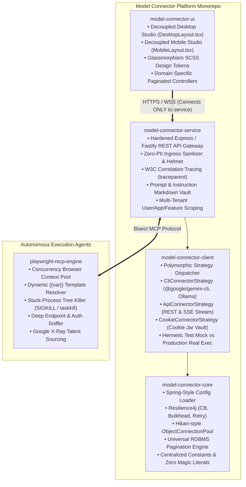
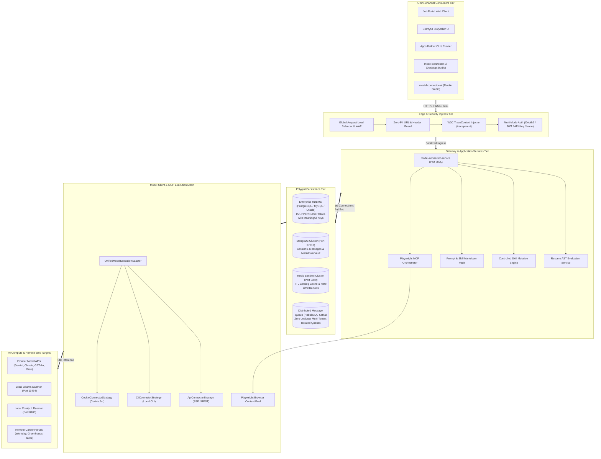

# Model Connector Platform — Master Architectural Blueprint

> **Canonical Document**: Unified Master Specification for `model-connector-platform` & `playwright-mcp-engine`  
> **Macro System Architecture**: [High-Level Design (HLD)](hld.md)  
> **Detailed Component Specifications**: [Low-Level Design (LLD)](lld.md)  
> **UI High-Level Design**: [UI HLD (Security & Best Practices)](ui-hld.md)  
> **UI Low-Level Design & Figma Flows**: [UI LLD & Figma Flows](ui-lld.md)  
> **UI Screen Workflows & Mockups**: [UI Flows Specification](ui-flows.md)  
> **Gap Analysis & Implementation Roadmap**: [Gap Analysis & Implementation Roadmap](gap-analysis-and-implementation-roadmap.md)  
> **Use Case Specifications & Architecture**: [Use Case Catalog & Architecture](usecase/README.md)

---

## 📑 Table of Contents

- [1. Executive Architectural Blueprint Overview](#1-executive-architectural-blueprint-overview)
  - [1.1 Purpose, Scope and System Definition](#11-purpose-scope-and-system-definition)
  - [1.2 Single-Word Semantic Anchors](#12-single-word-semantic-anchors)
  - [1.3 Master Documentation Topology](#13-master-documentation-topology)
- [2. Multi-Tier Distributed Monorepo Architecture](#2-multi-tier-distributed-monorepo-architecture)
  - [2.1 Core Subsystem Responsibilities](#21-core-subsystem-responsibilities)
  - [2.2 Unidirectional Dependency Invariant](#22-unidirectional-dependency-invariant)
- [3. The 2×2 Architectural Interlocking Matrix](#3-the-22-architectural-interlocking-matrix)
  - [3.1 The Four Interlocking Quadrants](#31-the-four-interlocking-quadrants)
  - [3.2 Unified System Architecture Topology](#32-unified-system-architecture-topology)
- [4. Planned Multi-Application Ecosystem Roadmap](#4-planned-multi-application-ecosystem-roadmap)
  - [4.1 Application 1: Autonomous Intelligent Job Portal](#41-application-1-autonomous-intelligent-job-portal)
  - [4.2 Application 2: ComfyUI Storyteller Engine](#42-application-2-comfyui-storyteller-engine)
  - [4.3 Application 3: Autonomous Apps Builder](#43-application-3-autonomous-apps-builder)
- [5. Model Context Protocol (MCP) & Playwright Integration](#5-model-context-protocol-mcp--playwright-integration)
  - [5.1 Bisect Engine Architecture](#51-bisect-engine-architecture)
  - [5.2 Concurrency, Watchdog & Network Sniffing](#52-concurrency-watchdog--network-sniffing)
- [6. High-Availability & Scalability Governance (1M DAU / Concurrency)](#6-high-availability--scalability-governance-1m-dau--concurrency)
  - [6.1 Read vs. Write Workload Profiling](#61-read-vs-write-workload-profiling)
  - [6.2 Anti-Data-Loss & Zero-Interruption Failover](#62-anti-data-loss--zero-interruption-failover)
  - [6.3 Asynchronous Non-Blocking Execution Model](#63-asynchronous-non-blocking-execution-model)
  - [6.4 Zero-Leakage Multi-Tenant Queue System](#64-zero-leakage-multi-tenant-queue-system)
- [7. Enterprise Security, Privacy & Zero PII Governance](#7-enterprise-security-privacy--zero-pii-governance)
  - [7.1 Multi-Mode Authentication & Authorization Matrix](#71-multi-mode-authentication--authorization-matrix)
  - [7.2 Zero-PII Ingress & Log Redaction Invariant](#72-zero-pii-ingress--log-redaction-invariant)
- [8. Continuous Compliance & Architectural Verification](#8-continuous-compliance--architectural-verification)

---

## 1. Executive Architectural Blueprint Overview

### 1.1 Purpose, Scope and System Definition

The **Model Connector Platform** is an enterprise AI gateway, multi-agent orchestration fabric, and Model Context Protocol (MCP) execution ecosystem designed to provide:
1. **Direct Model Connectivity**: Unifies access to frontier cloud reasoning models (Google Gemini, OpenAI ChatGPT, Anthropic Claude, xAI Grok, Microsoft Copilot) and offline local engines (Ollama) through a polymorphic strategy pattern (`CLI`, `REST API`, `Cookie session`).
2. **Indirect Application Connectivity**: Establishes standard integration interfaces for diverse enterprise applications, including the **Autonomous Job Portal**, **ComfyUI Storyteller**, and the **Autonomous Apps Builder**.
3. **Model Context Protocol (MCP) Integration**: Connects with headless execution agents, particularly the **Playwright MCP Engine**, to enable web-to-markdown extraction, automated form filling, deep endpoint sniffing, and talent sourcing.
4. **Zero-Trust Multi-Tenant Isolation**: Guarantees cryptographically partitioned session, prompt, and instruction boundaries preventing cross-contamination between users, applications, and features while handling 1,000,000 active concurrent users globally.

### 1.2 Single-Word Semantic Anchors

| Engineering Concept | Platform Scope | Primary Semantic Anchor | Secondary Semantic Anchor | Reference Document |
| :--- | :--- | :--- | :--- | :--- |
| **High-Level Design (HLD)** | System topology, clusters, protocols, scalability | **Architecture** | **Macro** | [hld.md](hld.md) |
| **Low-Level Design (LLD)** | Classes, adapters, schemas, algorithms, DDL, NoSQL | **Detailed** | **Micro** | [lld.md](lld.md) |
| **UI Screen Workflows** | Layouts, flows, onboarding, mockups, RBAC | **Presentation** | **Interface** | [ui-flows.md](ui-flows.md) |
| **Functional Requirements (FR)** | Invocations, mutations, AST evaluation, workflows | **Behavior** | **Action** | [blueprint.md § 4](blueprint.md#4-planned-multi-application-ecosystem-roadmap) |
| **Non-Functional Requirements (NFR)** | Zero PII, W3C tracing, 1M DAU, zero-leakage queues | **Quality** | **Constraint** | [blueprint.md § 6-7](blueprint.md#6-high-availability--scalability-governance-1m-dau--concurrency) |
| **The Entire Blueprint** | Unified multi-module platform design contract | **Specification** | **Roadmap** | [blueprint.md](blueprint.md) |

### 1.3 Master Documentation Topology

To maintain extreme clarity, zero redundancy, and deep technical authority, the architecture documentation is partitioned into four dedicated documents:

```
docs/
├── blueprint.md  ◄── [CURRENT] Master specification, executive roadmap, interlocking matrix & invariants
├── hld.md        ◄── High-Level Design: Topologies, protocol matrix, global scale for 1M users, multi-tenancy
├── lld.md        ◄── Low-Level Design: Class diagrams, 15-table DDL, MongoDB NoSQL, Redis KV, queue isolation
├── ui-flows.md   ◄── UI Screen Architecture: Mockup images, onboarding flows (UI & API), role-based console
└── images/
    └── model-connector-ui/
        ├── 01_onboarding_screen.jpg
        ├── 02_dashboard_metrics.jpg
        ├── 03_user_workspace.jpg
        ├── 04_admin_governance.jpg
        ├── 05_employee_management.jpg
        ├── 06_workflow_builder.jpg
        ├── 07_onboarding_providers.jpg
        ├── 08_onboarding_workflow_setup.jpg
        └── 09_onboarding_execution_stream.jpg
```

---

## 2. Multi-Tier Distributed Monorepo Architecture

### 2.1 Core Subsystem Responsibilities

The monorepo operates under strict Maven-style conventions (`src/main/typescript`, `src/main/resources`, `src/test/typescript`):



### 2.2 Unidirectional Dependency Invariant

In strict compliance with **`STD-COD-001`** and **`STD-COD-004`**:
- **Zero Relative Package Navigation**: All internal references must use `@/*` path mapping (e.g., `@/core/config`, `@/domain/models`).
- **Acyclic Dependency Flow**: `model-connector-core` has zero dependencies on client or service modules; `model-connector-client` depends strictly on `model-connector-core`; `model-connector-service` coordinates client and core; `model-connector-ui` binds strictly to `model-connector-service`.

---

<a id="3-the-22-architectural-interlocking-matrix"></a>
## 3. The 2×2 Architectural Interlocking Matrix

### 3.1 The Four Interlocking Quadrants

```
                           FUNCTIONAL (What / Behavior)           NON-FUNCTIONAL (How / Quality)
                     +---------------------------------------+---------------------------------------+
                     |  QUADRANT 1: HLD + FUNCTIONAL         |  QUADRANT 2: HLD + NON-FUNCTIONAL     |
                     |  • 6 Model Family Service Routing     |  • Global 1M Concurrent Users Scale   |
   HIGH-LEVEL (HLD)  |  • 3 Planned Apps Integration Paths   |  • W3C TraceContext Across 1k+ Svcs   |
   (Macro / Where)   |  • Playwright MCP Bisect Mesh         |  • Zero-Data-Loss WAL Replication     |
                     |  • Asynchronous Job Queuing           |  • Read/Write Intensity Optimization  |
                     +---------------------------------------+---------------------------------------+
                     |  QUADRANT 3: LLD + FUNCTIONAL         |  QUADRANT 4: LLD + NON-FUNCTIONAL     |
                     |  • Polymorphic Strategy Pattern       |  • Resilience4j Circuit Breakers      |
   LOW-LEVEL (LLD)   |  • Universal SQL Pagination Builder   |  • Hikari-style ObjectConnectionPool  |
   (Micro / Where)   |  • 15-Table UPPER CASE DDL Schema     |  • PII Regex Guard & URL Sanitizer    |
                     |  • MongoDB NoSQL & Redis Structures   |  • Zero-Leakage HMAC Queue Protocol   |
                     |  • Watchdog Stuck Process Killer      |  • Test Mocking vs Real CLI Execution |
                     +---------------------------------------+---------------------------------------+
```

### 3.2 Unified System Architecture Topology



---

## 4. Planned Multi-Application Ecosystem Roadmap

### 4.1 Application 1: Autonomous Intelligent Job Portal

The Job Portal connects to `model-connector-platform` to deliver automated end-to-end talent placement:
1. **Resume AST Parsing & Scorecard Evaluation**:
   - Parses incoming resumes into Abstract Syntax Tree (AST) representations.
   - Evaluates applicant competencies against job descriptions using centralized system prompts (`SYSTEM_PROMPTS`).
   - Produces detailed ATS scorecards (0–100%) and identifies missing qualifications.
2. **Controlled Resume Content Mutation**:
   - Permits user-governed skill substitutions (e.g. converting AWS to GCP references for a Google-centric role).
   - Enforces strict factual integrity guidelines: prohibits fabricating titles, companies, or unheld degrees.
3. **Multi-Channel Referral & Outreach Messaging**:
   - Synthesizes personalized outreach messages for LinkedIn InMail, portal applications, and direct email referrals.
   - Employs base professional prompts with candidate-specific customization and preview gates.
4. **Automated Follow-Up Cadence Scheduler**:
   - Configurable 3-day and 5-day automated follow-up sequences.
   - Auto-halts cadences upon receiving recruiter responses.
5. **Career Portal Form Autofill via Playwright MCP**:
   - Navigates target career sites (Workday, Greenhouse, Lever).
   - Converts DOM into semantic markdown, requests exact field mappings from `model-connector-service`, and fills input controls automatically.
   - Maintains strict user-specific conversation isolation: User A's resume data never cross-contaminates User B's context.
6. **Multi-Portal Job Search**:
   - Executes automated searches across career sites, LinkedIn, RemoteOK, and Naukri using Playwright MCP X-Ray talent sourcing.

### 4.2 Application 2: ComfyUI Storyteller Engine

The ComfyUI Storyteller application orchestrates multimodal generative storytelling:
1. **System & Instruction Prompt Storage**:
   - Centralizes base creative director prompts and stylistic constraints in `model-connector-service`.
2. **Workflow Graph Template Orchestration**:
   - Manages versioned ComfyUI execution graphs (JSON DAGs) on `model-connector-service`. Dynamically injects positive/negative prompts, seed parameters, LoRA weights, and aspect ratios.
3. **Human-in-the-Loop (HITL) Verification**:
   - Generated assets (scene images, narrated character audio, animated clips) are presented to the creator for review.
   - When a user flags an output as high quality, the exact prompt, seed, model checkpoint, and workflow configuration are stamped as a `VERIFIED_PROMPT` in the platform registry for deterministic future generation.

### 4.3 Application 3: Autonomous Apps Builder

The Autonomous Apps Builder generates complete, production-grade software applications:
1. **Skill Markdown Ingestion**:
   - Ingests language-specific `SKILL.md` documents, architectural constraints, and coding standards stored in the platform vault.
2. **Context-Aware Code Synthesis**:
   - Adheres to design patterns (Strategy, Factory, Chain of Responsibility) and complexity constraints (nesting depth $\le 3$, SLAP $\le 20$ lines).
3. **Hermetic Test & Build Verification**:
   - Automatically executes builds and unit tests in isolated Docker runtime containers before delivering codebases.

---

## 5. Model Context Protocol (MCP) & Playwright Integration

### 5.1 Bisect Engine Architecture

To guarantee security, reusability, and tenant isolation, the platform enforces a **Bisect Architecture** when interacting with `playwright-mcp-engine`:

```
┌────────────────────────────────────────────────────────┐
│                   BISECT ENVELOPE                      │
├───────────────────────────┬────────────────────────────┤
│   PART A: WORKFLOW SPEC   │     PART B: PARAMETER BAG  │
│  (Structural & Deterministic)│    (Ephemeral & Tenant-Scoped) │
├───────────────────────────┼────────────────────────────┤
│ • Action Step Sequence    │ • Applicant Full Name      │
│ • Prioritized Selectors   │ • Contact Phone & Email    │
│ • Assertion Conditions    │ • Transposed Resume Text   │
│ • Navigation URLs         │ • Dynamic Session Tokens   │
└───────────────────────────┴────────────────────────────┘
```

- **Part A (Workflow JSON)**: Reusable, immutable automation definitions stored in `WORKFLOW_TEMPLATES`. Contains zero user PII.
- **Part B (Placeholder Parameters)**: Injected dynamically at runtime using template variables (`{{vars.applicantEmail}}`), keeping user PII entirely out of workflow templates.

### 5.2 Concurrency, Watchdog & Network Sniffing

The `playwright-mcp-engine` provides:
1. **Browser Slot Pool (`BrowserPool.ts`)**: Regulates concurrent headless browser processes with memory threshold recycling.
2. **Stuck-Process Watchdog Killer (`process-killer.ts`)**: Automatically identifies child OS PIDs and forcefully terminates hung processes (`SIGKILL` on Linux, `taskkill /F /T` on Windows) when step execution exceeds the 15,000ms deadline.
3. **Deep Network & Auth Sniffer (`sniffer.ts`, `auth-detector.ts`)**: Classifies network endpoints, indexes headers, detects Bearer JWT tokens, session cookies, and 401/403 authorization gates.

### 5.3 Onboarding-Driven Dynamic Workflow Generation & The Zero-Skip Invariant

During application onboarding, `model-connector-service` synthesizes an immutable, canonical Directed Acyclic Graph (DAG) specifying the exact sequential execution steps for all inbound records.
1. **The Zero-Skip Guarantee**: Steps cannot be missed, bypassed, or dropped during automated execution. Missing outputs trigger a hard freeze.
2. **Audited Skip Overrides**: Steps can only be bypassed via explicit user authorization:
   - **Record-Level Skip (`SKIP_SINGLE_RECORD`)**: Bypasses a single record with a mandatory audit justification string (minimum 10 characters).
   - **Flow-Wide Skip (`SKIP_FLOW_WIDE`)**: Bypasses a step for all future records by generating a new incremented DAG version under Tenant Admin privileges.

---

## 6. High-Availability & Scalability Governance (1M DAU / Concurrency)

### 6.1 Read vs. Write Workload Profiling

For detailed analytical breakdowns of read/write intensity across all subsystems, refer to [hld.md § 7.2](hld.md#72-read-vs-write-intensity-profile-analysis).

- **Read-Intensive Services**: Model Catalog Discovery (99% Read), Session History Inquiries (85% Read). Accelerated via Redis Sentinel in-memory caching and CDN static asset caching.
- **Write-Intensive Services**: Audit & Telemetry Ingestion (95% Write), ComfyUI Binary Generation (80% Write), Resume AST Scoring (60% Write). Buffered via Kafka/RabbitMQ distributed streaming topics.

### 6.2 Anti-Data-Loss & Zero-Interruption Failover

Conforming to enterprise reliability standards:
1. **Write-Ahead Logging (WAL)**: All relational state mutations require verified WAL disk synchronization before committing.
2. **Transactional Outbox Pattern**: Database writes and telemetry events commit in a single atomic transaction. An asynchronous CDC daemon streams events to Kafka.
3. **Graceful Degraded Mode**: If the relational primary becomes partitioned, the platform switches to a read-only replica for catalog lookups while queueing incoming session turns in Redis ring buffers.

### 6.3 Asynchronous Non-Blocking Execution Model

To prevent gateway connection dropouts during long-running model inference (5s–180s), the platform utilizes an adaptive protocol selector:
- **Interactive (< 3s)**: Synchronous HTTP/2 REST.
- **Streaming (< 60s)**: Server-Sent Events (SSE) with 5-second heartbeat comments (`: ping\n\n`).
- **Long-Running (> 60s)**: `202 Accepted` + asynchronous task ticket + WebSocket / Webhook delivery.

### 6.4 Zero-Leakage Multi-Tenant Queue System

To prevent any possibility of User A receiving or sniffing User B's asynchronous results, the queue architecture mandates:
1. **Cryptographically Salted Inbound Queues**: `q.inbound.<tenantId>.<userId>` routed strictly from exchange topic keys.
2. **Ephemeral Exclusive Reply-To Queues**: Subscriptions use temporary queues (`q.reply.<userId>.<jobId>.<nonce>`) configured with exclusive access, auto-deleting upon task completion.
3. **HMAC Signed Envelopes**: Every message envelope is signed using a tenant master secret (`hmac_sha256`), verified by workers prior to model dispatch.

### 6.5 Token Exhaustion & Context Recovery Triad

To prevent execution failure when a model's physical context window is surpassed or provider quotas are depleted:
1. **Tier 1 (Adaptive AST Compaction)**: Prunes boilerplate markdown, comments, and empty AST structures, reducing prompt size by 30%–45%.
2. **Tier 2 (Rolling Context Summarization)**: Compresses turns $1$ to $N-2$ into a semantic digest, preserving active turn fidelity while freeing 80% of context tokens.
3. **Tier 3 (Dynamic Failover Cascade)**: Automatically routes requests to larger context models (GPT-4o 128k $\to$ Claude 200k $\to$ Gemini 1M) or to local offline Ollama instances.

---

## 7. Enterprise Security, Privacy & Zero PII Governance

### 7.1 Multi-Mode Authentication & Authorization Matrix

The platform supports four authentication modes:
1. **`GOOGLE_OAUTH`**: Mandatory for Web Studio UI and Google Cloud Vertex integrations.
2. **`ENTERPRISE_JWT`**: Signed RS256/Ed25519 tokens for inter-service communication encoding tenant, user, and feature scopes.
3. **`API_KEY`**: High-entropy 64-character tokens for CLI and automated CI/CD pipelines, matched using `crypto.timingSafeEqual` against salted SHA-256 database hashes.
4. **`NONE` (Anonymous)**: Strictly permitted in local development environments (`NODE_ENV=development`) or air-gapped on-premise deployments.

### 7.2 Zero-PII Ingress & Log Redaction Invariant

Conforming to **`NFR-SEC-001`**:
- **Zero PII in URLs**: `piiUrlGuardMiddleware` inspects all incoming request URLs. Requests containing emails, tokens, or credentials in query parameters are rejected with `400 Bad Request`.
- **Log Redaction**: The W3C tracing logger scrubs sensitive headers (`Authorization`, `Cookie`, `X-API-Key`) and redacts PII strings matching configured regular expressions prior to emitting structured NDJSON.

### 7.3 Out-of-Band Upstream Revocation Trap & Resilient Recovery

When an end-user revokes upstream credentials (e.g., revoking Google OAuth access via Google Account Security or invalidating API keys) without informing the platform:
1. **Fatal Auth Trap**: The error interceptor classifies `401/403` responses containing `invalid_grant` or `token_revoked` as fatal revocation events, immediately stopping retry loops.
2. **Step Preservation**: Running pipelines are frozen at the current step index with all intermediate artifacts preserved in `WORKFLOW_EXECUTION_JOBS`.
3. **Seamless Resumption**: Upon re-authenticating via `model-connector-ui`, the pipeline resumes directly from the suspended step without restarting from scratch.

### 7.4 Free-Tier Model Client Cookie Strategy

For users utilizing free-tier model web interfaces (Google AI Studio, Gemini Web, Claude Free, ChatGPT Web):
1. **AES-256-GCM Vault**: Session cookies are encrypted using AES-256-GCM with per-user cryptographic salts and random 12-byte IVs.
2. **Browser Emulation**: Injects accurate browser headers (`Sec-Ch-Ua`, `Sec-Fetch-*`, `User-Agent`) to bypass anti-bot challenges.
3. **Playwright MCP Sync**: Injects decrypted cookies into headless browser contexts via `context.addCookies(...)` for authenticated web model execution.
4. **Health Probing**: Background worker performs periodic 0-token pings to detect cookie expiration before workflow dispatch.

### 7.5 Hardened Container Security & Docker Architecture

All Docker container images and Compose services enforce enterprise defense-in-depth security:
1. **Multi-Stage Builds & Non-Root Execution**: `USER node` privilege dropping across all production runner containers.
2. **Privilege De-escalation**: Mandatory `security_opt: [ "no-new-privileges:true" ]`.
3. **Resource Quotas**: Hard CPU and Memory limits in `deploy.resources.limits` preventing host starvation.
4. **Zero Hardcoded Secrets**: Zero default API keys or passwords baked into Dockerfiles or Compose definitions.
5. **Declarative Configuration**: Universal `application.yml` master configuration providing reproducible defaults.

---

## 8. Continuous Compliance & Architectural Verification

### 8.1 The 7 Golden Rules of Code Synthesis

All code generated or refactored within this repository must strictly adhere to:
1. **`@/*` Absolute Imports**: Never use `./` or `../`. Import via mapped root packages.
2. **OOP Design Patterns with DI**: Replace procedural functions with classes adhering to SOLID principles.
3. **Zero `if/else` or `switch` Branching for Domain Logic**: Use Strategy, Factory, and Chain of Responsibility patterns.
4. **Vendor-Neutral Naming**: Use generic abstractions (`modelExecutionPayload`, `tokenBudget`) rather than model-specific terms.
5. **Centralized Constants**: Extract all literals to `@/constants/`.
6. **Zero Code Duplication (DRY)**: Reusable utilities reside in `model-connector-core`.
7. **`application.yml` Master Configuration**: Default configurations and environment parameters are loaded declaratively from YAML.

### 8.2 Automated Verification Test Suite

The platform architecture is continuously verified using the automated verification suite:

```bash
python config/scripts/verification/verify_platform.py
```

### Invariant Test Suite Coverage:
1. **Root Parent File Isolation**: Validates only approved files (`README.md`, `package.json`, `.gitignore`, `docs`) reside at the repository root.
2. **Relational Schema Invariants**: Asserts strictly UPPER CASE tables and non-generic meaningful primary keys (all 20 tables verified).
3. **NoSQL Document Validation**: Verifies MongoDB collections schema compliance.
4. **Distributed Microservices Tracing**: Verifies `TraceContext`, `traceparent`, `traceId`, `spanId`, and `durationMs` propagation across all controllers and loggers.
5. **Functionality-Based Multi-Model Adapters**: Confirms polymorphic support across all 6 model families in `UnifiedModelExecutionAdapter`.
6. **Zero Relative Package Navigation**: Verifies 100% `@/*` path mapping across all TypeScript modules with zero relative climbing (`../`).
7. **Decoupled Operations Studio**: Asserts complete separation between Desktop (`DesktopLayout.tsx`) and Mobile (`MobileLayout.tsx`) components and styles.

