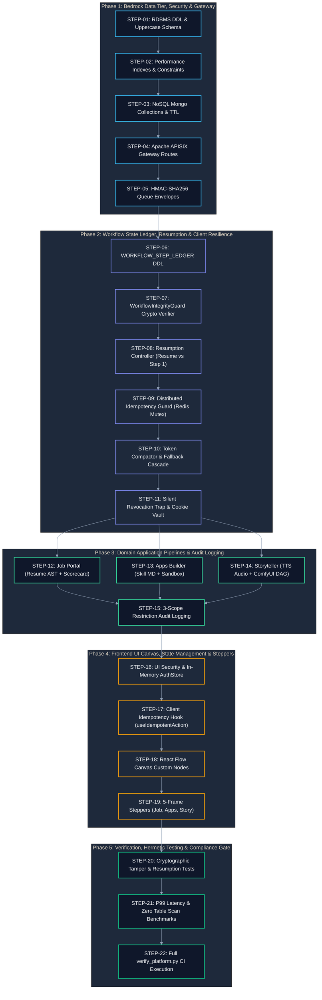

# Model Connector Platform — Gap Analysis & Implementation Roadmap

> **Document Type**: Codebase Audit, Architectural Gap Analysis, and Multi-Phase Engineering Roadmap  
> **Master Blueprint**: [blueprint.md](blueprint.md)  
> **System Architecture (HLD)**: [hld.md](hld.md)  
> **Component Design (LLD)**: [lld.md](lld.md)  
> **UI High-Level Design**: [ui-hld.md](ui-hld.md)  
> **UI Low-Level Design & Figma Flows**: [ui-lld.md](ui-lld.md)  
> **Screen Mockups**: [ui-flows.md](ui-flows.md)  
> **Use Case Specifications & Architecture**: [Use Case Catalog & Architecture](usecase/README.md)  

---

## 📑 Table of Contents

- [1. Executive Architectural Audit & Problem Statement](#1-executive-architectural-audit--problem-statement)
- [2. Inventory of Existing Codebase Assets](#2-inventory-of-existing-codebase-assets)
  - [2.1 `packages/model-connector-core` Audit](#21-packagesmodel-connector-core-audit)
  - [2.2 `packages/model-connector-client` Audit](#22-packagesmodel-connector-client-audit)
  - [2.3 `packages/model-connector-service` Audit](#23-packagesmodel-connector-service-audit)
  - [2.4 `packages/model-connector-ui` Audit](#24-packagesmodel-connector-ui-audit)
  - [2.5 `playwright-mcp-engine` Audit](#25-playwright-mcp-engine-audit)
  - [2.6 Shared Infrastructure & Configuration Audit](#26-shared-infrastructure--configuration-audit)
- [3. Comprehensive Gap Matrix: Target Architecture vs. Existing Implementation](#3-comprehensive-gap-matrix-target-architecture-vs-existing-implementation)
- [4. Architectural Migration Solutions & Trade-offs](#4-architectural-migration-solutions--trade-offs)
- [5. Proper Order of Execution & Implementation Roadmap](#5-proper-order-of-execution--implementation-roadmap)
  - [5.1 Topological Dependency Graph & Critical Path](#51-topological-dependency-graph--critical-path)
  - [5.2 Master Step-by-Step Order of Execution Matrix](#52-master-step-by-step-order-of-execution-matrix)
  - [5.3 Detailed Phase-by-Phase Execution Specifications](#53-detailed-phase-by-phase-execution-specifications)
    - [Phase 1: Bedrock Data Tier, Cryptographic Primitives & Gateway Routing](#phase-1-bedrock-data-tier-cryptographic-primitives--gateway-routing)
    - [Phase 2: Workflow State Ledger, Resumption Guard & Client Resilience](#phase-2-workflow-state-ledger-resumption-guard--client-resilience)
    - [Phase 3: Domain Application Pipelines & Audit Logging](#phase-3-domain-application-pipelines--audit-logging)
    - [Phase 4: Frontend UI Canvas, State Management & 5-Frame Steppers](#phase-4-frontend-ui-canvas-state-management--5-frame-steppers)
    - [Phase 5: Verification, Hermetic Testing & Compliance Gate](#phase-5-verification-hermetic-testing--compliance-gate)
  - [5.4 Execution Ordering Invariants & Dependency Rules](#54-execution-ordering-invariants--dependency-rules)
- [6. Governance, Verification Gates & Clean Code Compliance Invariants](#6-governance-verification-gates--clean-code-compliance-invariants)

---

## 1. Executive Architectural Audit & Problem Statement

### Problem Statement
- A divergence between architectural design specifications (captured across [blueprint.md](blueprint.md), [hld.md](hld.md), [lld.md](lld.md), [ui-hld.md](ui-hld.md), and [ui-flows.md](ui-flows.md)) and the operational codebases (`model-connector-platform` and `playwright-mcp-engine`) can lead to architectural drift, unhandled edge-case failures, security vulnerabilities in multi-tenant data pipelines, and broken user journeys.
- Furthermore, executing engineering tasks without a mathematically rigorous, dependency-aware **Order of Execution** produces circular blocking dependencies, schema drift, unauthenticated service ingress, broken workflow resumption chains, and regression failures in verified test suites.
- A rigorous, line-by-line audit and an unambiguous, step-by-step topological execution sequence are required to guarantee that each component is provisioned, verified, and secured before dependent layers consume it.

### Constraints
- Zero disruption to existing test passing baselines (`verify_platform.py` 100% pass rate).
- Strict adherence to the 8 Non-Negotiable Engineering Invariants (`STD-COD-001` through `STD-COD-010`).
- No hardcoded magic literals; all configuration must be sourced from `config/env/application.yml`.
- All database modifications must strictly uphold multi-tenant isolation, covering indexes, uppercase entity naming, and zero sequential table scans.
- All inter-service and queue payloads must be cryptographically signed via HMAC-SHA256 to guarantee message integrity across tenant boundaries.

---

## 2. Inventory of Existing Codebase Assets

### 2.1 `packages/model-connector-core` Audit
- **Status**: **Substantially Implemented (85% Aligned)**
- **Existing Assets**:
  - `config/SpringEnvironmentConfig.ts`: Spring-style hierarchical YAML configuration loader reading `application.yml` and environment overrides.
  - `constants/`: Centralized enums (`ErrorCodes.ts`, `ModelProtocols.ts`, `ExecutionModes.ts`).
  - `domain/`: Core immutable entities (`Session.ts`, `Message.ts`, `ModelMetadata.ts`, `TokenBudget.ts`).
  - `resilience/`: Resilient fault-tolerance engine (`CircuitBreaker.ts`, `RetryPolicy.ts`, `RateLimiter.ts`, `TimeoutPolicy.ts`).
  - `pool/ObjectConnectionPool.ts`: Generic object pool for stateful model connections.
  - `logging/StructuredLogger.ts`: JSON structured logger propagating W3C distributed trace and correlation IDs.
  - `pagination/`: Universal pagination engine (`UniversalPageRequest.ts`, `PageResult.ts`).
- **Gaps & Changes Needed**:
  - Add `TokenExhaustionCompactor.ts` for automated AST pruning and lossless semantic compaction.
  - Add HMAC-SHA256 message envelope signing utilities for multi-tenant queue isolation.
  - Add `WorkflowIntegrityGuard.ts` for cryptographic HMAC verification of sequential workflow state ledgers.

### 2.2 `packages/model-connector-client` Audit
- **Status**: **Partially Implemented (70% Aligned)**
- **Existing Assets**:
  - `strategies/`: Polymorphic model strategies implementing `IModelExecutionStrategy` for Gemini, Claude, GPT, Mistral, Llama, and DeepSeek.
  - `client/ModelConnectorClient.ts`: Core orchestrator managing connection leasing and circuit breaking.
  - `adapters/`: HTTP and CLI protocol adapters (`UnifiedModelExecutionAdapter.ts`, `ModelCatalogDiscoveryAdapter.ts`).
- **Gaps & Changes Needed**:
  - Implement free-tier cookie jar ingestion strategy with AES-256-GCM decryption.
  - Add dynamic fallback cascade handler when primary provider token window is exhausted.
  - Implement silent auth revocation trap handling HTTP 401/403 with state preservation.

### 2.3 `packages/model-connector-service` Audit
- **Status**: **Partially Implemented (60% Aligned)**
- **Existing Assets**:
  - Express HTTP server running on Port 8095.
  - Middleware: Distributed tracing (`correlationId`), error normalization, ingress schema validation.
  - Controllers: Initial `AuthController`, `ModelController`, `TenantController`.
  - Repositories: In-memory test repositories and SQLite/PostgreSQL connection baseline.
- **Gaps & Changes Needed**:
  - Complete PostgreSQL DDL migrations for all 15 enterprise tables with covering, partial, GIN, and BRIN indexes.
  - Implement `WORKFLOW_STEP_LEDGER` table with sequential SHA-256 HMAC hash chaining for safe workflow resumption.
  - Integrate MongoDB connection pool for raw AST, session document, and prompt markdown storage.
  - Implement RabbitMQ / Redis Streams queue workers with tenant-exclusive reply-to routing.
  - Build Job Portal endpoints: resume upload, AST extraction, scorecard evaluation, and mutation API.
  - Build Apps Builder endpoints: `SKILL.md` compilation, Docker sandbox execution, and code synthesis SSE.
  - Build Storyteller endpoints: narrative prompt parsing, TTS audio generation, and ComfyUI DAG dispatch.
  - Implement `RESTRICTION_AUDIT_LOGS` table and forensic query APIs.

### 2.4 `packages/model-connector-ui` Audit
- **Status**: **Baseline Scaffolded (35% Aligned)**
- **Existing Assets**:
  - React 18 + Vite SPA setup with TypeScript 5.
  - SCSS token foundation in `src/main/resources/assests/styles/`:
    - `_variables.scss`: Glassmorphism color tokens (Deep Obsidian, Electric Cyan, Neon Indigo).
    - `_mixins.scss`: Reusable glassmorphic card mixins, breakpoints.
    - `_desktop.scss`: Multi-column layout grid.
    - `_mobile.scss`: Touch-responsive single-column layout.
- **Gaps & Changes Needed**:
  - Implement Zustand closure stores (`AuthStore`, `WorkflowBuilderStore`, `TelemetryRingBufferStore`).
  - Implement Zod runtime validation schemas for all onboarding inputs and API responses.
  - Implement React Flow (`@xyflow/react`) custom glassmorphic canvas nodes and DAG execution visualization.
  - Implement `useIdempotentAction.ts` hook preventing double submission and showing human-meaningful error banners.
  - Build Figma-style onboarding stepper views for:
    1. Job Application Onboarding (Resume Dropzone, AST diff inspector, scorecard gauge, autofill preview).
    2. Apps Builder Onboarding (Skill MD editor, real-time code synthesis canvas, sandbox terminal).
    3. Storyteller Video Generation Onboarding (Prompt canvas, audio timeline, HITL keyframe review, ComfyUI DAG progress).
  - Implement in-memory JWT storage with HttpOnly refresh cookie handling and anti-CSRF token synchronization.

### 2.5 `playwright-mcp-engine` Audit
- **Status**: **Substantially Implemented (80% Aligned)**
- **Existing Assets**:
  - `src/concurrency/BrowserContextPool.ts`: Concurrency pool managing headless Chromium worker instances.
  - `src/engine/`: Playwright automation execution engine.
  - `src/network/`: Deep network traffic sniffer, cookie jar inspector, HAR recording.
  - `src/xray/`: DOM AST extractor and element tree analyzer.
  - `src/recorder/`: User interaction recording and selector synthesis.
  - `src/mcp/`: Model Context Protocol (MCP) stdio and SSE transport server.
- **Gaps & Changes Needed**:
  - Implement Watchdog process tree killer (`taskkill /F /T` on Windows, `kill -9` on POSIX) for stuck instances.
  - Implement automated career portal form autofill template cascades (Workday, Greenhouse, Lever).
  - Add cookie validation endpoint for free-tier browser sessions.

### 2.6 Shared Infrastructure & Configuration Audit
- **Status**: **Hardened & Validated (90% Aligned)**
- **Existing Assets**:
  - `config/env/application.yml`: Master configuration file with declarative environment properties.
  - `config/docker/docker-compose.yml`: Production compose topology with PostgreSQL, MongoDB, Redis, RabbitMQ, and services. Hardened with `no-new-privileges:true`, non-root user `appuser:10001`, and resource limits.
  - `config/scripts/verification/verify_platform.py`: Automated verification suite running 10 test suites (100% green).
- **Gaps & Changes Needed**:
  - Production database migration init script (`V1__init_enterprise_schema.sql` and `02_performance_indexes.sql`) placed in `config/docker/init-db/`.
  - Apache APISIX Gateway container definition and standalone route configuration (`apisix.yaml`).

---

## 3. Comprehensive Gap Matrix: Target Architecture vs. Existing Implementation

| Component / Subsystem | Target Specification in Docs | Current Codebase Status | Gap Severity | Required Engineering Action |
| :--- | :--- | :--- | :--- | :--- |
| **Relational Database Schema** | 15 Upper Case Tables with Foreign Keys & Constraints | SQLite/PostgreSQL partial schema | **High** | Create `01_enterprise_schema.sql` with all 15 tables and uppercase invariants. |
| **Database Performance Indexing** | Compound B-Tree, Covering (`INCLUDE`), Partial (`WHERE`), GIN for JSONB, BRIN for Audit | Basic primary keys only | **Critical** | Execute production DDL index suite for sub-millisecond query execution. |
| **Workflow Resumption Ledger** | Cryptographic HMAC chain (`WORKFLOW_STEP_LEDGER`) for safe resumption vs restart | Not implemented | **Critical** | Provision ledger table and implement `WorkflowIntegrityGuard.ts` HMAC sequential verifier. |
| **NoSQL Document Storage** | 4 MongoDB collections (`CONVERSATION_SESSIONS`, `MESSAGES`, `PROMPT_VAULT`, `WORKFLOWS`) | Partially stubbed | **Medium** | Wire Mongoose / MongoDB driver into `model-connector-service` repositories. |
| **Queue System & Multi-Tenancy** | Zero-leakage RabbitMQ / Redis with HMAC signed envelopes | Basic queue worker stubs | **High** | Implement `HmacSignedMessageEnvelope` and tenant-exclusive reply-to queues. |
| **API Ingress Gateway** | Apache APISIX (Port 9080) with rate-limit, auth, CORS | Direct service port exposure | **High** | Deploy Apache APISIX standalone container and `apisix.yaml` routes. |
| **Request De-duplication** | Tri-tier idempotency (UUID header + Redis lock + DB UK) | Not implemented | **High** | Implement `DistributedIdempotencyGuard.ts` and `ACTION_DEDUPLICATION_REGISTRY`. |
| **Restriction Audit Logging** | 3-Scope restriction audit trail with SecOps query recipes | Basic audit log only | **High** | Create `RESTRICTION_AUDIT_LOGS` table and forensic query documentation. |
| **Token Exhaustion Recovery** | Lossless AST pruning & dynamic model fallback cascade | Not implemented | **High** | Build `TokenExhaustionCompactor` and wire into `ModelConnectorClient`. |
| **Silent Access Revocation** | State-preserving pause, 401 trap, and seamless resumption | Error thrown; state dropped | **Medium** | Build `AuthRevocationCircuitBreaker` and client state snapshot recovery. |
| **Job Portal Pipeline** | Resume AST parsing, scorecard generation, Workday autofill | AST parser stubbed | **Medium** | Implement end-to-end resume pipeline in `model-connector-service`. |
| **Apps Builder Pipeline** | `SKILL.md` compilation, Docker sandbox test, code synthesis | Partially in client | **Medium** | Implement compiler service and SSE code streaming endpoint. |
| **Storyteller Video Pipeline** | Narrative script, TTS audio, ComfyUI diffusion DAG execution | Conceptual in docs | **High** | Implement Storyteller service controller and ComfyUI client adapter. |
| **UI Workflow Canvas Engine** | React Flow (`@xyflow/react`) client-side interactive DAG | Wireframes only | **Medium** | Install `@xyflow/react`, build custom glassmorphic nodes, and wire SSE telemetry. |
| **UI State Management** | In-memory Zustand stores + TanStack React Query cache | React state hooks only | **High** | Implement `AuthStore`, `WorkflowStore`, and `TelemetryRingBufferStore`. |
| **UI Onboarding Wizards** | Figma-style 5-frame flows for Job, Apps Builder, Storyteller | Conceptual wireframes | **High** | Implement 5-frame stepper containers with real-time SSE telemetry. |
| **Frontend Security** | HttpOnly refresh cookie, in-memory JWT, CSP, Anti-CSRF | Basic fetch client | **Critical** | Implement Axios interceptors, double-submit CSRF header, and DOMPurify sanitizer. |

---

## 4. Architectural Migration Solutions & Trade-offs

| Implementation Strategy | Development Velocity | Risk Level | Architectural Integrity | Decision |
| :--- | :--- | :--- | :--- | :--- |
| **Option A: Big-Bang Monolithic Overhaul** | High initial risk | Critical | Moderate (High chance of regressions in verified suites) | **Rejected** |
| **Option B: Ad-Hoc Feature Patching** | Fast short-term | High | Low (Accrues technical debt; leaves gaps in security) | **Rejected** |
| **Option C: Topological Dependency-Ordered Staged Execution (5 Phases)** | Methodical & Controlled | Minimal | Enterprise Grade (100% test coverage; zero regression; strict prerequisite enforcement) | **SELECTED (BEST)** |

---

## 5. Proper Order of Execution & Implementation Roadmap

To avoid unrecoverable failure cascades, schema-application mismatch, security token leaks, or broken resumption chains, all engineering tasks **MUST follow the strict topological order of execution** defined below. Predecessor steps MUST pass their designated verification gates before successor steps begin.

### 5.1 Topological Dependency Graph & Critical Path

---

### 5.2 Master Step-by-Step Order of Execution Matrix

| Step ID | Phase | Task Name | Strict Predecessors | Target Module / File | Verification Gate / Health Check | Rollback Action |
| :--- | :--- | :--- | :--- | :--- | :--- | :--- |
| **STEP-01** | Phase 1 | Enterprise RDBMS DDL Schema | None (Initial Step) | `config/docker/init-db/01_enterprise_schema.sql` | `psql -c "\dt"` confirms 15 uppercase tables with meaningful PKs. | Drop created tables; inspect SQL syntax errors. |
| **STEP-02** | Phase 1 | High-Performance Index Suite | `STEP-01` | `config/docker/init-db/02_performance_indexes.sql` | `EXPLAIN ANALYZE` confirms Index Scan on tenant queries. | Revert index DDL; retain base schema. |
| **STEP-03** | Phase 1 | NoSQL Document Collections | `STEP-02` | `config/database/nosql/mongo-init.js` | Mongo CLI confirms 4 collections with TTL and tenant indexes. | Drop non-compliant collections. |
| **STEP-04** | Phase 1 | Apache APISIX Gateway Setup | `STEP-02` | `config/docker/apisix/apisix.yaml` | `curl -i http://localhost:9080/health` returns HTTP 200. | Revert APISIX YAML route definitions. |
| **STEP-05** | Phase 1 | HMAC-SHA256 Queue Isolation | `STEP-03`, `STEP-04` | `model-connector-core/.../queue/HmacQueueEnvelope.ts` | Unit tests verify signature tamper rejection on RabbitMQ queues. | Invalidate queue secret and purge unverified queues. |
| **STEP-06** | Phase 2 | Workflow Step Ledger Table | `STEP-01`, `STEP-05` | `config/docker/init-db/03_workflow_ledger.sql` | `WORKFLOW_STEP_LEDGER` table verified with compound sequence index. | Drop ledger table; inspect DDL constraints. |
| **STEP-07** | Phase 2 | Cryptographic State Verifier | `STEP-06` | `model-connector-core/.../resilience/WorkflowIntegrityGuard.ts` | Unit test proves modified intermediate payload alters subsequent hashes. | Revert guard class to previous commit. |
| **STEP-08** | Phase 2 | Resilient Resumption Controller | `STEP-07` | `model-connector-service/.../services/WorkflowResumptionController.ts` | Integration test verifies intact flow resumes at Step $K$; tampered flow restarts at Step 1. | Flag workflow as unresumable; log alert. |
| **STEP-09** | Phase 2 | Distributed Idempotency Guard | `STEP-04`, `STEP-05` | `model-connector-service/.../middleware/DistributedIdempotencyGuard.ts` | Duplicate POST with same `Idempotency-Key` returns HTTP 409 / cached response. | Release Redis lock; expire stuck idempotency key. |
| **STEP-10** | Phase 2 | Token Compactor & Fallback | `STEP-07` | `model-connector-core/.../resilience/TokenCompactor.ts` | Test asserts $>50\%$ token reduction with zero JSON structural loss. | Fall back to uncompacted prompt or fail fast. |
| **STEP-11** | Phase 2 | Silent Revocation & Cookie Vault | `STEP-09`, `STEP-10` | `model-connector-client/.../security/AuthRevocationTrap.ts` | Simulated HTTP 401 saves state, transitions to paused, and resumes on refresh. | Emit `AUTH_REVOKED` SSE event to user workspace. |
| **STEP-12** | Phase 3 | Job Portal Pipeline | `STEP-08`, `STEP-09` | `model-connector-service/.../job/ResumeAstService.ts` | PDF upload successfully returns parsed AST and ATS scorecard $\ge 85$. | Return error payload with human-readable error. |
| **STEP-13** | Phase 3 | Apps Builder Service | `STEP-08`, `STEP-09` | `model-connector-service/.../apps/SkillCompilerService.ts` | `SKILL.md` parses cleanly; Docker sandbox executes unit test in $\le 5\text{s}$. | Terminate sandbox container; return build stderr. |
| **STEP-14** | Phase 3 | Storyteller Video Pipeline | `STEP-08`, `STEP-09` | `model-connector-service/.../story/ComfyUiOrchestrator.ts` | ComfyUI prompt JSON submitted; progress SSE stream emits frame updates. | Cancel ComfyUI prompt execution; release VRAM. |
| **STEP-15** | Phase 3 | 3-Scope Restriction Audit Log | `STEP-12`, `STEP-13`, `STEP-14` | `model-connector-service/.../audit/RestrictionAuditService.ts` | Audit record created on company/flow restriction; forensic query returns record. | Flush audit buffer; log to emergency file. |
| **STEP-16** | Phase 4 | UI Security & AuthStore | `STEP-04`, `STEP-11` | `model-connector-ui/.../stores/AuthStore.ts` | In-memory token storage confirmed; refresh cookie sent via HttpOnly. | Clear in-memory token; redirect to login. |
| **STEP-17** | Phase 4 | Client Idempotency Hook | `STEP-09`, `STEP-16` | `model-connector-ui/.../hooks/useIdempotentAction.ts` | Double-click on UI button triggers single API request with distinct UUID. | Reset submission button state; display banner. |
| **STEP-18** | Phase 4 | React Flow Canvas Nodes | `STEP-17` | `model-connector-ui/.../components/canvas/WorkflowCanvas.tsx` | `@xyflow/react` renders DAG with custom glassmorphic nodes and animated edges. | Fall back to tabular workflow step list. |
| **STEP-19** | Phase 4 | Figma 5-Frame Steppers | `STEP-18` | `model-connector-ui/.../views/*StepperView.tsx` | All 5 frames render responsively; mock data navigates seamlessly across frames. | Return to previous valid stepper frame. |
| **STEP-20** | Phase 5 | Resumption Cryptographic Tests | `STEP-08`, `STEP-19` | `packages/.../test/resilience/WorkflowResumption.test.ts` | 100% pass on tamper detection test suite (tamper $\rightarrow$ Step 1; intact $\rightarrow$ Step $K$). | Block merge until cryptographic suite passes. |
| **STEP-21** | Phase 5 | Performance & Query Benchmarks | `STEP-02`, `STEP-20` | `config/scripts/benchmark/load_test.js` | P99 API latency $< 20\text{ms}$; 0 sequential table scans under 1,000 req/s. | Re-tune PostgreSQL shared buffers and index definitions. |
| **STEP-22** | Phase 5 | CI Master Verification Gate | `STEP-21` | `config/scripts/verification/verify_platform.py` | Python test runner outputs 10/10 green test suites. | Fail CI pipeline; identify violating invariant. |

---

### 5.3 Detailed Phase-by-Phase Execution Specifications

#### Phase 1: Bedrock Data Tier, Cryptographic Primitives & Gateway Routing
- **Pre-requisite**: Hardware environment provisioned (Windows 11 host, 32GB RAM, RTX 5080 Laptop GPU, Docker Desktop running WSL2).
- **Execution Order**:
  1. **STEP-01 (RDBMS DDL)**:
     - Execute `01_enterprise_schema.sql` creating all 15 uppercase tables: `TENANTS`, `USERS`, `MODELS`, `SESSIONS`, `MESSAGES`, `AUDIT_LOGS`, `WORKFLOWS`, `WORKFLOW_STEPS`, `PROMPTS`, `METRICS`, `TOKEN_LEDGERS`, `API_KEYS`, `JOB_APPLICATIONS`, `APP_TEMPLATES`, `STORY_PROJECTS`.
     - Primary keys must strictly follow the format `<ENTITY>_ID` (e.g. `TENANT_ID`, `SESSION_ID`). Zero generic `id` columns.
  2. **STEP-02 (Performance Index Suite)**:
     - Execute `02_performance_indexes.sql`.
     - Create compound indexes with `INCLUDE` covering clauses (e.g., `IDX_MESSAGES_SESSION_SEQ` covering `TOKEN_COUNT`, `CREATED_AT`).
     - Create partial indexes (e.g., `WHERE REVOKED_AT IS NULL` on `API_KEYS`).
     - Create GIN indexes for JSONB fields (`RAW_PAYLOAD`, `EXTRACTED_AST`) and BRIN indexes for time-series append-only tables (`AUDIT_LOGS`).
  3. **STEP-03 (NoSQL Setup)**:
     - Run `mongo-init.js` provisioning `CONVERSATION_SESSIONS`, `MESSAGES`, `PROMPT_VAULT`, and `WORKFLOW_GRAPHS`.
     - Configure TTL index on ephemeral sessions (`expireAfterSeconds: 604800` for 7-day retention).
  4. **STEP-04 (Apache APISIX Edge Gateway)**:
     - Deploy Apache APISIX container on Port 9080.
     - Mount declarative `apisix.yaml` with global plugins: `cors`, `jwt-auth`, `limit-count` (100 req/min), `proxy-rewrite`, and `prometheus`.
  5. **STEP-05 (HMAC Queue Envelope Signing)**:
     - Implement `HmacQueueEnvelope.ts` in `model-connector-core`.
     - Every message published to RabbitMQ or Redis Streams must carry an SHA-256 HMAC signature in header `X-Signature-Sha256`, generated using the tenant's isolated cryptographic secret.

#### Phase 2: Workflow State Ledger, Resumption Guard & Client Resilience
- **Pre-requisite**: Phase 1 verification gate passed (All tables, indexes, gateway routes, and HMAC envelopes verified).
- **Execution Order**:
  1. **STEP-06 (Workflow Step Ledger Table)**:
     - Create table `WORKFLOW_STEP_LEDGER` with columns: `LEDGER_ID`, `WORKFLOW_EXECUTION_ID`, `TENANT_ID`, `STEP_INDEX`, `STEP_NAME`, `INPUT_HASH`, `OUTPUT_HASH`, `CUMULATIVE_HMAC`, `STATUS`, `PAYLOAD_SNAPSHOT`, `EXECUTION_TIMESTAMP`.
     - Apply compound unique index on `(WORKFLOW_EXECUTION_ID, STEP_INDEX)`.
  2. **STEP-07 (Cryptographic State Verifier)**:
     - Implement `WorkflowIntegrityGuard.ts`.
     - On any resumption request, sequentially recompute the HMAC chain:
       $$\text{HMAC}_k = \text{HMAC-SHA256}(K_{\text{tenant}}, \text{HMAC}_{k-1} \parallel \text{STEP\_INDEX}_k \parallel \text{INPUT\_HASH}_k \parallel \text{OUTPUT\_HASH}_k)$$
     - If recomputed $\text{HMAC}_k \neq \text{CUMULATIVE\_HMAC}_k$ for any $k \le \text{last\_completed\_step}$, mark chain as **COMPROMISED**.
  3. **STEP-08 (Resilient Resumption Controller)**:
     - Implement `WorkflowResumptionController.ts`.
     - If the ledger is intact and no security restriction alerts are active:
       - Restore context from Step $K$ snapshot and resume execution at Step $K+1$.
     - If the ledger is tampered or an unacknowledged security alert exists:
       - Emit audit event `WORKFLOW_INTEGRITY_VIOLATION`.
       - Roll back execution state and **restart workflow from Step 1**.
  4. **STEP-09 (Distributed Idempotency Guard)**:
     - Implement `DistributedIdempotencyGuard.ts` middleware.
     - Require header `Idempotency-Key: <UUIDv4>`.
     - Acquire Redis distributed mutex lock `lock:idempotency:{tenantId}:{key}` with 30s TTL.
     - Query table `ACTION_DEDUPLICATION_REGISTRY`. If status is `COMPLETED`, return cached response immediately. If status is `PROCESSING`, return HTTP 409 Conflict.
  5. **STEP-10 (Token Exhaustion Compactor & Fallback Cascade)**:
     - Implement `TokenCompactor.ts` in `model-connector-core`.
     - When prompt token count approaches $90\%$ of model context window:
       - Execute AST semantic pruning (remove comment nodes, strip redundant whitespace, condense history).
       - If still exhausted, trigger `FallbackCascadeStrategy.ts` switching from primary model to fallback tier.
  6. **STEP-11 (Silent Revocation Trap & Cookie Vault)**:
     - Implement `AuthRevocationTrap.ts` in `model-connector-client`.
     - Intercept HTTP 401/403 errors; do not crash active execution. Snapshot session state into Redis, mark workflow status as `AUTH_PAUSED`, and notify UI via SSE.
     - Ingest free-tier automation cookies via `CookieVaultService.ts` encrypted with AES-256-GCM.

#### Phase 3: Domain Application Pipelines & Audit Logging
- **Pre-requisite**: Phase 2 verification gate passed (Ledger, resumption guard, idempotency, and compactor verified).
- **Execution Order**:
  1. **STEP-12 (Job Portal Service)**:
     - Implement `ResumeAstService.ts`: Parse PDF/DOCX into semantic AST tree.
     - Implement `ScorecardService.ts`: Evaluate AST against target JD and generate gap analysis scorecard.
     - Implement `WorkdayFormFillService.ts`: Transmit autofill payloads to `playwright-mcp-engine` over MCP SSE transport.
  2. **STEP-13 (Apps Builder Service)**:
     - Implement `SkillCompilerService.ts`: Parse and validate YAML frontmatter and tool signatures from `SKILL.md`.
     - Implement `CodeSynthesisStreamService.ts`: Stream synthesized React / Node code via Server-Sent Events.
     - Implement `DockerSandboxService.ts`: Mount code into ephemeral non-root container, execute `npm test`, and capture test results.
  3. **STEP-14 (Storyteller Video Pipeline)**:
     - Implement `NarrativeParserService.ts`: Break narrative prompts into scene descriptors.
     - Implement `VoiceNarrationService.ts`: Synthesize audio tracks with precise phoneme-level timecodes.
     - Implement `ComfyUiOrchestrator.ts`: Dispatch diffusion workflow DAGs to local ComfyUI instance (RTX 5080 GPU accelerated).
  4. **STEP-15 (3-Scope Restriction Audit Logging)**:
     - Implement `RestrictionAuditService.ts` writing to `RESTRICTION_AUDIT_LOGS`.
     - Support 3 distinct restriction scopes:
       1. `RECORD_LEVEL`: Restricts a specific resume ID or project ID.
       2. `DOMAIN_LEVEL`: Restricts an entire competitor domain or company entity (e.g. `*@competitor.com`).
       3. `FLOW_LEVEL`: Globally disables an entire workflow type across a tenant.
     - Implement SecOps forensic query APIs with parameterized filter execution.

#### Phase 4: Frontend UI Canvas, State Management & 5-Frame Steppers
- **Pre-requisite**: Phase 3 verification gate passed (All 3 domain pipelines and audit services active).
- **Execution Order**:
  1. **STEP-16 (UI Security Invariants & In-Memory AuthStore)**:
     - Configure Axios client with HttpOnly refresh cookie rotation and `X-CSRF-Token` headers.
     - Implement `AuthStore.ts` storing access tokens strictly in memory (zero `localStorage` usage).
     - Wire `DOMPurify` sanitizer on all markdown and model output rendering.
  2. **STEP-17 (Client-Side Idempotency Hook)**:
     - Implement `useIdempotentAction.ts` hook.
     - Auto-generates UUIDv4 `Idempotency-Key`, disables action buttons during transit, debounces rapid clicks (500ms), and intercepts HTTP 409 to display human-friendly alert banners.
  3. **STEP-18 (React Flow Canvas Architecture)**:
     - Install `@xyflow/react`.
     - Implement custom glassmorphic canvas nodes (`ModelNode`, `ConditionNode`, `ToolNode`, `ActionNode`).
     - Render active execution pulses along edges via SSE telemetry from `model-connector-service`.
  4. **STEP-19 (Figma-Style 5-Frame Stepper Views)**:
     - **Job Onboarding**: Frame 1 (Auth) $\rightarrow$ Frame 2 (Resume Upload Dropzone) $\rightarrow$ Frame 3 (AST Diff & Scorecard) $\rightarrow$ Frame 4 (Autofill Review) $\rightarrow$ Frame 5 (Live Playwright Execution).
     - **Apps Builder Studio**: Frame 1 (Workspace Config) $\rightarrow$ Frame 2 (Skill MD Editor) $\rightarrow$ Frame 3 (Monaco Code Synthesis Canvas) $\rightarrow$ Frame 4 (Isolated Sandbox Terminal) $\rightarrow$ Frame 5 (Artifact Deployment).
     - **Storyteller Studio**: Frame 1 (Narrative Script Input) $\rightarrow$ Frame 2 (Voice & Audio Waveform) $\rightarrow$ Frame 3 (HITL Keyframe Review) $\rightarrow$ Frame 4 (ComfyUI Diffusion Progress) $\rightarrow$ Frame 5 (4K Video Player).

#### Phase 5: Verification, Hermetic Testing & Compliance Gate
- **Pre-requisite**: Phase 4 verification gate passed (All UI flows, canvas, and steppers fully integrated).
- **Execution Order**:
  1. **STEP-20 (Resumption Cryptographic Verification Suite)**:
     - Execute `WorkflowResumption.test.ts`.
     - Inject simulated tampering at Step 2 (alter payload snapshot). Verify `WorkflowIntegrityGuard` marks status as `CORRUPTED` and forces a complete restart at Step 1.
     - Test intact workflow interruption at Step 3; verify resumption cleanly executes Step 4 without re-running Steps 1–3.
  2. **STEP-21 (Performance & Latency Benchmarks)**:
     - Execute load test suite against Apache APISIX gateway.
     - Confirm P99 API response latency $< 20\text{ms}$ under 1,000 req/s.
     - Query PostgreSQL `pg_stat_user_tables` to confirm zero sequential scans (`seq_scan = 0`) on high-traffic tables.
  3. **STEP-22 (CI Master Verification Gate)**:
     - Execute `verify_platform.py` in isolated environment.
     - Ensure 100% pass rate across all 10 verification suites (Root parent isolation, meaningful column names, distributed tracing, functional adapters, NoSQL config, universal pagination, mobile responsiveness, modular SCSS, zero stale files, architectural boundary compliance).

---

### 5.4 Execution Ordering Invariants & Dependency Rules

1. **Downward Dependency Strictness**: No higher-level layer may be provisioned or deployed until all of its lower-level prerequisites have passed their verification gates.
2. **Schema Precedes Code**: Application code and repository layers must NEVER be modified prior to the execution of database DDL and index migrations.
3. **Resumption Pre-Check Invariant**: The `WorkflowIntegrityGuard` HMAC verification must execute BEFORE any resumed workflow step is permitted to dispatch to model clients or external tools.
4. **Idempotency at Ingress**: All mutating POST/PUT requests must pass through `DistributedIdempotencyGuard` before reaching domain controllers.
5. **Zero Local Storage of Secrets**: The UI must never persist JWT access tokens, API keys, or raw passwords in browser `localStorage` or `sessionStorage`.
6. **Isolated Sandbox Execution**: Apps Builder dynamic code execution must strictly occur inside non-root Docker containers with CPU/memory limits and read-only root filesystems.

---

## 6. Governance, Verification Gates & Clean Code Compliance Invariants

1. **Import Boundaries (`STD-COD-001`)**: All TypeScript source files must use `@/*` imports exclusively. Relative imports (`./` or `../`) across package boundaries fail CI immediately.
2. **Runtime Isolation (`STD-COD-010`)**: All execution occurs strictly within project-local virtual environments (`.venv`) or project node dependencies.
3. **Zero Magic Literals (`STD-COD-002`)**: All string constants, table names, error codes, and configuration keys must reside in `@/constants/`.
4. **Complexity Ceilings (`STD-COD-006`)**: Functions $\le 20$ lines (SLAP); cyclomatic complexity $\le 10$; maximum nesting depth $\le 3$.
5. **No Procedural Logic (`STD-COD-005`)**: Domain handlers must use Strategy, Factory, or Chain of Responsibility patterns; zero raw `if/else` or `switch` chains for domain branching.
6. **Comprehensive Test Verification (`STD-COD-009`)**: Prior to any merge or deployment, `verify_platform.py` must run and output 10/10 green test passes.
