# Model Connector Platform — High-Level Design (HLD)

> **Document Status**: Production Architectural Standard  
> **Document Scope**: Macro System Architecture, Topology, Distributed Integration, and Scalability  
> **Parent Blueprint**: [blueprint.md](blueprint.md)  
> **Detailed Component Design**: [lld.md](lld.md)  
> **UI High-Level Design**: [UI HLD (Security & Best Practices)](ui-hld.md)  
> **UI Low-Level Design & Figma Flows**: [UI LLD & Figma Flows](ui-lld.md)  
> **UI Screen Workflows**: [ui-flows.md](ui-flows.md)  
> **Gap Analysis & Implementation Roadmap**: [Gap Analysis & Implementation Roadmap](gap-analysis-and-implementation-roadmap.md)  
> **Use Case Specifications & Architecture**: [Use Case Catalog & Architecture](usecase/README.md)

---

## 📑 Table of Contents

- [1. Executive Architecture Summary](#1-executive-architecture-summary)
- [2. System Topologies & Monorepo Boundaries](#2-system-topologies--monorepo-boundaries)
  - [2.1 Monorepo Multi-Module Ecosystem](#21-monorepo-multi-module-ecosystem)
  - [2.2 Ingress & Omni-Channel Service Topologies](#22-ingress--omni-channel-service-topologies)
  - [2.3 Polyglot Storage Topology (RDBMS + Document NoSQL + In-Memory KV)](#23-polyglot-storage-topology-rdbms--document-nosql--in-memory-kv)
- [3. Omni-Channel Communication & Protocol Architecture](#3-omni-channel-communication--protocol-architecture)
  - [3.1 Long-Running AI Inference vs. Timeout Governance](#31-long-running-ai-inference-vs-timeout-governance)
  - [3.2 Protocol Selection Matrix: REST vs. SSE vs. WebSockets vs. Queues vs. gRPC](#32-protocol-selection-matrix-rest-vs-sse-vs-websockets-vs-queues-vs-grpc)
  - [3.3 Asynchronous Non-Blocking Execution Topology](#33-asynchronous-non-blocking-execution-topology)
  - [3.4 Enterprise Distributed Queue & Multi-Tenant Zero-Leakage Architecture](#34-enterprise-distributed-queue--multi-tenant-zero-leakage-architecture)
- [4. MCP (Model Context Protocol) & Playwright MCP Architecture](#4-mcp-model-context-protocol--playwright-mcp-architecture)
  - [4.1 Bisect Engine Architecture](#41-bisect-engine-architecture)
  - [4.2 Authentication & Authorization Sniffing Mesh](#42-authentication--authorization-sniffing-mesh)
  - [4.3 Concurrency Browser Pooling & Stuck-Process Watchdog](#43-concurrency-browser-pooling--stuck-process-watchdog)
- [5. Planned Application Integrations & Ecosystem Services](#5-planned-application-integrations--ecosystem-services)
  - [5.1 Application 1: Autonomous Intelligent Job Portal](#51-application-1-autonomous-intelligent-job-portal)
  - [5.2 Application 2: ComfyUI Storyteller Engine](#52-application-2-comfyui-storyteller-engine)
  - [5.3 Application 3: Autonomous Apps Builder](#53-application-3-autonomous-apps-builder)
- [6. Multi-Tenant Isolation & Zero Cross-Contamination Security](#6-multi-tenant-isolation--zero-cross-contamination-security)
  - [6.1 Strict User-to-App-to-Feature Isolation Boundaries](#61-strict-user-to-app-to-feature-isolation-boundaries)
  - [6.2 Tenant Scoping Matrix](#62-tenant-scoping-matrix)
- [7. Global Scalability Architecture (1 Million Concurrent Active Users)](#7-global-scalability-architecture-1-million-concurrent-active-users)
  - [7.1 Global Ingress, Anycast, and CDN Topology](#71-global-ingress-anycast-and-cdn-topology)
  - [7.2 Read vs. Write Intensity Profile Analysis](#72-read-vs-write-intensity-profile-analysis)
  - [7.3 Zero-Data-Loss Persistence & Fault-Tolerant Failover](#73-zero-data-loss-persistence--fault-tolerant-failover)
- [8. Authentication, Authorization & Security Perimeters](#8-authentication-authorization--security-perimeters)
  - [8.1 Multi-Mode Security Model (OAuth2, JWT, API Key, None)](#81-multi-mode-security-model-oauth2-jwt-api-key-none)
  - [8.2 Zero-PII Ingress Guard & Sanitization Specification](#82-zero-pii-ingress-guard--sanitization-specification)
  - [8.3 Local vs. Remote Deployment Perimeters](#83-local-vs-remote-deployment-perimeters)
- [9. Distributed Observability & Distributed Tracing (1k+ Microservices)](#9-distributed-observability--distributed-tracing-1k-microservices)
  - [9.1 W3C TraceContext Propagation Standards](#91-w3c-tracecontext-propagation-standards)
  - [9.2 Structured NDJSON Audit Logging Specification](#92-structured-ndjson-audit-logging-specification)
- [10. Silent Access Revocation & Access Denied Architecture](#10-silent-access-revocation--access-denied-architecture)
  - [10.1 Out-of-Band Upstream Revocation Trap](#101-out-of-band-upstream-revocation-trap)
  - [10.2 Workflow State Preservation & Blast Radius Containment](#102-workflow-state-preservation--blast-radius-containment)
  - [10.3 User Flow & Re-Authentication Recovery Sequence](#103-user-flow--re-authentication-recovery-sequence)
- [11. Production Ecosystem Libraries & Exact Versions](#11-production-ecosystem-libraries--exact-versions)
  - [11.1 Feature-to-Library Mapping Matrix](#111-feature-to-library-mapping-matrix)
  - [11.2 Architectural Compliance with STD-COD-005.1](#112-architectural-compliance-with-std-cod-0051)
- [12. Onboarding-Driven Dynamic Workflow Generation & Zero-Skip Invariant](#12-onboarding-driven-dynamic-workflow-generation--zero-skip-invariant)
  - [12.1 Dynamic DAG Synthesis from Application Onboarding](#121-dynamic-dag-synthesis-from-application-onboarding)
  - [12.2 The Zero-Skip Invariant & Explicit Skip Manifests](#122-the-zero-skip-invariant--explicit-skip-manifests)
  - [12.3 Record-Level Skip vs. Flow-Wide Skip Semantics](#123-record-level-skip-vs-flow-wide-skip-semantics)
- [13. Free-Tier Cookie-Based Model Connector Client Architecture](#13-free-tier-cookie-based-model-connector-client-architecture)
  - [13.1 Browser Session Cookie Harvest & AES-256-GCM Vault](#131-browser-session-cookie-harvest--aes-256-gcm-vault)
  - [13.2 Anti-Bot Header Emulation & Playwright MCP Cookie Synchronization](#132-anti-bot-header-emulation--playwright-mcp-cookie-synchronization)
  - [13.3 Silent Expiry Watchdog & Health Probing](#133-silent-expiry-watchdog--health-probing)
- [14. Token Exhaustion Architecture & Dynamic Recovery Protocols](#14-token-exhaustion-architecture--dynamic-recovery-protocols)
  - [14.1 Two Dimensions of Token Exhaustion (Context Overflow vs Quota Depletion)](#141-two-dimensions-of-token-exhaustion-context-overflow-vs-quota-depletion)
  - [14.2 Recovery Triad: Compaction, Rolling Summary & Dynamic Failover](#142-recovery-triad-compaction-rolling-summary--dynamic-failover)
  - [14.3 End-to-End Token Exhaustion User Flow Sequence](#143-end-to-end-token-exhaustion-user-flow-sequence)
- [15. Mandatory Code Generation & Engineering Standards](#15-mandatory-code-generation--engineering-standards)
  - [15.1 The 7 Golden Rules of Code Synthesis](#151-the-7-golden-rules-of-code-synthesis)
  - [15.2 Anti-Pattern Catalog & Replacement Design Patterns](#152-anti-pattern-catalog--replacement-design-patterns)
- [16. Containerization & Docker Security Hardening Architecture](#16-containerization--docker-security-hardening-architecture)
  - [16.1 Multi-Stage Isolation & Non-Root Execution](#161-multi-stage-isolation--non-root-execution)
  - [16.2 Defense-in-Depth Container Security Controls](#162-defense-in-depth-container-security-controls)
- [17. Apache APISIX Enterprise API Gateway Integration](#17-apache-apisix-enterprise-api-gateway-integration)
  - [17.1 Problem Statement & Architectural Constraints](#171-problem-statement--architectural-constraints)
  - [17.2 Apache Gateway Candidates Comparative Analysis](#172-apache-gateway-candidates-comparative-analysis)
  - [17.3 Selected Solution: Apache APISIX Deployment Architecture](#173-selected-solution-apache-apisix-deployment-architecture)
- [18. UI-Based Workflow Engine Evaluation (React Flow vs. Langflow vs. Airflow)](#18-ui-based-workflow-engine-evaluation-react-flow-vs-langflow-vs-airflow)
  - [18.1 Problem Statement & Architectural Constraints](#181-problem-statement--architectural-constraints)
  - [18.2 Comprehensive Technology Comparison Matrix](#182-comprehensive-technology-comparison-matrix)
  - [18.3 Selected Solution: Dual-Tier Reactive Workflow Architecture](#183-selected-solution-dual-tier-reactive-workflow-architecture)
- [19. Tri-Layered Security Perimeter Architecture](#19-tri-layered-security-perimeter-architecture)
- [20. Host System Hardware Profile & Docker Container Resource Allocation Matrix](#20-host-system-hardware-profile--docker-container-resource-allocation-matrix)
  - [20.1 Host Machine Hardware Profile](#201-host-machine-hardware-profile)
  - [20.2 Production Docker Resource Allocation Table](#202-production-docker-resource-allocation-table)
- [21. Distributed Idempotency & De-duplication Architecture](#21-distributed-idempotency--de-duplication-architecture)
  - [21.1 Problem Statement](#211-problem-statement)
  - [21.2 Tri-Tier De-duplication Engine](#212-tri-tier-de-duplication-engine)
  - [21.3 User-Facing Meaningful Message Dictionary](#213-user-facing-meaningful-message-dictionary)
- [22. Resilient Workflow Resumption & Cryptographic Tamper-Detection Architecture](#22-resilient-workflow-resumption--cryptographic-tamper-detection-architecture)
  - [22.1 Problem Statement & Architectural Constraints](#221-problem-statement--architectural-constraints)
  - [22.2 Architectural Solutions & Trade-offs](#222-architectural-solutions--trade-offs)
  - [22.3 Selected Best Solution: Merkle-Chained HMAC State Integrity Guard](#223-selected-best-solution-merkle-chained-hmac-state-integrity-guard)
  - [22.4 Decision Diagram: Resume vs. Restart from Beginning](#224-decision-diagram-resume-vs-restart-from-beginning)
  - [22.5 End-to-End Resumption & Tamper User Flow Sequence](#225-end-to-end-resumption--tamper-user-flow-sequence)
- [23. Multi-MCP (Model Context Protocol) Orchestration Architecture](#23-multi-mcp-model-context-protocol-orchestration-architecture)
  - [23.1 MCP Heterogeneous Transport Matrix (stdio, SSE, WebSocket)](#231-mcp-heterogeneous-transport-matrix-stdio-sse-websocket)
  - [23.2 Protocol Handshake, Capability Negotiation & Dynamic Tool Ingestion](#232-protocol-handshake-capability-negotiation--dynamic-tool-ingestion)
  - [23.3 Multi-Tenant Sandbox & Credential Isolation Mesh](#233-multi-tenant-sandbox--credential-isolation-mesh)
  - [23.4 Multi-MCP End-to-End User Flow & Sequence Diagram](#234-multi-mcp-end-to-end-user-flow--sequence-diagram)
- [24. Playwright-MCP to Model-Connector-Platform AI Assistance Loop-back Architecture](#24-playwright-mcp-to-model-connector-platform-ai-assistance-loop-back-architecture)
  - [24.1 Problem Statement & In-Flight Autonomous Remediation Pattern](#241-problem-statement--in-flight-autonomous-remediation-pattern)
  - [24.2 Loop Prevention, Recursion Depth Guards & Trace Invariant](#242-loop-prevention-recursion-depth-guards--trace-invariant)
  - [24.3 Playwright-to-Model AI Assistance Sequence Diagram](#243-playwright-to-model-ai-assistance-sequence-diagram)
- [25. LinkedIn X-Ray DOM Extraction & Semantic Matching Architecture](#25-linkedin-x-ray-dom-extraction--semantic-matching-architecture)
  - [25.1 X-Ray Search Discovery & Deep DOM AST Extraction Pipeline](#251-x-ray-search-discovery--deep-dom-ast-extraction-pipeline)
  - [25.2 DOM Tree Noise Elimination, Anti-Bot & Human Emulation Mesh](#252-dom-tree-noise-elimination-anti-bot--human-emulation-mesh)
  - [25.3 Semantic AST Resume-to-Job Matching Workflow](#253-semantic-ast-resume-to-job-matching-workflow)
  - [25.4 LinkedIn X-Ray End-to-End User Flow Diagram](#254-linkedin-x-ray-end-to-end-user-flow-diagram)
- [26. Playwright-MCP Workflow Template & Dynamic Placeholder Engine with Session Vault](#26-playwright-mcp-workflow-template--dynamic-placeholder-engine-with-session-vault)
  - [26.1 Declarative Workflow Template Schema & Dynamic Placeholder Taxonomy](#261-declarative-workflow-template-schema--dynamic-placeholder-taxonomy)
  - [26.2 Just-in-Time AI Escalation for Unresolved Placeholders](#262-just-in-time-ai-escalation-for-unresolved-placeholders)
  - [26.3 BrowserContext Session Lifecycle & AES-256-GCM StorageState Vault](#263-browsercontext-session-lifecycle--aes-256-gcm-storagestate-vault)
  - [26.4 End-to-End Workflow Execution & Session Rehydration Sequence](#264-end-to-end-workflow-execution--session-rehydration-sequence)
- [27. Platform-Wide Timezone Governance & Recipient-Centric Dispatch Architecture](#27-platform-wide-timezone-governance--recipient-centric-dispatch-architecture)
  - [27.1 Universal UTC Storage Invariant & Boundary Normalization](#271-universal-utc-storage-invariant--boundary-normalization)
  - [27.2 Recipient-Centric IANA Timezone Resolution Mesh](#272-recipient-centric-iana-timezone-resolution-mesh)
  - [27.3 Business Hours Delivery Windows, Weekend & Holiday Suppression](#273-business-hours-delivery-windows-weekend--holiday-suppression)
  - [27.4 High-Level Sequence & Timezone Calculation Flow Diagram](#274-high-level-sequence--timezone-calculation-flow-diagram)
- [28. Containerized Agent-Per-Workflow Architecture & Apache Ingress Orchestration](#28-containerized-agent-per-workflow-architecture--apache-ingress-orchestration)
  - [28.1 Architectural Paradigm: Decoupled Single-Responsibility Workflow Containers](#281-architectural-paradigm-decoupled-single-responsibility-workflow-containers)
  - [28.2 Apache Ingress Gateway Routing (APISIX vs. Heavy Batch Orchestrators)](#282-apache-ingress-gateway-routing-apisix-vs-heavy-batch-orchestrators)
  - [28.3 Container Topology & Resource Boundary Matrix](#283-container-topology--resource-boundary-matrix)
  - [28.4 Multi-Container Inter-Agent Event Bus & State Sharing](#284-multi-container-inter-agent-event-bus--state-sharing)

---

## 1. Executive Architecture Summary

The **Model Connector Platform** is an enterprise-grade, distributed AI gateway and automation fabric designed to decouple client applications from raw model provider interfaces, heterogeneous AI tools, and Model Context Protocol (MCP) agents.

The platform provides:
1. **Direct Model Connectivity**: Polymorphic access to frontier cloud LLMs (Google Gemini, OpenAI ChatGPT, Anthropic Claude, xAI Grok, Microsoft Copilot) and local offline inference engines (Ollama) via CLI, REST API, and Cookie session strategies.
2. **Indirect Application Connectivity**: Standardized integration pathways for specialized multi-agent applications including the **Autonomous Job Portal**, **ComfyUI Storyteller Engine**, and **Autonomous Apps Builder**.
3. **Model Context Protocol (MCP) Mesh**: Bi-directional integration with execution agents, prominently featuring the **Playwright MCP Engine** for headless DOM parsing, web-to-markdown extraction, automated form filling, and talent sourcing.
4. **Resilient Multi-Tenant Isolation**: Cryptographically partitioned multi-tenancy preventing data cross-talk between users, applications, and features while handling up to 1,000,000 active concurrent users globally.

---

## 2. System Topologies & Monorepo Boundaries

### 2.1 Monorepo Multi-Module Ecosystem

The platform enforces strict unidirectional dependency boundaries. Under no circumstances may lower-level modules depend upon higher-level modules:

```
[model-connector-core]  (Foundation: Config, Resilience, Pooling, Constants, DB Dialects)
        ▲
        │ (imports foundation primitives)
[model-connector-client] (Adapters: CLI, REST API, Cookie Strategies, Model Discovery)
        ▲
        │ (in-process binding or microservice REST invocation)
[model-connector-service] (Gateway: Auth, Multi-Tenancy, Prompt Vault, W3C Tracing, Audit)
        ▲
        │ (HTTP/SSE REST API, WebSockets)
[model-connector-ui] / [Client Apps: Job Portal, ComfyUI, Apps Builder] / [Playwright MCP]
```

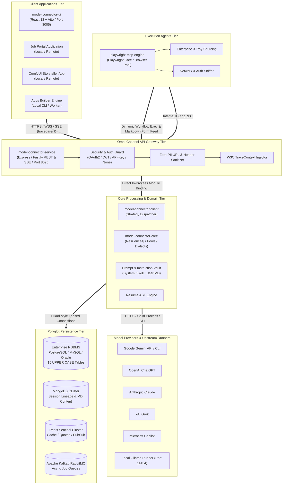

### 2.2 Ingress & Omni-Channel Service Topologies

| Module | Deployment Unit | Default Port | Internal Responsibilities | External Boundaries |
| :--- | :--- | :--- | :--- | :--- |
| **`model-connector-core`** | NPM / Monorepo Library | In-process | Spring-style config loader, Resilience4j state machines, generic `ObjectConnectionPool`, SQL pagination dialects, W3C Logger. | Zero network endpoints; imported strictly as a compile-time dependency. |
| **`model-connector-client`** | NPM / Monorepo Library | In-process / RPC | Polymorphic strategy pattern (`CliConnectorStrategy`, `ApiConnectorStrategy`, `CookieConnectorStrategy`), automated test mocking. | Direct process spawn (`gemini`, `ollama`) or upstream HTTP client dispatch. |
| **`model-connector-service`** | Docker Microservice | Port 8095 | REST API endpoints (`/api/v1/*`), PII URL guard, multi-tenant session isolation, prompt & instruction database catalog, W3C tracing. | Express/Node.js runtime, protected by Nginx reverse proxy, TLS 1.3 termination. |
| **`model-connector-ui`** | SPA Static / Nginx | Port 3005 / 80 | Decoupled Desktop Studio (`DesktopLayout.tsx`) and Mobile Studio (`MobileLayout.tsx`), responsive glassmorphism SCSS. | Browser user interface communicating exclusively with `model-connector-service`. |
| **`playwright-mcp-engine`** | Standalone Node.js Daemon | Port 8098 / Stdio | Browser slot pool, stuck-process watchdog killer, DOM-to-markdown conversion, authentication sniffer, Google X-Ray sourcing. | Exposes stdio and SSE MCP server endpoints; runs headless Chromium/Firefox/WebKit. |

### 2.3 Polyglot Storage Topology (RDBMS + Document NoSQL + In-Memory KV)

The platform divides persistence into three specialized storage tiers based on consistency, latency, and data velocity requirements:
1. **Relational Tier (RDBMS: PostgreSQL / MySQL / Oracle)**:
   - Stores ACID-critical entities: User identities (`USERS`), application registries (`APPLICATIONS`), tenant permissions (`USER_APP_PERMISSIONS`), model provider credentials (`MODEL_CREDENTIALS`), and core audit logs (`AUDIT_LOGS`).
   - All identifiers adhere strictly to UPPER CASE conventions and meaningful keys (`APPLICATION_ID`, `USER_ID`, `MODEL_ID`).
2. **Document NoSQL Tier (MongoDB Cluster: Port 27017)**:
   - Stores unbounded, polymorphic, high-velocity data: Multi-turn session histories (`CONVERSATION_SESSIONS`), individual message frames (`CONVERSATION_MESSAGES`), markdown prompts and guidelines (`PROMPT_MARKDOWN_VAULT`), and automation steps (`WORKFLOW_DAG_DEFINITIONS`).
   - Supports document validation, horizontal sharding by `tenantId`, and automated TTL expiration on audit streaming logs.
3. **In-Memory Cache & Coordination Tier (Redis Sentinel: Port 6379)**:
   - Ultra-low-latency in-memory state: Active model catalog cache (`mc:catalog:models`), token bucket rate limit counters (`mc:ratelimit`), Circuit Breaker state machines (`mc:circuitbreaker`), and Redis Streams for fast task progress events.

---

## 3. Omni-Channel Communication & Protocol Architecture

### 3.1 Long-Running AI Inference vs. Timeout Governance

Frontier LLM completions and multi-agent workflows (e.g. evaluating 50-page resumes or synthesizing video storyboards) frequently require between 5 seconds and 180 seconds. Standard HTTP synchronous request/response patterns fail due to:
- Gateway ingress timeouts (Nginx default 60s, AWS ALB 60s, Cloudflare 100s).
- Client socket disconnections resulting in orphaned compute expenditure.
- Thread/connection starvation across client pools.

To solve this, the platform mandates an **Adaptive Communication Protocol Engine**:

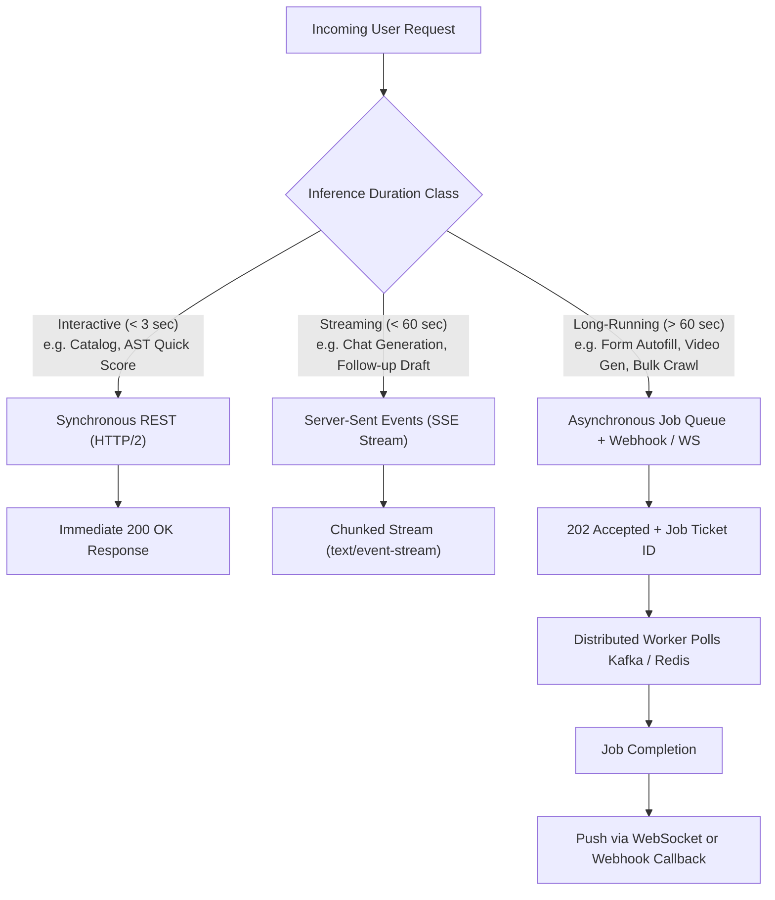

### 3.2 Protocol Selection Matrix: REST vs. SSE vs. WebSockets vs. Queues vs. gRPC

| Feature Dimension | REST (HTTP/2) | Server-Sent Events (SSE) | WebSockets (WSS) | Message Queue (Kafka/RabbitMQ) | gRPC (HTTP/2) |
| :--- | :--- | :--- | :--- | :--- | :--- |
| **Directionality** | Unidirectional (Req/Res) | Unidirectional (Server-to-Client) | Full Duplex (Bi-directional) | Asynchronous Publish/Subscribe | Bi-directional Streaming |
| **Connection Overhead** | Low (Per request) | Minimal (Single long-lived HTTP) | Moderate (Upgrade handshake) | Persistent Broker Connections | Minimal (Multiplexed TCP) |
| **Reconnection Support** | Stateless | Built-in (`Last-Event-ID`) | Manual client heartbeat required | Consumer offset recovery | Channel sub-channel backoff |
| **Timeout Susceptibility** | High (Terminated by load balancers) | Low (Kept alive by heartbeat pings) | Low (Kept alive by WebSocket ping/pong) | Zero (Decoupled producer & consumer) | Moderate (Governed by gRPC deadline) |
| **Best-Fit Workloads** | Model catalog discovery, Session metadata CRUD, Healthchecks | Real-time token streaming, Chat inference, Live progress logs | Interactive multi-party canvas, Real-time browser screencast | Form autofill workflows, Batch resume parsing, Video generation | Internal microservice-to-microservice high-speed RPC |

### 3.3 Asynchronous Non-Blocking Execution Topology

When long-running tasks are submitted:
1. `model-connector-service` validates authorization, redacts PII, and assigns a W3C `traceparent` and unique `JOB_ID`.
2. The payload is enqueued into a dedicated Redis Stream or Kafka topic (`jobs.ai.inference`).
3. The HTTP API immediately returns `202 Accepted` with a tracking envelope:
   ```json
   {
     "jobId": "JOB-98234-AF7",
     "status": "QUEUED",
     "estimatedDurationMs": 15000,
     "pollUrl": "/api/v1/jobs/JOB-98234-AF7",
     "wsChannel": "ws://api.model-connector.internal/ws/jobs/JOB-98234-AF7"
   }
   ```
4. Asynchronous worker pools lease execution slots, invoke upstream models via `UnifiedModelExecutionAdapter`, persist results to MongoDB/PostgreSQL, and dispatch a terminal event to WebSocket subscribers.

### 3.4 Enterprise Distributed Queue & Multi-Tenant Zero-Leakage Architecture

In a distributed environment with 1,000,000 active concurrent users across multiple tenants (Job Portal, ComfyUI, Apps Builder), the queue subsystem enforces **Strict Zero-Leakage Multi-Tenancy**:

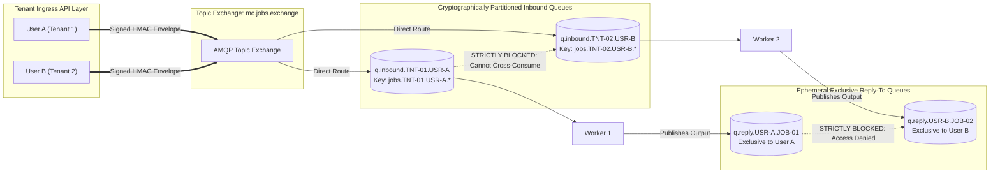

#### Core Invariants of the Zero-Leakage Queue System:
1. **Isolated Routing Keys**: Routing keys strictly adhere to `jobs.<tenant_id>.<user_id>.<feature_id>`. Subscribers are bound strictly to their own specific user queue.
2. **Ephemeral Exclusive Reply-To Queues**: Long-running asynchronous responses return through temporary queues (`q.reply.<user_id>.<job_id>.<nonce>`) configured with `exclusive: true, auto_delete: true`. No other user account has read permissions.
3. **HMAC Cryptographic Envelope Verification**: Every message envelope carries an HMAC-SHA256 signature calculated from a per-tenant master secret. Workers verify the signature before processing; forged or cross-tenant messages are immediately dropped into an isolated Dead Letter Queue (`dlx.security`).
4. **WebSocket/SSE Multiplexing Gateway**: Clients open a secure WebSocket or SSE connection bound strictly to their user ID (verified via RS256 JWT claims). The gateway maps the user's ephemeral queue events to their socket, blocking any attempt to snoop another user's job stream.

---

## 4. MCP (Model Context Protocol) & Playwright MCP Architecture

### 4.1 Bisect Engine Architecture

The platform integrates with `playwright-mcp-engine` using a **Bisect Architecture**, where the structural execution workflow (the "What") is strictly isolated from variable user data (the "How" and "With What"):

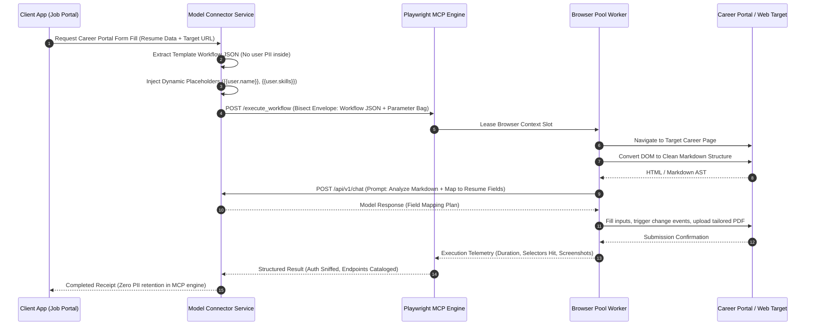

- **Workflow JSON (Bisect Part A)**: Deterministic, immutable step definitions containing step IDs, selector fallback cascades (`[css, xpath, aria]`), action types (`navigate`, `click`, `fill`, `extract`), and assertion gates.
- **Placeholder Parameters (Bisect Part B)**: Encrypted user data payload passed in-memory during step execution, resolving template expressions like `{{vars.applicantEmail}}` without persisting user details in workflow definitions.

### 4.2 Authentication & Authorization Sniffing Mesh

The `playwright-mcp-engine` network sniffer intercepts every HTTP frame during automation:
- **Zero-Trust Auth Detection**: Heuristically indexes `Authorization: Bearer <jwt>`, Basic Auth, Session Cookies (`connect.sid`, `jwt`), and Custom API Keys (`X-API-Key`).
- **Endpoint Cataloging**: Automatically records discovered URLs, HTTP methods, authorization requirements (`ANONYMOUS`, `AUTHENTICATED`, `SCOPED`), and status codes into an endpoint catalog.
- **Security Invariant**: Discovered tokens are classified by scope and type; tokens are transmitted to `model-connector-service` over TLS-protected internal channels and are stripped from all persistent log sinks.

### 4.3 Concurrency Browser Pooling & Stuck-Process Watchdog

Headless browser automation under high load is prone to memory leaks, zombie renderer processes, and hung network sockets.
- **Resource Pooling (`BrowserPool.ts`)**: Pre-warms browser contexts in worker slots, recycling contexts after $N$ operations to prevent Chromium memory bloat.
- **Watchdog stuck-process killer (`watchdog.ts` & `process-killer.ts`)**:
  - Each step is bound to an absolute deadline (e.g. 15,000ms).
  - If a step hangs (e.g. unhandled JavaScript modal or infinite redirect loop), the watchdog identifies the child OS PID.
  - Automatically executes forceful process tree termination (`SIGKILL` on POSIX, `taskkill /F /T` on Windows).
  - Evicts the fouled worker slot, initializes a pristine replacement slot, and returns status `STUCK_PROCESS_KILLED` with full diagnostic telemetry to the caller without bringing down the server.

---

## 5. Planned Application Integrations & Ecosystem Services

### 5.1 Application 1: Autonomous Intelligent Job Portal

The Job Portal is a self-hosted or cloud-hosted multi-tenant talent matching application:

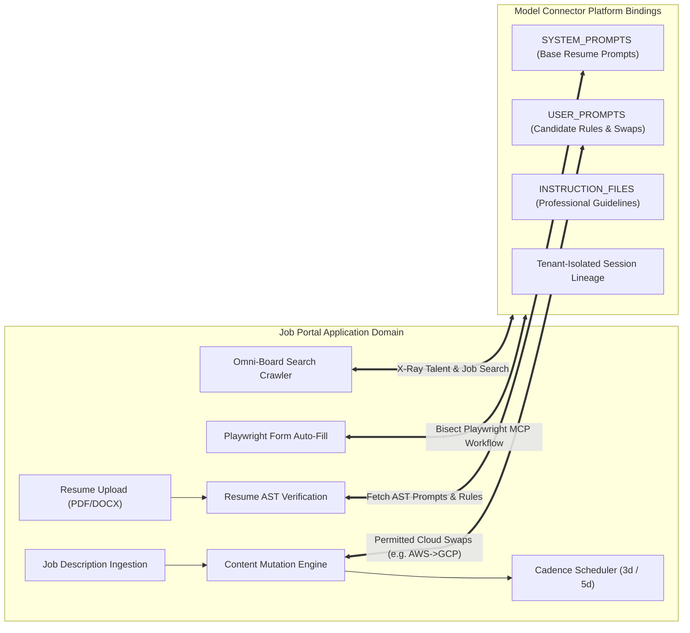

#### Key Functional Capabilities:
1. **Resume AST Verification & Scorecard**:
   - Parses resumes into Abstract Syntax Tree (AST) representations (Skills, Experience, Certifications, Chronology).
   - Evaluates structural completeness and semantic alignment against job descriptions using validated prompt templates.
   - Computes deterministic ATS compatibility scores (0–100) and highlights missing competencies.
2. **Controlled Resume Content Mutation**:
   - Enables fine-grained candidate authorization rules: e.g. explicitly allowing transposition of related technologies (such as changing AWS to GCP or PyTorch to TensorFlow) while forbidding fabrication of unverified tenure or seniority.
3. **Automated Multi-Channel Outreach & Referral Generation**:
   - Generates customized outreach messages tailored for LinkedIn InMail, portal applications, and direct executive referral emails.
   - Stores prompt strategies on the model-connector side; candidates can supply custom personal voice prompts while auditing AI output before sending.
4. **Automated Follow-Up Cadence Engine**:
   - Schedules and dispatches contextual follow-ups at 3-day and 5-day intervals with intelligent response detection to abort sequences once a recruiter responds.
5. **Headless Career Portal Form Auto-Fill via Playwright MCP**:
   - Ingests external career site URLs (Workday, Greenhouse, Lever, Taleo).
   - Converts the remote DOM into semantic Markdown.
   - Leverages `model-connector-service` to determine exact field mappings.
   - Automatically populates form fields and attaches customized resumes while maintaining 100% tenant-isolated session state.
6. **Multi-Portal Job Search**:
   - Connects to career portals, LinkedIn, RemoteOK, and Naukri via `playwright-mcp-engine` Google X-Ray search strategies.

### 5.2 Application 2: ComfyUI Storyteller Engine

The ComfyUI Storyteller application orchestrates multimodal generative storytelling:

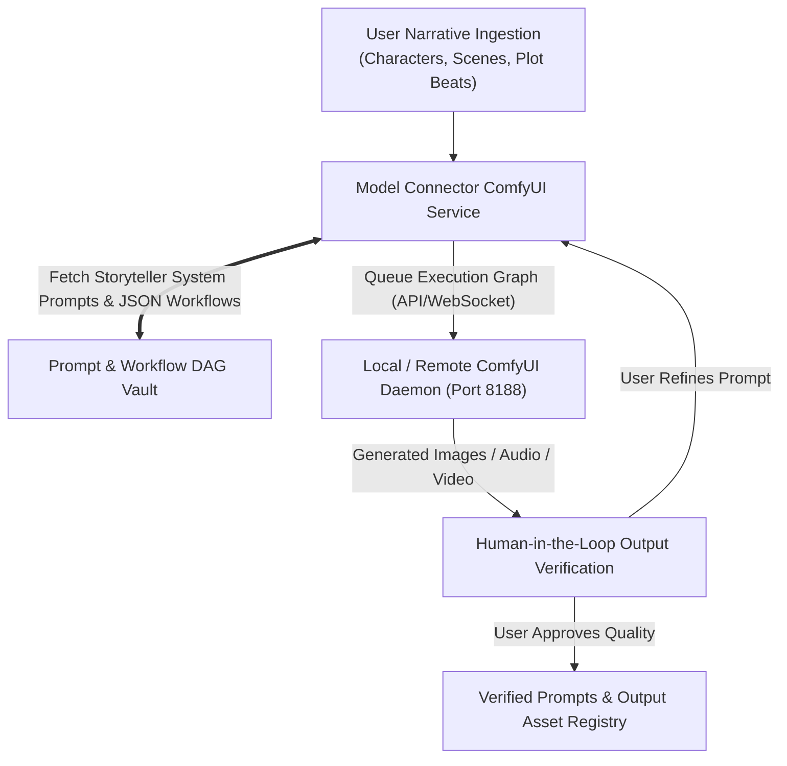

#### Key Functional Capabilities:
1. **System & Instruction Prompt Management**:
   - Maintains base creative director system prompts alongside story-specific character continuity instructions.
2. **Workflow Graph Template Orchestration**:
   - Stores versioned ComfyUI execution graphs (JSON DAGs) on `model-connector-service`. Dynamically injects positive/negative prompts, seed parameters, LoRA weights, and aspect ratios.
3. **Human-in-the-Loop (HITL) Verification**:
   - Generated assets (scene images, narrated character audio, animated clips) are presented to the creator for review.
   - When a user flags an output as high quality, the exact prompt, seed, model checkpoint, and workflow configuration are stamped as a `VERIFIED_PROMPT` in the platform registry for deterministic future generation.

### 5.3 Application 3: Autonomous Apps Builder

The Autonomous Apps Builder produces complete, executable software codebases:
1. **Dynamic Skill Markdown Ingestion**:
   - Loads targeted skill instruction files (`SKILL.md`), design pattern definitions, and architectural constraints stored in `model-connector-service`.
2. **Context-Aware Code Generation**:
   - Ingests language constraints (e.g. TypeScript 5, Python 3.12, strict typing, zero relative imports) and constructs complete project directory hierarchies.
3. **Hermetic Sandbox Execution**:
   - Spawns Dockerized isolated build and test runners to compile generated source code, execute automated unit tests, and verify architectural invariants before output delivery.

---

## 6. Multi-Tenant Isolation & Zero Cross-Contamination Security

### 6.1 Strict User-to-App-to-Feature Isolation Boundaries

In an enterprise environment where 1 user concurrently utilizes the Job Portal, ComfyUI Storyteller, and custom Chat workflows, the platform enforces **Three-Dimensional Context Scoping**:

$$\text{Security Scope} = \langle \text{USER\_ID}, \text{APPLICATION\_ID}, \text{FEATURE\_ID} \rangle$$

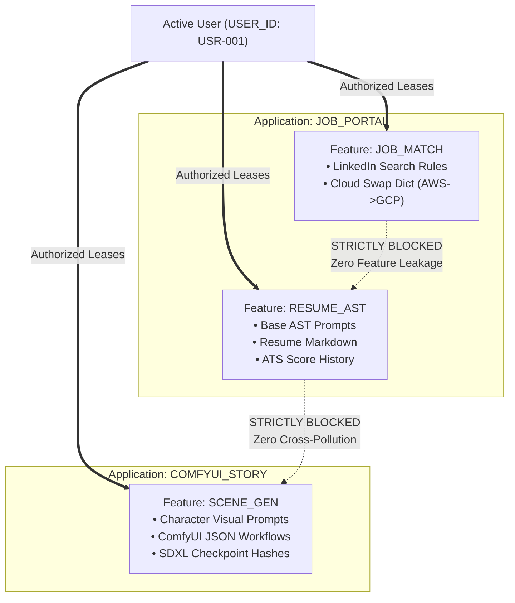

### 6.2 Tenant Scoping Matrix

| Request Scenario | Tenant Identification | Permitted Scope Access | Prohibited Scope Access | Enforcement Level |
| :--- | :--- | :--- | :--- | :--- |
| **User A submits Resume for AST Verification** | `USER_A`, `JOB_PORTAL`, `RESUME_AST` | `SYSTEM_PROMPTS` for AST scoring; User A resume text; User A custom scoring criteria. | ComfyUI workflows; Job search crawlers; User B resume records or messages. | Database row-level security & repository query filters. |
| **User A modifies Cloud Skills (AWS $\to$ GCP)** | `USER_A`, `JOB_PORTAL`, `RESUME_MUTATE` | User A skill swap rules; User A current resume version. | Base system prompts belonging to other tenants; ComfyUI assets. | Application service boundary. |
| **User A triggers ComfyUI Story Scene** | `USER_A`, `COMFYUI_STORY`, `SCENE_GEN` | ComfyUI character prompts; workflow JSON; seed parameters. | Job portal resumes, candidate contact details, recruiter messages. | Memory context isolation & token budget limiter. |
| **User B enters Career Portal via Playwright** | `USER_B`, `JOB_PORTAL`, `FORM_FILL` | User B profile data; active target job application URL. | User A profile data, resumes, session cookies, or W3C traces. | Cryptographic session salt & isolated browser context. |

---

## 7. Global Scalability Architecture (1 Million Concurrent Active Users)

### 7.1 Global Ingress, Anycast, and CDN Topology

To support 1,000,000 concurrent active users distributed across North America, EMEA, and APAC:

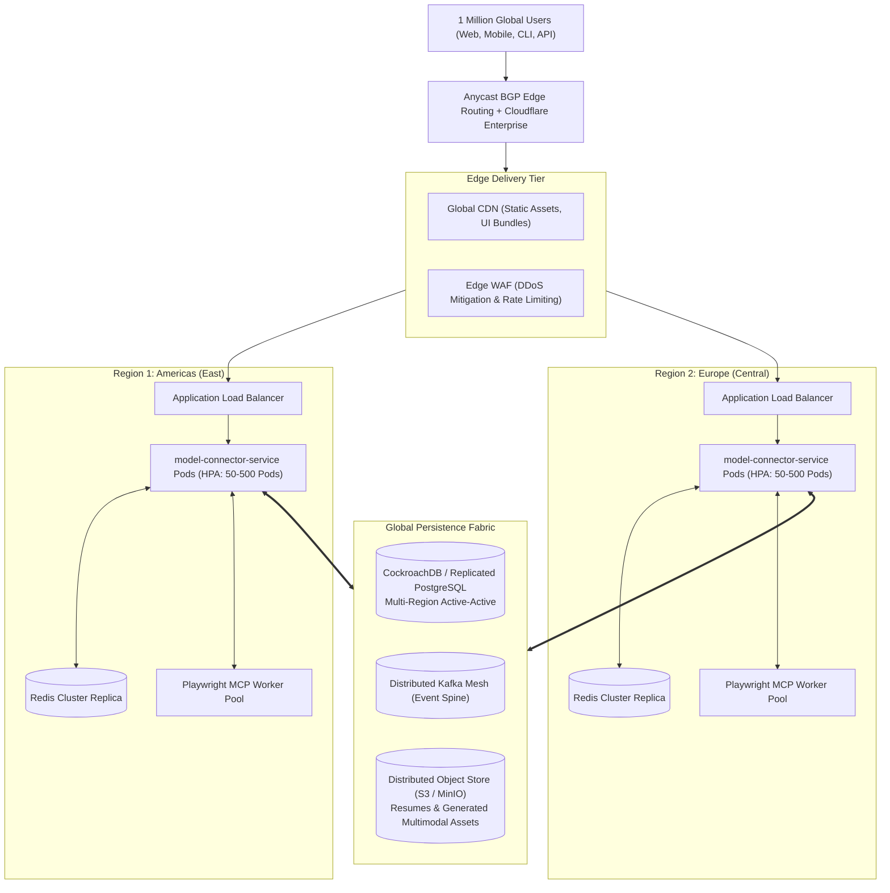

### 7.2 Read vs. Write Intensity Profile Analysis

Understanding read and write profiles is essential for resource allocation:

| Application / Service | Read / Write Ratio | Characteristic Profile | Storage Tier Strategy | Mitigation for High Load |
| :--- | :--- | :--- | :--- | :--- |
| **Model Catalog Discovery** | **99% Read / 1% Write** | Read-Intensive: Models, capabilities, and availability checks are requested millions of times. | Redis In-Memory Cache (TTL: 300s); Local In-Process Cache. | Cache warming at startup; instantaneous cache hit responses. |
| **Resume AST Scoring** | **40% Read / 60% Write** | Balanced-to-Write-Heavy: Ingests documents, parses AST nodes, generates scores, writes audit entries. | PostgreSQL / MongoDB; Transactional Outbox pattern. | Asynchronous parsing via Redis Streams / Kafka queue. |
| **Playwright Form Autofill** | **80% Read / 20% Write** | Read-Heavy on DOM analysis; Write-Heavy on telemetry and audit logs. | Read cached workflow JSON; Stream DOM analysis to model. | Worker slot pooling; browser context recycling. |
| **ComfyUI Storyteller** | **20% Read / 80% Write** | Write-Intensive: Generates high-volume binary payloads, image frames, and video streams. | S3 / MinIO Object Storage for binaries; PostgreSQL for metadata. | Direct presigned URL uploads bypassing the Node.js API gateway. |
| **Audit & Telemetry Sink** | **5% Read / 95% Write** | Pure Write-Intensive: 1,000,000 concurrent users generate tens of thousands of log records/sec. | Buffered Kafka Topic $\to$ ClickHouse / Elasticsearch cluster. | Batched async writes with zero blocking on critical request path. |

### 7.3 Zero-Data-Loss Persistence & Fault-Tolerant Failover

To prevent data loss during catastrophic host or database outages:
1. **Write-Ahead Logging (WAL)**: All relational state transactions require confirmed WAL disk sync before acknowledging client writes.
2. **Transactional Outbox Pattern**: State mutations and corresponding audit events are committed in a single atomic database transaction. An asynchronous CDC (Change Data Capture / Debezium) daemon tails the transaction log to publish messages to Kafka.
3. **Graceful Degraded Mode**: If the relational primary database experiences a network split, `model-connector-service` switches dynamically to a read-only replica for catalog lookups while queueing incoming session turns in an in-memory Redis ring buffer until primary recovery.

---

## 8. Authentication, Authorization & Security Perimeters

### 8.1 Multi-Mode Security Model (OAuth2, JWT, API Key, None)

The platform supports four distinct authentication modes configured on a per-endpoint and per-application basis:

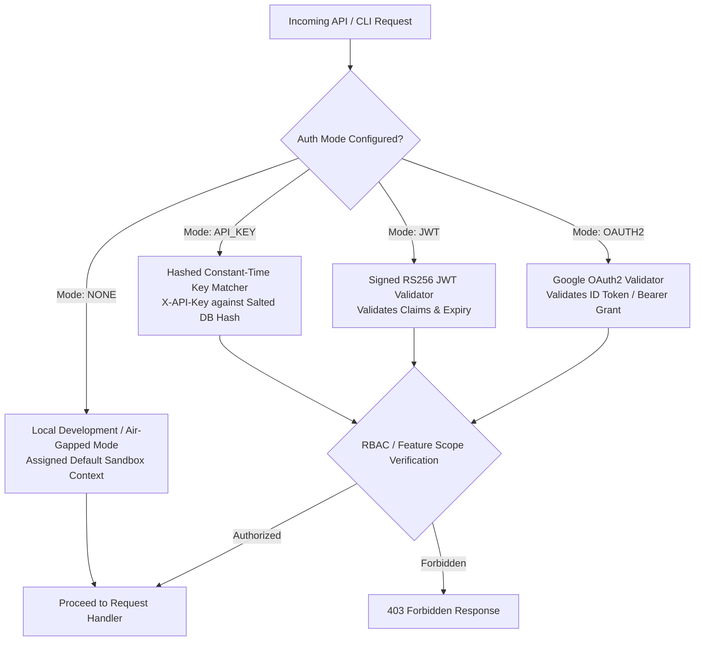

1. **Google OAuth2 Integration**: Used primarily for web client authentication and direct Google Cloud Vertex/Gemini model resource authorization.
2. **Enterprise JWT (RS256)**: Used for service-to-service communication between external apps (Job Portal, ComfyUI) and `model-connector-service`. Tokens encode `tenantId`, `userId`, `appId`, and permitted `features`.
3. **Hashed API Keys**: High-performance keys for automated CI/CD and CLI integrations (`model-connector-client`). Keys are compared using `crypto.timingSafeEqual` against salted SHA-256 hashes in `MODEL_CREDENTIALS`.
4. **Anonymous / None Mode**: Strictly restricted to local development environments (`NODE_ENV=development`) or air-gapped on-premise deployments where ingress authentication is delegated entirely to an upstream mesh proxy (e.g. Istio/Envoy).

### 8.2 Zero-PII Ingress Guard & Sanitization Specification

Conforming to **`NFR-SEC-001`**, sensitive personal identifiers (PII) must never enter URL parameters, query strings, or unredacted log streams:
- **Query Parameter Interception**: Incoming URLs are parsed by `piiUrlGuardMiddleware`. If parameters match known PII regular expressions (email addresses, raw API keys, bearer tokens, credit cards), the request is rejected with `400 Bad Request` before invoking any controller.
- **Header & Body Masking**: Sensitive fields (`authorization`, `cookie`, `oauth_credential_field`, `password`) are scrubbed by the W3C tracing logger, substituting sensitive substrings with `[REDACTED]`.

### 8.3 Local vs. Remote Deployment Perimeters

| Parameter | Local Deployment (On-Device / Dev) | Remote Enterprise Deployment (Cloud / K8s) |
| :--- | :--- | :--- |
| **Network Perimeter** | Loopback interface (`127.0.0.1`) or Docker bridge `model-box-net`. | Private VPC, Kubernetes Pod Overlay, Cloudflare Edge Ingress. |
| **TLS Enforcement** | Optional (Plain HTTP permitted locally). | Mandatory TLS 1.3 with automated Let's Encrypt / Vault certificates. |
| **Authentication Default** | `API_KEY` or `NONE` (Local developer context). | Strict `OAUTH2` or `JWT` with short-lived tokens and refresh cycles. |
| **Model Ingress** | Local Ollama daemon (`localhost:11434`) + direct CLI. | Cloud Frontier Model APIs via outbound NAT gateways with fixed IPs. |
| **MCP Execution** | Local Chrome browser subprocess via Playwright. | Scaled headless Chromium Pods running in sandboxed gVisor/Firecracker nodes. |

---

## 9. Distributed Observability & Distributed Tracing (1k+ Microservices)

### 9.1 W3C TraceContext Propagation Standards

In an ecosystem scaling across hundreds to thousands of microservices, distributed tracing must adhere strictly to the **W3C TraceContext** standard:

```
traceparent: 00-4bf92f3577b34da6a3ce929d0e0e4736-00f067aa0ba902b7-01
              │  └──────────────┬────────────────┘ └───────┬────────┘ └─┬┘
              │             Trace ID                    Span ID      Flags
              Version (00)
```

1. **Trace Propagation Contract**:
   - `model-connector-service` extracts or synthesizes `traceparent` at HTTP ingress.
   - The trace context is propagated across downstream modules (`model-connector-client`, `playwright-mcp-engine`, Kafka headers, and database session comments).
   - Downstream spans generate fresh `spanId` values while preserving the root `traceId`.
2. **Correlation ID Aliasing**: For legacy system compatibility, `x-correlation-id` and `x-request-id` are mapped directly to `traceId`.

### 9.2 Structured NDJSON Audit Logging Specification

All platform logging emits single-line newline-delimited JSON (NDJSON) written to standard output (`stdout`):

```json
{
  "timestamp": "2026-10-20T19:55:00.123Z",
  "level": "INFO",
  "service": "model-connector-service",
  "environment": "production",
  "traceId": "4bf92f3577b34da6a3ce929d0e0e4736",
  "spanId": "00f067aa0ba902b7",
  "correlationId": "4bf92f3577b34da6a3ce929d0e0e4736",
  "userId": "USR-7821-EXP",
  "appId": "JOB_PORTAL",
  "featureId": "RESUME_AST",
  "action": "EXECUTE_MODEL_PROMPT",
  "modelId": "gemini-3.8-flash",
  "strategyMode": "api",
  "latencyMs": 412,
  "statusCode": 200,
  "clientIp": "192.0.2.45",
  "message": "Model inference completed successfully with 1048 tokens generated"
}
```

- **Zero Information Leakage**: No SQL queries with raw values, no prompt contents containing candidate names, and no authorization bearer tokens are ever written to audit logs.
- **Queryable Fields**: Indexed by log aggregators (Elasticsearch, Loki, BigQuery) for immediate forensic inspection across 1,000+ distributed microservice instances.

---

## 10. Silent Access Revocation & Access Denied Architecture

### 10.1 Out-of-Band Upstream Revocation Trap

When an end-user or tenant revokes platform access out-of-band (e.g., revoking Google OAuth access via Google Account Security settings, regenerating an OpenAI/Anthropic API key, or invalidating session cookies) without notifying `model-connector-platform`:

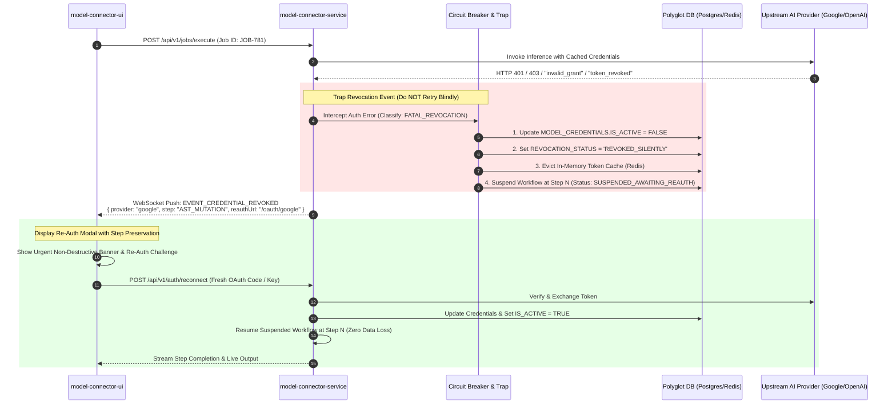

1. **Error Classification Interceptor**:
   - The platform strictly distinguishes between **transient faults** (network timeouts, rate limits HTTP 429) and **fatal revocation faults** (HTTP 401 Unauthorized, HTTP 403 Forbidden with `invalid_grant`, `account_deactivated`, `token_expired_or_revoked`).
   - Transient faults invoke exponential backoff retry.
   - Fatal revocation faults **immediately abort retries** to prevent upstream account bans or log flooding.

### 10.2 Workflow State Preservation & Blast Radius Containment

1. **Blast Radius Isolation**:
   - Upstream revocation by User $A$ impacts **only** User $A$'s active session and credentials.
   - Cross-tenant credentials and platform-wide shared connection pools remain completely isolated and active.
2. **Step-Level State Freeze**:
   - When revocation occurs at Step $K$ of an $M$-step workflow, the system writes an execution checkpoint to `WORKFLOW_EXECUTION_JOBS`:
     - `SAVED_STEP_INDEX = K`
     - `PARTIAL_STEP_OUTPUTS = { step_1_ast: {...}, step_2_prompt: {...} }`
     - `EXECUTION_STATUS = 'SUSPENDED_AWAITING_REAUTH'`
   - The message in the queue is acknowledged or stored in a persistent suspension registry, freeing worker threads.

### 10.3 User Flow & Re-Authentication Recovery Sequence

1. **Real-Time Push Alert**: `model-connector-service` publishes a high-priority event `EVENT_CREDENTIAL_REVOKED` over the user's private WebSocket.
2. **UI Action Banner**: `model-connector-ui` renders a non-intrusive re-authentication modal highlighting:
   - Target Provider (e.g. *Google Gemini Cloud Console* or *Anthropic API Key*).
   - Suspended Operation (e.g. *Resume AST Skill Mutation (Record #412)*).
   - Clear Action Button: **"Reconnect Provider & Resume Pipeline"**.
3. **Resumption Without Step Restart**:
   - Once the user re-authorizes, the gateway tests the credential with a 0-token ping probe.
   - Upon successful verification, the engine loads `PARTIAL_STEP_OUTPUTS` and resumes directly at Step $K$, saving token costs and execution time.

---

## 11. Production Ecosystem Libraries & Exact Versions

In strict accordance with directive **`STD-COD-005.1`** (Never reinvent utilities; strictly leverage vetted enterprise ecosystem libraries), the platform specifies the following production libraries:

### 11.1 Feature-to-Library Mapping Matrix

| Subsystem / Feature Domain | Production Ecosystem Library | Latest Version | Core Architectural Role & Justification |
| :--- | :--- | :--- | :--- |
| **Schema Validation & Type Contracts** | `zod` | `^3.23.8` | Universal schema enforcement, runtime contract validation, DTO sanitization, Zero-PII parsing. |
| **Authentication & OAuth2 Mesh** | `@auth/core` | `^0.35.0` | Framework-agnostic OAuth 2.0 / OpenID Connect engine with PKCE flow support. |
| **Google Provider SDK & Auth** | `google-auth-library` | `^9.14.2` | Enterprise OAuth token exchange, service account authentication, and auto-refresh token lifecycles. |
| **Cryptographic Tokens & JWE/JWKS** | `jose` | `^5.9.6` | Lightweight, zero-dependency JWT/JWS/JWE encryption and signature verification using native Web Crypto. |
| **Distributed Message Queue (AMQP)** | `amqplib` | `^0.10.4` | High-performance RabbitMQ AMQP 0-9-1 driver with confirmation channels and routing key isolation. |
| **Redis Distributed Queue & Cache** | `ioredis` | `^5.4.1` | Robust in-memory cluster driver supporting pipelines, Sentinel failover, and zero-latency caching. |
| **Queue Job Orchestration** | `bullmq` | `^5.18.0` | Enterprise Redis-backed job scheduler, rate-limited queues, stalled job watchdogs, and child jobs. |
| **Deterministic State Machine / DAG** | `xstate` | `^5.18.2` | Finite state machine and Actor model engine enforcing the Zero-Skip Workflow Invariant. |
| **Long-Running Workflow Orchestration** | `@temporalio/client` / `workflow` | `^1.11.1` | Distributed durable execution engine for multi-day follow-up schedules and resilient retries. |
| **Headless Browser & MCP Automation** | `playwright` | `^1.49.0` | Multi-engine browser automation (Chromium, Firefox, WebKit) for DOM extraction and form submission. |
| **Stealth & Anti-Bot Evasion** | `playwright-extra` | `^4.3.6` | Headless browser fingerprint spoofing and stealth plugins for seamless free-tier interaction. |
| **Model Context Protocol Core** | `@modelcontextprotocol/sdk` | `^1.0.1` | Official Anthropic/Linux Foundation standard for tools, resource subscriptions, and agent context. |
| **Resume & Code AST Parsing** | `@babel/parser` & `@babel/traverse` | `^7.26.0` | Complete Abstract Syntax Tree generation, node traversal, and deterministic skill substitution. |
| **PDF Extraction & Parsing** | `pdf-parse` | `^1.1.1` | Fast, low-overhead binary PDF text stream extraction for inbound candidate resumes. |
| **Word Document AST Conversion** | `mammoth` | `^1.8.0` | Semantic `.docx` to HTML/Markdown converter preserving structural headings and skill tables. |
| **Markdown Parsing & Rendering** | `markdown-it` | `^14.1.0` | High-speed, CommonMark-compliant parser for the Prompt Markdown Vault and UI rendering. |
| **Relational Database Access** | `pg` + `kysely` | `^8.13.0` / `^0.27.4` | Pure Node.js PostgreSQL driver paired with Kysely for compile-time end-to-end type safety without ORM bloat. |
| **Document NoSQL Database** | `mongodb` | `^6.10.0` | Official MongoDB Node.js driver supporting transactions, Change Streams, and connection pooling. |
| **Password & Secret Hashing** | `argon2` | `^0.41.1` | Memory-hard password hashing algorithm (Argon2id) for credential salts and user identity vaults. |
| **Distributed Tracing & Telemetry** | `@opentelemetry/api` + `sdk-node` | `^1.9.0` / `^0.54.0` | W3C TraceContext standards-compliant distributed tracing instrumenting HTTP, gRPC, and AMQP. |

### 11.2 Architectural Compliance with STD-COD-005.1

All third-party utilities and libraries are isolated behind domain interfaces and leaf adapters:
1. **Zero Reinvention Invariant**: Complex algorithms (schema validation, cryptographic hashing, distributed tracing, and finite state machines) strictly utilize the vetted enterprise ecosystem packages detailed in Section 11.1.
2. **Centralized Platform Access**: In accordance with **`STD-COD-011`**, runtime platform capabilities and Node.js built-ins (`process`, `fs`, `path`, `crypto`, `child_process`) are encapsulated within `@model-box/model-connector-core/utils`.
3. **Decoupled Contracts**: Domain logic and handlers consume abstract service contracts (`ITokenRecoveryStrategy`, `IMcpTransportAdapter`, `IStateLedgerService`), ensuring complete testability, mockability, and zero vendor lock-in.

---

## 12. Onboarding-Driven Dynamic Workflow Generation & Zero-Skip Invariant

### 12.1 Dynamic DAG Synthesis from Application Onboarding

When an external application or customer tenant registers during the **Onboarding Stepper**, `model-connector-service` dynamically compiles an immutable **Workflow Execution DAG**:

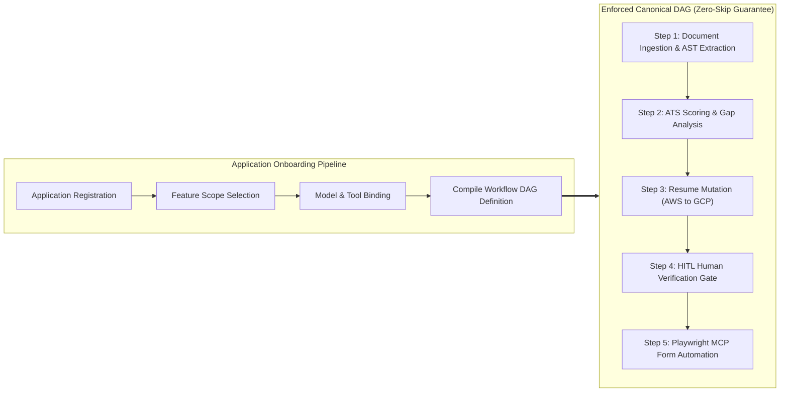

1. **Step Dependency Graph**: Each step explicitly defines its required input schema, output schema, timeout policy, and mandatory predecessor step IDs.
2. **State Machine Actor**: An `xstate` v5 actor instance is spawned per record to enforce sequential execution without gaps.

### 12.2 The Zero-Skip Invariant & Explicit Skip Manifests

By default, **the platform strictly forbids skipping or omitting any step in the generated workflow**. If a step produces an empty artifact or fails its assertion, execution halts immediately.

Steps can **only** be skipped when the user explicitly provides an authenticated, audited skip instruction through one of two mechanisms:

### 12.3 Record-Level Skip vs. Flow-Wide Skip Semantics

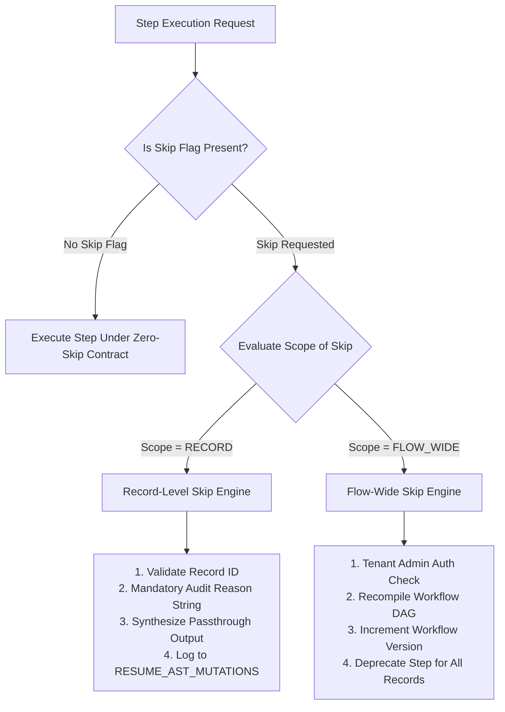

1. **Record-Level Skip (`SKIP_SINGLE_RECORD`)**:
   - **Applicability**: Pertains strictly to a single record identifier (e.g., `RECORD_ID = 'REC-90812'`).
   - **Requirements**:
     - User must supply a non-empty `skipReason` (e.g. *"Candidate already possesses certified GCP Cloud Architect credentials; AWS mutation unneeded"*).
     - The engine injects a synthetic pass-through payload that satisfies the predecessor schema requirements for downstream steps.
     - An audit record is permanently written to `SYSTEM_AUDIT_LOGS`.
2. **Flow-Wide Skip (`SKIP_FLOW_WIDE`)**:
   - **Applicability**: Applies to *all* current and future records processed through that onboarded application workflow.
   - **Requirements**:
     - Requires `TENANT_ADMIN` or `OPERATOR` authorization level.
     - The platform increments the DAG version (`version = version + 1`) in `WORKFLOW_DAG_DEFINITIONS`.
     - Active records currently midway through processing are completed on the legacy DAG version to preserve execution stability.

---

## 13. Free-Tier Cookie-Based Model Connector Client Architecture

### 13.1 Browser Session Cookie Harvest & AES-256-GCM Vault

For users accessing frontier AI models via free-tier web interfaces (e.g., Google AI Studio, Gemini Web, Anthropic Claude Free, ChatGPT Web) where paid API keys are unavailable, `model-connector-client` provides a secure **Cookie Strategy Adapter**:

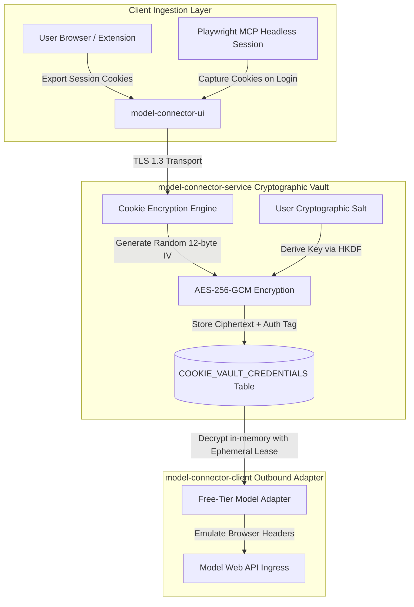

1. **Cryptographic Storage Standards**:
   - Cookies are encrypted using **AES-256-GCM** with a distinct 96-bit initialization vector (IV) per entry and a 128-bit authentication tag.
   - Master encryption keys are derived using **HKDF-SHA256** combined with user-specific cryptographic salts stored in `USER_IDENTITIES`.
   - Raw cookie strings are never written to disk, caches, or audit logs.

### 13.2 Anti-Bot Header Emulation & Playwright MCP Cookie Synchronization

Web model endpoints enforce strict anti-bot and fingerprinting checks. `model-connector-client` emulates authentic browser traffic by orchestrating:
1. **Dynamic Header Synthesis**:
   - Matches client headers to the exact browser fingerprint: `User-Agent`, `Sec-Ch-Ua`, `Sec-Ch-Ua-Mobile`, `Sec-Ch-Ua-Platform`, `Sec-Fetch-Dest: empty`, `Sec-Fetch-Mode: cors`, `Sec-Fetch-Site: same-origin`.
   - Automates CSRF and `X-Requested-With` header injection using tokens extracted from the session payload.
2. **Playwright MCP Headless Cookie Sync**:
   - When complex browser actions or multi-turn chats are required, `model-connector-service` synchronizes the decrypted cookie jar directly into `playwright-mcp-engine` browser contexts via `browserContext.addCookies(...)`, enabling headless execution with authenticated sessions.

### 13.3 Silent Expiry Watchdog & Health Probing

```
Cron Schedule: Every 15 Minutes
Prober: GET /api/session/health (Lightweight 0-token ping)
Threshold: HTTP 200 -> OK | HTTP 401/403 -> TRIGGER_RENEWAL
```

- A background worker periodically dispatches lightweight probes using the stored cookies.
- If a cookie expires or is invalidated upstream, the platform triggers the **Silent Revocation Protocol (Section 10)**, alerting the user to re-import or refresh their session cookies before active job execution fails.

---

## 14. Token Exhaustion Architecture & Dynamic Recovery Protocols

### 14.1 Two Dimensions of Token Exhaustion (Context Overflow vs Quota Depletion)

When processing deep multi-turn AI interactions, resume AST mutations, or long-form storytelling workflows, token exhaustion occurs along two distinct operational vectors:

```
┌────────────────────────────────────────────────────────────────────────┐
│                      TOKEN EXHAUSTION VECTORS                          │
├──────────────────────────────────┬─────────────────────────────────────┤
│ 1. CONTEXT WINDOW OVERFLOW       │ 2. PROVIDER QUOTA / RATE EXHAUSTION │
├──────────────────────────────────┼─────────────────────────────────────┤
│ • Input payload + system prompt  │ • HTTP 429 Too Many Requests        │
│   + session history > Model Max  │ • "RESOURCE_EXHAUSTED" / 403 Quota  │
│ • Example: 150k tokens sent to   │ • Account monthly budget consumed   │
│   a 128k context model (GPT-4o)  │ • Per-minute token burst exceeded   │
│ • Error: context_length_exceeded │ • Error: insufficient_quota         │
└──────────────────────────────────┴─────────────────────────────────────┘
```

### 14.2 Recovery Triad: Compaction, Rolling Summary & Dynamic Failover

To guarantee zero pipeline aborts and uninterrupted user progress, `model-connector-service` implements an automated **Three-Tier Token Recovery Triad**:

```mermaid
flowchart TD
    INBOUND["Inbound Job / Step Invocation"] --> CHECK{"Token Budget Pre-flight Check"}
    
    CHECK -->|Within Limits| EXEC["Dispatch to Active Model"]
    
    CHECK -->|Context > 80% Capacity| COMPACT["Tier 1: Adaptive AST & Prompt Compaction"]
    COMPACT --> RE_EVAL{"Post-Compaction Fits Context?"}
    RE_EVAL -->|Yes| EXEC
    RE_EVAL -->|No| SUMMARY["Tier 2: Rolling Context Summarization"]
    
    SUMMARY --> RE_EVAL2{"Post-Summary Fits Context?"}
    RE_EVAL2 -->|Yes| EXEC
    RE_EVAL2 -->|No| FAILOVER["Tier 3: Dynamic Model Failover Cascade"]
    
    EXEC --> STATUS{"Execution Result"}
    STATUS -->|HTTP 200 OK| SUCCESS["Return Output Stream"]
    STATUS -->|HTTP 429 / Quota Exhausted| FAILOVER
    
    FAILOVER --> CASCADE{"Alternative Model with Available Quota?"}
    CASCADE -->|Model Found (e.g. Gemini 2M / Claude 200k)| DISPATCH_ALT["Dispatch to Alternative Model"]
    CASCADE -->|All Providers Exhausted| PAUSE["Suspend Workflow & Push Re-Auth / Top-Up Modal"]
```

1. **Tier 1: Adaptive AST & Prompt Compaction**:
   - Parses the input payload and strips non-essential elements: Markdown whitespace, redundant formatting, HTML comments, and structural boilerplate.
   - Trims resume AST nodes down to core competency trees without loss of semantic facts.
   - Achieves a deterministic **30%–45% token reduction**.
2. **Tier 2: Rolling Context Summarization**:
   - For long-running conversations exceeding turn 10:
   - Turns $1$ through $N-2$ are fed into a lightweight local summarizer (Ollama `llama3.2` or fast cloud model `gemini-3.8-flash`).
   - The historical turns are replaced with a concise semantic digest (`[PREVIOUS_TURNS_SUMMARY]`), keeping only the most recent 2 turns in full fidelity.
3. **Tier 3: Dynamic Model Failover Cascade**:
   - When a specific model provider returns HTTP 429 or when context surpasses the model's physical window:
   - The platform dynamically routes the request to an alternative provider in the same capability tier:
     $$\text{GPT-4o (128k)} \longrightarrow \text{Claude 3.7 Sonnet (200k)} \longrightarrow \text{Gemini 3.8 Flash (1,048,576 tokens)}$$
   - If paid cloud quotas are fully depleted across providers, the engine fails over to local offline inference via **Ollama**.

### 14.3 End-to-End Token Exhaustion User Flow Sequence

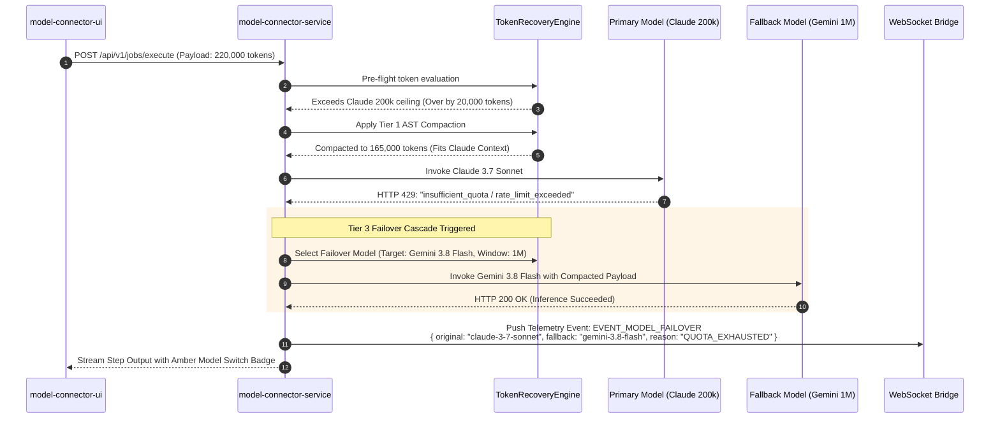

---

## 15. Mandatory Code Generation & Engineering Standards

All code generated or refactored within `model-connector-platform` must strictly satisfy the following **7 Golden Engineering Invariants**:

### 15.1 The 7 Golden Rules of Code Synthesis

1. **Strict `@/*` Root Path Navigation (`STD-COD-001`)**:
   - **Prohibited**: Relative climbing (`./`, `../`, `../../`).
   - **Mandatory**: `@/*` absolute package aliases mapped in `tsconfig.json` (e.g. `@/core/config`, `@/security/vault`, `@/workflow/engine`).
2. **Object-Oriented Design Patterns with Dependency Injection (`STD-COD-005`)**:
   - **Prohibited**: Stale static procedural functions, global state mutations, and unmanaged singletons.
   - **Mandatory**: Classes following SOLID principles, instantiated through constructor dependency injection (DI) and implementing explicit TypeScript interfaces.
3. **Zero `if/else` or `switch` Branching for Domain Logic (`STD-COD-005`)**:
   - **Prohibited**: Multi-branch `if`, nested `if/else` (> 2 levels), and multi-case `switch` statements.
   - **Mandatory**: Replace branching with vetted design patterns:
     - **Strategy Pattern**: For protocol/model execution (`CliConnectorStrategy`, `ApiConnectorStrategy`, `CookieConnectorStrategy`).
     - **Factory Pattern**: For dynamic handler creation.
     - **Chain of Responsibility**: For ingress interceptors and security filters.
     - **Specification Pattern**: For rule and constraint validation.
4. **Zero Model-Specific Naming in Generic Infrastructure**:
   - **Prohibited**: Variable or method names tied to a specific vendor in core modules (e.g., `geminiApiKey`, `sendOpenAiPrompt()`, `claudeResponse`).
   - **Mandatory**: Abstract vendor-neutral terminology (e.g., `modelExecutionPayload`, `providerApiKey`, `rawInferenceResponse`, `contextTokenBudget`). Model names are strictly confined to concrete adapter implementations.
5. **Centralized Constants & Zero Magic Literals (`STD-COD-002`)**:
   - **Prohibited**: Inline magic strings or numbers (e.g. `'API'`, `8095`, `'GEMINI'`, `180000`).
   - **Mandatory**: Extracted to centralized enums or constants in `@/constants/` (e.g., `StrategyMode.API`, `ServerDefaults.PORT`, `ModelFamily.GEMINI`).
6. **Zero Code Duplication & Reusability First (`STD-COD-004`)**:
   - Common logic (retry math, token compaction, cryptographic HMAC generation) must be encapsulated in shared libraries (`model-connector-core`) rather than re-implemented across services.
7. **Declarative `application.yml` Master Configuration**:
   - All runtime properties, resilience thresholds, model endpoints, and fallback cascades must be declared in `application.yml` with sensible production defaults.

### 15.2 Anti-Pattern Catalog & Replacement Design Patterns

| Anti-Pattern to Eliminate | Prohibited Code Sample | Mandatory Design Pattern Replacement |
| :--- | :--- | :--- |
| **Multi-case `switch` for model routing** | `switch(model) { case 'gemini': ... }` | **Strategy Pattern** with a registry map: `modelStrategyRegistry.get(family).execute(...)` |
| **Nested `if/else` for error handling** | `if (401) { ... } else if (429) { ... }` | **Chain of Responsibility**: `RevocationTrapHandler -> QuotaExhaustionHandler -> TransientRetryHandler` |
| **Relative module navigation** | `import { Foo } from '../../core/Foo';` | **Root Package Alias**: `import { Foo } from '@/core/Foo';` |
| **Hardcoded vendor variables** | `const geminiPrompt = ...;` | **Polymorphic DTO**: `const promptPayload: IModelPromptPayload = ...;` |
| **Hardcoded constants** | `if (status === 'ACTIVE')` | **Centralized Enum**: `if (status === CredentialStatus.ACTIVE)` |

---

## 16. Containerization & Docker Security Hardening Architecture

### 16.1 Multi-Stage Isolation & Non-Root Execution

All container images across `model-connector-platform` implement hardened multi-stage builds ensuring zero build tooling in production images:

```dockerfile
# Hardened Non-Root Container Pattern
FROM node:22-bookworm-slim AS runner
WORKDIR /app
USER node
EXPOSE 8095
ENTRYPOINT ["node", "packages/model-connector-service/dist/index.js"]
```

### 16.2 Defense-in-Depth Container Security Controls

1. **Privilege De-escalation (`no-new-privileges`)**: All container runtime definitions in `docker-compose.yml` enforce `security_opt: [ "no-new-privileges:true" ]`, preventing containerized processes from acquiring escalated setuid privileges.
2. **Deterministic Resource Ceilings (`deploy.resources.limits`)**:
   - Backend Service: `cpus: '2.0'`, `memory: 2048M`.
   - Frontend UI: `cpus: '1.0'`, `memory: 512M`.
   - Prevents noisy-neighbor starvation and Denial of Service (DoS) attacks on host environments.
3. **Zero Secrets in Docker Images**:
   - No default API keys, passwords, or encryption salts are ever baked into Dockerfiles or compose defaults.
   - All credentials are injected exclusively at runtime via secure environment files or external secret vaults (HashiCorp Vault / AWS Secrets Manager).
4. **Automated Container Healthchecks**: Built-in HTTP and TCP health probes with strict 5-second deadlines continuously assess pod viability without requiring root-level shell access.

---

## 17. Apache APISIX Enterprise API Gateway Integration

### 17.1 Problem Statement & Architectural Constraints
- **Problem Statement**: Exposing internal microservices directly to client applications or third-party webhooks creates tight coupling, exposes internal service ports, increases the attack surface for DDoS and credential stuffing, and complicates cross-cutting concerns (rate-limiting, mTLS, distributed tracing, and request de-duplication).
- **Constraints**:
  - The API Gateway must be open-source and run locally inside Docker containers alongside the application stack.
  - Latency overhead introduced by the gateway must not exceed $1.0\text{ ms}$ at P99.
  - Memory consumption must remain $< 150\text{ MB}$ to preserve host resources for AI workloads.
  - Dynamic route re-configuration must occur without restarting the gateway process.

### 17.2 Apache Gateway Candidates Comparative Analysis
| Gateway Technology | Architecture / Engine | Memory Footprint | Dynamic Reload | Lua/Wasm Plugins | Decision |
| :--- | :--- | :--- | :--- | :--- | :--- |
| **Apache APISIX** | OpenResty (Nginx + LuaJIT) + Wasm | **~60-80 MB** | **Zero-Reload (Hot Update)** | Native Lua + Wasm | **SELECTED (BEST)** |
| **Apache Traffic Server (ATS)** | C++ Multi-Threaded Reverse Proxy | ~250-400 MB | Requires Config Reload | C/C++ Plugins Only | **Rejected (Too Heavy / Complex)** |
| **Apache HTTP Server (`httpd`)** | Multi-Processing Modules (MPM) | ~150-300 MB | Reload Required (`graceful`) | C Modules | **Rejected (Legacy Paradigm)** |
| **Spring Cloud Gateway** | Java Virtual Machine (JVM) | ~450-800 MB | Requires Context Refresh | Java Only | **Rejected (JVM Overhead)** |

### 17.3 Selected Solution: Apache APISIX Deployment Architecture
- **Apache APISIX** is selected as the primary ingress gateway for the platform:
  - **Port Topology**: Ingress on Port `9080` (HTTP) and Port `9443` (HTTPS); Admin API on Port `9180` (Internal Docker network only).
  - **Declarative Standalone Mode**: Configured via `config/apisix/apisix.yaml`, eliminating the operational overhead of a separate etcd cluster for single-host deployments.
  - **Active Plugins**:
    1. `limit-count`: Sliding-window per-tenant rate-limiting (e.g., 60 requests/minute for free-tier, 1000 requests/minute for enterprise).
    2. `key-auth`: Validates tenant API keys before routing to backend microservices.
    3. `cors`: Enforces strict origin whitelist (`http://localhost:3005`).
    4. `opentelemetry`: Propagates W3C `traceparent` headers across all ingress requests.
    5. `response-rewrite`: Injects security headers (`X-Content-Type-Options: nosniff`, `X-Frame-Options: DENY`, `Strict-Transport-Security`).

```yaml
# config/apisix/apisix.yaml (Declarative Standalone Routes)
routes:
  - id: model-service-route
    uri: /api/v1/*
    upstream:
      nodes:
        "model-connector-service:8095": 1
      type: roundrobin
    plugins:
      cors:
        allow_origins: "http://localhost:3005"
        allow_methods: "GET,POST,PUT,DELETE,PATCH,OPTIONS"
        allow_headers: "DNT,X-CustomHeader,Keep-Alive,User-Agent,X-Requested-With,If-Modified-Since,Cache-Control,Content-Type,Authorization,X-CSRF-Token,Idempotency-Key"
        allow_credential: true
      limit-count:
        count: 100
        time_window: 60
        rejected_code: 429
        key_type: var
        key: consumer_name
      opentelemetry:
        sampler:
          name: always_on
```

---

## 18. UI-Based Workflow Engine Evaluation (React Flow vs. Langflow vs. Airflow)

### 18.1 Problem Statement & Architectural Constraints
- **Problem Statement**: The platform requires a visual, interactive workflow builder where users can design, inspect, configure, and debug multi-step DAG workflows (such as Job Application form filling, Skill MD compilation, and Storyteller video generation). Selecting the wrong workflow abstraction can bloat the system with gigabytes of unneeded dependencies or introduce multi-second execution latencies.
- **Constraints**:
  - The workflow editor must be responsive, interactive, and render in $< 16\text{ ms}$ ($60\text{ fps}$).
  - Must run within the client browser without requiring massive dedicated server orchestrators.
  - Real-time step telemetry and node status transitions (Pending $\rightarrow$ Running $\rightarrow$ Success / Failure) must update via Server-Sent Events (SSE).

### 18.2 Comprehensive Technology Comparison Matrix
| Workflow Tool / Library | Architectural Role | Memory Footprint | Real-Time UI Latency | Deployment Complexity | Fit for Platform |
| :--- | :--- | :--- | :--- | :--- | :--- |
| **React Flow (`@xyflow/react`)** | **Client-Side Visual Canvas (SPA)** | **~120 KB bundle** | **$< 1\text{ ms}$ (Native Canvas/DOM)** | Zero extra containers; npm package in UI | **SELECTED (BEST FOR UI)** |
| **Langflow** | Python Fullstack Visual LLM Builder | ~1.5 - 2.5 GB RAM | 200 - 800 ms (REST polling) | Heavy Python backend container | **Rejected (Heavily tied to LangChain)** |
| **LangSmith** | Cloud SaaS Monitoring & Tracing | External Cloud | Variable (Network dependent) | Commercial closed-source SaaS | **Rejected (Violates local privacy)** |
| **Apache Airflow** | Batch Scheduled ETL Orchestrator | ~2.5 - 4.0 GB RAM | 5 - 15 seconds per task startup | Requires Postgres, Redis, Scheduler, Webserver | **Rejected (Unsuited for interactive UI)** |

### 18.3 Selected Solution: Dual-Tier Reactive Workflow Architecture
- **Tier 1 (UI Presentation Layer)**: **React Flow (`@xyflow/react`)**:
  - Renders the interactive visual node graph directly in `model-connector-ui`.
  - Custom glassmorphic nodes: `AstParserNode`, `ScorecardNode`, `ModelInferenceNode`, `PlaywrightActionNode`, `HitlCheckpointNode`.
  - Real-time node status badges driven by Zustand store subscriptions and SSE streams.
- **Tier 2 (Service Execution Layer)**: **Native Node.js DAG Engine in `model-connector-service`**:
  - Topological sort algorithm (`TopologicalSorter.ts`) resolving node dependencies into an acyclic execution graph.
  - Asynchronous task worker executing nodes concurrently while respecting dependencies and watchdog timeouts.

---

## 19. Tri-Layered Security Perimeter Architecture

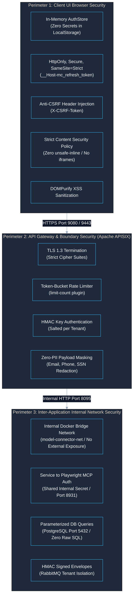

---

## 20. Host System Hardware Profile & Docker Container Resource Allocation Matrix

### 20.1 Host Machine Hardware Profile
- **Operating System**: Windows 11 Pro 64-bit with WSL2 / Docker Desktop
- **Central Processing Unit (CPU)**: 1 Physical Processor / **24 Logical Processors**
- **Total Physical Memory (RAM)**: **32.0 GB (33,690,267,648 bytes)**
- **Dedicated Graphics Processing Unit (GPU)**: **NVIDIA GeForce RTX 5080 Laptop GPU** (Dedicated High-Performance VRAM)

### 20.2 Production Docker Resource Allocation Table
The host machine possesses ample compute and memory capacity. Containers are allocated deterministic resource ceilings in `docker-compose.yml` to prevent starvation while leaving 14+ GB of system RAM for the host operating system and GPU inference workloads:

| Service Container | Base Image / Technology | CPU Limits | Memory Limit | Memory Reservation | GPU Acceleration | Primary Ports |
| :--- | :--- | :--- | :--- | :--- | :--- | :--- |
| **`apache-apisix`** | `apache/apisix:3.9.0-debian` | 1.0 cores | 256 MB | 128 MB | None | 9080, 9443 |
| **`model-connector-service`** | `node:22-bookworm-slim` | 2.0 cores | 1024 MB | 512 MB | None | 8095 (Internal) |
| **`model-connector-ui`** | `nginx:1.27-alpine` | 0.5 cores | 256 MB | 64 MB | None | 3005 |
| **`playwright-mcp-engine`** | `mcr.microsoft.com/playwright:v1.48.0` | 4.0 cores | 3072 MB | 1024 MB | None | 8931 (Internal) |
| **`postgres-db`** | `postgres:16-alpine` | 2.0 cores | 2048 MB | 1024 MB | None | 5432 (Internal) |
| **`mongo-db`** | `mongo:7.0` | 2.0 cores | 2048 MB | 1024 MB | None | 27017 (Internal) |
| **`redis-cache`** | `redis:7.2-alpine` | 1.0 cores | 512 MB | 256 MB | None | 6379 (Internal) |
| **`rabbitmq-queue`** | `rabbitmq:3.13-management-alpine`| 1.0 cores | 1024 MB | 512 MB | None | 5672, 15672 |
| **`comfyui-worker`** *(Optional)* | Python 3.11 + PyTorch CUDA | 6.0 cores | 8192 MB | 4096 MB | **NVIDIA RTX 5080 Passthrough** | 8188 (Internal) |
| **Total Stack Allocation** | *9 Microservices* | *19.5 Cores* | **~18.4 GB RAM** | *~8.5 GB RAM* | *16 GB VRAM* | *Host Free: ~13.6 GB* |

---

## 21. Distributed Idempotency & De-duplication Architecture

### 21.1 Problem Statement
- In asynchronous and human-interactive workflows, accidental double-clicks, network retries, or automated webhook repeats can cause disastrous duplicate side-effects:
  - Triggering two automated follow-up emails to the same recruiter within seconds.
  - Submitting duplicate job applications to the same portal.
  - Dispatching duplicate GPU-intensive ComfyUI video rendering jobs, overloading the RTX 5080 GPU.

### 21.2 Tri-Tier De-duplication Engine
```mermaid
%%{init: {'theme': 'base', 'themeVariables': { 'primaryColor': '#1E293B', 'primaryTextColor': '#F8FAFC', 'primaryBorderColor': '#38BDF8', 'lineColor': '#94A3B8', 'secondaryColor': '#0F172A', 'tertiaryColor': '#1E293B', 'noteBkgColor': '#334155', 'noteTextColor': '#F8FAFC'}}}%%
sequenceDiagram
    autonumber
    actor User as Client UI / Automated Trigger
    participant UI as model-connector-ui
    participant GW as Apache APISIX Gateway
    participant Redis as Redis Distributed Lock Tier
    participant DB as PostgreSQL Transactional DB
    participant Engine as Target Execution Engine

    User->>UI: Click "Dispatch Follow-Up Outreach"
    UI->>UI: Optimistic UI Lock: Disable Button; Generate Idempotency-Key (UUIDv4)
    UI->>GW: POST /api/v1/tenants/job-portal/follow-ups/dispatch<br/>Headers: Idempotency-Key: "uuid-9921", Payload: {...}
    GW->>Redis: SET lock:action:job_portal:outreach:hash {requestId} NX EX 60
    alt Lock Acquired (First Request)
        Redis-->>GW: OK (Lock Held)
        GW->>DB: INSERT INTO FOLLOW_UP_SCHEDULES (..., DEDUPLICATION_HASH, EXECUTION_STATUS='PENDING')
        DB-->>GW: Insert Succeeded
        GW->>Engine: Enqueue Email Dispatch Task
        GW-->>UI: 201 Created { scheduleId: "SCHED-101", status: "SCHEDULED" }
        UI-->>User: Green Success Notification: "Outreach scheduled successfully."
    else Lock Failed / Key Exists (Duplicate Request)
        Redis-->>GW: NULL (Lock Conflict Detected)
        GW-->>UI: 409 Conflict { errorCode: "ERR_DUPLICATE_ACTION", message: "A follow-up email is already queued for this recipient.", existingId: "SCHED-101" }
        UI-->>User: Informative Amber Banner: "A follow-up email to this recruiter is already scheduled for Oct 24. Click here to view."
    end
```

### 21.3 User-Facing Meaningful Message Dictionary
The platform strictly rejects raw technical database errors or uninformative 500 codes, replacing them with clear, actionable human guidance:

| Trigger Scenario | Raw System Error (Prohibited) | User-Facing Actionable Message (Mandatory) | Client UI Action / Recovery Button |
| :--- | :--- | :--- | :--- |
| **Duplicate Follow-up Trigger** | `Duplicate key violation on constraint UK_FOLLOWUP` | *"A follow-up outreach for this candidate is already scheduled for Oct 24. No duplicate action was taken."* | Button: `[View Scheduled Email]` |
| **Duplicate Story Video Render** | `Redis lock contention: lock:comfyui:active` | *"A video rendering job is currently in progress for this story (42% completed). Please wait for completion."* | Button: `[Go to Live Render Progress]` |
| **Duplicate Resume Submission** | `HTTP 409 Conflict: Application exists` | *"You have already submitted an application to this job opening on Oct 19."* | Button: `[View Submission Receipt]` |
| **Model Context Overflow** | `400 Bad Request: prompt token limit 1048576` | *"The document exceeds the single-turn context window. Automatic lossless compaction has been prepared."* | Button: `[Apply Compaction & Retry]` |
| **Session Auth Revocation** | `401 Unauthorized: token expired` | *"Your session credentials have expired or were updated. Your work has been safely preserved."* | Button: `[Re-Authenticate with 1-Click]` |

---

## 22. Resilient Workflow Resumption & Cryptographic Tamper-Detection Architecture

### 22.1 Problem Statement & Architectural Constraints
- **Problem Statement**:
  - Long-running multi-step AI workflows (e.g. Job Application AST parsing $\rightarrow$ scoring $\rightarrow$ career portal autofill; or Apps Builder code synthesis $\rightarrow$ sandbox testing $\rightarrow$ deployment; or Storyteller audio synthesis $\rightarrow$ ComfyUI diffusion rendering) can fail at intermediate steps due to transient network drops, downstream model rate limits (429), out-of-band credential revocation, or browser process crashes.
  - Blindly resuming execution from the failed step introduces a critical vulnerability: intermediate cached payloads, prompt outputs, or parsed AST trees might have been altered, corrupted, or tampered with by an attacker or a stale cache.
  - Conversely, forcing every failed workflow to start from scratch destroys user experience, wastes expensive LLM context tokens, and causes redundant GPU diffusion costs.
- **Constraints**:
  - The workflow engine must deterministically identify the exact step that failed ($S_k$).
  - Before resuming execution, the engine must cryptographically verify that zero intermediate data from prior completed steps ($S_1, \dots, S_{k-1}$) has been altered or tampered with.
  - **The Strict Integrity Invariant**: If ANY prior step payload has been modified, if an alert flag is raised, or if state checksums mismatch, the engine **MUST invalidate all intermediate state and restart the workflow strictly from the beginning (Step 1)**.
  - If and only if all prior step states pass cryptographic verification with zero alerts, the engine resumes seamlessly from the failed step ($S_k$).
  - Integrity verification overhead must not exceed $5\text{ ms}$ at P99.

### 22.2 Architectural Solutions & Trade-offs
| Architectural Option | Fault Tolerance | Security & Tamper Resistance | Compute & Latency Overhead | Decision |
| :--- | :--- | :--- | :--- | :--- |
| **Option A: Unchecked Direct Step Resume** | High | **Critical Security Flaw** (Vulnerable to payload tampering and poisoned cache) | Low | **Rejected** |
| **Option B: Complete Restart on Any Failure** | Low (Heavy UX penalty, token waste) | High | Massive Token & GPU Waste | **Rejected** |
| **Option C: Cryptographic Merkle-Chained HMAC State Verification with Auto-Reset on Tamper** | **Optimal** (Resumes healthy flows seamlessly) | **Enterprise Grade** (Zero-tamper guarantee; instant restart on integrity mismatch) | **$< 2\text{ ms}$** (SHA-256 HMAC state validation) | **SELECTED (BEST)** |

### 22.3 Selected Best Solution: Merkle-Chained HMAC State Integrity Guard
The platform implements a sequential cryptographic state chain for every workflow step:
1. **Initial Root Hash ($H_0$)**:
   $$H_0 = \text{HMAC-SHA256}(K_{\text{tenant}}, \text{workflowId} \parallel \text{tenantId} \parallel \text{canonicalJSON}(\text{initialInputs}))$$
2. **Cumulative Step Chaining ($H_i$)**:
   For each completed step $S_i$ producing output $O_i$:
   $$H_i = \text{HMAC-SHA256}(K_{\text{tenant}}, H_{i-1} \parallel \text{stepId} \parallel \text{canonicalJSON}(O_i) \parallel \text{completedTimestamp})$$
3. **Execution Ledger**: Each step record is persisted with its cumulative state hash (`STEP_STATE_HASH`) and parent link (`PREV_STATE_HASH`).
4. **Verification & Resumption Gate**:
   - On resume request, the engine recalculates the entire hash chain $H'_1, \dots, H'_{k-1}$.
   - If $\forall i, H'_i == H_i$ AND zero active alerts $\implies$ **Resume from Step $S_k$**.
   - If $\exists i, H'_i \neq H_i$ OR any alert active $\implies$ **Purge Cache, Reset to Step 1, Restart from Beginning**.

### 22.4 Decision Diagram: Resume vs. Restart from Beginning
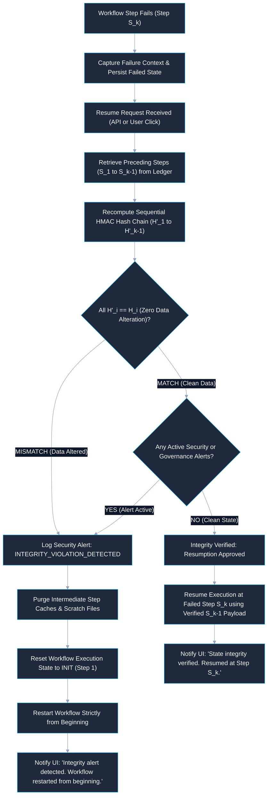

### 22.5 End-to-End Resumption & Tamper User Flow Sequence
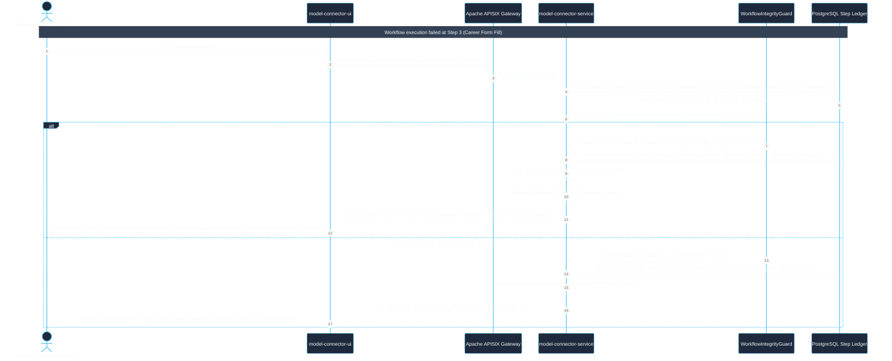

---

## 23. Multi-MCP (Model Context Protocol) Orchestration Architecture

### 23.1 MCP Heterogeneous Transport Matrix (stdio, SSE, WebSocket)

The **Model Connector Platform** provides a universal, multi-tenant Model Context Protocol (MCP) orchestration layer capable of communicating with heterogeneous local and remote MCP servers. Rather than coupling to a single runtime, the platform dynamically negotiates JSON-RPC 2.0 communication across three core transport mechanisms:

| Transport Type | Runtime Environment | Protocol Standard | Authentication & Security Perimeter | Use Case & Target MCP Servers | Latency Profile |
| :--- | :--- | :--- | :--- | :--- | :--- |
| **`stdio` (Standard I/O)** | Local Subprocess Execution | Piped `stdin`/`stdout` JSON-RPC 2.0 | Non-root container UID 10001; strict cgroup CPU/RAM limits; read-only root FS | `playwright-mcp-engine`, Filesystem MCP, Git MCP, SQLite MCP | $\le 1\text{ ms}$ (zero network overhead) |
| **`SSE` (Server-Sent Events)** | Remote Microservice / Cloud | HTTP POST (Requests) + Long-Lived HTTP GET (SSE Stream) | Mutual TLS (mTLS) or `Authorization: Bearer <JWT>` with tenant claims | Remote Playwright workers, Enterprise Database MCP, Kubernetes MCP | $10\text{--}40\text{ ms}$ (network dependent) |
| **`WebSocket`** | Distributed Edge Agents | Full-Duplex RFC 6455 Binary/Text Frames | WSS protocol with TLS 1.3, ticket-based token handshake | High-frequency telemetry streams, live browser interactive screencasting | $\le 5\text{ ms}$ (persistent socket) |

### 23.2 Protocol Handshake, Capability Negotiation & Dynamic Tool Ingestion

When `model-connector-service` establishes a connection to any MCP server:
1. **The `initialize` Handshake**:
   - `Client` sends `initialize` request providing client version, supported protocol version (`2024-11-05`), and client capabilities (`roots`, `sampling`).
   - `MCP Server` responds with its capabilities:
     - `tools`: Set of callable functions with JSONSchema input definitions.
     - `resources`: Read-only data URIs (e.g. `file:///logs`, `db://schema`).
     - `prompts`: Parameterized prompt templates exposed by the server.
2. **Dynamic Tool Schema Ingestion**:
   - The platform’s `McpToolCatalog` normalizes disparate MCP tool schemas into standard JSONSchema tool definitions compatible with major foundation models (Google Gemini function declarations, Anthropic Claude tool schemas, OpenAI function calling).
3. **Execution Routing**:
   - When the foundation model emits a `call_tool(name, arguments)` intent, the platform matches the tool name to the registered MCP server, validates the input arguments against the tool's schema, and dispatches the execution over the negotiated transport.

### 23.3 Multi-Tenant Sandbox & Credential Isolation Mesh

To guarantee absolute multi-tenant safety across MCP executions:
- **Tenant-Scoped Subprocess Pools**: For `stdio` MCP servers, worker processes are spawned on demand within ephemeral Docker containers tagged with the tenant's cryptographic ID (`tenant_id`). Filesystem access is jailed to `/var/tenant-sandbox/{tenant_id}/`.
- **Credential Masking & Injection**: Target server credentials (e.g., GitHub tokens, database passwords, career portal cookies) are decrypted from the platform's AES-256-GCM vault just-in-time and passed via environment variables directly to the isolated MCP process. Credentials are automatically scrubbed from stdout/stderr streams before logging.
- **Circuit Breaking & Timeout Guards**: Each tool call is guarded by a strict timeout (default: $30\text{s}$; web navigation: $60\text{s}$) and a sliding-window circuit breaker preventing runaway child processes.

### 23.4 Multi-MCP End-to-End User Flow & Sequence Diagram

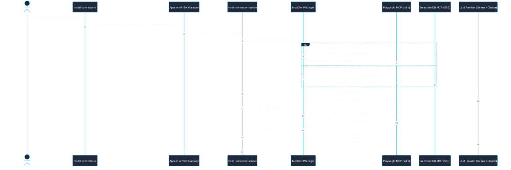

---

## 24. Playwright-MCP to Model-Connector-Platform AI Assistance Loop-back Architecture

### 24.1 Problem Statement & In-Flight Autonomous Remediation Pattern

- **Problem**: During web automation workflows (e.g., career portal applications, complex Workday forms, dynamic single-page applications), `playwright-mcp-engine` regularly encounters ambiguous or unexpected DOM states:
  - Custom shadow-DOM dropdowns with non-standard attributes.
  - Multi-step application questions requiring synthesis (e.g., *"Describe a situation where you managed conflicting deadlines"*).
  - Obfuscated dynamic class names (e.g., `.css-19v0x2y`) that break standard CSS selectors.
  - Unexpected modal popups, cookie consent overlays, or CAPTCHA checkpoints.
- **Architectural Solution**: Rather than failing the workflow or bundling massive machine learning models inside the headless browser worker, `playwright-mcp-engine` features an autonomous **AI Assistance Loop-back Client** (`ModelAssistanceClient`). When an in-flight automation step is blocked, the engine pauses page execution, generates a sanitized structural slice of the DOM (or downscaled WebP screenshot), and makes an authenticated callback to `model-connector-service`.

### 24.2 Loop Prevention, Recursion Depth Guards & Trace Invariant

To prevent infinite loops or cascading token consumption:
1. **Trace Propagation**: Every AI assistance request inherits the original W3C `traceparent` and `correlationId` from the active workflow.
2. **Recursion Depth Counter (`X-AI-Recursion-Depth`)**:
   - The engine increments a strict invocation counter on each loop-back request.
   - The maximum allowable depth is **3 attempts per page interaction**. If the AI assistance cannot resolve a selector or answer a question within 3 iterations, execution terminates deterministically with an `AMBIGUOUS_DOM_UNRESOLVED` exception or transitions to Human-in-the-Loop (HITL) pause mode.
3. **Execution Budget & Confidence Threshold**:
   - The AI assistant must return a structured response containing an `actionType`, `targetSelector`, `inferredValue`, and `confidence` score ($0.0 \le C \le 1.0$).
   - If `confidence < 0.75`, the engine discards the proposal and aborts rather than executing dangerous phantom clicks.

### 24.3 Playwright-to-Model AI Assistance Sequence Diagram

```mermaid
%%{init: {'theme': 'base', 'themeVariables': { 'primaryColor': '#1E293B', 'primaryTextColor': '#F8FAFC', 'primaryBorderColor': '#38BDF8', 'lineColor': '#94A3B8', 'secondaryColor': '#0F172A', 'tertiaryColor': '#1E293B', 'noteBkgColor': '#334155', 'noteTextColor': '#F8FAFC'}}}%%
sequenceDiagram
    autonumber
    participant Browser as Target Web Page (Workday / Lever)
    participant PWMCP as Playwright MCP Engine
    participant AssistClient as ModelAssistanceClient
    participant GW as Apache APISIX Gateway
    participant Svc as model-connector-service
    participant LLM as Frontier Model (Gemini / Claude)

    PWMCP->>Browser: page.click("button[data-automation-id='submit']")
    Browser-->>PWMCP: Error: Element Not Found / Obfuscated DOM Overlay
    Note over PWMCP: In-Flight Automation Blocked: Trigger AI Assistance
    
    PWMCP->>PWMCP: Extract Sanitized Interactive Subtree (Clean DOM AST, <40KB)
    PWMCP->>AssistClient: requestActionRemediation(domSlice, intent="Click Next / Continue")
    AssistClient->>GW: POST /api/v1/ai/assist/dom-action (Header: X-AI-Recursion-Depth: 1)
    GW->>Svc: Forward Authenticated Request (Tenant Scoped)
    
    Svc->>LLM: Fast Reasoning Prompt: Disambiguate DOM & Identify Selector
    LLM-->>Svc: JSON: { actionType: "CLICK", selector: "div.css-1f92j > button.btn-primary", confidence: 0.94 }
    Svc-->>AssistClient: 200 OK with Remediated Action Proposal
    AssistClient-->>PWMCP: Execute Recommended Action: CLICK 'div.css-1f92j > button.btn-primary'
    
    PWMCP->>Browser: page.click("div.css-1f92j > button.btn-primary")
    Browser-->>PWMCP: Navigation Successful (Target Page Transitioned)
    PWMCP->>PWMCP: Reset Recursion Counter & Continue Workflow DAG
```

---

## 25. LinkedIn X-Ray DOM Extraction & Semantic Matching Architecture

### 25.1 X-Ray Search Discovery & Deep DOM AST Extraction Pipeline

The platform incorporates an intelligent **LinkedIn X-Ray & Profile Extraction Engine** designed to source candidate profiles and parse job listings without triggering anti-scraping blocks or suffering from brittle DOM changes:

```mermaid
%%{init: {'theme': 'base', 'themeVariables': { 'primaryColor': '#1E293B', 'primaryTextColor': '#F8FAFC', 'primaryBorderColor': '#38BDF8', 'lineColor': '#94A3B8', 'secondaryColor': '#0F172A', 'tertiaryColor': '#1E293B', 'noteBkgColor': '#334155', 'noteTextColor': '#F8FAFC'}}}%%
flowchart LR
    classDef step fill:#1E293B,stroke:#38BDF8,stroke-width:2px,color:#F8FAFC;
    classDef storage fill:#0F172A,stroke:#34D399,stroke-width:2px,color:#F8FAFC;

    Q["1. Boolean Query Synthesis<br/>(site:linkedin.com/in/ ...)"]:::step --> B["2. Playwright Headless Navigation<br/>(Human-Emulated Session)"]:::step
    B --> X["3. DOM Tree Sanitizer<br/>(Strip Scripts, Ads, SVGs)"]:::step
    X --> P["4. Semantic Profile AST Parser<br/>(Exp, Edu, Skills, Tenure)"]:::step
    P --> M["5. AST Matcher & Scorecard Engine<br/>(Candidate AST vs Job AST)"]:::step
    M --> S[("PostgreSQL & MongoDB<br/>Structured Candidate Vault")]:::storage
```

### 25.2 DOM Tree Noise Elimination, Anti-Bot & Human Emulation Mesh

- **DOM Noise Reduction**: Raw LinkedIn profile pages contain between $3.5\text{ MB}$ and $6\text{ MB}$ of HTML, $85\%$ of which consists of tracking scripts, hydration JSON blobs, analytics beacons, sponsored carousels, and complex SVG icons. The `DomAstSanitizer`:
  - Prunes all `<script>`, `<style>`, `<svg>`, `<noscript>`, `<iframe>`, and `data-ad` containers.
  - Extracts strictly structural semantic tags: `<h1>`, `<h2>`, `<section>`, `<ul>`, `<li>`, and `<time>`.
  - Compresses the DOM representation into a clean, hierarchical JSON AST tree of $\le 65\text{ KB}$, enabling direct ingestion into model context windows without token bloat.
- **Human-Like Emulation Mesh**:
  - **Randomized Spline Cursor Curves**: Mouse movements utilize randomized cubic Bezier curves rather than direct linear coordinates.
  - **Typing Jitter**: Automated keystrokes feature dynamic pauses between $40\text{ ms}$ and $160\text{ ms}$ per character with occasional natural typo corrections.
  - **Viewport & Fingerprint Jittering**: Randomizes WebGL vendor strings, canvas hashes, audio context noise, and user-agent client hints across browser contexts.

### 25.3 Semantic AST Resume-to-Job Matching Workflow

Once the candidate profile AST and the job specification AST are extracted, the engine executes a multi-dimensional semantic match:
1. **Core Competency Overlap**: Evaluates mandatory technical skills and tools with synonym normalization (e.g. `K8s` $\equiv$ `Kubernetes`, `Node.js` $\equiv$ `NodeJS`).
2. **Tenure & Seniority Weighting**: Calculates cumulative years of relevant experience across chronological roles, discounting overlapping or non-relevant internships.
3. **Domain Compatibility**: Compares industry experience (FinTech, HealthTech, AI Infrastructure) against the target hiring profile.
4. **ATS Gap Analysis Output**: Produces a structured scorecard with an overall score ($0\text{--}100$), matched strengths, missing mandatory requirements, and targeted resume customization recommendations.

### 25.4 LinkedIn X-Ray End-to-End User Flow Diagram

```mermaid
%%{init: {'theme': 'base', 'themeVariables': { 'primaryColor': '#1E293B', 'primaryTextColor': '#F8FAFC', 'primaryBorderColor': '#38BDF8', 'lineColor': '#94A3B8', 'secondaryColor': '#0F172A', 'tertiaryColor': '#1E293B', 'noteBkgColor': '#334155', 'noteTextColor': '#F8FAFC'}}}%%
sequenceDiagram
    autonumber
    actor Recruiter as Recruiter / Job Seeker
    participant UI as model-connector-ui
    participant Svc as model-connector-service
    participant XRay as LinkedInXRayEngine
    participant PWMCP as Playwright MCP Service
    participant Target as LinkedIn Public / Session Web
    participant DB as Polyglot Persistence

    Recruiter->>UI: Input Target Role ("Staff AI Engineer, San Francisco")
    UI->>Svc: POST /api/v1/xray/discover { role: "Staff AI Engineer", geo: "SF" }
    Svc->>XRay: synthesizeXRayQuery(role, geo)
    XRay-->>Svc: Query: 'site:linkedin.com/in/ "Staff AI Engineer" "San Francisco" ("PyTorch" OR "TensorFlow")'
    
    Svc->>PWMCP: executeDiscoveryCrawl(query)
    PWMCP->>Target: Perform Headless Search & Extract Profile Links
    Target-->>PWMCP: Return Profile Result URLs
    
    loop For each candidate profile (up to limit)
        PWMCP->>Target: Navigate Profile URL (Human Emulated Jitter)
        Target-->>PWMCP: Raw Profile HTML (4MB)
        PWMCP->>PWMCP: DOM Tree Sanitization (Prune Noise -> 50KB Clean AST)
        PWMCP->>XRay: parseProfileAst(cleanHtml)
        XRay-->>PWMCP: CandidateProfileAST { experience, education, skills }
        PWMCP->>Svc: evaluateCandidateFit(candidateAst, jobSpecAst)
        Svc->>DB: Persist Candidate Record & Compatibility Scorecard
    end
    
    Svc-->>UI: Real-Time SSE Stream of Scored Candidates
    UI-->>Recruiter: Interactive Scorecard Grid with Match Gauges (85%, 92%, 97%)
```

---

## 26. Playwright-MCP Workflow Template & Dynamic Placeholder Engine with Session Vault

### 26.1 Declarative Workflow Template Schema & Dynamic Placeholder Taxonomy

The platform standardizes browser automation through declarative, reusable **Workflow Templates**. Each template represents a directed sequence of browser interactions parameterized by dynamic placeholders:

```yaml
# Example: Workday Application Workflow Template
templateId: "workday-job-application-v1"
targetPlatform: "WORKDAY"
steps:
  - stepOrder: 1
    action: "NAVIGATE"
    targetUrl: "{{job.applicationUrl}}"
  - stepOrder: 2
    action: "FILL"
    selector: "input[data-automation-id='legalNameSection_firstName']"
    value: "{{candidate.profile.firstName}}"
  - stepOrder: 3
    action: "FILL"
    selector: "input[data-automation-id='legalNameSection_lastName']"
    value: "{{candidate.profile.lastName}}"
  - stepOrder: 4
    action: "UPLOAD_FILE"
    selector: "input[type='file'][data-automation-id='file-upload-input']"
    filePath: "{{candidate.artifacts.optimizedResumePdfPath}}"
  - stepOrder: 5
    action: "AI_RESOLVE_AND_FILL"
    selector: "textarea[data-automation-id='customQuestion_diversityOrExperience']"
    prompt: "Synthesize a concise 100-word answer to the question '{{dom.questionLabel}}' using candidate resume achievements."
    fallbackValue: "Please see attached resume for detailed experience."
```

#### Dynamic Placeholder Taxonomy:
1. **Static Profile Placeholders (`{{candidate.*}}`)**:
   - Deterministic bindings extracted directly from the candidate’s verified resume AST: `{{candidate.profile.firstName}}`, `{{candidate.contact.phone}}`, `{{candidate.links.linkedIn}}`.
2. **Environment & Context Placeholders (`{{job.*}}`, `{{env.*}}`)**:
   - Injected runtime variables: `{{job.targetCompany}}`, `{{job.roleTitle}}`, `{{env.APISIX_GATEWAY_URL}}`.
3. **Dynamic DOM-Bound Placeholders (`{{dom.*}}`)**:
   - Values extracted in real-time from the active page context: `{{dom.questionLabel}}`, `{{dom.csrfToken}}`.
4. **Just-in-Time AI Placeholders (`{{ai.*}}` / `AI_RESOLVE_AND_FILL`)**:
   - Complex application questions requiring contextual reasoning and LLM synthesis.

### 26.2 Just-in-Time AI Escalation for Unresolved Placeholders

When the `WorkflowTemplateExecutor` encounters an `AI_RESOLVE_AND_FILL` step or an unresolved custom placeholder:
1. It pauses step execution and captures the on-screen question label, field constraints (max character count, input type), and preceding form context.
2. It invokes the **AI Assistance Loop-back Client** (§24) sending the candidate's complete resume AST and the specific question prompt.
3. The model synthesizes a customized, truthful response tailored to the candidate's actual work history.
4. The resolved string is sanitized (stripping null bytes, script tags, and template injection tokens) and injected into the target form field.

### 26.3 BrowserContext Session Lifecycle & AES-256-GCM StorageState Vault

To enable seamless multi-step workflows without forcing users to solve authentication challenges or log in on every single automation run:
- **Playwright `storageState` Capture**: Upon successful manual or automated login to a career portal (e.g. LinkedIn, Workday, Greenhouse), the engine captures the browser context's complete cryptographic storage state (`cookies`, `origins`, `localStorage` key-value pairs).
- **AES-256-GCM Encryption Vault**:
  - The serialized storage state is encrypted using the tenant’s dedicated cryptographic key with a unique 96-bit initialization vector (`IV`) and a 128-bit authentication tag (`authTag`).
  - Stored in the PostgreSQL table `BROWSER_SESSION_VAULT` with metadata: `DOMAIN`, `EXPIRES_AT`, `TENANT_ID`, `IS_ACTIVE`.
- **Session Rehydration & Keepalive**:
  - When initiating a new workflow run, the engine queries the vault for an active session matching the target domain.
  - The storage state is decrypted in-memory and passed to `browser.newContext({ storageState })`.
  - If a lightweight HEAD request indicates the session has expired ($401$ or redirect to `/login`), the engine marks the session as `EXPIRED`, attempts silent cookie refresh (§13), or notifies the user via UI alert.

### 26.4 End-to-End Workflow Execution & Session Rehydration Sequence

```mermaid
%%{init: {'theme': 'base', 'themeVariables': { 'primaryColor': '#1E293B', 'primaryTextColor': '#F8FAFC', 'primaryBorderColor': '#38BDF8', 'lineColor': '#94A3B8', 'secondaryColor': '#0F172A', 'tertiaryColor': '#1E293B', 'noteBkgColor': '#334155', 'noteTextColor': '#F8FAFC'}}}%%
sequenceDiagram
    autonumber
    actor User as Job Applicant
    participant UI as model-connector-ui
    participant Svc as model-connector-service
    participant Vault as BrowserSessionVault (Postgres / Redis)
    participant PWMCP as Playwright MCP Service
    participant Target as Career Portal (Workday)
    participant AI as Model Connector AI Assist

    User->>UI: Click "Auto-Apply with Tailored Resume"
    UI->>Svc: POST /api/v1/jobs/apply { templateId: "workday-v1", candidateId: "CAN-881" }
    
    Svc->>Vault: getEncryptedSession(tenantId, domain="myworkdayjobs.com")
    Vault-->>Svc: EncryptedStorageState (AES-256-GCM)
    Svc->>PWMCP: executeTemplate(template, candidateData, encryptedSession)
    
    PWMCP->>PWMCP: In-Memory Decrypt storageState & Launch BrowserContext
    PWMCP->>Target: Navigate to Application URL (Rehydrated Session)
    Target-->>PWMCP: 200 OK (User Authenticated; Application Form Displayed)
    
    loop Sequential Step Execution & Placeholder Resolution
        alt Static Placeholder (e.g. {{candidate.profile.firstName}})
            PWMCP->>PWMCP: Resolve static token from candidate profile
            PWMCP->>Target: page.fill(selector, "Alex")
        else AI-Driven Placeholder (e.g. AI_RESOLVE_AND_FILL Custom Question)
            PWMCP->>Target: Extract question label ("Why do you want to work at Acme?")
            PWMCP->>AI: synthesizeAnswer(question, resumeAst, maxWords=100)
            AI-->>PWMCP: "With 7 years building distributed AI gateways..."
            PWMCP->>Target: page.fill(textareaSelector, answer)
        end
    end
    
    PWMCP->>Target: Capture updated session cookies post-application
    PWMCP->>Vault: updateSessionState(tenantId, domain, newStorageState)
    PWMCP-->>Svc: Workflow Completed Successfully (Application Confirmation ID: ACME-99120)
    Svc-->>UI: Real-Time SSE: "Application Successfully Submitted!"
```

---

## 27. Platform-Wide Timezone Governance & Recipient-Centric Dispatch Architecture

### 27.1 Universal UTC Storage Invariant & Boundary Normalization

To eliminate daylight saving bugs, ambiguous leap-second edge cases, and cross-region synchronization drift across distributed microservices:

1. **Storage Invariant**: Every timestamp persisted across PostgreSQL (`TIMESTAMP WITH TIME ZONE`), MongoDB (`ISODate`), Redis (`EXPIREAT` UNIX epoch milliseconds), and RabbitMQ message envelope headers is strictly normalized to **Coordinated Universal Time (UTC / ISO 8601 `Z`)**. Zero localized timestamps are ever stored at rest.
2. **Ingress Boundary Normalization**:
   - The Apache APISIX ingress gateway and Express middleware inspect the incoming `X-Client-Timezone` header (automatically reported by client browsers via `Intl.DateTimeFormat().resolvedOptions().timeZone`, e.g., `America/New_York`, `Asia/Kolkata`, `Europe/London`).
   - If the header is absent, the middleware falls back to the authenticated user's stored profile timezone in the `USERS` table.
   - The verified IANA timezone identifier is attached to the request's distributed execution context without altering the underlying UTC timestamps.
3. **Egress Presentation Localization**:
   - All REST and SSE API responses transmit timestamps in standard UTC ISO 8601 format (`2026-10-21T14:18:00.000Z`).
   - Client UI components (`FormatDate`, `TimelineClock`) format these timestamps in the operator's active localized timezone, appending an explicit timezone badge (e.g. `10:18 AM EDT`).

### 27.2 Recipient-Centric IANA Timezone Resolution Mesh

Conventional systems naively schedule automated messages based on the *sender's* timezone or the *server's* clock, resulting in follow-ups landing in recruiter inboxes at 2:00 AM local time. The Model Connector Platform enforces the **Recipient-Centric Scheduling Invariant**:

> **The Recipient-Centric Invariant**: Any automated interaction impacting an external human recipient (e.g. follow-up emails, interview scheduling, LinkedIn outreach) MUST be scheduled and dispatched relative to the **RECIPIENT'S local business timezone**.

The platform resolves recipient timezones using a 4-tier resolution hierarchy:
1. **Tier 1 (Explicit Profile Metadata)**: Location string extracted from recipient's LinkedIn profile or resume AST (e.g., `"Greater Seattle Area"` $\implies$ `America/Los_Angeles`).
2. **Tier 2 (Corporate Domain Geolocation)**: Inferred from corporate email domain MX records and corporate headquarters database (e.g., `@tokyo-ai.co.jp` $\implies$ `Asia/Tokyo`, `@berlin-fintech.de` $\implies$ `Europe/Berlin`).
3. **Tier 3 (Inbound Interaction Telemetry)**: Extracted from `Date` headers and IP geolocation of inbound recruiter email replies.
4. **Tier 4 (Safe Universal Fallback)**: If recipient location cannot be resolved, default to sender's timezone and restrict dispatch to the universal safe midday window ($10:00\text{ AM -- } 03:00\text{ PM}$).

### 27.3 Business Hours Delivery Windows, Weekend & Holiday Suppression

To maximize open rates and maintain a professional communication profile, outgoing automated communications adhere to strict scheduling windows:

| Target Day & Time Window | Open Rate Effectiveness | Dispatch Policy | Handling of Off-Hour Triggers |
| :--- | :--- | :--- | :--- |
| **Mon–Thu: 09:30 AM – 11:30 AM Local** | **Peak (Highest Open Rate)** | Primary dispatch window | Held in Redis queue until morning window opens |
| **Mon–Thu: 02:00 PM – 04:00 PM Local** | **Secondary (Post-Lunch Review)** | Secondary dispatch window | Dispatched if queued during early afternoon |
| **Friday After 12:00 PM Local** | **Low (Risk of Weekend Burial)** | **Suppressed** | Automatically deferred to **Monday at 09:30 AM local time** |
| **Saturday & Sunday Local** | **Unprofessional (High Unsubscribe Risk)** | **Strictly Prohibited** | Automatically deferred to **Monday at 09:30 AM local time** |
| **Recognized Public Holidays** | **Zero Response (Offices Closed)** | **Suppressed** | Evaluated against national holiday calendar; deferred to next business day |
| **Human-Like Micro-Jitter** | **Eliminates Robotic Spikes** | Injects $\pm 12\text{ to } 35\text{ minutes}$ random offset | Applies dynamic jitter to every scheduled timer |

### 27.4 High-Level Sequence & Timezone Calculation Flow Diagram

```mermaid
%%{init: {'theme': 'base', 'themeVariables': { 'primaryColor': '#1E293B', 'primaryTextColor': '#F8FAFC', 'primaryBorderColor': '#38BDF8', 'lineColor': '#94A3B8', 'secondaryColor': '#0F172A', 'tertiaryColor': '#1E293B', 'noteBkgColor': '#334155', 'noteTextColor': '#F8FAFC'}}}%%
sequenceDiagram
    autonumber
    participant Svc as model-connector-service
    participant TZReg as TimezoneResolutionRegistry
    participant WinCalc as BusinessWindowCalculator
    participant RedisQ as Redis Scheduled Timers
    participant Dispatcher as OmniChannelDispatcher
    participant Recipient as Recruiter Inbox (London - BST)

    Svc->>TZReg: resolveRecipientTimezone(recipientEmail="hiring@london-fintech.co.uk")
    TZReg->>TZReg: Domain "@london-fintech.co.uk" matched to 'Europe/London' (BST, UTC+1)
    TZReg-->>Svc: Resolved IANA Timezone: "Europe/London"
    
    Svc->>WinCalc: calculateNextAvailableWindow(timezone="Europe/London", triggerTime=UTC 19:30 Friday)
    WinCalc->>WinCalc: Detects Friday evening local time (20:30 BST) -> Friday afternoon suppression active
    WinCalc->>WinCalc: Advances target to Monday morning (09:30 BST)
    WinCalc->>WinCalc: Adds randomized human jitter (+22 minutes) -> Final Target: Monday 09:52 BST (UTC 08:52)
    WinCalc-->>Svc: Dispatch Target: 2026-10-26T08:52:00.000Z
    
    Svc->>RedisQ: ZADD scheduled_dispatches 1793004720000 "FUP-9921"
    
    Note over RedisQ,Dispatcher: Time passes until Monday 08:52 UTC (09:52 BST London Time)
    RedisQ->>Dispatcher: Pop scheduled timer "FUP-9921"
    Dispatcher->>Recipient: Dispatch Email via Amazon SES with W3C Trace Headers
    Recipient-->>Dispatcher: Delivered during peak morning business hours
```

---

## 28. Containerized Agent-Per-Workflow Architecture & Apache Ingress Orchestration

<a id="281-architectural-paradigm-decoupled-single-responsibility-workflow-containers"></a>
### 28.1 Architectural Paradigm: Apache Maka (Incubating) Containerized Agents
To maximize developer velocity, eliminate cascading failures, and enforce granular cost accounting, each business workflow executes inside an isolated **Apache Maka (Incubating) Agent Container**:
1. **Append-Only Event Log State Projection**: Apache Maka records every model message, tool invocation, permission decision, and termination event into a durable, local SQLite/append-only log. System state is deterministically derived as `State(t) = Project(Log[0…t])`, guaranteeing zero-loss crash recovery and re-entrancy without custom replay engineering.
2. **Built-in Tool Permission Gating**: Maka's native security engine gates filesystem (`Read`, `Write`, `Edit`) and shell execution (`Bash`, `Glob`, `Grep`) behind configurable Human-in-the-Loop (HITL) policies.
3. **Bring-Your-Own-Model (BYOM) Cost Efficiency**: Seamlessly bridges frontier cloud LLMs (Gemini, Claude) and zero-cost local inference engines (Ollama).

<a id="282-apache-ingress-gateway-routing-apisix-vs-heavy-batch-orchestrators"></a>
### 28.2 Apache Ingress Gateway Routing (Unified Execution Entry Point)
- **Apache APISIX** serves as the ultra-fast ingress perimeter layer (~60–80 MB RAM, $< 1\text{ ms}$ P99 latency):
  - **Unified Execution Ingress**: Client traffic targets a single unified entry point (`POST /api/v1/executions` and `GET /api/v1/executions/:id/events` for real-time SSE streaming).
  - **Zero Workflow / Agent Slugs in Perimeter**: Workflow names or agent names are strictly prohibited in public URLs, headers, and query parameters.
  - **Internal Dynamic Dispatch**: APISIX routes to the internal `model-connector-dispatcher`, which resolves the execution manifest and session, dynamically proxying to internal Maka worker containers via internal mTLS.
  - Heavy orchestrators like **Apache Airflow** are strictly omitted from interactive streaming execution due to their 2.5–4.0 GB memory footprint and 5–15 second task startup overhead.

### 28.3 Container Topology & Resource Boundary Matrix

| Container Service | Embedded Maka Runtime Features | Dedicated Internal Port | CPU Limit | Memory Limit | Health Probe |
| :--- | :--- | :--- | :--- | :--- | :--- |
| **`gateway-apisix`** | Reverse Proxy, Rate Limiting, CORS | `9080 / 9443` | `1.0 CPU` | `256 MB` | HTTP `/apisix/status` |
| **`maka-worker-instance-01`** | Append-Only Log, Browser MCP Tools | `8081` (internal) | `1.5 CPU` | `1536 MB` | HTTP `/health` |
| **`maka-worker-instance-02`** | Permission-Gated Edit, Bash, Grep | `8082` (internal) | `2.0 CPU` | `2048 MB` | HTTP `/health` |
| **`maka-worker-instance-03`** | Eval Harness, Local RTX Host Bridge | `8083` (internal) | `2.0 CPU` | `2048 MB` | HTTP `/health` |
| **`maka-worker-instance-04`** | DOM Sanitizer, Profile AST Extractor | `8084` (internal) | `1.0 CPU` | `1024 MB` | HTTP `/health` |
| **`maka-worker-instance-05`** | Timezone Resolver, HITL Gate | `8085` (internal) | `0.5 CPU` | `512 MB` | HTTP `/health` |
| **`maka-worker-instance-06`** | Telemetry Logger, Lesson Extractor | `8086` (internal) | `0.5 CPU` | `512 MB` | HTTP `/health` |

### 28.4 Multi-Container Inter-Agent Event Bus & State Sharing
- Inter-agent coordination is mediated through **Redis Pub/Sub & Delay Queues** (for asynchronous events and scheduled timers) and **PostgreSQL 16** (for the immutable `WORKFLOW_STEP_LEDGER` cryptographic state chain).
- Zero shared filesystem dependencies: state is serialized as cryptographically signed JSON payloads. Detailed API schemas and UI states are documented in [UC-14](usecase/UC-14-containerized-agent-per-workflow-topology.md#4-ui-interaction--real-time-flow).
