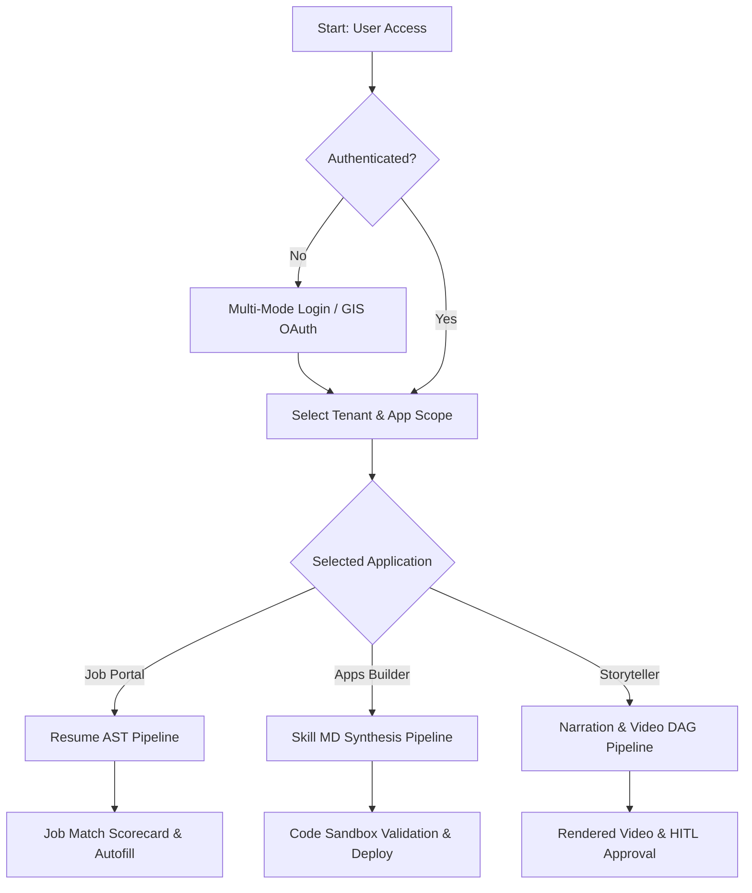
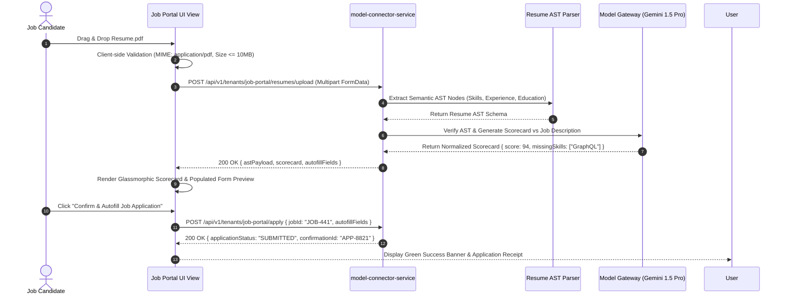
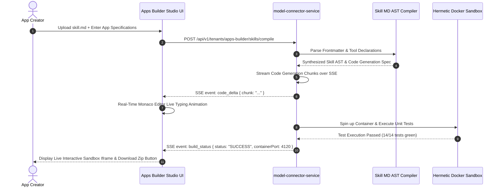
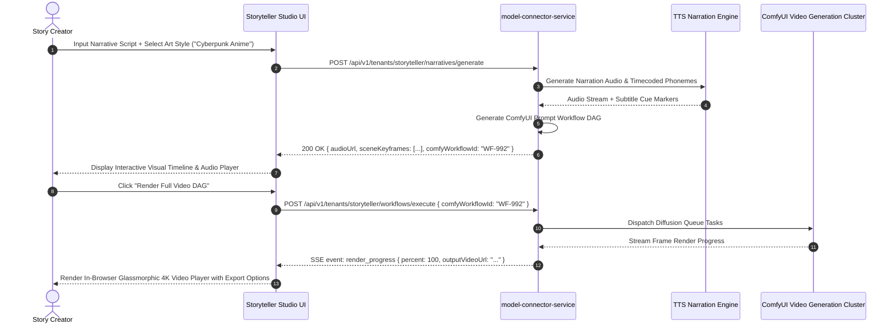
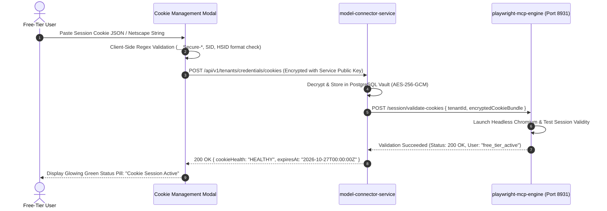
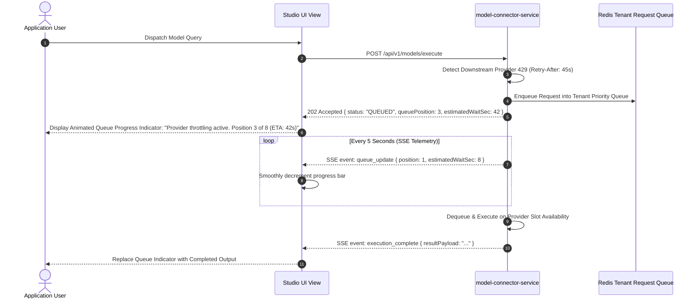
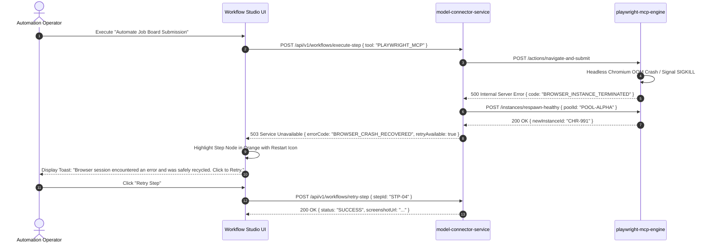

# Model Connector UI — High-Level Design (HLD)

> **Document Type**: Architecture & High-Level System Design for `model-connector-ui`  
> **Master Blueprint**: [blueprint.md](blueprint.md)  
> **Backend Architecture**: [hld.md](hld.md)  
> **Detailed UI Component Specifications**: [ui-lld.md](ui-lld.md)  
> **Screen Flows & Wireframes**: [ui-flows.md](ui-flows.md)  
> **Gap Analysis & Implementation Roadmap**: [gap-analysis-and-implementation-roadmap.md](gap-analysis-and-implementation-roadmap.md)  
> **Use Case Specifications & Architecture**: [Use Case Catalog & Architecture](usecase/README.md)  

---

## 📑 Table of Contents

- [1. Executive Architectural Overview & Topology](#1-executive-architectural-overview--topology)
- [2. Frontend Security Architecture & Best Practices](#2-frontend-security-architecture--best-practices)
  - [2.1 Zero-Trust Client Authentication & Token Storage](#21-zero-trust-client-authentication--token-storage)
  - [2.2 Content Security Policy (CSP) & Defense-in-Depth](#22-content-security-policy-csp--defense-in-depth)
  - [2.3 Cross-Site Scripting (XSS) Sanitization Pipeline](#23-cross-site-scripting-xss-sanitization-pipeline)
  - [2.4 Anti-CSRF Token Synchronization & Framebusting](#24-anti-csrf-token-synchronization--framebusting)
- [3. Enterprise UI Best Practices & Glassmorphism Design System](#3-enterprise-ui-best-practices--glassmorphism-design-system)
  - [3.1 Tokenized Design System & Scoped Layout Isolation](#31-tokenized-design-system--scoped-layout-isolation)
  - [3.2 State Management & Reactive Telemetry Architecture](#32-state-management--reactive-telemetry-architecture)
  - [3.3 Responsive Typography, Layouts & WCAG 2.1 AA Accessibility](#33-responsive-typography-layouts--wcag-21-aa-accessibility)
  - [3.4 Performance Budget, Lazy Loading & Code Splitting](#34-performance-budget-lazy-loading--code-splitting)
- [4. Positive User Flows (Happy Paths)](#4-positive-user-flows-happy-paths)
  - [4.1 Global Login & Multi-Mode Tenant Onboarding](#41-global-login--multi-mode-tenant-onboarding)
  - [4.2 Job Application Onboarding & Resume Scorecard Flow](#42-job-application-onboarding--resume-scorecard-flow)
  - [4.3 Apps Builder Onboarding & Code Synthesis Flow](#43-apps-builder-onboarding--code-synthesis-flow)
  - [4.4 Storyteller Video Generation Onboarding Flow](#44-storyteller-video-generation-onboarding-flow)
  - [4.5 Free-Tier Cookie Ingestion & Playwright Automation Flow](#45-free-tier-cookie-ingestion--playwright-automation-flow)
  - [4.6 Admin Circuit Breaker Routing & Provider Switch Flow](#46-admin-circuit-breaker-routing--provider-switch-flow)
- [5. Negative User Flows (Unhappy & Failure Paths)](#5-negative-user-flows-unhappy--failure-paths)
  - [5.1 Mid-Flight Access Revocation & Session Recovery Flow](#51-mid-flight-access-revocation--session-recovery-flow)
  - [5.2 Model Token Exhaustion & Compaction Fallback Flow](#52-model-token-exhaustion--compaction-fallback-flow)
  - [5.3 Provider 429 Rate Limiting & Queue Backpressure Flow](#53-provider-429-rate-limiting--queue-backpressure-flow)
  - [5.4 Corrupted Resume Payload & AST Parsing Rejection Flow](#54-corrupted-resume-payload--ast-parsing-rejection-flow)
  - [5.5 Playwright MCP Browser Execution Crash & Recovery Flow](#55-playwright-mcp-browser-execution-crash--recovery-flow)
  - [5.6 Unauthorized Mandatory Step Skip Policy Rejection Flow](#56-unauthorized-mandatory-step-skip-policy-rejection-flow)
- [6. Architectural Invariants & Governance Summary](#6-architectural-invariants--governance-summary)
- [7. Master UI HTTP Navigation & Condition-Based Action Matrix](#7-master-ui-http-navigation--condition-based-action-matrix)
  - [7.1 Flow Navigation, Error Handling & Client State Mapping Table](#71-flow-navigation-error-handling--client-state-mapping-table)
- [8. Client-Side De-duplication, Debounce & Idempotency Key Engine](#8-client-side-de-duplication-debounce--idempotency-key-engine)
  - [8.1 Problem Statement](#81-problem-statement)
  - [8.2 Client-Side Safeguards](#82-client-side-safeguards)
- [9. UI-Based Workflow Engine: React Flow (`@xyflow/react`) Integration](#9-ui-based-workflow-engine-react-flow-xyflowreact-integration)
  - [9.1 Why `@xyflow/react` is Preferred Over Langflow & Airflow](#91-why-xyflowreact-is-preferred-over-langflow--airflow)
  - [9.2 Custom Glassmorphic DAG Nodes](#92-custom-glassmorphic-dag-nodes)
- [10. Eye-Friendly Visual Standards & Accessible Color Palette Specification](#10-eye-friendly-visual-standards--accessible-color-palette-specification)
  - [10.1 Ergonomic Visual Design Principles](#101-ergonomic-visual-design-principles)
  - [10.2 Mermaid Diagram Soothing Dark Theme Directive](#102-mermaid-diagram-soothing-dark-theme-directive)

---

## 1. Executive Architectural Overview & Topology

### Problem Statement
- Enterprise AI frontend applications often suffer from architectural entanglement: exposing raw model API keys in browser memory, directly calling third-party LLM endpoints, leaking internal session state across tenant boundaries, and suffering from catastrophic re-renders during high-frequency telemetry streaming.

### Constraints
- The UI must communicate **exclusively** with `model-connector-service` on Port 8095 over HTTPS/WSS/SSE.
- Zero direct browser connections to Google Gemini, Anthropic, OpenAI, or `playwright-mcp-engine`.
- Strict multi-tenant isolation: credentials, workspaces, workflows, and ASTs belonging to Tenant $A$ must never be observable by Tenant $B$.
- Modern bundle size budget: initial entry chunk $< 200\text{ KB}$ gzipped; dynamic visual DAG components lazy-loaded on demand.

### Architectural Solutions & Trade-offs
| Architectural Option | Pros | Cons | Complexity | Decision |
| :--- | :--- | :--- | :--- | :--- |
| **Option A: Monolithic Next.js Fullstack UI** | Unified SSR & backend routing in one node process. | Couplings between SSR server and backend service; heavy runtime memory footprint; complicates desktop/mobile asset separation. | High | **Rejected** |
| **Option B: Pure Static Single Page Application (React 18 + Vite) + Dedicated Gateway Proxy** | Total decoupling; sub-second HMR; hermetic containerization; static asset CDN caching; strict REST/WSS contract with `model-connector-service`. | Requires dedicated CORS and cookie-forwarding configuration on backend gateway. | Low-Medium | **SELECTED (BEST)** |
| **Option C: Micro-frontend Web Components with Module Federation** | Independent deployment per module (Onboarding, Workflow, Analytics). | Massive configuration overhead; CSS isolation leakage; complex cross-application state synchronization for real-time SSE. | Very High | **Rejected** |

### Selected Best Solution
- **Decoupled Single Page Application (SPA)** built with React 18, TypeScript 5, Vite, and modular SCSS.
- Architectural boundary enforced by network topology:
```
+-----------------------------------------------------------------------------------+
|                              Client Web Browser                                   |
|                                                                                   |
|   +---------------------------------------------------------------------------+   |
|   |                       model-connector-ui (Port 3005)                      |   |
|   |  - Responsive Glassmorphism Design System (_desktop.scss / _mobile.scss)  |   |
|   |  - In-Memory Auth & Tenant Context (Zero secrets in localStorage)         |   |
|   |  - Real-Time Event Stream Consumer (SSE & WSS Client)                    |   |
|   |  - Visual Workflow DAG Canvas (Canvas / SVG Engine)                       |   |
|   +---------------------------------------------------------------------------+   |
+------------------------------------------+----------------------------------------+
                                           |
                                           | HTTPS / WSS / SSE (Strict Port 8095)
                                           v
+-----------------------------------------------------------------------------------+
|                   model-connector-service (Gateway API, Port 8095)                |
|  - Rate Limiting, CSP Injection, Anti-CSRF Validation, RBAC Enforcement          |
+--------------------+-------------------------------------+------------------------+
                     |                                     |
                     v                                     v
+-----------------------------------+     +-----------------------------------------+
|    External AI Model Providers    |     |      playwright-mcp-engine (Port 8931)  |
|  (Gemini, Claude, GPT, Mistral)   |     |  (Isolated Headless Browser Automation) |
+-----------------------------------+     +-----------------------------------------+
```

---

## 2. Frontend Security Architecture & Best Practices

### 2.1 Zero-Trust Client Authentication & Token Storage

#### Problem Statement
- Storing access tokens, refresh tokens, or API secrets in browser `localStorage` or `sessionStorage` makes them immediately vulnerable to Cross-Site Scripting (XSS) extraction via malicious dependencies or injected scripts.

#### Constraints
- Tokens must survive page refresh during an active user session without sacrificing security.
- Token refresh must occur seamlessly without dropping active long-running workflow SSE connections.

#### Solutions & Trade-offs
| Storage Option | Security Level | XSS Risk | CSRF Risk | Decision |
| :--- | :--- | :--- | :--- | :--- |
| **Option A: `localStorage` / `sessionStorage`** | Low | Critical (Readable via JavaScript) | Zero | **Rejected** |
| **Option B: Pure In-Memory React State** | Very High | Negligible (Cleared on page close) | Zero | **Incomplete** (Lost on F5 refresh) |
| **Option C: In-Memory Token with HttpOnly, Secure, SameSite=Strict Refresh Cookie** | Enterprise Grade | Zero token leakage via JS; refresh token isolated in native browser cookie jar. | Mitigated via SameSite=Strict + Anti-CSRF Header | **SELECTED (BEST)** |

#### Selected Best Solution
- **In-Memory JWT Access Token**: The short-lived access token (TTL: 15 minutes) is kept strictly in-memory within a closure-scoped Zustand store (`AuthStore`). It is **never** written to `localStorage`, `sessionStorage`, or indexedDB.
- **HttpOnly Refresh Cookie**: The long-lived refresh token (TTL: 7 days) is stored in an `HttpOnly`, `Secure`, `SameSite=Strict` cookie (`__Host-mc_refresh_token`).
- **Silent Refresh Interceptor**: Axios / Fetch request interceptor transparently requests a new short-lived access token via `POST /api/v1/auth/refresh` at 14 minutes or upon receiving a `401 Unauthorized` challenge.

---

### 2.2 Content Security Policy (CSP) & Defense-in-Depth

#### Problem Statement
- Insecure frontend applications can be manipulated into executing injected scripts or loading unverified external assets (fonts, scripts, iframes) from attacker-controlled domains.

#### Constraints
- Must allow Google Identity Services (GIS) for OAuth 2.0 PKCE authentication while forbidding arbitrary external script execution.
- Inline script execution (`unsafe-inline`) and `eval()` must be categorically banned.

#### Selected Best Solution
- The server injects strict Content Security Policy HTTP response headers on every HTML delivery:
```http
Content-Security-Policy: 
    default-src 'self';
    script-src 'self' https://accounts.google.com/gsi/client;
    style-src 'self' 'unsafe-inline' https://fonts.googleapis.com;
    font-src 'self' https://fonts.gstatic.com data:;
    img-src 'self' data: blob: https://*.googleusercontent.com;
    connect-src 'self' https://accounts.google.com/gsi/ wss://localhost:8095 https://localhost:8095;
    frame-src https://accounts.google.com/gsi/;
    object-src 'none';
    base-uri 'self';
    form-action 'self';
    frame-ancestors 'none';
    upgrade-insecure-requests;
```
- **Subresource Integrity (SRI)**: All bundled chunks and vendor scripts enforce cryptographic SHA-384 integrity hashes.

---

### 2.3 Cross-Site Scripting (XSS) Sanitization Pipeline

#### Problem Statement
- AI model outputs, resume AST preview trees, and user-provided markdown content can contain malicious `<script>` tags, event handlers (`onload=`), or crafted SVG vectors that execute in the client's context.

#### Constraints
- Rich text, code blocks, and markdown formatting must be rendered cleanly without disabling HTML safety.

#### Solutions & Trade-offs
| Sanitization Option | Performance | Security | Flexibility | Decision |
| :--- | :--- | :--- | :--- | :--- |
| **Option A: React Default JSX Escaping** | Highest | High for strings | Fails on rich markdown rendering (`dangerouslySetInnerHTML`) | **Incomplete** |
| **Option B: Regex-Based Tag Stripper** | High | Low (Easily bypassed by nesting & obfuscation) | Poor | **Rejected** |
| **Option C: DOMPurify + Strict Whitelist Schema + Safe Markdown AST Processor** | High | Enterprise Grade (Zero script execution; removes all event attributes) | High | **SELECTED (BEST)** |

#### Selected Best Solution
- All dynamic model responses, resume AST diffs, and storyteller markdown scripts pass through a centralized sanitization utility:
```typescript
// @/utils/sanitizer.ts
import DOMPurify from 'dompurify';

export const sanitizeModelContent = (dirtyContent: string): string => {
  return DOMPurify.sanitize(dirtyContent, {
    ALLOWED_TAGS: ['b', 'i', 'em', 'strong', 'a', 'p', 'h1', 'h2', 'h3', 'code', 'pre', 'ul', 'ol', 'li', 'table', 'thead', 'tbody', 'tr', 'th', 'td', 'blockquote'],
    ALLOWED_ATTR: ['href', 'target', 'rel', 'class'],
    ALLOW_DATA_ATTR: false,
    SAFE_FOR_TEMPLATES: true,
  });
};
```

---

### 2.4 Anti-CSRF Token Synchronization & Framebusting

#### Problem Statement
- Cross-Site Request Forgery (CSRF) can trick an authenticated user's browser into triggering state-altering API requests (such as deleting an API key, triggering model workflows, or skipping verification steps).

#### Selected Best Solution
- **Double-Submit Anti-CSRF Token Pattern**:
  1. On initial handshake, `model-connector-service` generates a cryptographically random, tenant-bound token (`mc_csrf_token`) and returns it via an accessible cookie and response header.
  2. Every state-altering HTTP request (`POST`, `PUT`, `DELETE`, `PATCH`) dispatched by the UI must include the `X-CSRF-Token` header containing this exact value.
  3. The service verifies header-to-cookie match before routing to any controller.
- **Framebusting Protection**:
  - `X-Frame-Options: DENY` header prevents clickjacking attacks inside malicious `<iframe>` wrappers.
  - Client-side framebusting defense snippet initialized before React root mounts.

---

## 3. Enterprise UI Best Practices & Glassmorphism Design System

### 3.1 Tokenized Design System & Scoped Layout Isolation

#### Problem Statement
- Unstandardized CSS leads to styling collisions, inconsistent spacing, bloated CSS bundles, and visual degradation between desktop and mobile viewport resolutions.

#### Selected Best Solution
- **Centralized SCSS Design System**: All styling is driven strictly by standardized SCSS tokens:
  - `_variables.scss`: Color palettes (Deep Obsidian `#0B0F19`, Electric Cyan `#00F2FE`, Neon Indigo `#4FACFE`, Amber Warning `#F6AD55`, Crimson Error `#FC8181`), typography scale, glassmorphism filters, border radii, transitions.
  - `_mixins.scss`: Reusable glassmorphic cards (`@include glass-panel`), flex centerings, micro-animation keyframes, media queries.
  - `_desktop.scss`: Multi-column grid systems, multi-pane workflow canvas, persistent telemetry sidebars.
  - `_mobile.scss`: Single-column stacking, collapsible bottom sheets, touch-optimized minimum $48\times 48\text{ px}$ target boundaries.

---

### 3.2 State Management & Reactive Telemetry Architecture

#### Problem Statement
- Streaming model tokens and server-sent telemetry events (SSE) at 60 events/second cause catastrophic full-tree re-renders when tied to root-level React states.

#### Solutions & Trade-offs
| State Architecture | Developer Experience | Render Performance | Memory Overhead | Decision |
| :--- | :--- | :--- | :--- | :--- |
| **Option A: Pure React Context API** | Simple | Poor (Any update invalidates all consumers) | Low | **Rejected** |
| **Option B: Redux Toolkit (RTK)** | Moderate | High (Selective subscriptions) | Heavy boilerplate | **Rejected** |
| **Option C: Zustand (Client State) + React Query (Server Cache) + Selective Hooks** | Excellent | Optimal (Granular component re-renders; memoized selectors; in-memory SSE ring buffer) | Minimal | **SELECTED (BEST)** |

#### Selected Best Solution
- **Zustand Isolated Stores**:
  - `AuthStore`: User identity, tenant ID, active scopes, cryptographic salt binding.
  - `WorkflowBuilderStore`: Node/Edge DAG state, selected step metadata, skip governance policy.
  - `TelemetryRingBufferStore`: In-memory circular buffer (max 500 entries) for streaming SSE metrics, preventing memory leaks during hours of continuous operation.
- **TanStack React Query**: Manages asynchronous server cache, automatic background refetching, and optimistic mutations for tenant configurations.

---

### 3.3 Responsive Typography, Layouts & WCAG 2.1 AA Accessibility

- **Fluid Typography**: Calculated via CSS `clamp()` (`clamp(1rem, 0.9rem + 0.5vw, 1.35rem)`), ensuring smooth readability from $320\text{ px}$ mobile screens to $4\text{K}$ monitors.
- **Accessibility Invariants (WCAG 2.1 AA)**:
  - Minimum contrast ratio of $4.5:1$ for normal text against glassmorphism dark backgrounds.
  - Complete keyboard operability (`Tab`, `Shift+Tab`, `Enter`, `Escape`) with visible, high-contrast cyan focus indicators (`outline: 2px solid #00F2FE`).
  - Screen reader semantic announcements using ARIA live regions (`aria-live="polite"` for telemetry counters, `aria-live="assertive"` for circuit breaker amber alerts).

---

### 3.4 Performance Budget, Lazy Loading & Code Splitting

- **Performance Budget Criteria**:
  - First Contentful Paint (FCP): $< 0.8\text{ seconds}$.
  - Largest Contentful Paint (LCP): $< 1.6\text{ seconds}$.
  - Cumulative Layout Shift (CLS): $< 0.05$.
- **Route-Based Lazy Loading**: Heavy modules (`WorkflowBuilderCanvas`, `AdminGovernanceConsole`, `NetworkMetricsDashboard`) are split into independent asynchronous chunks via `React.lazy()` and `Suspense` with glassmorphic skeleton loaders.

---

## 4. Positive User Flows (Happy Paths)



### 4.1 Global Login & Multi-Mode Tenant Onboarding

#### Problem Statement
- Developers, enterprise employees, and automated systems require distinct onboarding workflows (OAuth, corporate SSO, or direct API keys) without fracturing the frontend architecture.

#### Constraints
- Must enforce Google Identity Services PKCE validation.
- Must cryptographically bind the user session to a unique tenant salt.

#### Sequence Flow Diagram
```mermaid
sequenceDiagram
    autonumber
    actor User as Developer / Operator
    participant UI as model-connector-ui (Port 3005)
    participant GIS as Google Identity Services
    participant Svc as model-connector-service (Port 8095)
    participant DB as PostgreSQL Multi-Tenant DB

    User->>UI: Navigate to /onboard
    UI-->>User: Display Glassmorphic Onboarding Stepper (Step 1: Auth Mode)
    User->>UI: Select "Continue with Google"
    UI->>GIS: Trigger OAuth 2.0 PKCE Popup
    GIS-->>User: Present Google Consent Screen
    User->>GIS: Authorize Identity & Scopes
    GIS-->>UI: Return ID Token (JWT)
    UI->>Svc: POST /api/v1/auth/register { idToken, provider: "GOOGLE" }
    Svc->>Svc: Validate JWT Signature & Extract Claims
    Svc->>DB: Upsert User Record & Allocate Tenant Salt
    DB-->>Svc: Persisted { userId: "USR-1001", tenantId: "TNT-501", salt: "..." }
    Svc-->>UI: 201 Created { jwtToken: "...", tenantId: "TNT-501" } + Set-Cookie: __Host-mc_refresh_token
    UI->>UI: Store jwtToken in AuthStore memory; Advance Stepper to Step 2
    UI-->>User: Display Step 2: Tenant & Application Scope Selector
```

---

### 4.2 Job Application Onboarding & Resume Scorecard Flow

#### Problem Statement
- Job applicants need to upload resumes in multiple formats (PDF, DOCX) and receive real-time, deterministic AST parsing, scoring, and automated job portal form auto-filling without browser freezing.

#### Sequence Flow Diagram


---

### 4.3 Apps Builder Onboarding & Code Synthesis Flow

#### Problem Statement
- Application developers require an interactive studio where Skill markdown files are uploaded, parsed into semantic tool capabilities, synthesized into production-ready fullstack code, and verified within hermetic sandbox containers.

#### Sequence Flow Diagram


---

### 4.4 Storyteller Video Generation Onboarding Flow

#### Problem Statement
- Story creators need to input a narrative script, preview generated voice synthesis, review dynamic image generation prompts, and orchestrate complex ComfyUI video diffusion DAG workflows with human-in-the-loop (HITL) checkpoints.

#### Sequence Flow Diagram


---

### 4.5 Free-Tier Cookie Ingestion & Playwright Automation Flow

#### Problem Statement
- Users operating on free model tiers must securely supply browser session cookies so `playwright-mcp-engine` can automate web-based model sessions without exposing unencrypted cookies over the network.

#### Sequence Flow Diagram


---

### 4.6 Admin Circuit Breaker Routing & Provider Switch Flow

#### Problem Statement
- System administrators need an emergency governance UI to manually trip circuit breakers, adjust error rate thresholds, and redirect model traffic from a failing provider to a healthy fallback provider in $< 50\text{ ms}$.

#### Sequence Flow Diagram
```mermaid
sequenceDiagram
    autonumber
    actor Admin as System Administrator
    participant UI as Admin Operations Console
    participant Svc as model-connector-service
    participant Registry as Dynamic Model Provider Registry

    Admin->>UI: Observe Spike in Gemini 503 Errors on Telemetry Chart
    Admin->>UI: Click "Force Trip Circuit Breaker: Provider-Gemini"
    UI->>Svc: POST /api/v1/admin/circuit-breaker/trip { provider: "GEMINI_1_5_PRO", reason: "MANUAL_OVERRIDE" }
    Svc->>Registry: Update Circuit State to OPEN; Route Traffic to Claude-3-5-Sonnet
    Registry-->>Svc: Routing Table Updated
    Svc-->>UI: 200 OK { status: "OPEN", activeFallback: "CLAUDE_3_5_SONNET" }
    UI->>UI: Animate Breaker Switch to Glowing Red; Update Active Routes Pill
    UI-->>Admin: Display Toast Notification: "All traffic successfully rerouted to Claude 3.5 Sonnet"
```

---

## 5. Negative User Flows (Unhappy & Failure Paths)

### 5.1 Mid-Flight Access Revocation & Session Recovery Flow

#### Problem Statement
- When an administrator revokes a user's OAuth authorization or API key while a multi-step workflow is actively running, unhandled 401/403 responses can cause unrecoverable UI crashes and total loss of uncommitted work.

#### Constraints
- Workflow progress up to the last successful step must be safely preserved in local session memory.
- Must present a non-intrusive re-authentication modal that resumes the workflow immediately upon token renewal.

#### Failure & Recovery Sequence Flow Diagram
```mermaid
sequenceDiagram
    autonumber
    actor User as Active User
    participant UI as model-connector-ui
    participant Svc as model-connector-service
    participant IdP as Identity Provider

    Note over User,Svc: Workflow Step 3 in progress...
    Svc-->>UI: 401 Unauthorized { error: "TOKEN_REVOKED", code: "AUTH_EXPIRED" }
    UI->>UI: Catch 401; Pause Active Workflow Timer; Save State Snapshot in AuthStore
    UI-->>User: Display Floating Amber Re-Authentication Modal
    User->>UI: Click "Re-Authenticate with Provider"
    UI->>IdP: Trigger PKCE Re-Auth Dialog
    User->>IdP: Grant Consent
    IdP-->>UI: Return Fresh ID Token
    UI->>Svc: POST /api/v1/auth/refresh { idToken }
    Svc-->>UI: 200 OK { newJwtToken: "..." }
    UI->>UI: Update AuthStore; Dismiss Modal; Resume Workflow at Step 3
    UI->>Svc: POST /api/v1/workflows/resume { workflowId: "WF-109", step: 3 }
    Svc-->>UI: 200 OK { status: "RESUMED", stepOutput: "..." }
    UI-->>User: Green Alert: "Session renewed. Workflow execution resumed seamlessly."
```

---

### 5.2 Model Token Exhaustion & Compaction Fallback Flow

#### Problem Statement
- During extended conversation turns or massive code synthesis jobs, input prompts can exceed the provider's physical context window or tenant token budget, returning HTTP 429/400 context errors.

#### Sequence Flow Diagram
```mermaid
sequenceDiagram
    autonumber
    actor User as Studio User
    participant UI as User Workspace View
    participant Svc as model-connector-service
    participant Compactor as Semantic Token Compactor

    User->>UI: Submit Massive Document + Multi-Turn Prompt (1.2M tokens)
    UI->>Svc: POST /api/v1/models/execute
    Svc-->>UI: 422 Unprocessable Entity { error: "TOKEN_WINDOW_EXCEEDED", currentTokens: 1200000, limit: 1048576 }
    UI->>UI: Intercept Error; Display "Smart Context Compaction" Modal
    UI-->>User: Present Compaction Options (Lossless AST Pruning / Sliding Window / Deep Summary)
    User->>UI: Select "Lossless AST Pruning" & Click "Auto-Compact & Retry"
    UI->>Svc: POST /api/v1/models/compact-and-execute { strategy: "AST_PRUNING", targetTokens: 800000 }
    Svc->>Compactor: Strip Stale Code Comments & Redundant Schema Definitions
    Compactor-->>Svc: Compacted Payload (742,000 tokens)
    Svc->>Svc: Dispatch to Model Gateway
    Svc-->>UI: SSE event: token_stream { chunk: "..." }
    UI-->>User: Dismiss Modal & Stream Model Response with Cyan Compaction Badge (-38% tokens)
```

---

### 5.3 Provider 429 Rate Limiting & Queue Backpressure Flow

#### Problem Statement
- When downstream AI model providers experience global rate spikes or regional throttling, raw 429 errors must not fail the client request; the UI must display deterministic queue backpressure with estimated wait times.

#### Sequence Flow Diagram


---

### 5.4 Corrupted Resume Payload & AST Parsing Rejection Flow

#### Problem Statement
- Attackers or malformed PDF documents (such as PDF bombs, corrupted binary streams, or non-parseable encodings) uploaded to the Job Portal must be rejected early at the boundary before exhausting server memory.

#### Sequence Flow Diagram
```mermaid
sequenceDiagram
    autonumber
    actor Attacker as Malicious / Unlucky User
    participant UI as Job Portal Upload Component
    participant Svc as model-connector-service
    participant AST as Resume Parser Worker

    Attacker->>UI: Upload "Exploit_Buffer_Bomb.pdf"
    UI->>UI: Client-Side Pre-Flight Check (File Size: 9.8MB, Valid PDF Header)
    UI->>Svc: POST /api/v1/tenants/job-portal/resumes/upload
    Svc->>AST: Spawn Sandboxed AST Parse Task
    AST->>AST: Detect Recursive Deflate Object Bomb / Corrupt Header
    AST-->>Svc: Throw MalformedPayloadException("MALFORMED_PDF_DEFLATE_BOMB")
    Svc-->>UI: 400 Bad Request { errorCode: "ERR_RESUME_MALFORMED", message: "Uploaded file structure is corrupted or unreadable." }
    UI->>UI: Shake Upload Zone with Crimson Border; Display Specific Error Card
    UI-->>Attacker: "Parsing Failed: The document structure contains invalid or malformed data. Please re-export your resume as a clean PDF or DOCX."
```

---

### 5.5 Playwright MCP Browser Execution Crash & Recovery Flow

#### Problem Statement
- When `playwright-mcp-engine` crashes due to a Chromium out-of-memory error, network hang, or target site anti-bot captcha challenge, the UI must isolate the fault and provide manual intervention or automated headless restart.

#### Sequence Flow Diagram


---

### 5.6 Unauthorized Mandatory Step Skip Policy Rejection Flow

#### Problem Statement
- A user attempting to bypass a mandatory compliance, security audit, or resume AST scoring step in the visual workflow builder must be firmly prevented by the UI and rejected by backend policy enforcement.

#### Sequence Flow Diagram
```mermaid
sequenceDiagram
    autonumber
    actor User as Workflow Designer
    participant UI as Visual DAG Canvas
    participant Svc as model-connector-service

    User->>UI: Right-Click "Resume AST Verification Step" -> Select "Skip Step"
    UI->>UI: Evaluate Local Node Metadata: isMandatory == true
    UI->>UI: Trigger Modal Dialog: "Confirm Skip for Step: RESUME_AST_VERIFICATION"
    User->>UI: Check "Skip for All Records" & Click "Confirm Skip"
    UI->>Svc: POST /api/v1/workflows/nodes/update-policy { nodeId: "NODE-03", action: "SKIP_ALL" }
    Svc->>Svc: Evaluate Compliance Governance Rule (Policy #104: AST verification cannot be skipped in Job Portal scope)
    Svc-->>UI: 403 Forbidden { errorCode: "GOVERNANCE_POLICY_VIOLATION", reason: "Mandatory compliance step cannot be skipped." }
    UI->>UI: Animate Node with Crimson Shake; Reset Toggle
    UI-->>User: Display Error Banner: "Governance Error: Regulatory compliance requires AST verification for all candidate records. Skip action prohibited."
```

---

## 6. Architectural Invariants & Governance Summary

1. **Strict Port Separation**: All browser interactions route through `model-connector-service` (Port 8095). Port 8931 (`playwright-mcp-engine`) and external AI provider APIs are inaccessible to client browsers.
2. **Zero Plain CSS**: 100% of styles are compiled through modular SCSS adhering to the Deep Obsidian / Electric Cyan glassmorphism tokens.
3. **WCAG 2.1 AA Compliance**: All screens enforce visible focus indicators, screen-reader ARIA live announcements, and contrast ratios $> 4.5:1$.
4. **Resilient Error Boundaries**: Every major visual screen component is wrapped in an isolated React `ErrorBoundary` with step-preservation mechanics.
5. **No Secrets in Storage**: Access tokens are stored exclusively in-memory; refresh tokens are secured in native `HttpOnly` browser cookies.

---

## 7. Master UI HTTP Navigation & Condition-Based Action Matrix

### 7.1 Flow Navigation, Error Handling & Client State Mapping Table
The following navigation table defines the explicit mapping between backend HTTP responses, conditional branches, client-side visual state representations, and actionable user recovery options:

| User Flow | Client Request | HTTP Code | UI Visual State & Feedback | User Message (Meaningful & Actionable) | Recovery Action / Button |
| :--- | :--- | :--- | :--- | :--- | :--- |
| **Authentication Flow** | `POST /api/v1/auth/register` | `201 Created` | Stepper advances to Step 2; green check animation. | *"Authentication successful. Welcome to Model Connector Studio."* | Auto-advance to Scope Selection. |
| **Authentication Flow** | `POST /api/v1/auth/register` | `401 Unauthorized` | Shake login card; red glow border on Google CTA. | *"Google sign-in token expired. Please click below to re-authorize."* | Button: `[Sign in with Google]` |
| **Token Refresh** | `POST /api/v1/auth/refresh` | `403 Forbidden` | Floating amber re-authentication modal; pauses active timer. | *"Your enterprise session was revoked out-of-band. Work is saved."* | Button: `[Re-Authenticate with 1-Click]` |
| **Resume Upload** | `POST /api/v1/resumes/upload` | `400 Bad Request` | Shake dropzone; red alert chip displays MIME error. | *"The document could not be read. Please upload a standard PDF or DOCX."* | Button: `[Select Another File]` |
| **Resume Mutation** | `POST /api/v1/resumes/mutate` | `409 Conflict` | Skill chip flashes orange; reverts mutation toggle. | *"Cannot mutate this skill: no underlying project evidence in your resume."* | Link: `[View AST Skill Breakdown]` |
| **Career Application** | `POST /api/v1/job-portal/apply`| `409 Conflict` | Amber badge displays existing application details. | *"You have already applied to this position on Oct 19."* | Button: `[View Application Receipt]` |
| **Recruiter Outreach**| `POST /api/v1/outreach/send` | `409 Conflict` | Schedule card glows amber with existing queue date. | *"A follow-up email is already scheduled for Oct 24. No duplicate sent."* | Button: `[Edit Scheduled Message]` |
| **Skill MD Compilation**| `POST /api/v1/skills/compile` | `422 Unprocessable`| Monaco editor jumps to erroneous frontmatter line. | *"Frontmatter error: Missing required property 'name' in skill header."* | Editor inline lint annotation. |
| **Sandbox Execution** | `POST /api/v1/sandbox/run` | `500 Server Error` | Terminal view opens automatically; failing test highlighted. | *"Docker sandbox tests failed (2/14 failing). Review logs below."* | Button: `[Re-run Sandbox Tests]` |
| **Story Narration** | `POST /api/v1/story/narrate` | `429 Too Many Req` | Audio timeline displays queue position pill: "Position 3". | *"TTS generation is busy. Your request is queued (ETA: 35s)."* | Live SSE queue progress bar. |
| **ComfyUI Video DAG** | `POST /api/v1/story/render` | `503 Unavailable` | GPU status pill turns amber: "GPU Cluster Queue Active". | *"GPU worker is currently busy. Video rendering will resume shortly."* | Button: `[Notify Me When Finished]` |
| **Token Overflow** | `POST /api/v1/models/execute` | `422 Token Overflow`| Smart Compaction modal slides in with token savings meter. | *"Prompt exceeds 1M token limit. Lossless AST compaction is ready."* | Button: `[Auto-Compact (-38%) & Run]` |
| **Mandatory Step Skip**| `PATCH /api/v1/workflows/node`| `403 Forbidden` | Node shakes with red glow; reset toggle switch. | *"Governance Policy: AST verification cannot be skipped in this portal."* | Link: `[Review Compliance Policy]` |

---

## 8. Client-Side De-duplication, Debounce & Idempotency Key Engine

### 8.1 Problem Statement
- In multi-agent AI environments, accidental double-clicks or rapid button taps can dispatch duplicate high-cost requests (such as generating two identical ComfyUI video diffusion jobs or triggering multiple follow-up emails to the same hiring recruiter).

### 8.2 Client-Side Safeguards
1. **Optimistic Button Locking**:
   - Primary action buttons (`GlassButton`) immediately enter an `isSubmitting: true` state on click, disabling pointer events and rendering a subtle spinner.
2. **Global Input Debouncing**:
   - All state-altering user inputs enforce a $300\text{ ms}$ trailing debounce window via `@/utils/hooks/useDebounce.ts`.
3. **Idempotency Key Injection**:
   - The central Axios API client (`@/api/apiClient.ts`) generates a cryptographically random UUIDv4 (`Idempotency-Key: uuid-v4`) on every state-altering mutation (`POST`, `PUT`, `DELETE`).
   - If a network disconnect occurs and the request is retried, the identical `Idempotency-Key` is resent, allowing the backend gateway (Apache APISIX / Redis) to detect and return the cached in-flight response.

---

## 9. UI-Based Workflow Engine: React Flow (`@xyflow/react`) Integration

### 9.1 Why `@xyflow/react` is Preferred Over Langflow & Airflow
| Evaluation Dimension | Langflow | Apache Airflow | **React Flow (`@xyflow/react`)** |
| :--- | :--- | :--- | :--- |
| **Architectural Fit** | Standalone Python Web App | Enterprise Batch Scheduler | **Embedded Client-Side React Canvas** |
| **Memory Footprint** | ~1.5 - 2.5 GB RAM (Python container) | ~2.5 - 4.0 GB RAM (Postgres+Celery) | **Zero Backend RAM (~120 KB bundle in browser)** |
| **Rendering Latency** | 200 - 800 ms (Server polling) | 5 - 15 seconds per task launch | **$< 1\text{ ms}$ (Native SVG/Canvas at 60 fps)** |
| **Custom Glassmorphism**| Fixed, rigid UI theme | Heavy corporate Bootstrap theme | **100% tokenized via modular SCSS mixins** |
| **Host System Suitability**| Redundant server overhead | Severe host resource drain | **Optimal (Preserves 27+ GB RAM for AI models)** |
| **Final Recommendation**| Rejected (Coupled to LangChain) | Rejected (Unsuited for interactive UI) | **SELECTED (BEST FOR ENTERPRISE UI)** |

### 9.2 Custom Glassmorphic DAG Nodes
In `model-connector-ui`, the visual workflow editor renders custom glassmorphic React components:
- `AstVerificationNode.tsx`: Renders real-time ATS match percentage and missing skill indicators.
- `PlaywrightActionNode.tsx`: Displays live browser screenshot thumbnail and active DOM selector.
- `ComfyUiDiffusionNode.tsx`: Visualizes K-Sampler diffusion steps and GPU VRAM meter.
- `HitlCheckpointNode.tsx`: Human-in-the-Loop approval gate with interactive review buttons.

---

## 10. Eye-Friendly Visual Standards & Accessible Color Palette Specification

### 10.1 Ergonomic Visual Design Principles
To prevent eye strain and visual fatigue during long operator sessions, the UI and all architectural documentation diagrams adhere strictly to an **Eye-Friendly Dark Slate Ergonomic Palette**:

```
+-----------------------------------------------------------------------------------+
|                         SOOTHING ERGONOMIC PALETTE                                |
|                                                                                   |
|  [ #0F172A ] Deep Navy (Primary Background — Zero Glare / Reduces Eye Strain)     |
|  [ #1E293B ] Slate Blue (Glassmorphism Card Surface — Soft Visual Layering)       |
|  [ #38BDF8 ] Sky Blue (Primary Accents & Focused Borders — Non-Blinding Cyan)     |
|  [ #94A3B8 ] Muted Slate Gray (Secondary Text & Subtle Connectors)               |
|  [ #F8FAFC ] Crisp Off-White (Primary Typography — 12.5:1 High Contrast)         |
|  [ #F59E0B ] Amber Glow (Warnings & Non-Intrusive HITL Checkpoints)              |
|  [ #10B981 ] Soft Emerald (Success Confirmations & Passing Health Checks)        |
+-----------------------------------------------------------------------------------+
```

### 10.2 Mermaid Diagram Soothing Dark Theme Directive
All architectural sequence and flow diagrams standardize on the following soothing, low-glare Mermaid configuration:
```mermaid
%%{init: {'theme': 'base', 'themeVariables': { 'primaryColor': '#1E293B', 'primaryTextColor': '#F8FAFC', 'primaryBorderColor': '#38BDF8', 'lineColor': '#94A3B8', 'secondaryColor': '#0F172A', 'tertiaryColor': '#1E293B', 'noteBkgColor': '#334155', 'noteTextColor': '#F8FAFC'}}}%%
```
This guarantees that node boxes, connector lines, and participant lifelines render with soft slate backgrounds and sky-blue borders, completely eliminating eye fatigue.

