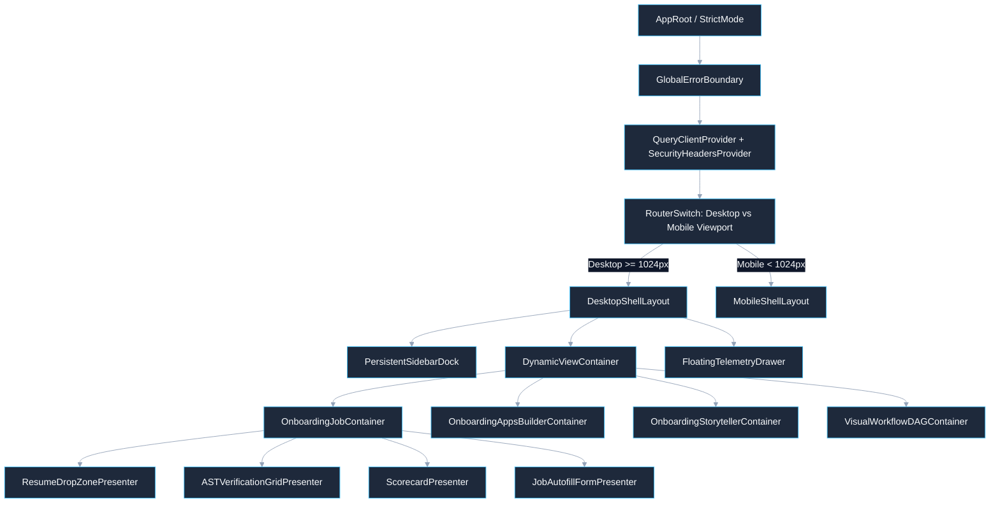

# Model Connector UI — Low-Level Design (LLD) & Figma-Style Onboarding Specifications

> **Document Type**: Detailed Component Specifications, React Architecture, Validation Schemas & Figma-Style Flows  
> **Master Blueprint**: [blueprint.md](blueprint.md)  
> **Macro Architecture**: [hld.md](hld.md)  
> **UI High-Level Design**: [ui-hld.md](ui-hld.md)  
> **Screen Mockups & Visual Architecture**: [ui-flows.md](ui-flows.md)  
> **Gap Analysis & Implementation Roadmap**: [gap-analysis-and-implementation-roadmap.md](gap-analysis-and-implementation-roadmap.md)  
> **Use Case Specifications & Architecture**: [Use Case Catalog & Architecture](usecase/README.md)  

---

## 📑 Table of Contents

- [1. Executive Frontend Architecture & Folder Structure](#1-executive-frontend-architecture--folder-structure)
- [2. Component Hierarchy & Container-Presenter Topology](#2-component-hierarchy--container-presenter-topology)
- [3. Zod Schema Validation & Strict Contract Specifications](#3-zod-schema-validation--strict-contract-specifications)
- [4. Figma-Style Frame-by-Frame Flow: Job Application Onboarding](#4-figma-style-frame-by-frame-flow-job-application-onboarding)
  - [4.1 Architecture, Problem Statement & Constraints](#41-architecture-problem-statement--constraints)
  - [4.2 Frame 1: Multi-Mode Authentication & Tenant Selection](#42-frame-1-multi-mode-authentication--tenant-selection)
  - [4.3 Frame 2: Resume Ingestion & Pre-Flight Validation](#43-frame-2-resume-ingestion--pre-flight-validation)
  - [4.4 Frame 3: Real-Time AST Verification & Missing Skill Mutation](#44-frame-3-real-time-ast-verification--missing-skill-mutation)
  - [4.5 Frame 4: Job Portal Target Selection & Form Autofill](#45-frame-4-job-portal-target-selection--form-autofill)
  - [4.6 Frame 5: Automated Playwright Submission & Success Receipt](#46-frame-5-automated-playwright-submission--success-receipt)
- [5. Figma-Style Frame-by-Frame Flow: Apps Builder Onboarding](#5-figma-style-frame-by-frame-flow-apps-builder-onboarding)
  - [5.1 Architecture, Problem Statement & Constraints](#51-architecture-problem-statement--constraints)
  - [5.2 Frame 1: Workspace Initialization & Template Choice](#52-frame-1-workspace-initialization--template-choice)
  - [5.3 Frame 2: Skill MD Ingestion & AST Parser Verification](#53-frame-2-skill-md-ingestion--ast-parser-verification)
  - [5.4 Frame 3: Real-Time Code Synthesis & Monaco Diff Studio](#54-frame-3-real-time-code-synthesis--monaco-diff-studio)
  - [5.5 Frame 4: Hermetic Docker Sandbox Execution & Unit Test Telemetry](#55-frame-4-hermetic-docker-sandbox-execution--unit-test-telemetry)
  - [5.6 Frame 5: Package Registry Publishing & Live Endpoint Deployment](#56-frame-5-package-registry-publishing--live-endpoint-deployment)
- [6. Figma-Style Frame-by-Frame Flow: Storyteller Video Generation Onboarding](#6-figma-style-frame-by-frame-flow-storyteller-video-generation-onboarding)
  - [6.1 Architecture, Problem Statement & Constraints](#61-architecture-problem-statement--constraints)
  - [6.2 Frame 1: Narrative Script Ingestion & Style Selection](#62-frame-1-narrative-script-ingestion--style-selection)
  - [6.3 Frame 2: Audio Voice Synthesis & Phoneme Cue Alignment](#63-frame-2-audio-voice-synthesis--phoneme-cue-alignment)
  - [6.4 Frame 3: Scene Keyframe Generation & Human-in-the-Loop (HITL) Review](#64-frame-3-scene-keyframe-generation--human-in-the-loop-hitl-review)
  - [6.5 Frame 4: ComfyUI Diffusion DAG Execution & Real-Time SSE Stream](#65-frame-4-comfyui-diffusion-dag-execution--real-time-sse-stream)
  - [6.6 Frame 5: Final Video Assembly, 4K Player & Distribution](#66-frame-5-final-video-assembly-4k-player--distribution)
- [7. Error Boundaries, Toast Notification Bus & Fallback Matrix](#7-error-boundaries-toast-notification-bus--fallback-matrix)
- [8. Implementation Invariants & Clean Code Standards](#8-implementation-invariants--clean-code-standards)
- [9. Interactive React Flow (`@xyflow/react`) Canvas Architecture & Idempotent Hooks](#9-interactive-react-flow-xyflowreact-canvas-architecture--idempotent-hooks)
  - [9.1 Custom Node State Schema & Edge Contracts](#91-custom-node-state-schema--edge-contracts)
  - [9.2 Centralized Idempotent Action Hook (`useIdempotentAction.ts`)](#92-centralized-idempotent-action-hook-useidempotentactionts)

---

## 1. Executive Frontend Architecture & Folder Structure

### Problem Statement
- Large enterprise frontends frequently become unmaintainable when business logic, data fetching, presentation markup, and validation rules are conflated within monolithic view files.

### Constraints
- Strict path aliases: `@/*` used universally (relative `./` and `../` strictly forbidden).
- Absolute separation of desktop multi-pane layouts from mobile stacked viewports.
- 100% type safety via TypeScript 5 and runtime Zod schemas.

### Directory Topology
```
packages/model-connector-ui/src/main/
+-- resources/
|   +-- assests/
|       +-- styles/
|           +-- _variables.scss      # Glassmorphism tokens, color palettes, spacing
|           +-- _mixins.scss         # Glass panel mixins, animations, breakpoints
|           +-- _desktop.scss        # Multi-column grid, canvas & dock styling
|           +-- _mobile.scss         # Single-column drawer & bottom-sheet styling
|           +-- main.scss            # Global reset, typography, token ingestion
+-- typescript/
    +-- App.tsx                      # Root router, query client, theme provider
    +-- main.tsx                     # Entrypoint with framebusting & CSP validation
    +-- api/                         # Axios client, SSE reader, CSRF interceptor
    +-- components/                  # Atomic & molecular glassmorphism UI components
    |   +-- atoms/                   # GlassButton, GlowInput, StatusBadge, Spinner
    |   +-- molecules/               # ModalDialog, StepperBar, FileDropZone, Toast
    |   +-- organisms/               # MonacoEditorPane, CanvasDAG, TelemetryGrid
    +-- containers/                  # Smart stateful controllers (Zustand + React Query)
    +-- desktop/                     # Desktop-specific multi-column orchestrators
    +-- mobile/                      # Mobile-specific touch-optimized view wrappers
    +-- schemas/                     # Zod runtime validation schemas
    +-- stores/                      # Zustand closure-scoped in-memory state stores
    +-- types/                       # Shared domain TypeScript interfaces
    +-- utils/                       # DOMPurify sanitizer, crypto helpers, formatters
```

---

## 2. Component Hierarchy & Container-Presenter Topology

### Architectural Pattern
- **Container-Presenter (Smart/Dumb) Pattern**: Containers (`@/containers/*`) manage data-fetching hooks, mutation dispatch, and state transitions. Presenters (`@/components/*`) are pure, stateless functions receiving typed props and returning glassmorphic JSX.



---

## 3. Zod Schema Validation & Strict Contract Specifications

### Problem Statement
- Form inputs, file uploads, and API responses from model services must be strictly validated at runtime to prevent injection attacks, silent data corruption, or undefined property crashes in React render loops.

### Constraints
- Zero `any` or loose type casts.
- Input validation must provide human-readable, localized error messages for UI field highlights.

### Solutions & Trade-offs
| Validation Approach | Type Safety | Bundle Impact | Runtime Safety | Decision |
| :--- | :--- | :--- | :--- | :--- |
| **Option A: Pure TypeScript Interfaces** | Compile-Time Only | Zero | Zero (Strips at runtime; vulnerable to malformed JSON) | **Incomplete** |
| **Option B: Manual Joi / Yup Validators** | Moderate | 40-60 KB | High | **Rejected** |
| **Option C: Zod Runtime Schemas + Inferred Static Types** | Universal (Compile + Runtime) | ~12 KB gzipped | Enterprise Grade (Throws typed errors; auto-coerces) | **SELECTED (BEST)** |

### Production Zod Schemas
```typescript
// @/schemas/onboarding.schemas.ts
import { z } from 'zod';

export const AuthOnboardingSchema = z.object({
  authMode: z.enum(['GOOGLE_GIS', 'ENTERPRISE_SSO', 'API_KEY', 'DEVELOPER_MOCK']),
  idToken: z.string().min(20, 'ID token is required and must be valid JWT').optional(),
  apiKey: z.string().regex(/^mc_live_[a-zA-Z0-9]{32,}$/, 'API key must match mc_live_ prefix').optional(),
  tenantScope: z.enum(['JOB_PORTAL', 'APPS_BUILDER', 'STORYTELLER', 'CUSTOM_PLATFORM']),
  selectedCapabilities: z.array(z.string()).min(1, 'Select at least one platform capability'),
});

export const ResumeUploadSchema = z.object({
  file: z.instanceof(File)
    .refine((file) => file.size <= 10 * 1024 * 1024, 'File size must not exceed 10MB')
    .refine((file) => ['application/pdf', 'application/vnd.openxmlformats-officedocument.wordprocessingml.document'].includes(file.type), 
      'Only valid PDF or DOCX documents are accepted'),
  targetJobDescription: z.string().min(50, 'Job description must be at least 50 characters').max(10000),
  autoMutateMissingSkills: z.boolean().default(false),
});

export const SkillMdUploadSchema = z.object({
  skillContent: z.string().min(20, 'Skill markdown cannot be empty')
    .refine((content) => content.startsWith('---'), 'Skill file must contain valid YAML frontmatter'),
  targetLanguage: z.enum(['TYPESCRIPT', 'PYTHON', 'GO', 'RUST']),
  runSandboxTests: z.boolean().default(true),
});

export const StorytellerPromptSchema = z.object({
  narrativeText: z.string().min(30, 'Story prompt must be at least 30 characters').max(15000),
  artStyle: z.enum(['CYBERPUNK_ANIME', 'CINEMATIC_PHOTOREALISTIC', 'PIXAR_3D', 'DARK_FANTASY']),
  voiceId: z.string().min(1, 'Narration voice is required'),
  aspectRatio: z.enum(['16:9', '9:16', '1:1']),
  hitlCheckpointEnabled: z.boolean().default(true),
});
```

---

## 4. Figma-Style Frame-by-Frame Flow: Job Application Onboarding

### 4.1 Architecture, Problem Statement & Constraints
- **Problem Statement**: Candidates struggle with lengthy, repetitive job portal application forms and lack insight into how automated Applicant Tracking Systems (ATS) score and filter their resumes.
- **Constraints**: PDF processing must occur asynchronously; missing skills must be surfaced transparently with candidate mutation approval before submission.
- **Platform Invariant**: Job autofill is a **user-defined business idea / custom manifest** executed through the platform's unified execution gateway (`POST /api/v1/executions`), leveraging the universal onboarding sequence documented in [ui-flows.md §2.4](ui-flows.md#24-universal-4-step-onboarding-flow-turning-any-user-idea-into-execution).

### 4.2 Frame 1: Multi-Mode Authentication & Tenant Selection
- **Frame Name**: `F-JOB-01: Auth & Scope Initialization`
- **Layout Grid**: 12-column desktop grid ($1440\times 900\text{ px}$ canvas), centered glassmorphic card ($680\text{ px}$ width).
- **UI Elements & Micro-Interactions**:
  - **Header**: Glowing cyan badge `"Step 1 of 5: Secure Portal Access"`, title `"Model Connector Authentication"`.
  - **Auth Cards (4-Grid)**:
    1. *Google OAuth (GIS)*: Electric Cyan accent, Google SVG icon, 1-click PKCE trigger.
    2. *Enterprise SSO*: SAML 2.0 / Okta badge, domain email field.
    3. *Developer API Key*: Monospace input with real-time Zod prefix validation.
    4. *Developer Mock*: Sandbox bypass for local debugging.
  - **Scope Radio Pill Group**: Pre-selected on `Job Portal Application`.
  - **Validation State**: Primary CTA `"Proceed to Resume Ingestion"` remains disabled (`opacity: 0.4`) until GIS returns valid JWT.
  - **Success Animation**: Button transforms into glowing green checkmark with $250\text{ ms}$ spring transition into Frame 2.

### 4.3 Frame 2: Resume Ingestion & Pre-Flight Validation
- **Frame Name**: `F-JOB-02: Resume Ingestion & Dropzone`
- **UI Elements & Micro-Interactions**:
  - **File Dropzone**: Glassmorphic dotted border (`2px dashed rgba(0, 242, 254, 0.4)`), dynamic drag-over glow effect (`#00F2FE` at 20% opacity).
  - **Pre-Flight Client Scanner**: Instantly reads magic bytes; displays document name, file size pill, and PDF page count.
  - **Job Description Target Box**: Monospace expandable textarea with character counter `(0 / 10,000)`.
  - **Validation Rules**:
    - File size $> 10\text{ MB} \implies$ Red warning banner: `"File exceeds 10MB limit"`.
    - Executable/malformed MIME $\implies$ Upload rejected instantly with shake animation.
  - **Action Button**: `"Analyze Resume AST & Match"`.

### 4.4 Frame 3: Real-Time AST Verification & Missing Skill Mutation
- **Frame Name**: `F-JOB-03: Semantic AST Verification Grid`
- **UI Elements & Micro-Interactions**:
  - **Two-Column Split Pane (50/50)**:
    - *Left Pane (Original AST)*: Interactive JSON/Tree visualization highlighting extracted nodes (Education, Experience, Verified Skills).
    - *Right Pane (Match Scorecard & Mutations)*:
      - Circular SVG Score Gauge: Animated radial dial counting from 0 to 94% with cyan/purple gradient.
      - Missing Skills Chip Array: Chips highlighted in Amber (`"GraphQL"`, `"Kubernetes"`).
      - Interactive Mutation Switch: `"Auto-synthesize tailored experience bullets for missing skills based on actual project AST"`.
  - **Micro-Interaction**: Toggling a skill chip triggers real-time AST recalculation via SSE without re-uploading the file.

### 4.5 Frame 4: Job Portal Target Selection & Form Autofill
- **Frame Name**: `F-JOB-04: Target Portal & Autofill Preview`
- **UI Elements & Micro-Interactions**:
  - **Target Portal Selector**: Dropdown supporting LinkedIn, Greenhouse, Lever, Workday, or Self-Hosted Custom Portal.
  - **Autofill Data Preview Accordion**:
    - Personal Information (Name, Phone, Location, Portfolio Links).
    - Work History (Normalized date ranges, synthesized achievement bullets).
    - Custom Questionnaire Answers (EEO, notice period, salary expectations).
  - **Validation Checkpoint**: Amber badge warning user if required portal fields are missing before dispatching the automated browser.

### 4.6 Frame 5: Automated Playwright Submission & Success Receipt
- **Frame Name**: `F-JOB-05: Playwright Execution & Final Receipt`
- **UI Elements & Micro-Interactions**:
  - **Live Browser Stream Viewport**: Scaled iframe rendering real-time screenshots from `playwright-mcp-engine` as it populates the target portal fields.
  - **Execution Stepper**:
    - `[✓] Navigated to Portal Application Page`
    - `[✓] Injected Normalized AST Form Data`
    - `[✓] Uploaded Tailored PDF Resume`
    - `[✓] Verified Captcha-Free DOM State`
    - `[✓] Clicked Submit & Captured Confirmation #`
  - **Success Modal**: Glassmorphic celebration card with confirmation ID (`APP-88219`), timestamp, and downloadable PDF submission audit log.

---

## 5. Figma-Style Frame-by-Frame Flow: Apps Builder Onboarding

### 5.1 Architecture, Problem Statement & Constraints
- **Problem Statement**: Generating fullstack apps from markdown specifications often fails silently when tools and models produce untyped, untested, or syntax-broken code.
- **Constraints**: Code synthesis must stream live chunks; generated code must be compiled and executed in a sandboxed Docker environment before being declared successful.
- **Platform Invariant**: Apps builder is a **user-defined workflow manifest** running on the platform's unified execution gateway (`POST /api/v1/executions`) with Docker sandbox capabilities toggled on.

### 5.2 Frame 1: Workspace Initialization & Template Choice
- **Frame Name**: `F-APP-01: Workspace Setup & Template Selection`
- **UI Elements & Micro-Interactions**:
  - **Workspace Name Input**: Monospace slug generator (`my-model-connector-app`).
  - **Runtime Framework Selector (Card Grid)**:
    - React 18 + Vite + SCSS
    - Node.js + Express + TypeScript
    - Python + FastAPI + Pydantic
    - Go + Chi + HTMX
  - **Target Architecture Pill**: Monorepo vs. Standalone Microservice.

### 5.3 Frame 2: Skill MD Ingestion & AST Parser Verification
- **Frame Name**: `F-APP-02: Skill Markdown AST Inspector`
- **UI Elements & Micro-Interactions**:
  - **Split Monaco Editor View**:
    - *Left Pane*: Live editable `SKILL.md` editor with YAML frontmatter syntax highlighting.
    - *Right Pane*: Parsed Tool AST Schema Tree. Displays extracted tools, input parameters, and required sandbox dependencies.
  - **Validation Badges**: Green pill for compliant YAML frontmatter; red inline lint marker if required fields are missing.

### 5.4 Frame 3: Real-Time Code Synthesis & Monaco Diff Studio
- **Frame Name**: `F-APP-03: Real-Time Streaming Synthesis Studio`
- **UI Elements & Micro-Interactions**:
  - **File Explorer Sidebar**: Dynamic file tree (`src/main/typescript/controllers/...`) updating in real-time as files are created.
  - **Monaco Code Canvas**: Syntax-highlighted streaming code with dynamic typing cursor.
  - **Compaction Indicator**: Floating pill displaying active token usage and lossless prompt compaction metrics.

### 5.5 Frame 4: Hermetic Docker Sandbox Execution & Unit Test Telemetry
- **Frame Name**: `F-APP-04: Sandbox Build & Test Execution`
- **UI Elements & Micro-Interactions**:
  - **Terminal Telemetry Console**: Emulated xterm.js terminal displaying hermetic Docker container build logs (`npm install`, `tsc --noEmit`, `vitest run`).
  - **Test Pass Rate Meter**: Radial gauge showing pass/fail counts (`14/14 tests passing - 100%`).
  - **Resource Telemetry Bar**: Live container memory and CPU utilization graphs.

### 5.6 Frame 5: Package Registry Publishing & Live Endpoint Deployment
- **Frame Name**: `F-APP-05: Artifact Publishing & Endpoint Deployment`
- **UI Elements & Micro-Interactions**:
  - **Live Sandbox Preview Iframe**: Interactive preview of the newly built web application.
  - **Export Action Hub**:
    - Button: `"Download Production Bundle (ZIP)"`
    - Button: `"Push to Git Repository (GitHub/GitLab)"`
    - Button: `"Deploy to Model Connector Service Gateway"`
  - **Endpoint Card**: Displays assigned base URL, live Swagger documentation link, and API access token.

---

## 6. Figma-Style Frame-by-Frame Flow: Storyteller Video Generation Onboarding

### 6.1 Architecture, Problem Statement & Constraints
- **Problem Statement**: Video generation from narrated stories requires orchestrating multiple AI subsystems (LLM script generation, TTS audio synthesis, ComfyUI diffusion rendering) with high rendering latency and GPU costs.
- **Constraints**: Must enforce Human-in-the-Loop (HITL) checkpoints before kicking off expensive GPU diffusion workflows.
- **Platform Invariant**: Storyteller is a **user-defined creative manifest** utilizing the platform's unified execution gateway (`POST /api/v1/executions`) and local RTX GPU bridge capability.

### 6.2 Frame 1: Narrative Script Ingestion & Style Selection
- **Frame Name**: `F-STY-01: Narrative Prompt & Aesthetic Studio`
- **UI Elements & Micro-Interactions**:
  - **Story Prompt Canvas**: Rich text prompt editor with tone presets (`Epic Fantasy`, `Cyberpunk Noir`, `Documentary Historical`).
  - **Aesthetic Carousel**: Interactive image cards showing sample keyframe styles with 1-click selection.
  - **Aspect Ratio Selector**: Toggle between `16:9 Landscape (YouTube)`, `9:16 Vertical (Shorts/TikTok)`, `1:1 Square (Feed)`.

### 6.3 Frame 2: Audio Voice Synthesis & Phoneme Cue Alignment
- **Frame Name**: `F-STY-02: Voice Narration & Audio Timeline`
- **UI Elements & Micro-Interactions**:
  - **Voice Selector Dropdown**: Categorized voice library (Actor, Tone, Accent) with instant audio preview button.
  - **Waveform Timeline Component**: Interactive SVG audio waveform showing synthesized voice track, silence markers, and phoneme sync cues.
  - **Speed & Pitch Sliders**: Real-time slider controls with immediate audio playback preview.

### 6.4 Frame 3: Scene Keyframe Generation & Human-in-the-Loop (HITL) Review
- **Frame Name**: `F-STY-03: Keyframe Visual HITL Checkpoint`
- **UI Elements & Micro-Interactions**:
  - **Storyboard Carousel**: 6 to 12 scene keyframes rendered as high-resolution preview cards.
  - **Individual Scene Controls**:
    - `"Regenerate Scene Prompt"`: Refines image prompt without altering narration audio.
    - `"Replace Image"`: Allows manual image upload or seed variation.
    - `"Approve Scene"`: Green toggle badge.
  - **HITL Checkpoint Gate**: CTA `"Render Full Video DAG"` is locked until all keyframe scenes are approved or user selects `"Auto-Approve All"`.

### 6.5 Frame 4: ComfyUI Diffusion DAG Execution & Real-Time SSE Stream
- **Frame Name**: `F-STY-04: ComfyUI Diffusion Progress & DAG Telemetry`
- **UI Elements & Micro-Interactions**:
  - **Animated DAG Node Flow**: Visual node diagram highlighting active rendering nodes (`K-Sampler`, `VAE-Decode`, `Frame Interpolator`, `AnimateDiff`).
  - **Rendering Progress Bar**: Smooth percentage bar backed by Server-Sent Events (`SSE: render_progress`).
  - **GPU Cluster Metrics**: Display active GPU worker ID, VRAM usage, and estimated time remaining.

### 6.6 Frame 5: Final Video Assembly, 4K Player & Distribution
- **Frame Name**: `F-STY-05: Final Video Player & Export Suite`
- **UI Elements & Micro-Interactions**:
  - **Glassmorphic 4K Video Player**: Custom HTML5 video player with fullscreen, playback speed, subtitle toggle, and chapter markers.
  - **Export Matrix**:
    - MP4 (H.264 / AAC) at 1080p and 4K.
    - WebM (VP9 / Opus) for web streaming.
    - SRT Subtitle File Download.
  - **Direct Publishing**: 1-click webhook distribution to YouTube Studio or TikTok Creator API.

---

## 7. Error Boundaries, Toast Notification Bus & Fallback Matrix

### Problem Statement
- Uncaught JavaScript runtime errors in third-party libraries (such as Monaco Editor or Canvas DAG renderers) must not crash the entire application or corrupt onboarding stepper state.

### Fallback Matrix
| Error Type | Detection Point | UI Component Behavior | Recovery Action |
| :--- | :--- | :--- | :--- |
| **Network Disconnect (Offline)** | `window.addEventListener('offline')` | Sticky Top Amber Banner: `"Network Connection Lost. Retrying..."` | Auto-reconnect SSE stream on `online` event. |
| **Session Expired (401)** | Axios Interceptor | Floating Re-Auth Dialog; preserves form draft in memory. | Transparent token refresh or 1-click GIS re-login. |
| **AST Parse Error (422)** | React Query Mutation `onError` | Shake Dropzone; display inline diff of invalid syntax. | Highlight line number in Monaco editor. |
| **Canvas DAG Crash** | Component `ErrorBoundary` | Render Fallback Card: `"Canvas failed to render. Switch to Table View."` | Fallback tabular node editor toggle. |
| **Token Exhaustion (400)** | API Model Response Handler | Trigger Smart Compaction Modal. | Auto-prune AST comments and re-execute. |

---

## 8. Implementation Invariants & Clean Code Standards

1. **Zero Relative Paths**: All imports across the frontend use `@/*` configured via `vite.config.ts` and `tsconfig.json`.
2. **Strict Zod Contract Parsing**: Every external payload entering the React application via HTTP or SSE is parsed through a Zod schema before state storage.
3. **Immutability by Default**: All Zustand store state updates use immutable state mutators (`set((state) => ({ ... }))`).
4. **CSS Token Enforcement**: Direct hexadecimal colors or pixel spacings in component files are prohibited; all values reference variables from `_variables.scss`.
5. **No Long Functions**: Component functions adhere to Single Level of Abstraction (SLAP) and do not exceed 25 lines of presentation markup.

---

## 9. Interactive React Flow (`@xyflow/react`) Canvas Architecture & Idempotent Hooks

### 9.1 Custom Node State Schema & Edge Contracts
```typescript
// @/types/workflowCanvas.ts
import type { Node, Edge } from '@xyflow/react';

export type WorkflowStepStatus = 'PENDING' | 'RUNNING' | 'SUCCESS' | 'FAILED' | 'SKIPPED' | 'AWAITING_HITL';

export interface BaseWorkflowNodeData {
  stepId: string;
  stepName: string;
  isMandatory: boolean;
  status: WorkflowStepStatus;
  progressPercent?: number;
  errorMessage?: string;
  executionDurationMs?: number;
}

export type CanvasCustomNode = Node<BaseWorkflowNodeData>;
export type CanvasCustomEdge = Edge<{ isAnimated: boolean; latencyMs?: number }>;
```

### 9.2 Centralized Idempotent Action Hook (`useIdempotentAction.ts`)
```typescript
// @/utils/hooks/useIdempotentAction.ts
import { useState, useCallback, useRef } from 'react';
import { apiClient } from '@/api/apiClient';

interface UseIdempotentActionOptions<TReq, TRes> {
  endpoint: string;
  method?: 'POST' | 'PUT' | 'PATCH' | 'DELETE';
  onSuccess?: (data: TRes) => void;
  onError?: (error: Error) => void;
  debounceMs?: number;
}

export function useIdempotentAction<TReq, TRes>(options: UseIdempotentActionOptions<TReq, TRes>) {
  const [isSubmitting, setIsSubmitting] = useState(false);
  const [error, setError] = useState<string | null>(null);
  const lastClickRef = useRef<number>(0);

  const execute = useCallback(async (payload: TReq) => {
    const now = Date.now();
    const debounceWindow = options.debounceMs ?? 300;

    // Client-side debounce protection
    if (now - lastClickRef.current < debounceWindow || isSubmitting) {
      return;
    }
    lastClickRef.current = now;

    setIsSubmitting(true);
    setError(null);

    // Cryptographic UUIDv4 Idempotency Key
    const idempotencyKey = crypto.randomUUID();

    try {
      const response = await apiClient.request<TRes>({
        url: options.endpoint,
        method: options.method ?? 'POST',
        data: payload,
        headers: {
          'Idempotency-Key': idempotencyKey,
        },
      });

      options.onSuccess?.(response.data);
      return response.data;
    } catch (err: unknown) {
      const errMsg = err instanceof Error ? err.message : 'Action execution failed';
      setError(errMsg);
      options.onError?.(new Error(errMsg));
    } finally {
      setIsSubmitting(false);
    }
  }, [options, isSubmitting]);

  return { execute, isSubmitting, error };
}
```

