# Model Connector Platform — Use Case Catalog & Architecture Index

> **Directory**: `docs/usecase/`  
> **Master Blueprint**: [blueprint.md §1.1](../blueprint.md#11-purpose-scope-and-system-definition)  
> **Macro System Architecture (HLD)**: [hld.md §1](../hld.md#1-executive-architecture-summary)  
> **Detailed Component Specifications (LLD)**: [lld.md §1](../lld.md#1-executive-low-level-design-overview)  
> **UI High-Level Design (Security & Patterns)**: [ui-hld.md §1](../ui-hld.md#1-executive-architectural-overview--topology)  
> **UI Low-Level Design & Figma Flows**: [ui-lld.md §1](../ui-lld.md#1-executive-frontend-architecture--folder-structure)  
> **UI Screen Workflows**: [ui-flows.md §1](../ui-flows.md#1-executive-ui-architecture--principles)  
> **Gap Analysis & Implementation Roadmap**: [gap-analysis-and-implementation-roadmap.md §1](../gap-analysis-and-implementation-roadmap.md#1-executive-architectural-audit--problem-statement)  

---

## 📑 Use Case Master Index

This directory contains end-to-end architectural, functional, low-level, UI, and API specifications for every core workload supported by the **Model Connector Platform**. Each document provides comprehensive coverage of problem statements, constraints, trade-off evaluations, Mermaid component diagrams, user flows, HLD topology, TypeScript LLD classes, relational DDL schemas, and error handling matrices.

| Use Case ID | Name & Scope | Primary Persona | Core Architecture & Technology | Dedicated Specification File |
| :--- | :--- | :--- | :--- | :--- |
| **UC-01** | **Intelligent Autonomous Job Portal & Career Form Autofill** | Candidate / Recruiter | Resume AST parsing, ATS Scorecard evaluation, Playwright MCP career portal autofill (Workday, Greenhouse, Lever), dynamic AI custom question synthesis. | [UC-01-job-portal-and-career-autofill.md §1](UC-01-job-portal-and-career-autofill.md#1-executive-summary--problem-statement) |
| **UC-02** | **Autonomous Fullstack Apps Builder Studio** | Developer / Creator | `SKILL.md` compiler, SSE code synthesis stream, ephemeral non-root Docker sandbox execution, automated test runner, and production zip export. | [UC-02-apps-builder-studio.md §1](UC-02-apps-builder-studio.md#1-executive-summary--problem-statement) |
| **UC-03** | **ComfyUI Storyteller & Video Generation Engine** | Content Creator / Storyteller | Narrative prompt decomposition, TTS audio synthesis with phoneme-level timecodes, HITL keyframe review, local RTX 5080 ComfyUI diffusion DAG dispatch. | [UC-03-storyteller-video-generation.md §1](UC-03-storyteller-video-generation.md#1-executive-summary--problem-statement) |
| **UC-04** | **LinkedIn X-Ray Discovery, Talent Sourcing & Profile AST Matching** | Recruiter / Sourcing Agent | Boolean search query generation, DOM tree sanitization ($4\text{MB} \rightarrow 50\text{KB}$ clean AST), profile semantic AST extraction, competency overlap scoring, anti-bot jitter mesh. | [UC-04-linkedin-xray-talent-sourcing.md §1](UC-04-linkedin-xray-talent-sourcing.md#1-executive-summary--problem-statement) |
| **UC-05** | **Multi-MCP Tool Orchestration & Dynamic Capabilities Gateway** | Platform Engineer / AI Agent | Heterogeneous MCP communication (`stdio`, `SSE`, `WebSocket`), JSON-RPC 2.0 handshake, dynamic tool schema ingestion for Gemini/Claude/OpenAI, and process sandboxing. | [UC-05-multi-mcp-orchestration.md §1](UC-05-multi-mcp-orchestration.md#1-executive-summary--problem-statement) |
| **UC-06** | **Free-Tier Cookie Harvesting & Silent Authentication Revocation Recovery** | End User / Operator | Headless browser session cookie harvesting, AES-256-GCM vault, HTTP 401/403 circuit trap, state-preserving pause, amber UI alert banners, and seamless re-auth. | [UC-06-cookie-harvesting-and-auth-revocation.md §1](UC-06-cookie-harvesting-and-auth-revocation.md#1-executive-summary--problem-statement) |
| **UC-07** | **Resilient Workflow State Ledger & Cryptographic Tamper-Detection Resumption** | DevOps / SecOps Engineer | `WORKFLOW_STEP_LEDGER` table, sequential HMAC-SHA256 chain verification, step-level failure detection, instant restart on tamper vs seamless resumption from Step $K$ if clean. | [UC-07-workflow-ledger-and-tamper-resumption.md §1](UC-07-workflow-ledger-and-tamper-resumption.md#1-executive-summary--problem-statement) |
| **UC-08** | **B2B & B2C Multi-Tenant Monetization, Billing, Audit & GDPR Governance** | Enterprise Admin / CFO / DPO | B2B/B2C value proposition, customer journey diagram, break-even unit economics chart, token/compute billing metrics, 3-scope restriction auditing, and GDPR Right to be Forgotten. | [UC-08-b2b-b2c-business-billing-and-gdpr.md §1](UC-08-b2b-b2c-business-billing-and-gdpr.md#1-executive-summary--value-proposition) |
| **UC-09** | **Omni-Channel Follow-up Automation, Timezone-Aware Scheduling & AI Validation Gate** | Candidate / Sales Agent | Multi-channel cadences (Email, LinkedIn, X, GitHub), IANA timezone recipient business window scheduling, 4-tier AI fact-checking/tone validation, and HITL authorization gate. | [UC-09-automated-followup-and-timezone-dispatch.md §1](UC-09-automated-followup-and-timezone-dispatch.md#1-executive-summary--problem-statement) |
| **UC-10** | **Cross-Platform Cookie Sharing & Credential Vault Synchronization** | Security Admin / Automation Worker | AES-256-GCM vault, Redis Pub/Sub `cred:sync` bus, zero-downtime hot-reload across UI, Service, and Playwright MCP headless browser pools. | [UC-10-cross-platform-session-and-cookie-sharing.md §1](UC-10-cross-platform-session-and-cookie-sharing.md#1-executive-summary--problem-statement) |
| **UC-11** | **Unified Conversation, Task State & Executive Summary Hub** | Operator / Candidate | Polyglot persistence (Postgres, Mongo, Redis), milestone task tracking, and automated human-centric executive summaries with daily recap digests. | [UC-11-conversation-task-state-and-summary-hub.md §1](UC-11-conversation-task-state-and-summary-hub.md#1-executive-summary--problem-statement) |
| **UC-12** | **Long-Running AI Task Lifecycle, Heartbeat & Nuanced Status Orchestration** | Platform Engineer / Operator | 14-state lifecycle FSM, 10s bi-directional pulse heartbeat, rate-limit backoff handling, sub-stage micro-progress telemetry, stalled worker auto-quarantine, and resumption. | [UC-12-long-running-ai-task-lifecycle-and-status-orchestration.md §1](UC-12-long-running-ai-task-lifecycle-and-status-orchestration.md#1-executive-summary--problem-statement) |
| **UC-13** | **Granular Feature Metering, Monthly Freeware Quotas & Agentic Conversation Learning** | Enterprise Admin / User | Multi-dimensional metering (AST, Browser, GPU, Tokens), monthly replenishable freeware quotas, budget fences, and agentic continuous learning from conversation feedback. | [UC-13-metrics-billing-capture-and-agentic-learning.md §1](UC-13-metrics-billing-capture-and-agentic-learning.md#1-executive-summary--problem-statement) |
| **UC-14** | **Containerized Agent-Per-Workflow Architecture & Modular Micro-Execution Topology** | DevOps / Infrastructure Engineer | Single-responsibility workflow containers, Apache APISIX sub-millisecond dynamic routing, zero cascading crash blast radius, and independent CPU/RAM ceilings. | [UC-14-containerized-agent-per-workflow-topology.md §1](UC-14-containerized-agent-per-workflow-topology.md#1-executive-summary--problem-statement) |
| **UC-15** | **Universal Model Connector Client: Omni-Authentication Mesh & Google Search AI Grounding** | Platform Engineer / Agent Developer | Polymorphic strategy dispatcher (CLI, Cookie, API, OAuth 2.0 PKCE, Enterprise IAM), AES-256-GCM vault, per-model userflows, and Google Search AI mode real-time grounding. | [UC-15-model-connector-client-omni-auth-and-google-search-ai-mode.md §1](UC-15-model-connector-client-omni-auth-and-google-search-ai-mode.md#1-executive-summary--problem-statement) |

---

## 🏛️ Cross-Cutting Architecture & Navigation Matrix

Every use case document conforms to the canonical platform design standards and links directly to the foundational specifications:

```mermaid
%%{init: {'theme': 'base', 'themeVariables': { 'primaryColor': '#1E293B', 'primaryTextColor': '#F8FAFC', 'primaryBorderColor': '#38BDF8', 'lineColor': '#94A3B8', 'secondaryColor': '#0F172A', 'tertiaryColor': '#1E293B', 'noteBkgColor': '#334155', 'noteTextColor': '#F8FAFC'}}}%%
flowchart TD
    classDef core fill:#0F172A,stroke:#38BDF8,stroke-width:2px,color:#F8FAFC;
    classDef uc fill:#1E293B,stroke:#818CF8,stroke-width:2px,color:#F8FAFC;
    classDef biz fill:#0F172A,stroke:#34D399,stroke-width:2px,color:#F8FAFC;

    BP["Master Blueprint<br/>(blueprint.md)"]:::core --> HLD["System HLD<br/>(hld.md)"]:::core
    HLD --> LLD["Component LLD<br/>(lld.md)"]:::core
    HLD --> UIHLD["UI HLD & Security<br/>(ui-hld.md)"]:::core
    LLD --> ROADMAP["Implementation Roadmap<br/>(gap-analysis-and-implementation-roadmap.md)"]:::core
    
    HLD & LLD --> UC1["UC-01: Job Portal & Career Autofill"]:::uc
    HLD & LLD --> UC2["UC-02: Apps Builder Studio"]:::uc
    HLD & LLD --> UC3["UC-03: Storyteller Video Generation"]:::uc
    HLD & LLD --> UC4["UC-04: LinkedIn X-Ray Talent Sourcing"]:::uc
    HLD & LLD --> UC5["UC-05: Multi-MCP Orchestration"]:::uc
    HLD & LLD --> UC6["UC-06: Cookie Harvesting & Revocation"]:::uc
    HLD & LLD --> UC7["UC-07: Workflow Resumption & Tamper Guard"]:::uc
    HLD & LLD --> UC8["UC-08: B2B/B2C Billing & GDPR Governance"]:::biz
    HLD & LLD --> UC9["UC-09: Automated Follow-up & Timezone Gate"]:::uc
    HLD & LLD --> UC10["UC-10: Cross-Platform Cookie Sync"]:::uc
    HLD & LLD --> UC11["UC-11: Conversation & Task Summary Hub"]:::uc
    HLD & LLD --> UC12["UC-12: Task Lifecycle & Status Engine"]:::uc
    HLD & LLD --> UC13["UC-13: Feature Metering & Agentic Learning"]:::biz
    HLD & LLD --> UC14["UC-14: Containerized Agent Topology"]:::uc
    HLD & LLD --> UC15["UC-15: Omni-Auth & Search Client"]:::uc
```

---

## 📐 Use Case Structure Invariants

Every specific use case document is structured into the following standardized sections:
1. **Executive Summary & Metadata Links**: Canonical links to parent documentation with precise section anchors.
2. **Problem Statement & Technical Constraints**: Strict latency, multi-tenancy, and security bounds.
3. **Architectural Solutions & Trade-off Matrix**: Explicit comparison between naive vs. chosen enterprise architecture.
4. **Macro Architecture (HLD) & Component Diagram**: Mermaid system diagram showing distributed microservice interactions.
5. **End-to-End User Flow Diagram**: Mermaid flowchart illustrating the complete customer/operator journey.
6. **Low-Level Design (LLD)**: TypeScript interface contracts, class implementations, and database DDL schemas.
7. **UI Interaction Flow & State Machine**: Detailed description of screens, buttons, states, error banners, and micro-telemetry.
8. **API Ingress & Protocol Specification**: Endpoints, HTTP status codes, idempotency headers, request/response JSON schemas.
9. **Failure Modes, Recovery Cascades & Fallback Matrix**: Exhaustive edge-case behavior and mitigation strategies.
