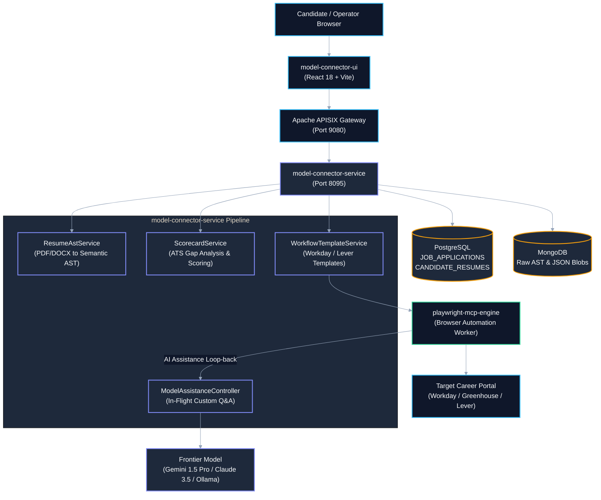
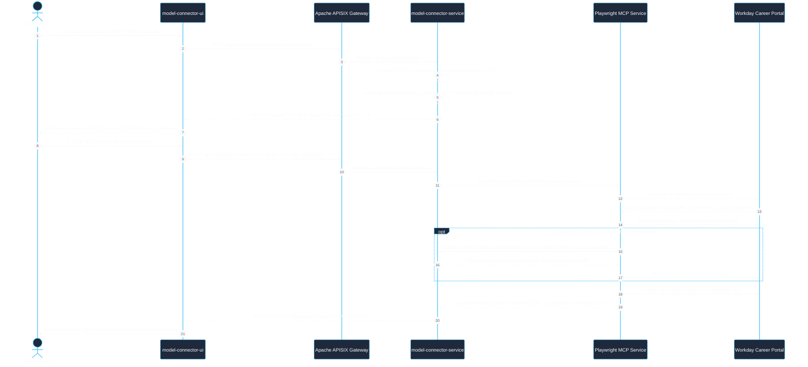
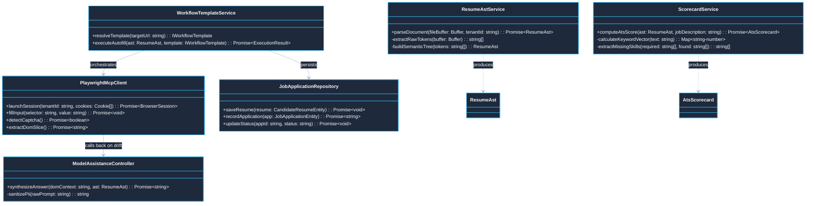
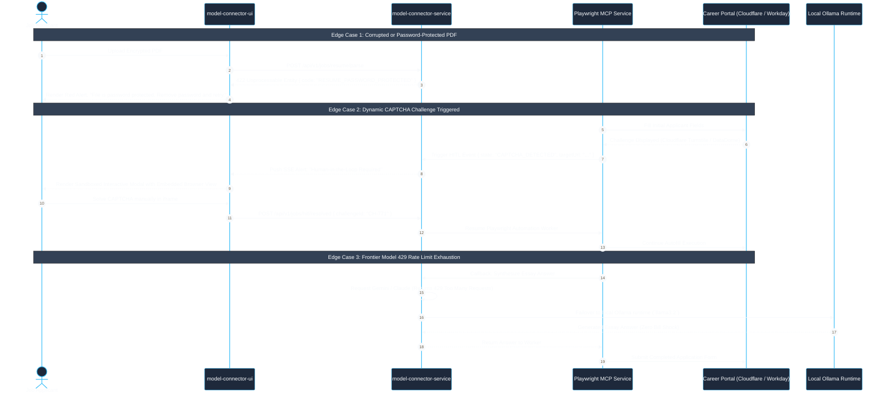

# Use Case 01 — Intelligent Autonomous Job Portal & Career Form Autofill

> **Document ID**: `UC-01`  
> **Category**: Domain Application Workload  
> **Master Index**: [README.md §1](README.md#1-use-case-01--intelligent-autonomous-job-portal--career-form-autofill)  
> **Master Blueprint**: [blueprint.md §4.1](../blueprint.md#41-application-1-autonomous-intelligent-job-portal)  
> **System Architecture (HLD)**: [hld.md §5.1](../hld.md#51-application-1-autonomous-intelligent-job-portal), [§24](../hld.md#24-playwright-mcp-to-model-connector-platform-ai-assistance-loop-back-architecture), [§26](../hld.md#26-playwright-mcp-workflow-template--dynamic-placeholder-engine-with-session-vault)  
> **Component Design (LLD)**: [lld.md §3](../lld.md#3-complete-enterprise-database-architecture-polyglot-persistence), [§21](../lld.md#21-playwright-mcp-to-model-connector-ai-assistance-client-implementation), [§23](../lld.md#23-playwright-workflow-template-executor-dynamic-placeholder-engine--session-vault)  
> **UI Flows**: [ui-flows.md §2](../ui-flows.md#2-screen-1-multi-mode-onboarding--authentication), [§13](../ui-flows.md#13-screen-11-linkedin-x-ray-discovery-playwright-dynamic-placeholder-workflows--ai-assistance-ui-flow)  

---

## 1. Executive Summary & Problem Statement

### 1.1 Executive Summary
* **Core Mission**: Enable candidates and enterprise talent acquisition teams to transform raw resumes (PDF/DOCX) into semantic Abstract Syntax Trees (AST), compute deterministic ATS compatibility scorecards against target Job Descriptions, and execute automated multi-step form applications across career portals (Workday, Greenhouse, Lever).
* **AI Assistance Loop-back**: Dynamically synthesizes in-flight essay answers and overcomes custom portal questionnaire hurdles via the `playwright-mcp-engine` without leaking Personally Identifiable Information (PII) across tenant perimeters.
* **Architecture Alignment**: Deployed as an autonomous workload executing on top of Model Connector Platform via unified execution protocols (`POST /api/v1/executions`).

### 1.2 Problem Statement
* **Manual Entry Fatigue**: Job seekers must repeatedly re-type work histories and educational credentials into non-standardized applicant tracking systems.
* **Fragile Web Automation**: Traditional CSS/XPath scrapers break on dynamic shadow-DOM structures, obfuscated class names, custom essay questions, and CAPTCHA barriers.
* **Loss of AST Semantic Integrity**: Naive string parsers destroy structural hierarchy, stripping nested dates, impact metrics, and technical competencies required for accurate ATS scoring.
* **Security & Isolation Risks**: Storing unencrypted resumes and sharing browser sessions across candidates risks catastrophic cross-tenant PII contamination.

### 1.3 Constraints & Non-Negotiables
* **Multi-Tenant Partitioning**: Resumes, AST payloads, and session tokens must be cryptographically partitioned by `TENANT_ID`. Zero cross-tenant data leakage.
* **Parsing & Autofill Latency SLA**: Resume AST parsing must complete in $\le 1500\text{ ms}$; form field autofill dispatch must maintain $\le 800\text{ ms}$ per interaction.
* **Scoring Determinism**: ATS scorecard calculation must achieve $\ge 90\%$ semantic fidelity matching human recruiter benchmarks.
* **Zero PII at Ingress Boundary**: Candidate contact details must be sanitized before model inference for custom essay synthesis.

---

## 2. Architectural Solutions & Trade-offs

* **Evaluation Matrix**:
  * **Option A: Regex & DOM Selector Scraping**:
    * *Pros*: Lowest token cost and compute footprint.
    * *Cons*: Extreme fragility; breaks on minor DOM modifications; cannot answer dynamic essay questions.
    * *Verdict*: **Rejected**.
  * **Option B: Full LLM Vision Direct Scraping**:
    * *Pros*: Understands visual canvas layouts and complex interfaces.
    * *Cons*: Prohibitive cost ($0.05+ per page view); high latency ($5\text{--}15\text{s}$ per step); severe rate limit risks.
    * *Verdict*: **Rejected**.
  * **Option C: Hybrid Semantic AST + Playwright MCP + In-Flight AI Assistance (Selected)**:
    * *Pros*: Deterministic AST field extraction, sub-second execution ($400\text{--}800\text{ms}$), just-in-time LLM fallback for dynamic questions only, robust to DOM changes.
    * *Cons*: Requires localized Playwright browser workers and session vault management.
    * *Verdict*: **SELECTED (BEST)**.

---

## 3. Macro Architecture (HLD) & Component Diagram

### 3.1 System Design Principles
* **Perimeter Ingress Gateway**: Apache APISIX operates as the edge gateway (port 9080), enforcing rate limits, SSL termination, and tenant authentication.
* **Decoupled Service Pipeline**: `model-connector-service` (port 8095) hosts stateless micro-services for parsing, scorecard synthesis, and template dispatch.
* **Polyglot Storage Partitioning**:
  * **PostgreSQL**: Relational schemas for `CANDIDATE_RESUMES` and `JOB_APPLICATIONS`.
  * **MongoDB**: Unstructured raw AST trees, full-text JSON artifacts, and template extraction blobs.
  * **Redis**: In-flight distributed session locks and idempotency token tracking.
* **Isolated Browser Execution**: Dedicated `playwright-mcp-engine` containers execute browser workloads in headless sandboxes.

### 3.2 High-Level Architecture Diagram



---

## 4. End-to-End User Flow Diagram

* **Architectural Principle**: The career autofill journey operates via streaming server-sent events (SSE) over the unified execution framework (`POST /api/v1/jobs/autofill/execute`), ensuring end-to-end user visibility and zero silent failures.

### 4.1 Nominal User Flow Sequence



---

## 5. Low-Level Design (LLD)

### 5.1 LLD Class & Component Interaction Diagram



### 5.2 Data Contracts & TypeScript Interfaces

```typescript
// @/domain/job/IResumeAst.ts

export interface WorkExperienceItem {
  readonly companyName: string;
  readonly roleTitle: string;
  readonly startDate: string;
  readonly endDate: string;
  readonly achievements: ReadonlyArray<string>;
  readonly verifiedSkills: ReadonlyArray<string>;
}

export interface ResumeAst {
  readonly candidateId: string;
  readonly fullName: string;
  readonly email: string;
  readonly phone: string;
  readonly location: string;
  readonly linkedInUrl?: string;
  readonly gitHubUrl?: string;
  readonly summary: string;
  readonly experiences: ReadonlyArray<WorkExperienceItem>;
  readonly education: ReadonlyArray<{ school: string; degree: string; year: string }>;
  readonly skills: ReadonlyArray<string>;
}

export interface AtsScorecard {
  readonly overallMatchScore: number; // 0 to 100
  readonly technicalCompetencyScore: number;
  readonly tenureScore: number;
  readonly matchedSkills: ReadonlyArray<string>;
  readonly missingMandatorySkills: ReadonlyArray<string>;
  readonly optimizationTips: ReadonlyArray<string>;
}
```

### 5.3 Relational DDL Schema

```sql
-- DDL for Job Applications and Resumes
CREATE TABLE IF NOT EXISTS CANDIDATE_RESUMES (
    RESUME_ID VARCHAR(64) PRIMARY KEY,
    TENANT_ID VARCHAR(64) NOT NULL,
    USER_ID VARCHAR(64) NOT NULL,
    RAW_FILE_NAME VARCHAR(255) NOT NULL,
    FILE_SIZE_BYTES BIGINT NOT NULL,
    SHA256_CHECKSUM VARCHAR(64) NOT NULL,
    EXTRACTED_AST_JSON JSONB NOT NULL,
    CREATED_AT TIMESTAMP WITH TIME ZONE NOT NULL DEFAULT CURRENT_TIMESTAMP,
    UPDATED_AT TIMESTAMP WITH TIME ZONE NOT NULL DEFAULT CURRENT_TIMESTAMP,
    CONSTRAINT FK_RESUME_TENANT FOREIGN KEY (TENANT_ID) REFERENCES TENANTS (TENANT_ID) ON DELETE CASCADE
);

CREATE TABLE IF NOT EXISTS JOB_APPLICATIONS (
    APPLICATION_ID VARCHAR(64) PRIMARY KEY,
    TENANT_ID VARCHAR(64) NOT NULL,
    USER_ID VARCHAR(64) NOT NULL,
    RESUME_ID VARCHAR(64) NOT NULL,
    TARGET_COMPANY VARCHAR(255) NOT NULL,
    TARGET_URL TEXT NOT NULL,
    ATS_SCORE NUMERIC(5,2) NOT NULL,
    APPLICATION_STATUS VARCHAR(32) NOT NULL DEFAULT 'PENDING',
    CONFIRMATION_NUMBER VARCHAR(128),
    SUBMISSION_TIMESTAMP TIMESTAMP WITH TIME ZONE,
    CREATED_AT TIMESTAMP WITH TIME ZONE NOT NULL DEFAULT CURRENT_TIMESTAMP,
    CONSTRAINT FK_JA_TENANT FOREIGN KEY (TENANT_ID) REFERENCES TENANTS (TENANT_ID) ON DELETE CASCADE,
    CONSTRAINT FK_JA_RESUME FOREIGN KEY (RESUME_ID) REFERENCES CANDIDATE_RESUMES (RESUME_ID) ON DELETE RESTRICT
);

CREATE INDEX IF NOT EXISTS IDX_JA_TENANT_USER ON JOB_APPLICATIONS (TENANT_ID, USER_ID, APPLICATION_STATUS);
```

---

## 6. UI Interaction Flow & Screen States

* **Dropzone State (`EMPTY` $\rightarrow$ `UPLOADING` $\rightarrow$ `PARSED`)**:
  * Drag-and-drop zone accepts `.pdf` and `.docx` files $\le 10\text{ MB}$.
  * Client calculates local SHA-256 hash and displays a real-time upload progress ring.
* **Scorecard State (`ANALYZING` $\rightarrow$ `READY`)**:
  * Circular radial gauge renders ATS compatibility score (e.g., `91%`).
  * Interactive chips toggle between `Matched Competencies` (Emerald) and `Missing Keywords` (Crimson).
* **Autofill Review State**:
  * Displays field-by-field mapping preview with editable overrides for custom fields.
* **Execution Telemetry State (`DISPATCHED` $\rightarrow$ `STREAMING` $\rightarrow$ `COMPLETED`)**:
  * Live step-by-step progress stepper:
    * `Step 1: Navigating to Portal (Completed - 610ms)`
    * `Step 2: Authenticating via Session Vault (Completed - 240ms)`
    * `Step 3: Autofilling Personal & Experience Fields (Completed - 820ms)`
    * `Step 4: AI Synthesizing Essay Answers (Active - 450ms)`
    * `Step 5: Application Submitted (Confirmation: WD-88210)`

---

## 7. API Ingress & Protocol Specification

### 7.1 Parse Resume & Synthesize AST
* **Endpoint**: `POST /api/v1/jobs/resume/parse`
* **Headers**: `Authorization: Bearer <JWT>`, `X-Tenant-Id: <TENANT_ID>`, `Content-Type: multipart/form-data`
* **Response**: `200 OK`
```json
{
  "resumeId": "RES-8819",
  "candidate": {
    "fullName": "Jane Doe",
    "email": "jane.doe@example.com",
    "skills": ["TypeScript", "Distributed Systems", "PostgreSQL", "Docker"]
  },
  "scorecard": {
    "overallMatchScore": 91.5,
    "matchedSkills": ["TypeScript", "Distributed Systems", "Docker"],
    "missingMandatorySkills": ["GraphQL", "Redis"],
    "optimizationTips": ["Highlight experience with distributed cache invalidation."]
  }
}
```

### 7.2 Execute Automated Application
* **Endpoint**: `POST /api/v1/jobs/autofill/execute`
* **Headers**: `Authorization: Bearer <JWT>`, `Idempotency-Key: <UUIDv4>`, `Content-Type: application/json`
* **Request Body**:
```json
{
  "resumeId": "RES-8819",
  "targetJobUrl": "https://acme.wd5.myworkdayjobs.com/en-US/careers/job/101",
  "templateType": "WORKDAY",
  "enableAiEssayAssistance": true
}
```
* **Response**: `202 Accepted` with SSE Stream URL `/api/v1/jobs/autofill/stream/JOB-APP-991`

---

## 8. Failure Modes, Edge Cases & Recovery User Flow

### 8.1 Edge Cases User Flow & Error Recovery Sequence



### 8.2 Failure Modes & Fallback Matrix

| Failure Mode | Trigger Condition | Automated System Response | User Experience Impact |
| :--- | :--- | :--- | :--- |
| **Corrupted PDF Upload** | Malformed PDF header or password-protected document | Return HTTP 422 Unprocessable Entity with error code `RESUME_PARSE_FAILED` | UI displays red alert: *"Unable to parse PDF. Please ensure file is not password protected."* |
| **Portal Selector Drift** | Career portal frontend changes class names or DOM structure | Playwright MCP pauses, extracts sanitized DOM slice, and triggers AI Assistance Loop-back (§24) | UI shows floating badge: *"AI Disambiguating Form Fields..."* Application proceeds without interruption. |
| **Session Expired** | Saved Workday session cookies expire ($401$ redirect to login) | Engine detects auth redirect, transitions to `AUTH_PAUSED`, snapshots state | UI presents one-click re-authentication modal; resumes form submission post-auth. |
| **CAPTCHA Checkpoint** | Cloudflare / DataDome challenge triggered | Worker halts automated input; alerts UI to trigger Human-in-the-Loop (HITL) solving window | Operator solves CAPTCHA in embedded sandboxed iframe; automated runner resumes immediately. |
| **Model API Quota 429** | Upstream provider exhausted during essay generation | Circuit breaker switches to local Ollama `llama3.2` model instance | Zero disruption to form completion; amber notification indicates local fallback used. |
