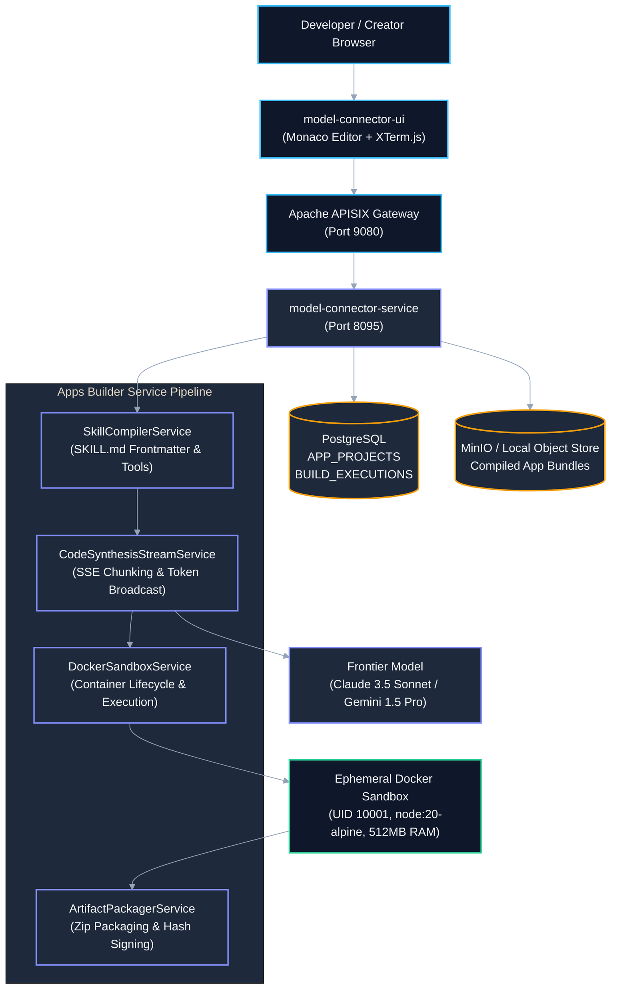
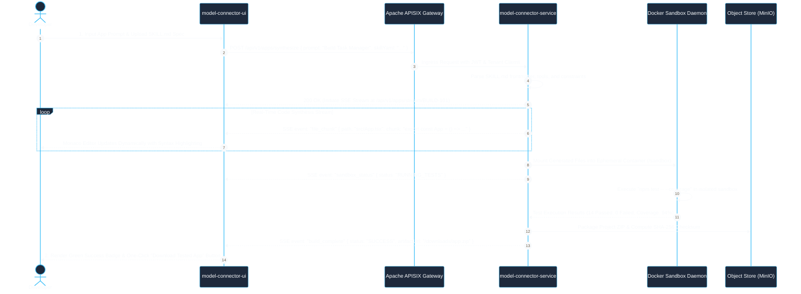
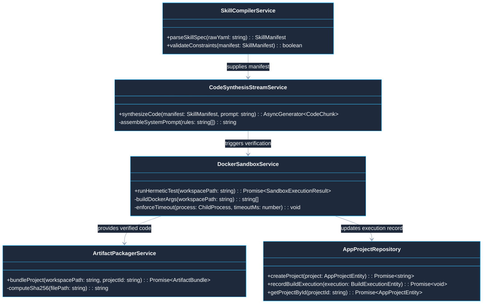
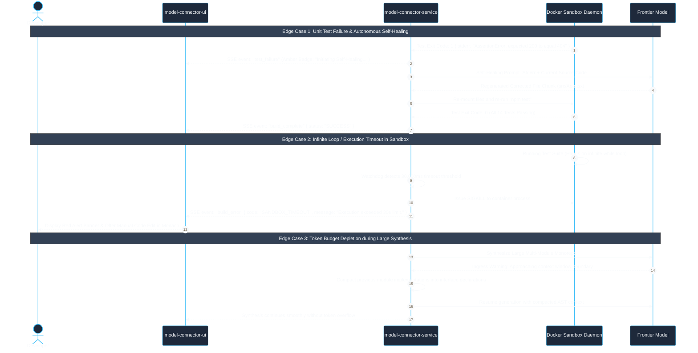

# Use Case 02 — Autonomous Fullstack Apps Builder Studio

> **Document ID**: `UC-02`  
> **Category**: Domain Application Workload  
> **Master Index**: [README.md §2](README.md#2-use-case-02--autonomous-fullstack-apps-builder-studio)  
> **Master Blueprint**: [blueprint.md §4.3](../blueprint.md#43-application-3-autonomous-apps-builder)  
> **System Architecture (HLD)**: [hld.md §5.3](../hld.md#53-application-3-autonomous-apps-builder)  
> **Component Design (LLD)**: [lld.md §4.5](../lld.md#45-flow-5-apps-builder-skill-md-ingestion--code-generation), [§11](../lld.md#11-dynamic-workflow-execution-engine--skip-governance), [§14](../lld.md#14-monorepo-code-generation-rules--anti-pattern-eliminator)  
> **UI Flows**: [ui-flows.md §7](../ui-flows.md#7-screen-6-visual-workflow-dag-builder--mcp-studio), [§13](../ui-flows.md#13-screen-11-linkedin-x-ray-discovery-playwright-dynamic-placeholder-workflows--ai-assistance-ui-flow)  

---

## 1. Executive Summary & Problem Statement

### 1.1 Executive Summary
* **Core Mission**: Enable software engineers and product creators to design, synthesize, verify, and package production-ready web and backend applications directly from natural language prompts and structured `SKILL.md` specifications.
* **Streaming & Verification Loop**: Synthesized source code streams in real-time over Server-Sent Events (SSE) into an interactive Monaco editor, undergoes automated hermetic test execution inside isolated non-root Docker containers, and packages verified project ZIP archives with cryptographic checksums.
* **Architecture Alignment**: Dispatched as an autonomous workload executing on Model Connector Platform via unified execution protocols (`POST /api/v1/executions`) with ephemeral container sandboxing.

### 1.2 Problem Statement
* **Hallucinated Syntheses**: Standard AI code generation models frequently output broken code with phantom dependencies, invalid imports, circular file references, and missing unit tests.
* **Manual Setup Friction**: Developers spend excessive time resolving linting errors, configuring toolchains, and debugging integration hurdles locally.
* **Security & Host Blast Radius**: Compiling and testing untrusted AI-generated code directly on host systems introduces critical risks of arbitrary remote code execution (RCE), network data exfiltration, and resource exhaustion.

### 1.3 Constraints & Non-Negotiables
* **Strict Container Sandboxing**: Code compilation and test execution must occur within non-root Docker containers (`UID 10001`), read-only root filesystems, dropped capabilities (`cap-drop: ALL`), and isolated memory boundaries ($\le 512\text{ MB}$).
* **Streaming Latency SLA**: Time-to-first-token must remain $\le 400\text{ ms}$; code synthesis streaming throughput must sustain $\ge 40\text{ tokens/sec}$.
* **Compliance with Monorepo Coding Standards**: Synthesized code must strictly enforce the 8 Non-Negotiable Engineering Invariants (`STD-COD-001` to `STD-COD-010`), using absolute `@/*` imports and zero nested procedural branching.
* **Zero Host Contamination**: Ephemeral containers must run with `--network none` during test execution to prevent unauthorized network exfiltration.

---

## 2. Architectural Solutions & Trade-offs

* **Evaluation Matrix**:
  * **Option A: Host Process `eval()` / Local Shell Execution**:
    * *Pros*: Lowest execution latency ($< 50\text{ms}$).
    * *Cons*: **Critical Security Hazard**; host compromise risk; non-deterministic dependencies.
    * *Verdict*: **Rejected**.
  * **Option B: Cloud Virtual Machine (VM) Virtualization**:
    * *Pros*: Strongest boundary isolation.
    * *Cons*: High spin-up latency ($20\text{--}60\text{s}$ cold boot); massive cloud infrastructure costs.
    * *Verdict*: **Rejected**.
  * **Option C: Ephemeral Non-Root Docker Sandbox with SSE Streaming (Selected)**:
    * *Pros*: Enterprise-grade security via cgroups and seccomp profiles, sub-second container instantiation ($< 400\text{ms}$), live interactive feedback in Monaco editor with XTerm.js terminal mirror.
    * *Cons*: Requires localized Docker daemon management and pre-warmed base images.
    * *Verdict*: **SELECTED (BEST)**.

---

## 3. Macro Architecture (HLD) & Component Diagram

### 3.1 System Design Principles
* **Edge Ingress Gateway**: Apache APISIX routes developer requests, handles tenant authentication, and maintains long-lived SSE connections.
* **Apps Builder Pipeline**:
  * `SkillCompilerService`: Ingests and validates structured `SKILL.md` frontmatter, schema definitions, and required tools.
  * `CodeSynthesisStreamService`: Coordinates prompt assembly with frontier models (Claude 3.5 Sonnet / Gemini 1.5 Pro) and streams file chunks.
  * `DockerSandboxService`: Manages container lifecycles, mounts files, executes tests, and captures stdout/stderr.
  * `ArtifactPackagerService`: Compiles validated code into a production ZIP archive and calculates SHA-256 integrity hashes.
* **Polyglot Persistence Layer**:
  * **PostgreSQL**: Stores `APP_PROJECTS` and `BUILD_EXECUTIONS`.
  * **MinIO / Local Object Store**: Retains compiled project bundles and build logs.

### 3.2 High-Level Architecture Diagram



---

## 4. End-to-End User Flow Diagram

* **Architectural Principle**: The code synthesis and sandbox validation lifecycle streams live execution telemetry over SSE, providing transparent visibility into code generation, container mounting, and test execution.

### 4.1 Nominal User Flow Sequence



---

## 5. Low-Level Design (LLD)

### 5.1 LLD Class & Component Interaction Diagram



### 5.2 Service Implementation & Container Executor

```typescript
// @/services/apps/DockerSandboxService.ts

import { childProcessUtils } from '@model-box/model-connector-core/utils';
import { DomainException } from '@/domain/exceptions/DomainException';

export interface SandboxExecutionResult {
  readonly exitCode: number;
  readonly stdout: string;
  readonly stderr: string;
  readonly executionDurationMs: number;
}

export class DockerSandboxService {
  private static readonly SANDBOX_IMAGE = 'model-connector/sandbox-runner:node20';
  private static readonly MAX_EXECUTION_TIME_MS = 30000;

  public async runHermeticTest(projectWorkspacePath: string): Promise<SandboxExecutionResult> {
    const startTime = Date.now();
    const dockerArgs = [
      'run', '--rm',
      '--network', 'none',
      '--user', '10001:10001',
      '--read-only',
      '--tmpfs', '/tmp:rw,noexec,nosuid,size=64m',
      '--memory', '512m',
      '--cpus', '1.0',
      '-v', `${projectWorkspacePath}:/app:ro`,
      DockerSandboxService.SANDBOX_IMAGE,
      'npm', 'test'
    ];

    try {
      const result = await childProcessUtils.execFileAsync('docker', dockerArgs, {
        timeout: DockerSandboxService.MAX_EXECUTION_TIME_MS,
      });

      return {
        exitCode: 0,
        stdout: result.stdout,
        stderr: result.stderr,
        executionDurationMs: Date.now() - startTime,
      };
    } catch (err: unknown) {
      const execErr = err as { code?: number; stdout?: string; stderr?: string };
      return {
        exitCode: execErr.code ?? 1,
        stdout: execErr.stdout ?? '',
        stderr: execErr.stderr ?? (err instanceof Error ? err.message : String(err)),
        executionDurationMs: Date.now() - startTime,
      };
    }
  }
}
```

### 5.3 Relational DDL Schema

```sql
-- DDL for Apps Builder Projects and Executions
CREATE TABLE IF NOT EXISTS APP_PROJECTS (
    PROJECT_ID VARCHAR(64) PRIMARY KEY,
    TENANT_ID VARCHAR(64) NOT NULL,
    USER_ID VARCHAR(64) NOT NULL,
    PROJECT_NAME VARCHAR(255) NOT NULL,
    TARGET_FRAMEWORK VARCHAR(64) NOT NULL DEFAULT 'REACT_VITE',
    SKILL_SPEC_MARKDOWN TEXT NOT NULL,
    CURRENT_STATUS VARCHAR(32) NOT NULL DEFAULT 'DRAFT',
    ARTIFACT_STORAGE_PATH TEXT,
    CREATED_AT TIMESTAMP WITH TIME ZONE NOT NULL DEFAULT CURRENT_TIMESTAMP,
    UPDATED_AT TIMESTAMP WITH TIME ZONE NOT NULL DEFAULT CURRENT_TIMESTAMP,
    CONSTRAINT FK_AP_TENANT FOREIGN KEY (TENANT_ID) REFERENCES TENANTS (TENANT_ID) ON DELETE CASCADE
);

CREATE TABLE IF NOT EXISTS BUILD_EXECUTIONS (
    EXECUTION_ID VARCHAR(64) PRIMARY KEY,
    PROJECT_ID VARCHAR(64) NOT NULL,
    TENANT_ID VARCHAR(64) NOT NULL,
    STATUS VARCHAR(32) NOT NULL DEFAULT 'RUNNING',
    TEST_EXIT_CODE INTEGER,
    TEST_STDOUT TEXT,
    TEST_STDERR TEXT,
    DURATION_MS BIGINT NOT NULL,
    CREATED_AT TIMESTAMP WITH TIME ZONE NOT NULL DEFAULT CURRENT_TIMESTAMP,
    CONSTRAINT FK_BE_PROJECT FOREIGN KEY (PROJECT_ID) REFERENCES APP_PROJECTS (PROJECT_ID) ON DELETE CASCADE
);

CREATE INDEX IF NOT EXISTS IDX_BE_PROJECT_STATUS ON BUILD_EXECUTIONS (PROJECT_ID, STATUS);
```

---

## 6. UI Interaction Flow & Screen States

* **Studio Config Frame**:
  * User inputs natural language prompt, selects target tech stack (React + Vite, Node.js + Express), and optionally uploads `SKILL.md`.
* **Real-Time Code Synthesis Frame**:
  * Monaco Editor displays live streaming code chunks with language syntax highlighting.
  * Left sidebar displays virtual project file tree populating in real-time (`src/App.tsx`, `package.json`).
* **Sandbox Terminal Frame (XTerm.js)**:
  * Live terminal stream mirrors Docker container test runner (`PASS src/App.test.tsx (4 tests)`).
* **Export & Deployment Frame**:
  * Displays green artifact readiness card with SHA-256 checksum and instant download button.

---

## 7. API Ingress & Protocol Specification

### 7.1 Initiate App Synthesis
* **Endpoint**: `POST /api/v1/apps/synthesize`
* **Headers**: `Authorization: Bearer <JWT>`, `X-Tenant-Id: <TENANT_ID>`, `Content-Type: application/json`
* **Request Body**:
```json
{
  "projectName": "TaskMasterPro",
  "prompt": "Build a responsive Kanban board with drag-and-drop, localStorage persistence, and modular CSS.",
  "targetFramework": "REACT_VITE",
  "skillMarkdown": "---\nname: kanban-spec\nversion: 1.0.0\n---"
}
```
* **Response**: `202 Accepted` with `{ "projectId": "PROJ-771", "streamUrl": "/api/v1/apps/stream/PROJ-771" }`

---

## 8. Failure Modes, Edge Cases & Recovery User Flow

### 8.1 Edge Cases User Flow & Error Recovery Sequence



### 8.2 Failure Modes & Fallback Matrix

| Failure Mode | Trigger Condition | Automated System Response | User Experience Impact |
| :--- | :--- | :--- | :--- |
| **Sandbox Test Failure** | Synthesized code fails generated unit tests (`exitCode != 0`) | System captures `stderr`, injects error into model self-healing prompt, and regenerates failing module | UI displays amber status: *"Autonomous healing in progress: fixing test regression..."* |
| **Sandbox Execution Timeout** | Infinite loop or hanging process in generated code ($>30\text{s}$) | Daemon sends `SIGKILL`, marks execution as `TIMEOUT`, and terminates container | UI displays red alert: *"Execution timed out. Potential infinite loop detected in generated code."* |
| **Token Budget Exhausted** | Massive project generation exceeds model token limits | Compactor compresses preceding files into semantic interface signatures (§13) | Synthesis continues seamlessly without crashing. |
| **Container OOM Crash** | Memory consumption exceeds 512MB limit during compilation | Docker exits with code 137; watchdog flags resource quota breach | UI prompts user to enable high-memory compilation mode for large builds. |
| **Network Egress Attempt** | Malicious or buggy script attempts outbound socket connection | Docker `--network none` flag instantly rejects packet transmission | Attempt logged to security audit trail; zero host network exposure. |
