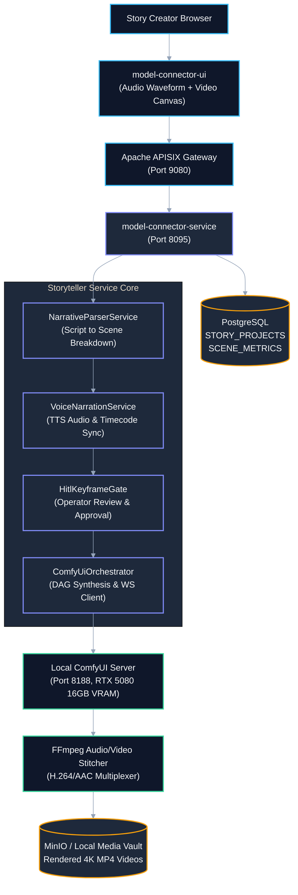
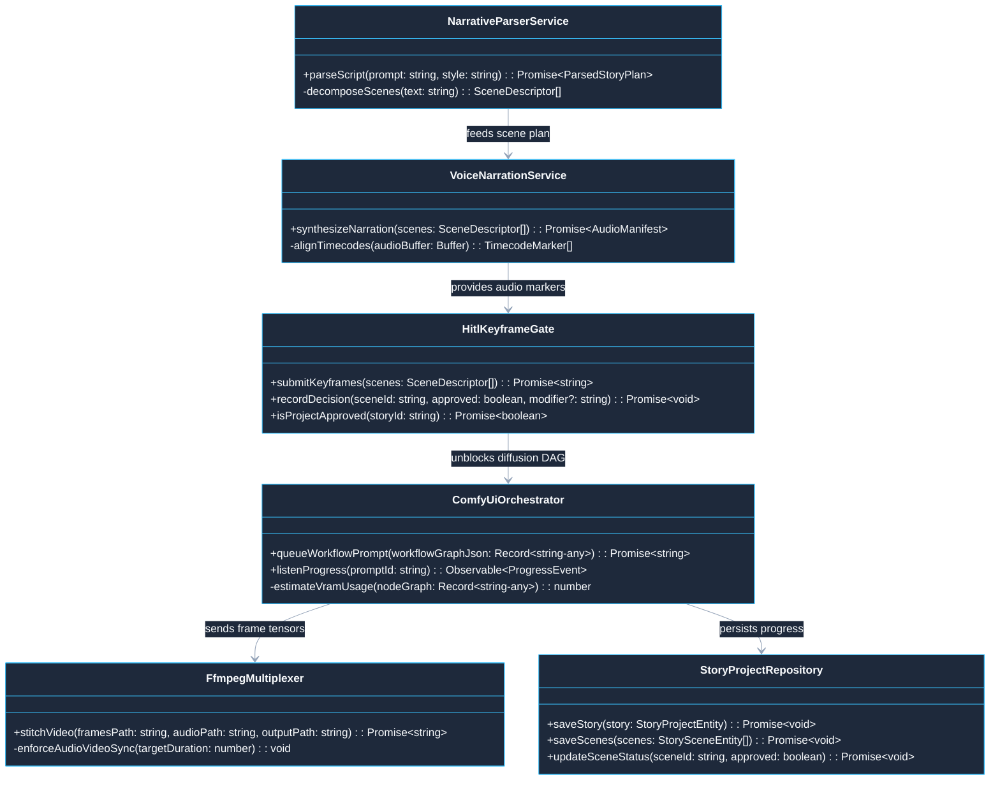

# Use Case 03 — ComfyUI Storyteller & Video Generation Engine

> **Document ID**: `UC-03`  
> **Category**: Domain Application Workload  
> **Master Index**: [README.md §3](README.md#3-use-case-03--comfyui-storyteller--video-generation-engine)  
> **Master Blueprint**: [blueprint.md §4.2](../blueprint.md#42-application-2-comfyui-storyteller-engine)  
> **System Architecture (HLD)**: [hld.md §5.2](../hld.md#52-application-2-comfyui-storyteller-engine), [§20](../hld.md#20-host-system-hardware-profile--docker-container-resource-allocation-matrix)  
> **Component Design (LLD)**: [lld.md §4.4](../lld.md#44-flow-4-comfyui-storyteller-prompt--workflow-generation)  
> **UI Flows**: [ui-flows.md §7](../ui-flows.md#7-screen-6-visual-workflow-dag-builder--mcp-studio), [§13](../ui-flows.md#13-screen-11-linkedin-x-ray-discovery-playwright-dynamic-placeholder-workflows--ai-assistance-ui-flow)  

---

## 1. Executive Summary & Problem Statement

### 1.1 Executive Summary
* **Core Mission**: Transform high-level natural language narrative premises into coherent, multi-scene cinematic audiovisual productions.
* **Orchestration Pipeline**: Decomposes story scripts into granular scene DAGs, synthesizes phoneme-aligned neural Text-to-Speech (TTS) audio, generates high-fidelity still keyframes for Human-in-the-Loop (HITL) approval, and coordinates local GPU-accelerated Stable Diffusion / SDXL / AnimateDiff workflows via ComfyUI.
* **Hardware & Cost Efficiency**: Executes entirely on local hardware (NVIDIA RTX 5080 Laptop GPU with 16GB VRAM) without recurring cloud inference fees.

### 1.2 Problem Statement
* **Visual Character Drift**: Monolithic text-to-video black-box models fail to maintain character seed, style consistency, and lighting coherence across sequential scene transitions.
* **Pacing & Synchronization Disjoint**: Pre-rendered video clips fail to match dialogue cadence, resulting in unnatural lip-sync and abrupt sentence cuts.
* **Prohibitive Cloud GPU Expenses**: Commercial video generation APIs charge steep per-second fees, restricting rapid prototyping and iterative creative exploration.
* **VRAM Volatility & CUDA Crashes**: Running multi-pass temporal diffusion without strict tensor memory governance causes catastrophic CUDA Out-of-Memory (OOM) failures.

### 1.3 Constraints & Non-Negotiables
* **Hardware Resource Enclosure**: Bound to 24 CPU cores, 32GB host system RAM, and NVIDIA RTX 5080 Laptop GPU (16GB VRAM).
* **VRAM Governance Ceiling**: ComfyUI process memory must remain strictly capped at $\le 12\text{ GB}$ dedicated VRAM, reserving $4\text{ GB}$ buffer for OS window compositing and audio pipelines.
* **Audio-Visual Alignment Precision**: Keyframe scene cuts and video transitions must synchronize with neural TTS sentence pauses within $\pm 40\text{ ms}$.
* **Human-in-the-Loop Checkpoint**: Final temporal video rendering must never execute without explicit operator approval of generated scene keyframes.

---

## 2. Architectural Solutions & Trade-offs

* **Evaluation Matrix**:
  * **Option A: Monolithic Cloud Video API (Runway / Pika)**:
    * *Pros*: Zero local hardware setup required.
    * *Cons*: Exorbitant operational cost ($0.10\text{--}0.50$ per second generated); complete lack of character seed control; black box output.
    * *Verdict*: **Rejected**.
  * **Option B: Sequential Command-Line Scripts**:
    * *Pros*: Simple procedural execution.
    * *Cons*: Fragile error handling; frequent CUDA OOM crashes; no interactive UI feedback or live waveform manipulation.
    * *Verdict*: **Rejected**.
  * **Option C: ComfyUI DAG Orchestration with Local GPU Acceleration & HITL Review (Selected)**:
    * *Pros*: Zero marginal operational cost via local RTX 5080 GPU; consistent character IP-Adapter and LoRA embeddings across scenes; strict pre-flight VRAM budgeting; interactive HITL approval canvas.
    * *Cons*: Requires localized ComfyUI process lifecycle supervision and WebSocket progress streaming.
    * *Verdict*: **SELECTED (BEST)**.

---

## 3. Macro Architecture (HLD) & Component Diagram

### 3.1 System Design Principles
* **Edge Ingress Gateway**: Apache APISIX routes creator commands, enforces tenant boundaries, and proxies WebSocket streaming telemetry.
* **Decoupled Storytelling Engine**:
  * `NarrativeParserService`: Breaks natural language story concepts into structured scene descriptions, camera angles, and character prompts.
  * `VoiceNarrationService`: Synthesizes neural TTS voice tracks and extracts exact phoneme timecodes.
  * `HitlKeyframeGate`: Presents generated still keyframes to the creator for interactive inspection, adjustment, or re-generation.
  * `ComfyUiOrchestrator`: Dispatches programmatic node graph JSON payloads to ComfyUI over HTTP and monitors generation progress via WebSocket.
  * `FfmpegMultiplexer`: Assembles latent video frames with narration audio into H.264/AAC 4K MP4 containers.
* **Polyglot Persistence Layer**:
  * **PostgreSQL**: Stores relational metadata in `STORY_PROJECTS` and `STORY_SCENES`.
  * **Local Media Vault / MinIO**: Retains rendered keyframe PNGs, TTS audio WAVs, and final video MP4s.

### 3.2 High-Level Architecture Diagram



---

## 4. End-to-End User Flow Diagram

* **Architectural Principle**: Storyteller generation enforces a two-phase commit: Phase 1 produces audio and keyframes for review; Phase 2 executes heavy temporal GPU diffusion only after human verification.

### 4.1 Nominal User Flow Sequence

```mermaid
%%{init: {'theme': 'base', 'themeVariables': { 'primaryColor': '#1E293B', 'primaryTextColor': '#F8FAFC', 'primaryBorderColor': '#38BDF8', 'lineColor': '#94A3B8', 'secondaryColor': '#0F172A', 'tertiaryColor': '#1E293B', 'noteBkgColor': '#334155', 'noteTextColor': '#F8FAFC'}}}%%
sequenceDiagram
    autonumber
    actor Creator as Content Creator
    participant UI as model-connector-ui
    participant GW as Apache APISIX Gateway
    participant Svc as model-connector-service
    participant Comfy as Local ComfyUI (RTX 5080)
    participant FFmpeg as FFmpeg Encoder

    Creator->>UI: 1. Input Narrative Prompt ("Cyberpunk detective investigates rogue AI")
    UI->>GW: POST /api/v1/story/create { prompt: "...", visualStyle: "CINEMATIC_NOIR" }
    GW->>Svc: Forward Story Creation Request
    Svc->>Svc: NarrativeParserService decomposes into 4 distinct scenes
    Svc->>Svc: VoiceNarrationService synthesizes scene audio tracks & phoneme cues
    Svc->>Comfy: Dispatch Keyframe Generation DAG
    Comfy-->>Svc: Rendered Still Keyframes for Scenes 1-4
    
    Svc-->>UI: 200 OK with Keyframes & Audio Waveforms
    UI-->>Creator: 2. Render HITL Keyframe Review Canvas
    
    Creator->>UI: 3. Approve Scenes 1-3; Click "Regenerate Scene 4 with Blue Lighting"
    UI->>Svc: POST /api/v1/story/scene/4/regenerate { promptModifier: "Deep cobalt lighting" }
    Svc->>Comfy: Regenerate Scene 4 Keyframe
    Comfy-->>Svc: Updated Keyframe 4
    Svc-->>UI: Live Update: Keyframe 4 Refreshed
    
    Creator->>UI: 4. Click "Render Final Video"
    UI->>Svc: POST /api/v1/story/render { projectId: "STORY-551" }
    Svc->>Comfy: Dispatch AnimateDiff Temporal Diffusion DAG (GPU Accelerated)
    
    loop Real-Time Rendering Progress
        Comfy-->>Svc: WebSocket Progress: { node: "KSampler", progress: 65% }
        Svc-->>UI: SSE Progress Event: 65% Rendered
    end
    
    Comfy-->>FFmpeg: Raw Latent Frames
    FFmpeg->>FFmpeg: Multiplex Frames with TTS Audio at exact timecodes
    FFmpeg-->>Svc: Rendered 4K MP4 Video (100% Complete)
    Svc-->>UI: Final Video Ready Event { videoUrl: "/media/story-551.mp4" }
    UI-->>Creator: 5. Interactive 4K Video Player with Download & Export Controls
```

---

## 5. Low-Level Design (LLD)

### 5.1 LLD Class & Component Interaction Diagram



### 5.2 Service Implementation & ComfyUI Client

```typescript
// @/services/story/ComfyUiOrchestrator.ts

import { DomainException } from '@/domain/exceptions/DomainException';

export interface ComfyPromptWorkflow {
  readonly oauth_client_reference: string;
  readonly prompt: Record<string, unknown>;
}

export class ComfyUiOrchestrator {
  public constructor(
    private readonly comfyBaseUrl = 'http://127.0.0.1:8188',
    private readonly clientId = 'model-connector-storyteller',
  ) {}

  public async queueWorkflowPrompt(workflowGraphJson: Record<string, unknown>): Promise<string> {
    const payload: ComfyPromptWorkflow = {
      oauth_client_reference: this.clientId,
      prompt: workflowGraphJson,
    };

    const res = await fetch(`${this.comfyBaseUrl}/prompt`, {
      method: 'POST',
      headers: { 'Content-Type': 'application/json' },
      body: JSON.stringify(payload),
    });

    if (!res.ok) {
      throw new DomainException(`COMFYUI_DISPATCH_FAILED: Server returned HTTP ${res.status}`);
    }

    const data = await res.json() as { prompt_id: string };
    return data.prompt_id;
  }
}
```

### 5.3 Relational DDL Schema

```sql
-- DDL for Storyteller Projects and Scenes
CREATE TABLE IF NOT EXISTS STORY_PROJECTS (
    STORY_ID VARCHAR(64) PRIMARY KEY,
    TENANT_ID VARCHAR(64) NOT NULL,
    USER_ID VARCHAR(64) NOT NULL,
    TITLE VARCHAR(255) NOT NULL,
    NARRATIVE_PROMPT TEXT NOT NULL,
    VISUAL_STYLE VARCHAR(64) NOT NULL DEFAULT 'CINEMATIC_NOIR',
    AUDIO_VOICE_ID VARCHAR(64) NOT NULL DEFAULT 'NEURAL_NARRATOR_M1',
    STATUS VARCHAR(32) NOT NULL DEFAULT 'DRAFT',
    FINAL_VIDEO_URL TEXT,
    DURATION_SECONDS NUMERIC(6,2),
    CREATED_AT TIMESTAMP WITH TIME ZONE NOT NULL DEFAULT CURRENT_TIMESTAMP,
    UPDATED_AT TIMESTAMP WITH TIME ZONE NOT NULL DEFAULT CURRENT_TIMESTAMP,
    CONSTRAINT FK_SP_TENANT FOREIGN KEY (TENANT_ID) REFERENCES TENANTS (TENANT_ID) ON DELETE CASCADE
);

CREATE TABLE IF NOT EXISTS STORY_SCENES (
    SCENE_ID VARCHAR(64) PRIMARY KEY,
    STORY_ID VARCHAR(64) NOT NULL,
    SCENE_ORDER INTEGER NOT NULL,
    SCRIPT_TEXT TEXT NOT NULL,
    AUDIO_TIMECODE_START NUMERIC(6,3) NOT NULL,
    AUDIO_TIMECODE_END NUMERIC(6,3) NOT NULL,
    KEYFRAME_IMAGE_URL TEXT,
    IS_APPROVED BOOLEAN NOT NULL DEFAULT FALSE,
    CREATED_AT TIMESTAMP WITH TIME ZONE NOT NULL DEFAULT CURRENT_TIMESTAMP,
    CONSTRAINT FK_SCENE_STORY FOREIGN KEY (STORY_ID) REFERENCES STORY_PROJECTS (STORY_ID) ON DELETE CASCADE,
    CONSTRAINT UQ_SCENE_ORDER UNIQUE (STORY_ID, SCENE_ORDER)
);

CREATE INDEX IF NOT EXISTS IDX_SCENE_STORY ON STORY_SCENES (STORY_ID, SCENE_ORDER);
```

---

## 6. UI Interaction Flow & Screen States

* **Script Prompt Canvas**:
  * Rich text prompt area with instant dropdown selectors for `Genre`, `Visual Palette`, and `Neural Voice Profile`.
* **Audio & Waveform State**:
  * Audio track visualizer displaying interactive frequency waves and draggable scene cut markers.
* **HITL Keyframe Grid**:
  * 4-card interactive grid displaying generated still keyframes.
  * Individual `Regenerate` button with prompt modifier input for localized scene retakes.
* **Diffusion Render State**:
  * Real-time radial gauge reflecting ComfyUI KSampler step progress (e.g., `Sampling Step 18/25`).
* **Cinema Player Frame**:
  * High-definition 4K video player with frame-by-frame scrub controls, audio track toggles, and direct MP4 export.

---

## 7. API Ingress & Protocol Specification

### 7.1 Create Story Project & Generate Scenes
* **Endpoint**: `POST /api/v1/story/create`
* **Headers**: `Authorization: Bearer <JWT>`, `X-Tenant-Id: <TENANT_ID>`, `Content-Type: application/json`
* **Request Body**:
```json
{
  "title": "Neon Shadows",
  "narrativePrompt": "In the rain-soaked streets of Neo-Shinjuku, a private detective discovers an AI that dreams.",
  "visualStyle": "CYBERPUNK_ANIME",
  "voiceProfile": "EN_US_MALE_GRAVEL"
}
```
* **Response**: `201 Created` with `{ "storyId": "STORY-991", "sceneCount": 4, "status": "HITL_REVIEW_READY" }`

---

## 8. Failure Modes, Edge Cases & Recovery User Flow

### 8.1 Edge Cases User Flow & Error Recovery Sequence

```mermaid
%%{init: {'theme': 'base', 'themeVariables': { 'primaryColor': '#1E293B', 'primaryTextColor': '#F8FAFC', 'primaryBorderColor': '#38BDF8', 'lineColor': '#94A3B8', 'secondaryColor': '#0F172A', 'tertiaryColor': '#1E293B', 'noteBkgColor': '#334155', 'noteTextColor': '#F8FAFC'}}}%%
sequenceDiagram
    autonumber
    actor Creator as Content Creator
    participant UI as model-connector-ui
    participant Svc as model-connector-service
    participant Comfy as ComfyUI (RTX 5080)
    participant FFmpeg as FFmpeg Multiplexer

    Note over Creator,FFmpeg: Edge Case 1: CUDA Out-of-Memory (OOM) on High-Resolution Pass
    Svc->>Comfy: Dispatch 4K Temporal Batch
    Comfy-->>Svc: Error: "CUDA out of memory. Tried to allocate 4.2 GiB (16.0 GiB total capacity)"
    Svc->>Svc: Pre-flight VRAM Governor catches failure
    Svc-->>UI: SSE Notification: "VRAM Constrained: Automatically switching to tiled KSampler..."
    Svc->>Comfy: Re-queue with Tiled Diffusion & Latent Batch Halved
    Comfy-->>Svc: Render Succeeded via Tiled VRAM Sharding

    Note over Creator,FFmpeg: Edge Case 2: Audio & Keyframe Temporal Drift
    VoiceNarrationService-->>Svc: Audio Track Length: 12.4s (Planned: 10.0s)
    Svc->>Svc: Timecode Drift Detected (+2.4s mismatch)
    Svc->>FFmpeg: Apply dynamic temporal frame interpolation (RIFE motion smoothing)
    FFmpeg->>FFmpeg: Interpolate 24 extra frames to match audio duration cleanly
    FFmpeg-->>Svc: Cleanly Multiplexed MP4 without sentence clipping

    Note over Creator,FFmpeg: Edge Case 3: ComfyUI Daemon Process Crash
    Comfy-->>Svc: Connection Dropped (ECONNREFUSED :8188)
    Svc->>Svc: TaskHeartbeatWatchdog flags daemon termination
    Svc->>Svc: Trigger local childProcess restart of ComfyUI daemon
    Svc->>Comfy: Re-hydrate pending DAG execution from PostgreSQL state
    Svc-->>UI: Live Reconnection Banner: "Engine recovered; resuming rendering at Scene 3"
```

### 8.2 Failure Modes & Fallback Matrix

| Failure Mode | Trigger Condition | Automated System Response | User Experience Impact |
| :--- | :--- | :--- | :--- |
| **CUDA Out-of-Memory (OOM)** | Large batch dimension or excessive latent frames exceed 16GB VRAM | ComfyUI driver intercepts error; orchestrator switches to tiled diffusion and halves latent batch size | UI displays amber notice: *"Optimizing VRAM allocations; retrying render..."* |
| **TTS Audio Desync** | Synthesized audio duration mismatches planned scene timecode | Video timeline dynamically applies RIFE temporal frame interpolation to expand/compress loop | Video transitions cleanly on sentence pauses without abrupt cuts. |
| **ComfyUI Process Crash** | Headless ComfyUI daemon terminates unexpectedly | Watchdog detects process loss, restarts local daemon, and resumes DAG from last saved checkpoint | Temporary delay ($< 5\text{s}$); user does not lose story configuration. |
| **Negative Prompts Bleed** | Visual artifacts or unwanted elements detected in keyframes | Human-in-the-Loop gate flags scene; prompts user for one-click negative prompt refinement | Operator adjusts prompt modifiers directly on the canvas before final video render. |
| **Disk Space Exhaustion** | Rendered intermediate 4K latents fill local temporary storage | Background janitor prunes cached latents older than 24 hours while preserving final MP4s | Zero build aborts due to disk exhaustion; seamless multi-project generation. |
