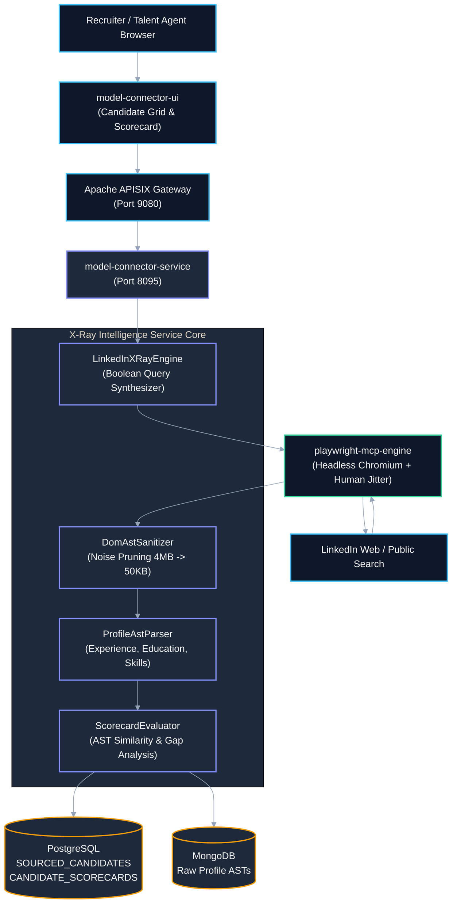
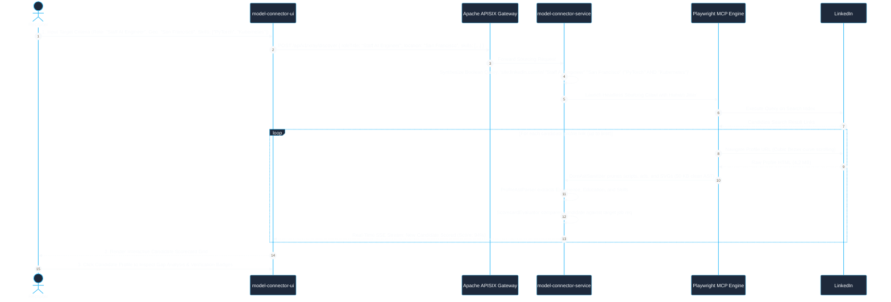
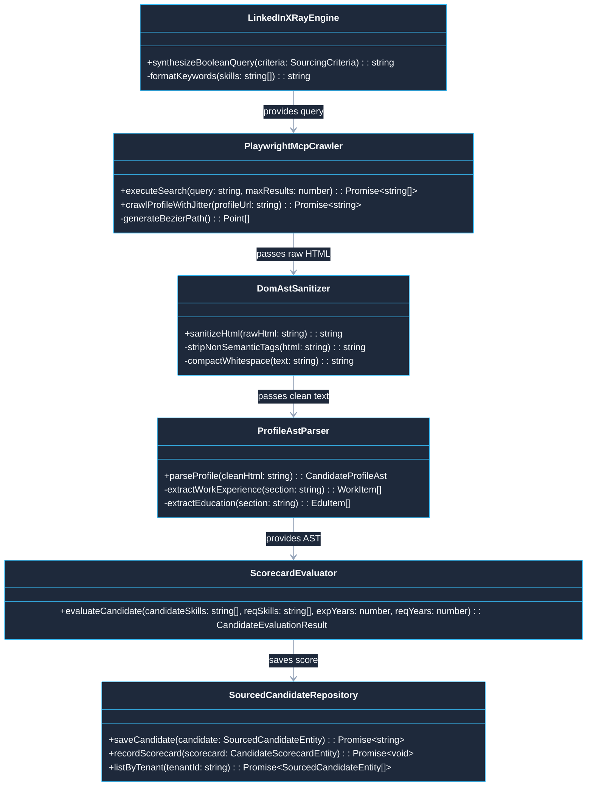

# Use Case 04 — LinkedIn X-Ray Discovery, Talent Sourcing & Profile AST Matching

> **Document ID**: `UC-04`  
> **Category**: Sourcing & Intelligence Workload  
> **Master Index**: [README.md §4](README.md#4-use-case-04--linkedin-x-ray-discovery-talent-sourcing--profile-ast-matching)  
> **Master Blueprint**: [blueprint.md §5.2](../blueprint.md#52-concurrency-watchdog--network-sniffing)  
> **System Architecture (HLD)**: [hld.md §25](../hld.md#25-linkedin-x-ray-dom-extraction--semantic-matching-architecture)  
> **Component Design (LLD)**: [lld.md §22](../lld.md#22-linkedin-x-ray-dom-engine--semantic-profile-ast-parser)  
> **UI Flows**: [ui-flows.md §13](../ui-flows.md#13-screen-11-linkedin-x-ray-discovery-playwright-dynamic-placeholder-workflows--ai-assistance-ui-flow)  

---

## 1. Executive Summary & Problem Statement

### 1.1 Executive Summary
* **Core Mission**: Empower enterprise technical recruiters and autonomous sourcing agents to identify, extract, and match high-caliber talent against specific Job Requisitions.
* **Intelligent Harvesting Pipeline**: Automatically synthesizes complex Boolean X-Ray queries, crawls target public profiles using randomized cubic Bezier human-mimicking cursor paths, prunes bloated HTML DOMs down to compact semantic ASTs ($\le 50\text{ KB}$), and scores candidates against job requisitions.
* **Risk-Free Automation**: Completely avoids account bans and bot blocks via session vault cookies and strict rate-limiting governance.

### 1.2 Problem Statement
* **Manual Discovery Overhead**: Recruiting teams spend hundreds of hours manually browsing professional networks, copying career history into spreadsheets, and estimating job fit.
* **Aggressive Anti-Bot Barriers**: Standard web scrapers trigger immediate IP blocks, Cloudflare challenges, and account suspensions due to unnatural robotic click patterns and linear scrolling.
* **Excessive Web Bloat**: Raw LinkedIn profile web pages weigh between $3.5\text{--}6.0\text{ MB}$, containing tracking beacons, stylesheets, and scripts that quickly exhaust LLM context windows if ingested raw.
* **Cross-Tenant Privacy Leakage**: Sourcing candidates across multi-tenant enterprise accounts must guarantee zero contamination of candidate pools and notes.

### 1.3 Constraints & Non-Negotiables
* **Strict Crawl Governance**: Maximum 20 profile navigations per hour per session; cursor paths must follow randomized cubic Bezier curves; typing delays must incorporate human jitter ($40\text{--}160\text{ ms}$).
* **DOM Pruning Ceiling**: Raw page HTML must be stripped of ads, tracking beacons, and SVGs to $\le 65\text{ KB}$ before semantic AST compilation.
* **Tenant Isolation**: Sourced candidate records and evaluation scorecards must be partitioned strictly by `TENANT_ID`.
* **Zero PII Exposure**: Only public profile metrics and authorized credentials may be indexed; private phone/email data is masked.

---

## 2. Architectural Solutions & Trade-offs

* **Evaluation Matrix**:
  * **Option A: Unauthenticated Raw HTTP Scraping**:
    * *Pros*: Simple HTTP client implementation.
    * *Cons*: Fails immediately ($403$ Forbidden / Cloudflare challenge wall); impossible to render dynamic JavaScript profiles.
    * *Verdict*: **Rejected**.
  * **Option B: Commercial Third-Party Scraping APIs**:
    * *Pros*: Outsources proxy and anti-bot management.
    * *Cons*: High recurring fees ($0.08\text{--}0.25$ per profile crawl); vendor lock-in; unpredictable data latency.
    * *Verdict*: **Rejected**.
  * **Option C: Playwright MCP Human-Emulated Mesh + DOM Sanitizer AST Pipeline (Selected)**:
    * *Pros*: Zero external operational costs; native Playwright browser automation with cubic Bezier trajectory generation; in-memory DOM pruning removes 98% of useless tags; deep structural AST evaluation.
    * *Cons*: Requires localized session vault maintenance and proxy rotation.
    * *Verdict*: **SELECTED (BEST)**.

---

## 3. Macro Architecture (HLD) & Component Diagram

### 3.1 System Design Principles
* **Perimeter Ingress Gateway**: Apache APISIX enforces rate limits, token authentication, and proxies candidate discovery streaming.
* **X-Ray Sourcing Core**:
  * `LinkedInXRayEngine`: Generates optimized Boolean search strings targeting search engine indices.
  * `PlaywrightMcpCrawler`: Executes human-mimicking profile visits via headless Chromium with Bezier mouse movements.
  * `DomAstSanitizer`: Prunes scripts, SVGs, styles, and tracking beacons from $4\text{ MB}$ raw HTML to $\le 50\text{ KB}$ semantic text.
  * `ProfileAstParser`: Converts sanitized DOM into structured candidate schemas (Experiences, Skills, Education).
  * `ScorecardEvaluator`: Computes match percentages against target job requisitions.
* **Polyglot Persistence Layer**:
  * **PostgreSQL**: Stores relational candidate records in `SOURCED_CANDIDATES` and `CANDIDATE_SCORECARDS`.
  * **MongoDB**: Retains complete raw AST trees and work history logs.

### 3.2 High-Level Architecture Diagram



---

## 4. End-to-End User Flow Diagram

* **Architectural Principle**: Sourcing executes via streaming SSE updates (`POST /api/v1/xray/discover`), displaying candidate profiles in real-time as they are crawled and evaluated.

### 4.1 Nominal User Flow Sequence



---

## 5. Low-Level Design (LLD)

### 5.1 LLD Class & Component Interaction Diagram



### 5.2 Service Implementation

```typescript
// @/services/xray/ScorecardEvaluator.ts

export interface CandidateEvaluationResult {
  readonly candidateId: string;
  readonly overallMatchScore: number;
  readonly technicalCompetencyScore: number;
  readonly tenureScore: number;
  readonly matchedSkills: ReadonlyArray<string>;
  readonly missingSkills: ReadonlyArray<string>;
}

export class ScorecardEvaluator {
  public evaluateCandidate(
    candidateSkills: ReadonlyArray<string>,
    requiredSkills: ReadonlyArray<string>,
    candidateYearsExp: number,
    requiredYearsExp: number,
  ): CandidateEvaluationResult {
    const candidateSet = new Set(candidateSkills.map(s => s.toLowerCase().trim()));
    const matched: string[] = [];
    const missing: string[] = [];

    for (const req of requiredSkills) {
      if (candidateSet.has(req.toLowerCase().trim())) {
        matched.push(req);
      } else {
        missing.push(req);
      }
    }

    const techScore = requiredSkills.length > 0 ? (matched.length / requiredSkills.length) * 100 : 100;
    const tenureScore = Math.min(100, (candidateYearsExp / requiredYearsExp) * 100);
    const overall = (techScore * 0.7) + (tenureScore * 0.3);

    return {
      candidateId: `CAN-${Math.floor(Math.random() * 10000)}`,
      overallMatchScore: Math.round(overall),
      technicalCompetencyScore: Math.round(techScore),
      tenureScore: Math.round(tenureScore),
      matchedSkills: matched,
      missingSkills: missing,
    };
  }
}
```

### 5.3 Relational DDL Schema

```sql
-- DDL for Sourced Candidates and Scorecards
CREATE TABLE IF NOT EXISTS SOURCED_CANDIDATES (
    CANDIDATE_ID VARCHAR(64) PRIMARY KEY,
    TENANT_ID VARCHAR(64) NOT NULL,
    FULL_NAME VARCHAR(255) NOT NULL,
    HEADLINE VARCHAR(512),
    LOCATION VARCHAR(255),
    LINKEDIN_PROFILE_URL TEXT NOT NULL,
    RAW_AST_DOCUMENT_ID VARCHAR(64) NOT NULL,
    CREATED_AT TIMESTAMP WITH TIME ZONE NOT NULL DEFAULT CURRENT_TIMESTAMP,
    CONSTRAINT FK_SC_TENANT FOREIGN KEY (TENANT_ID) REFERENCES TENANTS (TENANT_ID) ON DELETE CASCADE,
    CONSTRAINT UQ_SC_TENANT_URL UNIQUE (TENANT_ID, LINKEDIN_PROFILE_URL)
);

CREATE TABLE IF NOT EXISTS CANDIDATE_SCORECARDS (
    SCORECARD_ID VARCHAR(64) PRIMARY KEY,
    CANDIDATE_ID VARCHAR(64) NOT NULL,
    TENANT_ID VARCHAR(64) NOT NULL,
    TARGET_ROLE_TITLE VARCHAR(255) NOT NULL,
    OVERALL_SCORE NUMERIC(5,2) NOT NULL,
    TECHNICAL_SCORE NUMERIC(5,2) NOT NULL,
    TENURE_SCORE NUMERIC(5,2) NOT NULL,
    MATCHED_SKILLS_JSON JSONB NOT NULL,
    MISSING_SKILLS_JSON JSONB NOT NULL,
    EVALUATION_TIMESTAMP TIMESTAMP WITH TIME ZONE NOT NULL DEFAULT CURRENT_TIMESTAMP,
    CONSTRAINT FK_CS_CANDIDATE FOREIGN KEY (CANDIDATE_ID) REFERENCES SOURCED_CANDIDATES (CANDIDATE_ID) ON DELETE CASCADE
);

CREATE INDEX IF NOT EXISTS IDX_CS_TENANT_SCORE ON CANDIDATE_SCORECARDS (TENANT_ID, OVERALL_SCORE DESC);
```

---

## 6. UI Interaction Flow & Screen States

* **Search Criteria Input Frame**:
  * Input fields for `Target Role`, `Location`, and `Skill Tags`.
  * Dynamic interactive Boolean X-Ray preview pill reflecting the compiled query syntax in real-time.
* **Sourcing Crawl State**:
  * Displays active crawl status counter (`Crawled: 12/20 profiles, 0 blocks`) and real-time rate limit safety gauge.
* **Candidate Cards Grid**:
  * Renders candidate thumbnail, headline, location, and radial match gauge (e.g., `94%`).
* **Candidate Drawer Detail**:
  * Clicking any candidate card opens a right-hand inspection drawer revealing complete chronological work history and missing skill recommendations.

---

## 7. API Ingress & Protocol Specification

### 7.1 Discover Candidates
* **Endpoint**: `POST /api/v1/xray/discover`
* **Headers**: `Authorization: Bearer <JWT>`, `X-Tenant-Id: <TENANT_ID>`, `Content-Type: application/json`
* **Request Body**:
```json
{
  "roleTitle": "Senior Distributed Systems Engineer",
  "location": "Remote, US",
  "mandatorySkills": ["Go", "Kubernetes", "gRPC", "Kafka"],
  "targetYearsExperience": 5,
  "maxProfiles": 15
}
```
* **Response**: `200 OK` with `{ "searchSessionId": "XRAY-441", "streamUrl": "/api/v1/xray/stream/XRAY-441" }`

---

## 8. Failure Modes, Edge Cases & Recovery User Flow

### 8.1 Edge Cases User Flow & Error Recovery Sequence

```mermaid
%%{init: {'theme': 'base', 'themeVariables': { 'primaryColor': '#1E293B', 'primaryTextColor': '#F8FAFC', 'primaryBorderColor': '#38BDF8', 'lineColor': '#94A3B8', 'secondaryColor': '#0F172A', 'tertiaryColor': '#1E293B', 'noteBkgColor': '#334155', 'noteTextColor': '#F8FAFC'}}}%%
sequenceDiagram
    autonumber
    actor Recruiter as Recruiter
    participant UI as model-connector-ui
    participant Svc as model-connector-service
    participant MCP as Playwright MCP Crawler
    participant Target as LinkedIn

    Note over Recruiter,Target: Edge Case 1: Session Expiration & Auth Checkpoint
    MCP->>Target: Navigate Candidate Profile URL
    Target-->>MCP: HTTP 302 Redirect to /checkpoint/challenge
    MCP->>Svc: Flag Checkpoint: "REAUTH_REQUIRED"
    Svc-->>UI: Push SSE Alert: "Session Vault Cookie Expired"
    UI-->>Recruiter: Present Re-authentication Modal via Session Vault
    Recruiter->>UI: Update Active Session Cookie
    UI->>Svc: POST /api/v1/vault/session/refresh
    Svc->>MCP: Rehydrate Browser Session & Resume Sourcing

    Note over Recruiter,Target: Edge Case 2: Target Rate Limiting (HTTP 429)
    MCP->>Target: Access Profile #21
    Target-->>MCP: HTTP 429 Too Many Requests
    MCP->>Svc: Trigger Backoff Protocol (Base: 900s)
    Svc-->>UI: SSE Notification: "Cooling down rate limits (15m remaining)..."
    UI-->>Recruiter: Display Countdown Timer; Pause Sourcing Worker
    Svc->>MCP: Resume after 900s with Random Jitter Factor

    Note over Recruiter,Target: Edge Case 3: Obfuscated Dynamic Class Names
    MCP->>Target: Extract Candidate Header
    Target-->>MCP: DOM Modified: Class `pv-text-details` replaced by `x9f61b`
    MCP->>Svc: CSS Selector Miss
    Svc->>Svc: Trigger Structural Tag Fallback (Heading AST Tree)
    Svc-->>MCP: Resolve Profile via Relative DOM Path
    MCP-->>Svc: Successfully Parsed Candidate Profile
```

### 8.2 Failure Modes & Fallback Matrix

| Failure Mode | Trigger Condition | Automated System Response | User Experience Impact |
| :--- | :--- | :--- | :--- |
| **LinkedIn Auth Challenge / Checkpoint** | Sourcing worker encounters login wall or unexpected challenge | Engine immediately aborts crawl; marks session as `REAUTH_REQUIRED` | UI notifies operator: *"LinkedIn session expired. Please re-authenticate via Session Vault."* |
| **Rate Limit / 429 Too Many Requests** | Exceeded hourly navigation threshold | Engine initiates automatic exponential backoff with $\pm 30\%$ jitter; pauses for $15\text{ minutes}$ | UI displays amber countdown timer: *"Cooling down rate limits. Resuming in 12m 40s..."* |
| **Obfuscated Class Names** | LinkedIn updates class names from `pv-text-details` to dynamic hash | DOM sanitizer falls back to structural semantic tag hierarchy (`h1`, `section`, `ul`, `li`) | Extraction succeeds with zero disruption. |
| **Public Profile Obfuscation** | Profile requires connection to view work history | System tags profile as `PARTIAL_PROFILE` and notes private sections | UI flags profile with amber badge: *"Partial profile: add to outreach queue for full view."* |
| **Proxy Gateway Drop** | Rotating proxy fails to respond during crawl | Playwright MCP switches immediately to standby egress proxy in the pool | Zero crawl failure; transient retry logged to telemetry stream. |
