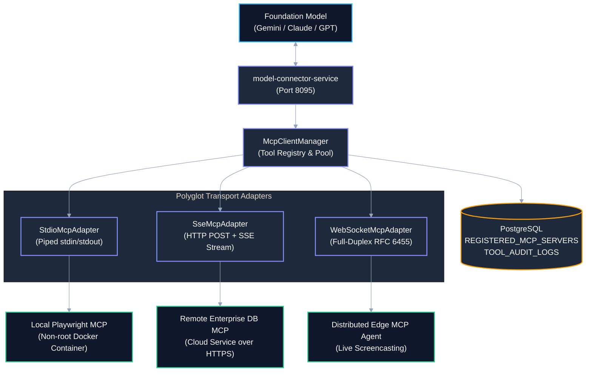
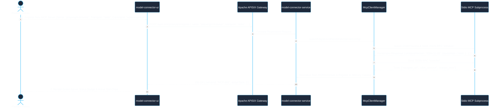
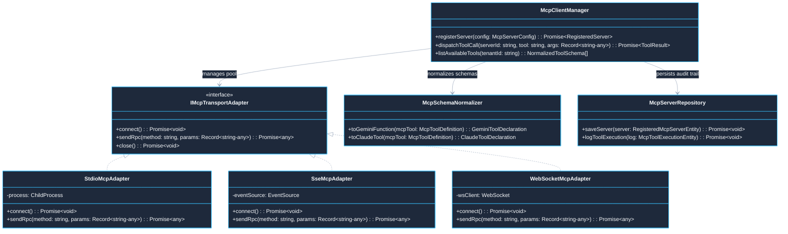

# Use Case 05 — Multi-MCP Tool Orchestration & Dynamic Capabilities Gateway

> **Document ID**: `UC-05`  
> **Category**: Core Platform Architecture & Gateway  
> **Master Index**: [README.md §5](README.md#5-use-case-05--multi-mcp-tool-orchestration--dynamic-capabilities-gateway)  
> **Master Blueprint**: [blueprint.md §5.1](../blueprint.md#51-bisect-engine-architecture)  
> **System Architecture (HLD)**: [hld.md §4](../hld.md#4-mcp-model-context-protocol--playwright-mcp-architecture), [§23](../hld.md#23-multi-mcp-model-context-protocol-orchestration-architecture)  
> **Component Design (LLD)**: [lld.md §20](../lld.md#20-multi-mcp-protocol-client--gateway-adapter-implementation)  
> **UI Flows**: [ui-flows.md §7](../ui-flows.md#7-screen-6-visual-workflow-dag-builder--mcp-studio)  

---

## 1. Executive Summary & Problem Statement

### 1.1 Executive Summary
* **Core Mission**: Provide a universal, secure capabilities integration layer connecting the Model Connector Platform to heterogeneous Model Context Protocol (MCP) servers across diverse environments.
* **Polyglot Transport Mesh**: Dynamically manages connections across `stdio` (local containerized process), `SSE` (remote HTTPS streams), and `WebSocket` (full-duplex RPC) transports.
* **Schema Normalization & Guardrails**: Normalizes external MCP tool definitions into canonical JSONSchema declarations for Gemini, Claude, and OpenAI foundation models, executing tool calls under strict multi-tenant isolation and timeout bounds.

### 1.2 Problem Statement
* **Tool Calling Fragmentation**: Foundation models cannot interact with external tools and data stores without bespoke adapters for every protocol and endpoint.
* **Single-Transport Limitations**: Most standard client libraries support only local `stdio` subprocesses, preventing connection to remote enterprise microservices or secure cloud agents.
* **Host Process Security Hazards**: Running untrusted community MCP servers directly on host machines exposes organizations to arbitrary remote code execution (RCE) and cross-tenant credential theft.
* **Lack of Timeout Governance**: Hanging tool execution causes unbounded model request stalling, cascading thread exhaustion, and token budget waste.

### 1.3 Constraints & Non-Negotiables
* **Strict Process Sandboxing**: Local `stdio` MCP workers must execute in isolated non-root containers (`UID 10001`), read-only root filesystems, dropped capabilities (`cap-drop: ALL`), and memory ceilings ($\le 1\text{ GB}$).
* **Protocol Standard Compliance**: 100% adherence to the Model Context Protocol JSON-RPC 2.0 specification (`protocolVersion: 2024-11-05`).
* **Tool Timeout Enforcement**: Default tool execution timeout enforced at $30\text{ seconds}$; browser automation actions capped at $60\text{ seconds}$.
* **Cryptographic Tenant Isolation**: Registered servers, credentials, and tool audit logs must be partitioned strictly by `TENANT_ID`.

---

## 2. Architectural Solutions & Trade-offs

* **Evaluation Matrix**:
  * **Option A: Hardcoded Custom REST Connectors**:
    * *Pros*: Simple ad-hoc endpoint integration.
    * *Cons*: Requires codebase updates for every new tool; zero standard capability discovery; vendor lock-in.
    * *Verdict*: **Rejected**.
  * **Option B: Raw Stdio-Only MCP Client**:
    * *Pros*: Minimal setup for local desktop scripts.
    * *Cons*: High blast radius; cannot bridge remote cloud services or distributed container agents.
    * *Verdict*: **Rejected**.
  * **Option C: Polyglot MCP Gateway (stdio, SSE, WebSocket) with Dynamic Normalization (Selected)**:
    * *Pros*: Universal pluggability for both local Docker containers and remote enterprise cloud agents; automated translation into model-native schemas; central audit logging and security policy enforcement.
    * *Cons*: Requires active connection pool management and heartbeat watchdog monitoring.
    * *Verdict*: **SELECTED (BEST)**.

---

## 3. Macro Architecture (HLD) & Component Diagram

### 3.1 System Design Principles
* **Edge Ingress Gateway**: Apache APISIX routes model calls, terminates TLS, and enforces tenant JWT claims.
* **MCP Gateway Subsystems**:
  * `McpClientManager`: Central lifecycle supervisor handling server handshakes, connection pooling, and tool registries.
  * `StdioMcpAdapter`: Spawns and supervises containerized child processes over piped stdin/stdout streams.
  * `SseMcpAdapter`: Connects to remote HTTP endpoints with Server-Sent Events streaming for bidirectional RPC.
  * `WebSocketMcpAdapter`: Maintains persistent full-duplex RFC 6455 channels for real-time edge agents.
  * `McpSchemaNormalizer`: Dynamically translates discovered MCP tools into model-compliant function calling schemas.
* **Polyglot Persistence Layer**:
  * **PostgreSQL**: Stores `REGISTERED_MCP_SERVERS` and `MCP_TOOL_EXECUTIONS`.
  * **Redis**: Tracks connection state heartbeats and transient session keys.

### 3.2 High-Level Architecture Diagram



---

## 4. End-to-End User Flow Diagram

* **Architectural Principle**: Server registration initiates an automated JSON-RPC 2.0 handshake (`initialize` followed by `tools/list`), validating capabilities before making tools available to models.

### 4.1 Nominal User Flow Sequence



---

## 5. Low-Level Design (LLD)

### 5.1 LLD Class & Component Interaction Diagram



### 5.2 Relational DDL Schema

```sql
-- DDL for Registered MCP Servers and Execution Logs
CREATE TABLE IF NOT EXISTS REGISTERED_MCP_SERVERS (
    SERVER_ID VARCHAR(64) PRIMARY KEY,
    TENANT_ID VARCHAR(64) NOT NULL,
    SERVER_NAME VARCHAR(255) NOT NULL,
    TRANSPORT_TYPE VARCHAR(32) NOT NULL, -- 'STDIO', 'SSE', 'WEBSOCKET'
    TARGET_ENDPOINT_OR_COMMAND TEXT NOT NULL,
    IS_ACTIVE BOOLEAN NOT NULL DEFAULT TRUE,
    AUTHENTICATION_CONFIG_JSON JSONB,
    DISCOVERED_CAPABILITIES_JSON JSONB,
    CREATED_AT TIMESTAMP WITH TIME ZONE NOT NULL DEFAULT CURRENT_TIMESTAMP,
    UPDATED_AT TIMESTAMP WITH TIME ZONE NOT NULL DEFAULT CURRENT_TIMESTAMP,
    CONSTRAINT FK_MCP_TENANT FOREIGN KEY (TENANT_ID) REFERENCES TENANTS (TENANT_ID) ON DELETE CASCADE,
    CONSTRAINT UQ_MCP_TENANT_NAME UNIQUE (TENANT_ID, SERVER_NAME)
);

CREATE TABLE IF NOT EXISTS MCP_TOOL_EXECUTIONS (
    EXECUTION_ID VARCHAR(64) PRIMARY KEY,
    SERVER_ID VARCHAR(64) NOT NULL,
    TENANT_ID VARCHAR(64) NOT NULL,
    TOOL_NAME VARCHAR(255) NOT NULL,
    INPUT_ARGUMENTS_JSON JSONB NOT NULL,
    EXECUTION_STATUS VARCHAR(32) NOT NULL, -- 'SUCCESS', 'FAILED', 'TIMED_OUT'
    DURATION_MS BIGINT NOT NULL,
    OUTPUT_PAYLOAD TEXT,
    CREATED_AT TIMESTAMP WITH TIME ZONE NOT NULL DEFAULT CURRENT_TIMESTAMP,
    CONSTRAINT FK_MTE_SERVER FOREIGN KEY (SERVER_ID) REFERENCES REGISTERED_MCP_SERVERS (SERVER_ID) ON DELETE CASCADE
);

CREATE INDEX IF NOT EXISTS IDX_MTE_SERVER_TOOL ON MCP_TOOL_EXECUTIONS (SERVER_ID, TOOL_NAME, CREATED_AT);
```

---

## 6. UI Interaction Flow & Screen States

* **MCP Server Catalog View**:
  * Grid rendering interactive cards for all active servers (`Playwright Engine`, `Postgres Explorer`, `Filesystem Sandbox`).
  * Live indicators displaying transport protocol, health ping latency, and active tool counts.
* **Add Server Modal**:
  * Dual-tab dialog for `stdio` configuration (executable command, sandbox image, environment variables) or `SSE` configuration (HTTPS URL, Bearer JWT).
* **Tool Inspector Drawer**:
  * Clicking any server card opens a sliding drawer displaying normalized JSONSchema parameter structures and test execution inputs.

---

## 7. API Ingress & Protocol Specification

### 7.1 Register MCP Server
* **Endpoint**: `POST /api/v1/mcp/servers/register`
* **Headers**: `Authorization: Bearer <JWT>`, `X-Tenant-Id: <TENANT_ID>`, `Content-Type: application/json`
* **Request Body**:
```json
{
  "serverName": "remote-db-explorer",
  "transportType": "SSE",
  "targetEndpoint": "https://mcp.internal.enterprise.com/mcp",
  "authToken": "eyJh..."
}
```
* **Response**: `201 Created` with `{ "serverId": "MCP-882", "status": "CONNECTED", "toolCount": 5 }`

---

## 8. Failure Modes, Edge Cases & Recovery User Flow

### 8.1 Edge Cases User Flow & Error Recovery Sequence

```mermaid
%%{init: {'theme': 'base', 'themeVariables': { 'primaryColor': '#1E293B', 'primaryTextColor': '#F8FAFC', 'primaryBorderColor': '#38BDF8', 'lineColor': '#94A3B8', 'secondaryColor': '#0F172A', 'tertiaryColor': '#1E293B', 'noteBkgColor': '#334155', 'noteTextColor': '#F8FAFC'}}}%%
sequenceDiagram
    autonumber
    actor Model as Foundation Model
    participant Svc as model-connector-service
    participant MCPMgr as McpClientManager
    participant StdioWorker as Stdio MCP Worker
    participant UI as model-connector-ui

    Note over Model,UI: Edge Case 1: Subprocess Crash & Automatic Recovery
    Model->>Svc: Execute Tool: "extract_dom"
    Svc->>MCPMgr: dispatchToolCall("MCP-882", "extract_dom", {...})
    MCPMgr->>StdioWorker: Piped JSON-RPC Request
    StdioWorker-->>MCPMgr: Process Crash: SIGSEGV (Exit Code 139)
    MCPMgr->>MCPMgr: Detect Process Exit & Clean Up Hanging Promises
    MCPMgr->>MCPMgr: Spawn Fresh Standby Worker (Attempt 1/3)
    MCPMgr->>StdioWorker: Re-initialize & Re-dispatch Tool Call
    StdioWorker-->>MCPMgr: Tool Execution Succeeded
    MCPMgr-->>Svc: Valid Tool Result Returned to Model

    Note over Model,UI: Edge Case 2: Tool Execution Timeout Breach (>30s)
    Model->>Svc: Execute Long Running DB Query Tool
    Svc->>MCPMgr: Dispatch Query
    MCPMgr->>StdioWorker: Query Sent (Server hangs on table lock)
    MCPMgr->>MCPMgr: Watchdog fires at 30,000ms threshold
    MCPMgr->>StdioWorker: Send SIGKILL to unblock thread
    MCPMgr-->>Svc: Tool Error: { code: "MCP_TOOL_TIMEOUT", message: "Execution exceeded 30s limit" }
    Svc-->>Model: Formatted JSON-RPC Error Payload (Model shifts execution strategy)

    Note over Model,UI: Edge Case 3: Remote SSE Network Drop
    MCPMgr->>Svc: Heartbeat Ping Failed (HTTP 504 Gateway Timeout)
    MCPMgr->>MCPMgr: Transition Server Status: "DEGRADED"
    MCPMgr-->>UI: Live SSE Event: "remote-db-explorer degraded; retrying connection..."
    MCPMgr->>MCPMgr: Exponential Backoff Reconnection (1s, 2s, 4s, 8s)
    MCPMgr-->>UI: Server Reconnected & Health Restored
```

### 8.2 Failure Modes & Fallback Matrix

| Failure Mode | Trigger Condition | Automated System Response | User Experience Impact |
| :--- | :--- | :--- | :--- |
| **Child Process Crash (`stdio`)** | MCP worker exits unexpectedly (`SIGSEGV` or uncaught exception) | Adapter detects exit, cleans up pending promises, attempts automatic restart (max 3 retries) | UI temporarily marks server as `RESTARTING`; resumes once healthy. |
| **Remote SSE Connection Drop** | Network disconnection or gateway timeout on remote MCP server | Adapter enters exponential backoff reconnection loop; marks tools as `DEGRADED` | In-flight tool calls fail fast with `MCP_SERVER_UNREACHABLE`; fallback models utilized. |
| **Schema Invalidation** | Server returns malformed JSON-RPC tool result | Gateway sanitizes output, rejects non-JSON payloads, and returns structured error to model | Foundation model receives formatted error prompt allowing it to retry or alter strategy. |
| **Tool Execution Timeout** | Tool call hangs or deadlocks for $>30\text{ seconds}$ | Subprocess watchdog terminates task via `SIGKILL`, returning `MCP_TOOL_TIMEOUT` | Prevents cascading gateway thread pool exhaustion. |
| **Memory Limit Breach** | MCP subprocess exceeds allocated 1GB cgroup memory limit | Container runtime terminates process with code 137 (OOMKilled) | Telemetry flags excessive memory usage and notifies platform admin. |
