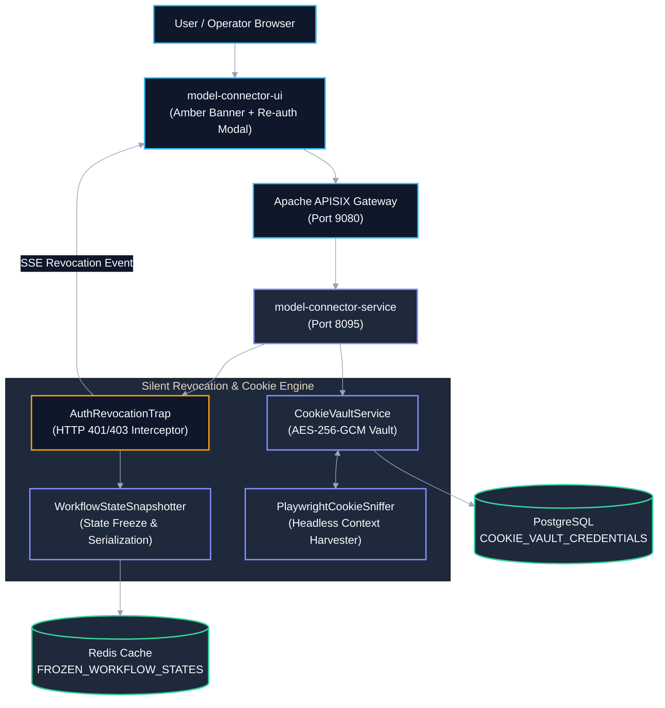
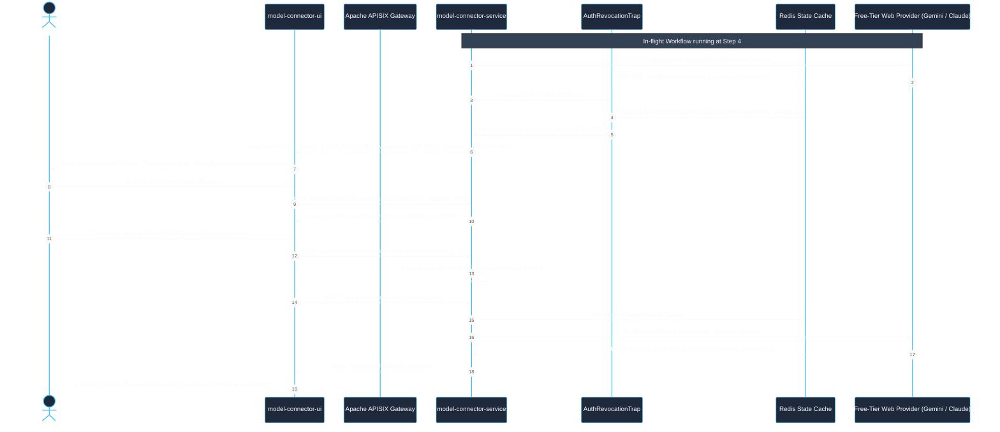
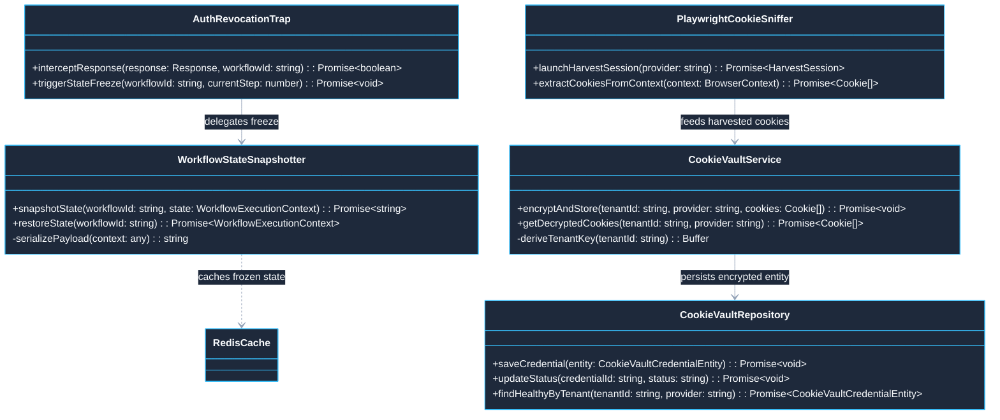
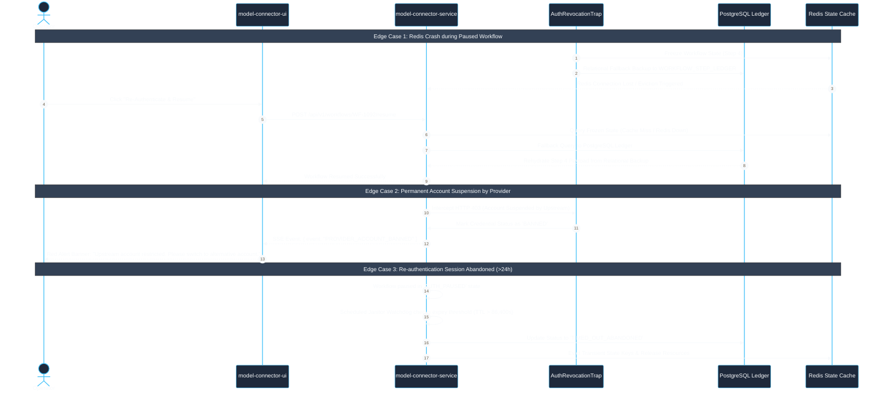

# Use Case 06 — Free-Tier Cookie Harvesting & Silent Authentication Revocation Recovery

> **Document ID**: `UC-06`  
> **Category**: Resilience & Authentication Workload  
> **Master Index**: [README.md §6](README.md#6-use-case-06--free-tier-cookie-harvesting--silent-authentication-revocation-recovery)  
> **Master Blueprint**: [blueprint.md §7.1](../blueprint.md#71-multi-mode-authentication--authorization-matrix)  
> **System Architecture (HLD)**: [hld.md §10](../hld.md#10-silent-access-revocation--access-denied-architecture), [§13](../hld.md#13-free-tier-cookie-based-model-connector-client-architecture)  
> **Component Design (LLD)**: [lld.md §9](../lld.md#9-silent-access-revocation--dynamic-recovery-design), [§12](../lld.md#12-free-tier-cookie-based-model-connector-client--playwright-sync)  
> **UI Flows**: [ui-flows.md §9](../ui-flows.md#9-screen-8-access-revocation--re-authentication-recovery-ui-flow), [§11](../ui-flows.md#11-screen-10-free-tier-cookie-management--health-inspector-ui-flow)  

---

## 1. Executive Summary & Problem Statement

### 1.1 Executive Summary
* **Core Mission**: Allow users and autonomous agents to harvest and utilize free-tier web model sessions (Gemini, Claude, ChatGPT) while maintaining 100% workflow continuity during out-of-band credential expiration or session invalidation.
* **Reactive Revocation Trap**: Intercepts upstream authentication revocations ($401$ Unauthorized / $403$ Forbidden) instantaneously, snapshots complete in-flight execution state into Redis and PostgreSQL within $\le 50\text{ ms}$, raises an interactive amber banner in the UI, and automatically resumes execution at the exact interrupted step post-reauthentication.
* **Cryptographic Vault Security**: Encrypts all harvested session cookies at rest using AES-256-GCM with tenant-isolated key derivation.

### 1.2 Problem Statement
* **Frequent Session Invalidation**: Free-tier model web cookies (`__Secure-1PSID`, `session_id`, `cf_clearance`) rotate frequently or expire unpredictably due to upstream security policies.
* **Destructive Workflow Drops**: Conventional automation pipelines crash immediately on HTTP 401/403, discarding hours of accumulated execution state and forcing users to restart complex DAGs from scratch.
* **Plaintext Credential Theft Vulnerability**: Insecure cookie persistence in flat files or unencrypted caches exposes user sessions to lateral theft across tenants.

### 1.3 Constraints & Non-Negotiables
* **AES-256-GCM Encryption**: All harvested session cookies and browser storage state must be encrypted at rest using AES-256-GCM with tenant-isolated master keys. Plaintext cookies exist strictly in ephemeral memory.
* **Sub-50ms Snapshot SLA**: Full workflow execution context must be serialized and persisted within $\le 50\text{ ms}$ of revoking authentication.
* **Zero Duplicate Re-execution**: Upon re-authentication, the workflow must resume at the exact interrupted step index with zero redundant executions of prior steps.
* **Multi-Tenant Partitioning**: Cookie vaults and snapshot records must be cryptographically partitioned by `TENANT_ID`.

---

## 2. Architectural Solutions & Trade-offs

* **Evaluation Matrix**:
  * **Option A: Fail-Fast Exception Throwing**:
    * *Pros*: Simplest code architecture.
    * *Cons*: Catastrophic user experience; drops active workflow state and accumulated context.
    * *Verdict*: **Rejected**.
  * **Option B: Periodic Background Session Polling**:
    * *Pros*: Preemptively detects expired tokens.
    * *Cons*: Heavy network and CPU overhead; constant pinging triggers anti-bot suspicion; token consumption.
    * *Verdict*: **Rejected**.
  * **Option C: Reactive Revocation Trap with State-Preserving Pause & Re-Auth Resumption (Selected)**:
    * *Pros*: Zero overhead during normal execution; preserves 100% of workflow state; one-click re-authentication via sandboxed iframe; deterministic resumption.
    * *Cons*: Requires distributed state synchronization between Redis and PostgreSQL.
    * *Verdict*: **SELECTED (BEST)**.

---

## 3. Macro Architecture (HLD) & Component Diagram

### 3.1 System Design Principles
* **Perimeter Ingress Gateway**: Apache APISIX routes model requests, terminates TLS, and broadcasts real-time SSE revocation alerts.
* **Revocation & Credential Vault Core**:
  * `AuthRevocationTrap`: Intercepts HTTP 401/403 error codes from upstream providers and flags execution state as `AUTH_PAUSED`.
  * `WorkflowStateSnapshotter`: Freezes execution variables, step payloads, and correlation IDs, persisting state into Redis with relational backup in PostgreSQL.
  * `CookieVaultService`: Manages AES-256-GCM encryption, decryption, and lifecycle health of provider credentials.
  * `PlaywrightCookieSniffer`: Automates headless login or assists operator interactive re-authentication in a sandboxed iframe.
* **Polyglot Persistence Layer**:
  * **Redis**: Fast, in-memory cache for `FROZEN_WORKFLOW_STATES`.
  * **PostgreSQL**: Stores relational credential records in `COOKIE_VAULT_CREDENTIALS` and historical audit trails.

### 3.2 High-Level Architecture Diagram



---

## 4. End-to-End User Flow Diagram

* **Architectural Principle**: When upstream authentication fails, the platform converts what would be a fatal error into an interactive, state-preserving re-authentication pause.

### 4.1 Nominal User Flow Sequence



---

## 5. Low-Level Design (LLD)

### 5.1 LLD Class & Component Interaction Diagram



### 5.2 Relational DDL Schema

```sql
-- DDL for Cookie Vault Credentials
CREATE TABLE IF NOT EXISTS COOKIE_VAULT_CREDENTIALS (
    COOKIE_CREDENTIAL_ID VARCHAR(64) PRIMARY KEY,
    TENANT_ID VARCHAR(64) NOT NULL,
    USER_ID VARCHAR(64) NOT NULL,
    PROVIDER_FAMILY VARCHAR(64) NOT NULL, -- 'GEMINI_WEB', 'CLAUDE_WEB', 'CHATGPT_WEB'
    ENCRYPTED_COOKIE_PAYLOAD TEXT NOT NULL,
    INITIALIZATION_VECTOR VARCHAR(32) NOT NULL,
    AUTHENTICATION_TAG VARCHAR(32) NOT NULL,
    HEALTH_STATUS VARCHAR(32) NOT NULL DEFAULT 'HEALTHY', -- 'HEALTHY', 'EXPIRED', 'REVOKED'
    LAST_VERIFIED_AT TIMESTAMP WITH TIME ZONE NOT NULL DEFAULT CURRENT_TIMESTAMP,
    CREATED_AT TIMESTAMP WITH TIME ZONE NOT NULL DEFAULT CURRENT_TIMESTAMP,
    UPDATED_AT TIMESTAMP WITH TIME ZONE NOT NULL DEFAULT CURRENT_TIMESTAMP,
    CONSTRAINT FK_CVC_TENANT FOREIGN KEY (TENANT_ID) REFERENCES TENANTS (TENANT_ID) ON DELETE CASCADE,
    CONSTRAINT UQ_CVC_TENANT_PROVIDER UNIQUE (TENANT_ID, USER_ID, PROVIDER_FAMILY)
);

CREATE INDEX IF NOT EXISTS IDX_CVC_TENANT_HEALTH ON COOKIE_VAULT_CREDENTIALS (TENANT_ID, HEALTH_STATUS);
```

---

## 6. UI Interaction Flow & Screen States

* **Normal Active State**:
  * Workflow progress stepper advances normally with cyan glow indicators.
* **Amber Alert Banner State**:
  * Upon receiving the `AUTH_REVOKED` SSE event, the top header transitions to amber:
    * *"Action Required: Upstream authentication revoked for Gemini Web. Workflow paused at Step 4. All progress is safely saved."*
    * Displays prominent `Re-Authenticate Now` button and `Cancel Workflow` option.
* **Sandboxed Re-Auth Modal**:
  * Opens an isolated iframe displaying the provider's official login portal.
* **Resumption Pulse State**:
  * Once authenticated, the banner turns emerald green (*"Re-authenticated! Resuming Step 4..."*) and fades out as execution finishes.

---

## 7. API Ingress & Protocol Specification

### 7.1 Import / Update Harvested Cookies
* **Endpoint**: `POST /api/v1/cookies/import`
* **Headers**: `Authorization: Bearer <JWT>`, `X-Tenant-Id: <TENANT_ID>`, `Content-Type: application/json`
* **Request Body**:
```json
{
  "providerFamily": "GEMINI_WEB",
  "cookieJar": [
    { "name": "__Secure-1PSID", "value": "A1b2c3d4...", "domain": ".google.com" },
    { "name": "SID", "value": "X9y8z7...", "domain": ".google.com" }
  ]
}
```
* **Response**: `200 OK` with `{ "status": "STORED_AND_VERIFIED", "health": "HEALTHY" }`

---

## 8. Failure Modes, Edge Cases & Recovery User Flow

### 8.1 Edge Cases User Flow & Error Recovery Sequence



### 8.2 Failure Modes & Fallback Matrix

| Failure Mode | Trigger Condition | Automated System Response | User Experience Impact |
| :--- | :--- | :--- | :--- |
| **Provider Account Ban** | Upstream provider flags free-tier session as bot and permanently bans account | Interceptor detects permanent ban response; marks credential as `BANNED` | UI shows red alert: *"Account restricted by provider. Please authenticate with a different account."* |
| **Redis Cache Eviction** | System crash or Redis restart while workflow is paused | Frozen state is backed up to PostgreSQL `WORKFLOW_STEP_LEDGER`; restored from relational DB | Zero state loss; slight rehydration delay ($< 100\text{ms}$). |
| **User Abandons Re-Auth** | User closes browser without re-authenticating within 24 hours | Janitor service marks workflow as `TIMED_OUT_ABANDONED` and releases held resources | System cleans up scratch memory gracefully. |
| **Iframe X-Frame-Options Block** | Provider login portal blocks embedding via `X-Frame-Options: DENY` | Client automatically falls back to secure popup window with `postMessage` synchronization | Seamless login experience without broken iframe rendering. |
| **Cookie Vault Key Rotation** | Tenant master encryption key is rotated in KMS | Re-encrypts all stored credentials in batch using new envelope key | Zero downtime; existing stored cookies remain valid and decryptable. |
