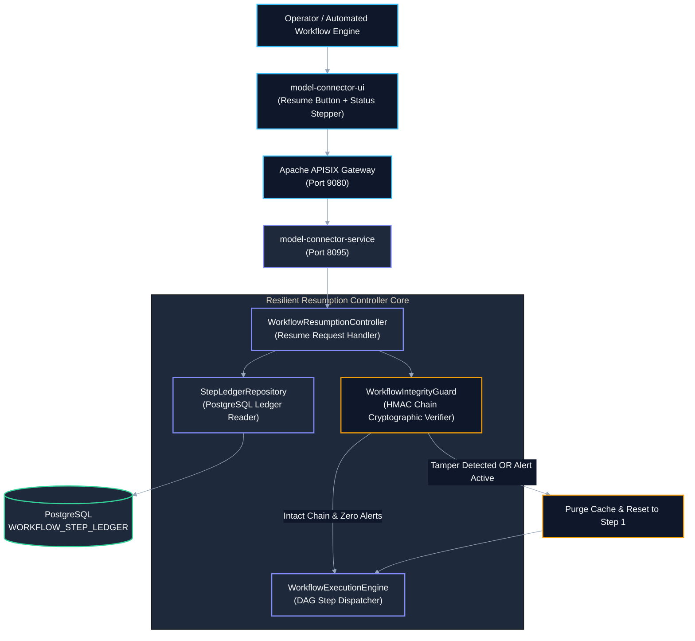
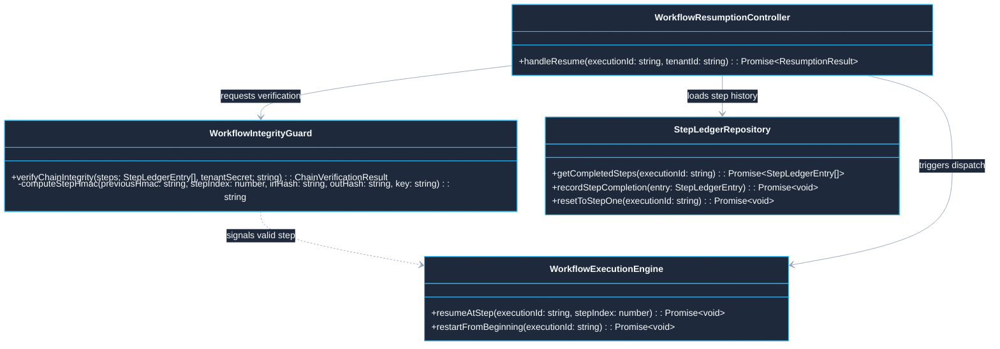
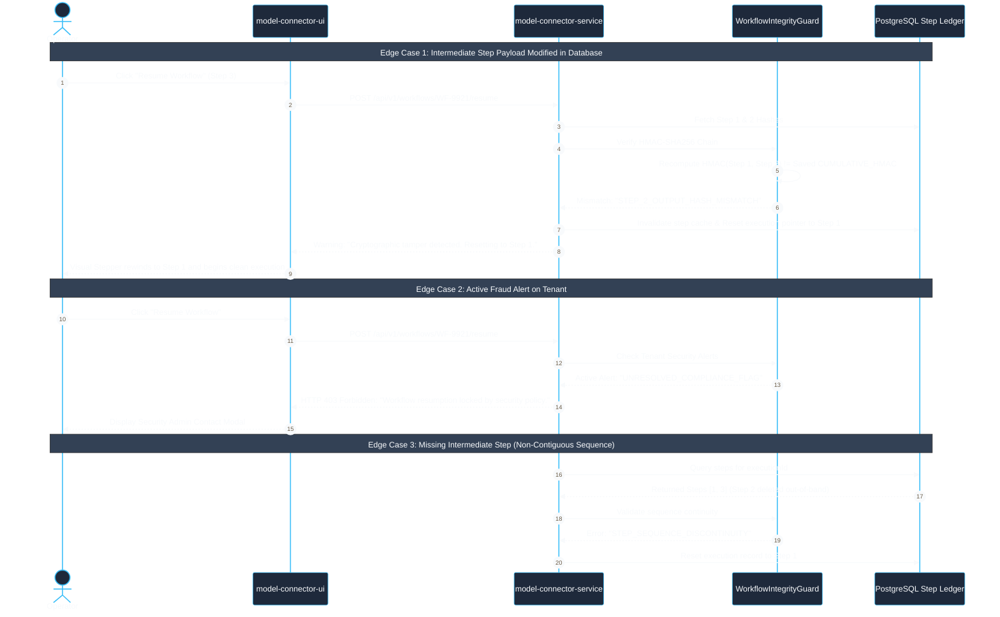

# Use Case 07 — Resilient Workflow State Ledger & Cryptographic Tamper-Detection Resumption

> **Document ID**: `UC-07`  
> **Category**: Resilience & Security Governance  
> **Master Index**: [README.md §7](README.md#7-use-case-07--resilient-workflow-state-ledger--cryptographic-tamper-detection-resumption)  
> **Master Blueprint**: [blueprint.md §6.2](../blueprint.md#62-anti-data-loss--zero-interruption-failover)  
> **System Architecture (HLD)**: [hld.md §22](../hld.md#22-resilient-workflow-resumption--cryptographic-tamper-detection-architecture)  
> **Component Design (LLD)**: [lld.md §19](../lld.md#19-low-level-design-workflow-resumption--cryptographic-state-ledger)  
> **UI Flows**: [ui-flows.md §9](../ui-flows.md#9-screen-8-access-revocation--re-authentication-recovery-ui-flow)  

---

## 1. Executive Summary & Problem Statement

### 1.1 Executive Summary
* **Core Mission**: Guarantee that long-running distributed workflows recover from network, container, or model timeouts without re-executing successfully completed upstream steps.
* **Cryptographic Tamper-Proofing**: Before resuming execution from an interrupted step ($S_k$), the engine executes a sequential HMAC-SHA256 chain verification across all prior step states ($S_1, \dots, S_{k-1}$).
* **Integrity Gate**: If any intermediate state has been altered or if an unacknowledged security alert exists, execution safely resets strictly to Step 1. If and only if the cryptographic chain is intact, execution resumes immediately at the failed step index.

### 1.2 Problem Statement
* **Wasteful Full Re-Execution**: Long-running multi-agent pipelines (Job applications, App building, Video generation) comprise dozens of computational steps. Restarting from Step 1 on a transient Step 7 timeout burns valuable GPU compute, model tokens, and human time.
* **Poisoned State Vulnerability**: Naively resuming from an intermediate step without verifying data integrity allows compromised cache records or malicious database tampering to poison downstream operations (e.g., modifying bank routing numbers or scoring results).
* **Auditability Void**: Conventional task frameworks lack verifiable cryptographic proofs of execution history.

### 1.3 Constraints & Non-Negotiables
* **Strict Cryptographic Invariant**:
  $$\text{HMAC}_k = \text{HMAC-SHA256}(K_{\text{tenant}}, \text{HMAC}_{k-1} \parallel \text{STEP\_INDEX}_k \parallel \text{INPUT\_HASH}_k \parallel \text{OUTPUT\_HASH}_k)$$
  If recomputed $\text{HMAC}_k \neq \text{CUMULATIVE\_HMAC}_k$ for any $k < \text{failed\_step}$ $\implies$ **Immediate Reset to Step 1**.
* **Verification Overhead SLA**: Chain verification latency must remain $\le 5\text{ ms}$ for workflows containing up to 100 sequential steps.
* **Immutable Audit Trail**: Every resumption attempt, whether approved or quarantined, must record an immutable event entry in `AUDIT_LOGS`.
* **Tenant Key Derivation**: $K_{\text{tenant}}$ is derived cryptographically from tenant KMS keys and never stored in plaintext.

---

## 2. Architectural Solutions & Trade-offs

* **Evaluation Matrix**:
  * **Option A: Unchecked Direct Step Resumption**:
    * *Pros*: Lowest execution latency ($< 1\text{ms}$).
    * *Cons*: **Critical Security Vulnerability**; poisoned cache or modified intermediate data accepted without validation.
    * *Verdict*: **Rejected**.
  * **Option B: Full Workflow Restart on Any Interruption**:
    * *Pros*: Guaranteed clean state from scratch.
    * *Cons*: High latency ($10\text{--}60\text{s}$ re-computation); excessive token and GPU resource waste.
    * *Verdict*: **Rejected**.
  * **Option C: Sequential Merkle-Chained HMAC Ledger Verification (Selected)**:
    * *Pros*: Mathematical proof of state integrity; sub-millisecond hash validation ($< 2\text{ms}$); reuses verified upstream steps while guaranteeing zero poisoned data execution.
    * *Cons*: Requires cumulative HMAC calculation on every step completion.
    * *Verdict*: **SELECTED (BEST)**.

---

## 3. Macro Architecture (HLD) & Component Diagram

### 3.1 System Design Principles
* **Edge Ingress Gateway**: Apache APISIX routes resumption calls, checks rate limits, and validates tenant tokens.
* **Resilient Resumption Controller Core**:
  * `WorkflowResumptionController`: Ingress controller handling `/resume` requests.
  * `WorkflowIntegrityGuard`: Computes sequential HMAC-SHA256 checks across historical step ledger records.
  * `StepLedgerRepository`: Queries append-only relational ledger rows from PostgreSQL.
  * `WorkflowExecutionEngine`: Dispatches step execution upon cryptographic clearance.
* **Polyglot Persistence Layer**:
  * **PostgreSQL**: Houses append-only immutable `WORKFLOW_STEP_LEDGER` records.
  * **Redis**: Retains active workflow lease locks and volatile step caches.

### 3.2 High-Level Architecture Diagram



---

## 4. End-to-End User Flow Diagram

* **Architectural Principle**: Resumption requests trigger synchronous cryptographic verification before any execution worker is dispatched.

### 4.1 Nominal User Flow Sequence

```mermaid
%%{init: {'theme': 'base', 'themeVariables': { 'primaryColor': '#1E293B', 'primaryTextColor': '#F8FAFC', 'primaryBorderColor': '#38BDF8', 'lineColor': '#94A3B8', 'secondaryColor': '#0F172A', 'tertiaryColor': '#1E293B', 'noteBkgColor': '#334155', 'noteTextColor': '#F8FAFC'}}}%%
sequenceDiagram
    autonumber
    actor User as Operator / Automated Workflow
    participant UI as model-connector-ui
    participant GW as Apache APISIX Gateway
    participant Svc as model-connector-service
    participant Guard as WorkflowIntegrityGuard
    participant DB as PostgreSQL Step Ledger

    Note over User,DB: Workflow failed at Step 3 (Career Form Fill) due to network timeout
    User->>UI: Click "Resume Workflow"
    UI->>GW: POST /api/v1/workflows/WF-9921/resume
    GW->>Svc: Forward Resume Request
    Svc->>DB: Fetch completed steps (Steps 1, 2) from WORKFLOW_STEP_LEDGER
    DB-->>Svc: Steps 1 & 2 records with CUMULATIVE_HMAC hashes
    
    Svc->>Guard: verifyChainIntegrity(executionId, steps, tenantSecret)
    
    alt Cryptographic Chain Compromised (Intermediate data modified)
        Guard-->>Svc: VerificationResult { isIntegrityIntact: false, reason: "STEP_2_HASH_MISMATCH" }
        Svc->>DB: Reset execution record to Step 1; purge intermediate scratch files
        Svc->>Svc: Restart workflow execution strictly from Step 1 (Resume Ingestion)
        Svc-->>UI: 200 OK { status: "RESTARTED_FROM_BEGINNING", reason: "INTEGRITY_CHECK_FAILED" }
        UI-->>User: Amber Warning Banner: "Intermediate data alteration detected. Workflow safely restarted from Step 1."
    else Cryptographic Chain Intact & Zero Alerts
        Guard-->>Svc: VerificationResult { isIntegrityIntact: true }
        Svc->>DB: Mark Step 3 as 'RUNNING'
        Svc->>Svc: Dispatch execution directly at Step 3 using verified Step 2 output
        Svc-->>UI: 200 OK { status: "RESUMED_AT_STEP", resumedStepId: "STEP_03" }
        UI-->>User: Green Success Banner: "State integrity verified. Resuming execution at Step 3."
    end
```

---

## 5. Low-Level Design (LLD)

### 5.1 LLD Class & Component Interaction Diagram



### 5.2 Relational DDL Schema

```sql
-- DDL for Cryptographic Workflow Step Ledger
CREATE TABLE IF NOT EXISTS WORKFLOW_STEP_LEDGER (
    LEDGER_ID VARCHAR(64) PRIMARY KEY,
    WORKFLOW_EXECUTION_ID VARCHAR(64) NOT NULL,
    TENANT_ID VARCHAR(64) NOT NULL,
    STEP_INDEX INTEGER NOT NULL,
    STEP_NAME VARCHAR(128) NOT NULL,
    INPUT_PAYLOAD_HASH VARCHAR(64) NOT NULL,
    OUTPUT_PAYLOAD_HASH VARCHAR(64) NOT NULL,
    PREVIOUS_STEP_HMAC VARCHAR(64) NOT NULL,
    CUMULATIVE_HMAC VARCHAR(64) NOT NULL,
    STEP_STATUS VARCHAR(32) NOT NULL, -- 'SUCCESS', 'FAILED', 'RUNNING'
    EXECUTION_DURATION_MS BIGINT NOT NULL,
    COMPLETED_TIMESTAMP TIMESTAMP WITH TIME ZONE NOT NULL DEFAULT CURRENT_TIMESTAMP,
    CONSTRAINT FK_WSL_TENANT FOREIGN KEY (TENANT_ID) REFERENCES TENANTS (TENANT_ID) ON DELETE CASCADE,
    CONSTRAINT UQ_WSL_EXECUTION_STEP UNIQUE (WORKFLOW_EXECUTION_ID, STEP_INDEX)
);

CREATE INDEX IF NOT EXISTS IDX_WSL_EXEC_STEP ON WORKFLOW_STEP_LEDGER (WORKFLOW_EXECUTION_ID, STEP_INDEX ASC);
```

---

## 6. UI Interaction Flow & Screen States

* **Failed Workflow State**:
  * Workflow execution card highlights in amber with badge: `FAILED AT STEP 3 (Network Timeout)`.
  * Renders prominent `Resume Workflow` and `Discard` buttons.
* **Resumption Verification State**:
  * Clicking `Resume Workflow` triggers instant verification spinner: *"Verifying cryptographic state integrity..."*
* **Approved Resumption State**:
  * Green pulse animates along DAG edge from Step 2 to Step 3. Step 3 status transitions to `RUNNING`.
* **Tamper Violation State**:
  * If verification fails, card flashes red, displays warning dialog (*"Cryptographic state signature mismatch detected on Step 2. Workflow reset to beginning."*), and stepper rewinds to Step 1.

---

## 7. API Ingress & Protocol Specification

### 7.1 Resume Failed Workflow
* **Endpoint**: `POST /api/v1/workflows/:executionId/resume`
* **Headers**: `Authorization: Bearer <JWT>`, `X-Tenant-Id: <TENANT_ID>`, `Idempotency-Key: <UUIDv4>`
* **Response (Clean State)**: `200 OK`
```json
{
  "status": "RESUMED_AT_STEP",
  "executionId": "WF-9921",
  "resumedStepIndex": 3,
  "resumedStepName": "Career Form Fill",
  "message": "State integrity verified. Resumed workflow execution seamlessly at Step 3."
}
```
* **Response (Tamper / Alert Detected)**: `200 OK`
```json
{
  "status": "RESTARTED_FROM_BEGINNING",
  "executionId": "WF-9921",
  "resumedStepIndex": 1,
  "resumedStepName": "Resume Ingestion",
  "violationReason": "STEP_2_OUTPUT_HASH_MISMATCH",
  "message": "State integrity check failed: intermediate data was modified. Workflow safely restarted from the beginning."
}
```

---

## 8. Failure Modes, Edge Cases & Recovery User Flow

### 8.1 Edge Cases User Flow & Error Recovery Sequence



### 8.2 Failure Modes & Fallback Matrix

| Failure Mode | Trigger Condition | Automated System Response | User Experience Impact |
| :--- | :--- | :--- | :--- |
| **Payload Hash Mismatch** | Redis cache corrupted or DB row modified out-of-band | Guard rejects chain, invalidates step cache, resets execution to Step 1 | UI shows warning banner; workflow restarts cleanly without poisoning final state. |
| **Active Security Alert** | Unresolved fraud or compliance alert raised on tenant | Guard halts resumption even if hashes match; resets to Step 1 | System blocks untrusted execution; requires admin approval. |
| **Missing Intermediate Step** | Step 1 exists, Step 3 exists, but Step 2 was deleted from DB | Chain continuity breaks; recomputed HMAC fails immediately | System detects broken sequence; restarts from Step 1. |
| **KMS Tenant Key Inaccessible** | Network timeout contacting tenant key management service | System holds workflow in `AWAITING_KMS` state; retries up to 5 times | UI displays amber notice: *"Verifying security credentials..."* |
| **Deadlock on Resumption Lock** | Concurrent resume requests fired simultaneously for same ID | Redis distributed lock permits exactly one verifier; secondary request returns 409 Conflict | Zero duplicate resume executions; thread safety guaranteed. |
