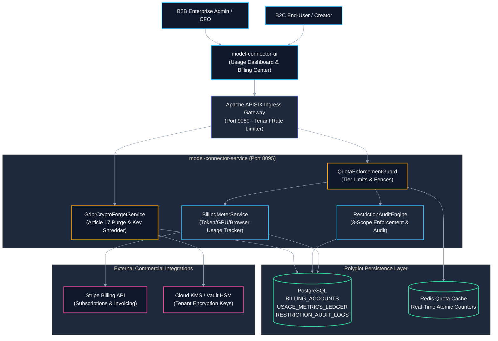
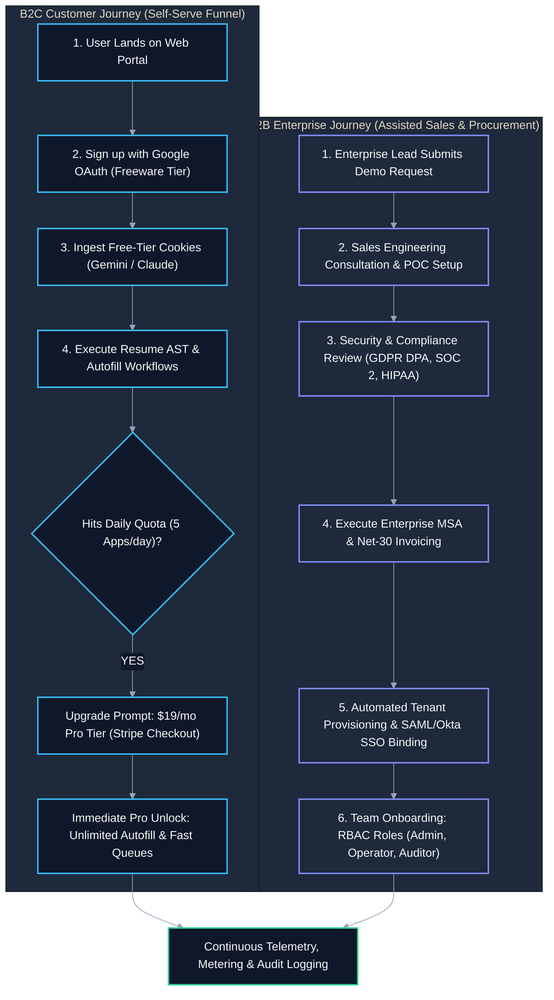
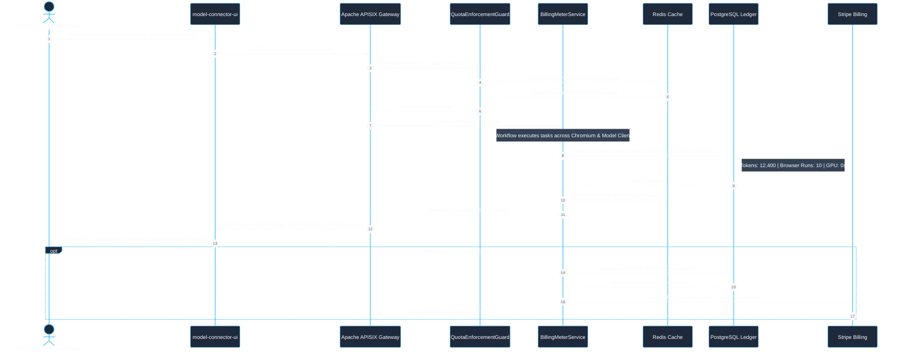
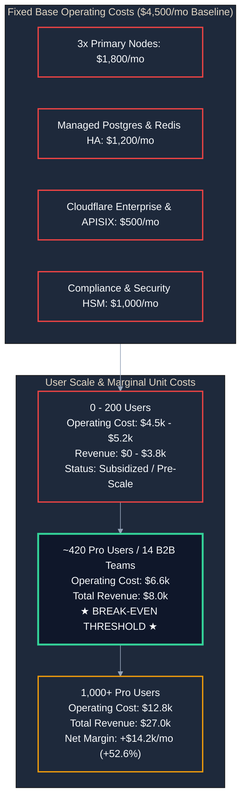
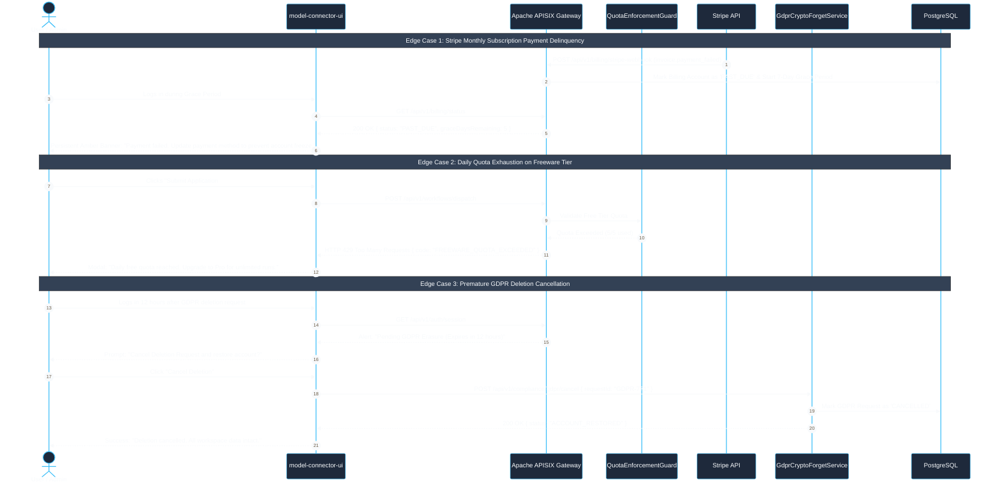

# Use Case 08 — B2B & B2C Business Models, Metered Billing, Audit & GDPR Compliance

> **Document ID**: `UC-08`  
> **Category**: Commercial Operations & Regulatory Compliance  
> **Master Index**: [README.md §8](README.md#8-use-case-08--b2b--b2c-multi-tenant-monetization-billing-audit--gdpr-governance)  
> **Master Blueprint**: [blueprint.md §6.4](../blueprint.md#64-zero-leakage-multi-tenant-queue-system)  
> **System Architecture (HLD)**: [hld.md §6](../hld.md#6-multi-tenant-isolation--zero-cross-contamination-security), [§7](../hld.md#7-global-scalability-architecture-1-million-concurrent-active-users), [§8](../hld.md#8-authentication-authorization--security-perimeters), [§16](../hld.md#16-containerization--docker-security-hardening-architecture)  
> **Component Design (LLD)**: [lld.md §6](../lld.md#6-protocol--concurrency-comparative-benchmarking), [§7](../lld.md#7-distributed-logging--audit-telemetry-schema), [§16](../lld.md#16-comprehensive-flow-restriction-audit-logging--investigation-architecture)  
> **UI Flows**: [ui-flows.md §3](../ui-flows.md#3-screen-2-network-analytics-dashboard--metrics), [§5](../ui-flows.md#5-screen-4-admin-operations--governance-console)  

---

## 1. Executive Summary & Value Proposition

### 1.1 Executive Summary
* **Dual-Engine Commercial Model**: The Model Connector Platform operates a unified commercial backbone supporting both B2C (individual consumers, job applicants, creators) and B2B (enterprise multi-tenant organizations, recruiting agencies, software studios).
* **Transparent Freeware Entry**: Enables immediate zero-cost onboarding via local consumer cookies and community templates, converting power users through deterministic daily quota fences.
* **Granular Usage Metering**: Records high-fidelity billing metrics (model tokens, GPU seconds, browser automation steps, disk storage) into an append-only relational ledger.
* **Enterprise Governance & Auditability**: Enforces 3-scope execution restrictions (Record-level, Domain-level, Flow-level) with full forensic audit telemetry.
* **Cryptographic GDPR Compliance**: Guarantees European Union GDPR Article 17 "Right to be Forgotten" via physical relational row purging combined with cryptographic key shredding in Hardware Security Modules (HSM).

### 1.2 Value Proposition Matrix

| Segment | Target Audience | Core Value Proposition | Commercial Model & Payment Terms | Key Enabling Features |
| :--- | :--- | :--- | :--- | :--- |
| **B2C Freeware Tier** | Individual Job Seekers, Indie Developers, Hobbyist Creators | Free access to consumer AI models and local Playwright automation without upfront infrastructure costs. | **Freeware (0 USD)**<br/>BYO-Cookie or rate-limited public inference; no credit card required. | Free-tier cookie harvesting (§13), local browser autofill, community templates. |
| **B2C Pro Creator** | Power Job Seekers, Content Creators, Solo Founders | Automated talent applications, high-definition ComfyUI video generation, and unlimited code synthesis. | **19 USD / Month**<br/>Stripe recurring credit card; instant self-serve cancellation. | Unlimited Playwright form autofill, priority model queues, local GPU ComfyUI integration. |
| **B2B Growth / Scale** | High-growth startups, boutique recruiting agencies, dev studios | Shared multi-tenant workspaces, team RBAC, centralized API key management, and higher rate-limit quotas. | **499 USD / Month + Metered Usage**<br/>Net-30 invoicing or corporate credit card; automated monthly overage billing. | 5 team seats, dedicated APISIX rate-limit tiers, 3-scope restriction auditing, custom MCP servers. |
| **B2B Enterprise Dedicated** | Fortune 500 corporations, regulated healthcare, financial institutions | Zero-data-retention AI inference, isolated dedicated VPC/on-premise deployment, custom SLA ($99.99\%$). | **Annual Contract (Custom, 25k+ USD)**<br/>Net-60 procurement, wire transfer, formal Master Services Agreement (MSA). | SSO (SAML/Okta), air-gapped deployment, custom cryptographic salt, GDPR DPA, 24/7 dedicated support. |

---

## 2. Architectural Solutions & System Design (HLD)

### 2.1 System Design Principles
* **Edge Ingress & Tenant Isolation**: Apache APISIX routes all incoming traffic, enforces tenant-specific rate limits, and extracts cryptographic tenant context (`X-Tenant-Id`).
* **Metered Billing Subsystem**:
  * `BillingMeterService`: Collects execution metrics asynchronously and writes them to an append-only PostgreSQL ledger.
  * `QuotaEnforcementGuard`: Evaluates active tier quotas (daily job apps, token limits, concurrency) prior to dispatching workloads.
  * `StripeBillingAdapter`: Integrates with Stripe Billing API for recurring subscription webhooks, automated invoice creation, and payment collection.
* **Audit Logging & Restriction Subsystem**:
  * `RestrictionAuditEngine`: Enforces 3-scope execution boundaries (Record-level, Domain-level, Flow-level) and records forensic SecOps telemetry.
* **GDPR Erasure & Key Shredding Subsystem**:
  * `GdprCryptoForgetService`: Executes active relational deletion and purges tenant encryption keys from KMS/HSM, cryptographically shredding all cold encrypted backups.
* **Polyglot Persistence Layer**:
  * **PostgreSQL**: Stores billing accounts, subscription tiers, append-only usage ledgers, audit records, and GDPR requests.
  * **Redis**: Maintains volatile tenant quota counters with sub-millisecond atomic decrement (`DECRBY`).
  * **HashiCorp Vault / Cloud KMS**: Secures per-tenant AES-256-GCM data encryption keys.

### 2.2 Macro Architecture (HLD) Diagram



### 2.3 Customer Journey & Funnel Flowchart



---

## 3. End-to-End User Flow Diagram

### 3.1 Nominal Metering, Billing & Audit User Flow



---

## 4. Break-even Unit Economics Diagram



### 4.1 Unit Cost Breakdown
* **Fixed Infrastructure Costs ($4,500/mo baseline)**:
  * 3x Primary Cluster Nodes (Kubernetes/Docker bare-metal instances): $1,800/mo.
  * Managed PostgreSQL + Redis High Availability: $1,200/mo.
  * Bandwidth, Cloudflare Enterprise DDoS & APISIX Gateway: $500/mo.
  * Compliance, Security Monitoring & Telemetry: $1,000/mo.
* **Variable Marginal Costs per User**:
  * Model Token Ingestion (Blended API rate): ~$0.0035 per 1,000 tokens.
  * Headless Browser Execution: ~$0.0012 per form automation run.
* **Break-even Point**:
  $$\text{Break-even} \approx 420 \text{ Active Pro B2C Subscribers } (\text{or } 14 \text{ B2B Growth Teams})$$

---

## 5. Multi-Tenant Metering & Billing Metrics Specification

The platform continuously records usage events into the immutable ledger `USAGE_METRICS_LEDGER` across four quantifiable dimensions:

$$\text{Total Invoice Bill} = \sum \Big( T_{\text{in}} \cdot C_{\text{in}} + T_{\text{out}} \cdot C_{\text{out}} + S_{\text{gpu}} \cdot C_{\text{gpu}} + E_{\text{mcp}} \cdot C_{\text{mcp}} \Big)$$

| Metric Dimension | Parameter Key | Unit of Measurement | Calculation Formula & Weighting | Target Audit Purpose |
| :--- | :--- | :--- | :--- | :--- |
| **Token Consumption** | `MTR_TOKENS_PROCESSED` | Exact Integer Token Count | Input Tokens $\times 1.0$ + Output Tokens $\times 3.0$ (adjusted per model family multiplier) | Model provider cost pass-through & margin tracking |
| **GPU Inference Time** | `MTR_GPU_COMPUTE_SECONDS` | Milliseconds (ms) | Total CUDA kernel execution time for diffusion/TTS passes | Local vs. Cloud GPU infrastructure amortization |
| **Browser MCP Runs** | `MTR_BROWSER_EXECUTIONS` | Step Execution Count | 1 Unit per completed Playwright automated form navigation | Headless Chromium concurrency pool capacity planning |
| **Storage Retention** | `MTR_STORAGE_GIGABYTE_HOURS` | GB-Hours | Average disk footprint of AST blobs, PDF resumes, and 4K video renders | Object store & database storage quota governance |

---

## 6. Audit Logging Architecture & 3-Scope Restrictions

### 6.1 Three Hierarchical Audit Scopes
* **Scope 1: Record-Level Restriction (`RECORD_LEVEL`)**:
  * Blocks or restricts automation on a specific single candidate ID or project ID.
  * *Example*: A candidate requests to freeze application runs on Resume `RES-8819`.
* **Scope 2: Domain-Level Restriction (`DOMAIN_LEVEL`)**:
  * Restricts an entire corporate domain or competitor entity across all users.
  * *Example*: Enterprise policy prohibits automated applications to `@competitor-defense.com`.
* **Scope 3: Flow-Level Restriction (`FLOW_LEVEL`)**:
  * Temporarily disables an entire workflow category (e.g. disabling all Storyteller video generation during peak model provider outages).

### 6.2 Forensic SecOps Investigation Queries

```sql
-- Forensic Query: Audit all domain-level restriction blocks in the last 30 days
SELECT 
    AUDIT_LOG_ID,
    TENANT_ID,
    USER_ID,
    RESTRICTION_SCOPE,
    RESTRICTED_ENTITY_KEY,
    REASON_CODE,
    ENFORCEMENT_ACTION,
    IP_ADDRESS,
    CREATED_AT
FROM RESTRICTION_AUDIT_LOGS
WHERE RESTRICTION_SCOPE = 'DOMAIN_LEVEL'
  AND CREATED_AT >= CURRENT_TIMESTAMP - INTERVAL '30 days'
ORDER BY CREATED_AT DESC;
```

---

## 7. GDPR Compliance & The Cryptographic "Right to be Forgotten"

### 7.1 Regulatory Compliance Framework
* **Article 15 (Right of Access)**: Users can download a consolidated, machine-readable JSON archive of all personal data, resume ASTs, and application history via a single click.
* **Article 17 (Right to be Forgotten / Erasure)**: When an erasure request is confirmed, the platform executes a two-phase cryptographic erasure process:
  * **Direct Data Purge**: Deletes records from active relational tables (`CANDIDATE_RESUMES`, `JOB_APPLICATIONS`, `USER_WORKSPACES`).
  * **Cryptographic Shredding**: Deletes the tenant’s unique AES-256-GCM encryption key from the hardware security vault (`HSM`), rendering all historical encrypted backups and cold storage archives permanently unreadable without violating append-only backup integrity.


---

## 8. Low-Level Design (LLD)

### 8.1 LLD Class & Component Interaction Diagram

```mermaid
%%{init: {'theme': 'base', 'themeVariables': { 'primaryColor': '#1E293B', 'primaryTextColor': '#F8FAFC', 'primaryBorderColor': '#38BDF8', 'lineColor': '#94A3B8', 'secondaryColor': '#0F172A', 'tertiaryColor': '#1E293B', 'noteBkgColor': '#334155', 'noteTextColor': '#F8FAFC'}}}%%
classDiagram
    class BillingMeterService {
        +recordUsage(event: UsageEvent): Promise~void~
        +aggregatePeriodUsage(tenantId: string, start: Date, end: Date): Promise~PeriodUsageSummary~
        +generateMonthlyInvoice(tenantId: string): Promise~InvoiceRecord~
    }

    class QuotaEnforcementGuard {
        +validateQuota(tenantId: string, metricType: string, requestedUnits: number): Promise~QuotaCheckResult~
        +decrementQuota(tenantId: string, metricType: string, count: number): Promise~void~
    }

    class RestrictionAuditEngine {
        +checkRestriction(scope: RestrictionScope, entityKey: string): Promise~boolean~
        +logEnforcement(entry: RestrictionAuditEntry): Promise~void~
    }

    class GdprCryptoForgetService {
        +initiateErasure(userId: string, tenantId: string): Promise~string~
        +executePhysicalPurge(requestId: string): Promise~void~
        +shredTenantKey(tenantId: string): Promise~ShredCertificate~
    }

    class BillingRepository {
        +findBillingAccount(tenantId: string): Promise~BillingAccount~
        +saveUsageEntry(entry: UsageMetricRow): Promise~void~
        +updateAccountStatus(tenantId: string, status: string): Promise~void~
    }

    BillingMeterService --> BillingRepository : persists usage ledgers
    QuotaEnforcementGuard --> BillingRepository : verifies active tier
    GdprCryptoForgetService --> BillingRepository : deletes relational data
    RestrictionAuditEngine --> BillingRepository : audits scope blocks
```



### 8.2 Relational DDL Schemas for Billing & GDPR

```sql
-- DDL for Billing Accounts and Metered Ledger
CREATE TABLE IF NOT EXISTS BILLING_ACCOUNTS (
    BILLING_ACCOUNT_ID VARCHAR(64) PRIMARY KEY,
    TENANT_ID VARCHAR(64) NOT NULL,
    TIER_TYPE VARCHAR(32) NOT NULL, -- 'B2C_FREE', 'B2C_PRO', 'B2B_GROWTH', 'B2B_ENTERPRISE'
    BILLING_CYCLE VARCHAR(16) NOT NULL DEFAULT 'MONTHLY',
    STRIPE_CUSTOMER_ID VARCHAR(128),
    ACTIVE_PAYMENT_STATUS VARCHAR(32) NOT NULL DEFAULT 'CURRENT',
    MONTHLY_BASE_USD NUMERIC(10,2) NOT NULL DEFAULT 0.00,
    CURRENT_PERIOD_START TIMESTAMP WITH TIME ZONE NOT NULL,
    CURRENT_PERIOD_END TIMESTAMP WITH TIME ZONE NOT NULL,
    CREATED_AT TIMESTAMP WITH TIME ZONE NOT NULL DEFAULT CURRENT_TIMESTAMP,
    CONSTRAINT FK_BA_TENANT FOREIGN KEY (TENANT_ID) REFERENCES TENANTS (TENANT_ID) ON DELETE CASCADE
);

CREATE TABLE IF NOT EXISTS USAGE_METRICS_LEDGER (
    LEDGER_ID VARCHAR(64) PRIMARY KEY,
    TENANT_ID VARCHAR(64) NOT NULL,
    USER_ID VARCHAR(64) NOT NULL,
    METRIC_TYPE VARCHAR(64) NOT NULL, -- 'MTR_TOKENS_PROCESSED', 'MTR_GPU_COMPUTE_SECONDS', etc.
    QUANTITY NUMERIC(14,4) NOT NULL,
    UNIT_RATE_USD NUMERIC(10,6) NOT NULL,
    TOTAL_CHARGE_USD NUMERIC(10,4) NOT NULL,
    CORRELATION_ID VARCHAR(128) NOT NULL,
    RECORDED_AT TIMESTAMP WITH TIME ZONE NOT NULL DEFAULT CURRENT_TIMESTAMP,
    CONSTRAINT FK_UML_TENANT FOREIGN KEY (TENANT_ID) REFERENCES TENANTS (TENANT_ID) ON DELETE CASCADE
);

CREATE TABLE IF NOT EXISTS GDPR_DELETION_REQUESTS (
    REQUEST_ID VARCHAR(64) PRIMARY KEY,
    TENANT_ID VARCHAR(64) NOT NULL,
    USER_ID VARCHAR(64) NOT NULL,
    REQUEST_STATUS VARCHAR(32) NOT NULL DEFAULT 'PENDING_VERIFICATION',
    VERIFICATION_TOKEN_HASH VARCHAR(64) NOT NULL,
    REQUESTED_AT TIMESTAMP WITH TIME ZONE NOT NULL DEFAULT CURRENT_TIMESTAMP,
    PURGED_AT TIMESTAMP WITH TIME ZONE,
    SHREDDED_KEY_ID VARCHAR(64),
    COMPLIANCE_CERTIFICATE_HASH VARCHAR(64),
    CONSTRAINT FK_GDPR_TENANT FOREIGN KEY (TENANT_ID) REFERENCES TENANTS (TENANT_ID) ON DELETE CASCADE
);

CREATE INDEX IF NOT EXISTS IDX_UML_TENANT_TIME ON USAGE_METRICS_LEDGER (TENANT_ID, RECORDED_AT DESC);
CREATE INDEX IF NOT EXISTS IDX_GDPR_STATUS ON GDPR_DELETION_REQUESTS (REQUEST_STATUS);
```

---

## 9. UI Interaction Flow & Screen States

* **Usage & Plan Dashboard**:
  * Visual radial gauges rendering monthly token quota, GPU seconds, and active plan badge (`B2B GROWTH: $499/mo`).
  * Real-time billing projection displaying unbilled overage amounts for the current billing cycle.
* **Upgrade / Payment Modal**:
  * Embedded Stripe Elements card input with automated tax calculation (VAT/GST).
  * Annual billing toggle displaying a 20% discount badge.
* **Audit Log Explorer**:
  * Filterable table showing 3-scope restriction events with JSON payload drawer and one-click export to CSV/JSON.
* **GDPR Data Privacy Center**:
  * *Card A (Export My Data)*: Generates downloadable `.zip` archive containing all resume ASTs, messages, and invoices.
  * *Card B (Delete My Account)*: Initiates multi-step modal requiring 2FA verification and 24-hour grace period cancellation.

---

## 10. API Ingress & Protocol Specification

### 10.1 Submit GDPR Deletion Request
* **Endpoint**: `POST /api/v1/compliance/gdpr/delete`
* **Headers**: `Authorization: Bearer <JWT>`, `X-Tenant-Id: <TENANT_ID>`, `Content-Type: application/json`
* **Request Body**:
```json
{
  "confirmationStatement": "I permanently request the erasure of my personal data under GDPR Article 17",
  "reason": "Account closure"
}
```
* **Response**: `202 Accepted`
```json
{
  "requestId": "GDPR-771",
  "status": "AWAITING_GRACE_PERIOD",
  "gracePeriodExpiresAt": "2026-10-25T14:30:00Z",
  "message": "Erasure request accepted. Account data will be permanently purged and encrypted keys shredded in 24 hours."
}
```

---

## 11. Failure Modes, Edge Cases & Recovery User Flow

### 11.1 Edge Cases User Flow & Error Recovery Sequence



### 11.2 Failure Modes & Fallback Matrix

| Failure Mode | Trigger Condition | Automated System Response | User Experience Impact |
| :--- | :--- | :--- | :--- |
| **Payment Delinquency / Past Due** | Monthly Stripe charge fails ($3\text{ retries}$) | Account transitions to `GRACE_PERIOD` for 7 days; model inference restricted to free-tier models | UI displays persistent amber banner: *"Payment failed. Please update credit card to prevent workspace suspension."* |
| **Quota Overrun (B2C Free Tier)** | Free-tier user hits 5 daily application limit | Gateway intercepts request with HTTP 429 Too Many Requests | UI shows upgrade modal: *"Daily freeware limit reached. Upgrade to Pro for unlimited applications."* |
| **Premature GDPR Deletion Cancellation** | User logs in during the 24-hour grace period | System prompts: *"You have a pending erasure request. Would you like to cancel deletion?"* | User can cancel erasure with 1 click; zero data loss occurs. |
| **KMS Key Shredding Timeout** | Cloud KMS or Vault HSM returns network 504 on key deletion | System marks request `RETRY_KEY_SHRED` and enqueues exponential backoff job | Active data is already purged; cryptographic shredding guaranteed within 1 hour. |
| **Double Metering on Retry** | Client retries failed API request with same idempotency key | Ingress deduplication filter matches `Idempotency-Key` and ignores duplicate charge | Zero over-billing; idempotency guaranteed. |
