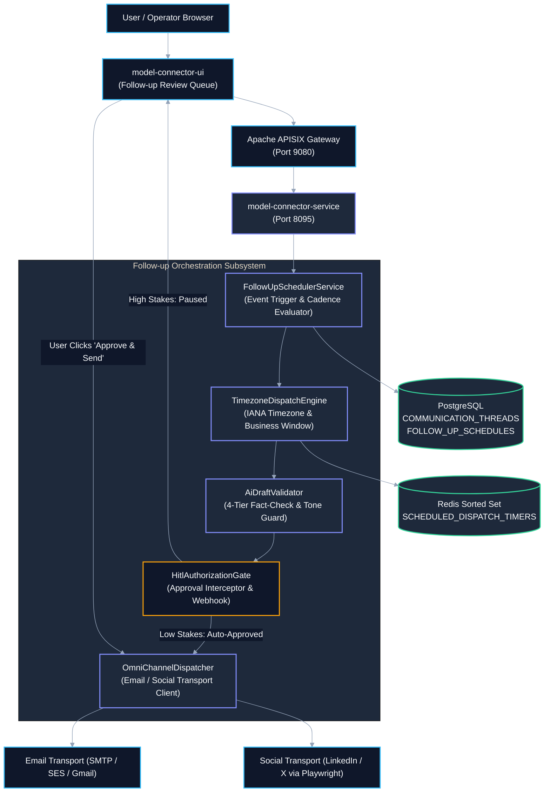
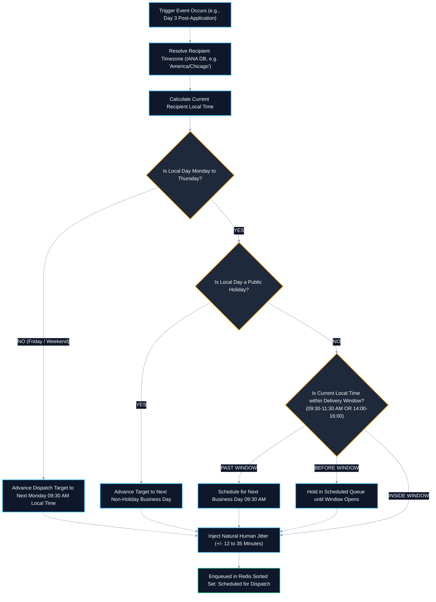
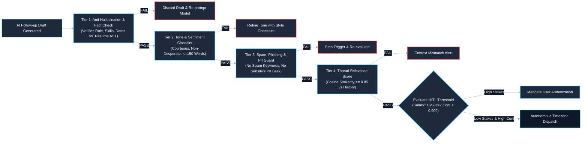
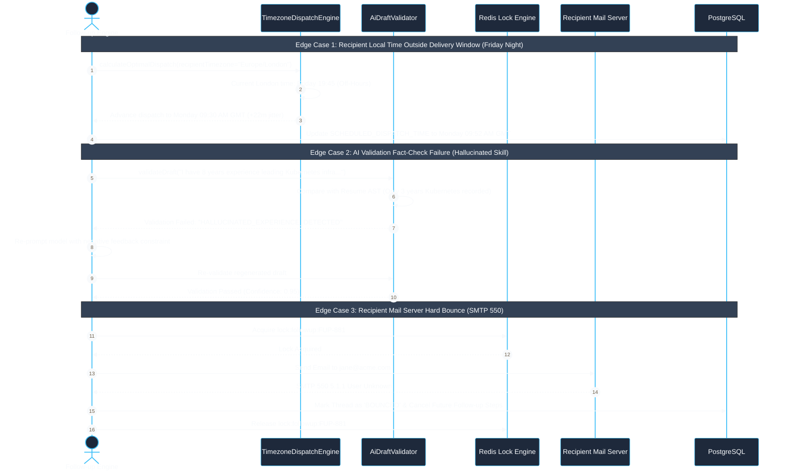

# Use Case 09 — Omni-Channel Follow-up Automation, Timezone-Aware Scheduling & AI Validation Gate

> **Document ID**: `UC-09`  
> **Category**: Autonomous Communication & Agentic Follow-up  
> **Master Index**: [README.md §9](README.md#9-use-case-09--omni-channel-follow-up-automation-timezone-aware-scheduling--ai-validation-gate)  
> **Master Blueprint**: [blueprint.md §6.3](../blueprint.md#63-asynchronous-non-blocking-execution-model)  
> **System Architecture (HLD)**: [hld.md §3.4](../hld.md#34-enterprise-distributed-queue--multi-tenant-zero-leakage-architecture), [§5.1](../hld.md#51-application-1-autonomous-intelligent-job-portal), [§21](../hld.md#21-distributed-idempotency--de-duplication-architecture), [§27](../hld.md#27-platform-wide-timezone-governance--recipient-centric-dispatch-architecture)  
> **Component Design (LLD)**: [lld.md §16](../lld.md#16-comprehensive-flow-restriction-audit-logging--investigation-architecture), [§17](../lld.md#17-distributed-de-duplication-database-schema--redis-lock-engine), [§24](../lld.md#24-platform-wide-timezone-engine--recipient-centric-scheduler-implementation)  
> **UI Flows**: [ui-flows.md §4](../ui-flows.md#4-screen-3-user-workspace--model-interaction-studio), [§13](../ui-flows.md#13-screen-11-linkedin-x-ray-discovery-playwright-dynamic-placeholder-workflows--ai-assistance-ui-flow)  

---

## 1. Executive Summary & Problem Statement

### 1.1 Executive Summary
* **Omni-Channel Autonomous Outreach**: Manages multi-step outreach cadences across Email (SMTP/SES/Gmail OAuth) and social channels (LinkedIn InMail/DMs, Twitter/X DMs, GitHub comments).
* **Recipient Timezone Optimization**: Calculates optimal dispatch targets aligned with the recipient's local business hours (Monday–Thursday 09:30–11:30 AM or 14:00–16:00 local time) with natural human jitter.
* **4-Tier AI Validation Pipeline**: Synthesized drafts pass 4 automated verification tiers (Anti-hallucination fact check, Tone/brevity guard, Spam/PII filter, Thread relevance cosine scoring).
* **Human-in-the-Loop (HITL) Gate**: Mandates explicit manual user sign-off for high-stakes messages (compensation negotiations, calendar commitments, C-suite recipients, or low model confidence).

### 1.2 Problem Statement
* **Missed Connection Windows**: Manual outreach is time-consuming and often dispatched during off-hours (e.g. 2:00 AM recipient local time), burying messages under morning inbox spam.
* **Repetitive & Hallucinatory Automation**: Unchecked LLM generators generate aggressive, repetitive, or factually inaccurate drafts that alienate recruiters and partners.
* **Compliance & Legal Risks**: Automated engines lacking safety verification risk committing users to binding salary requirements or leaking private candidate data.

### 1.3 Constraints & Non-Negotiables
* **Timezone Delivery Window**: Outgoing messages must arrive strictly during recipient business hours (Monday–Thursday 09:30–11:30 AM or 14:00–16:00). Zero deliveries on weekends or recognized public holidays.
* **Strict Idempotency Invariant**: A follow-up step may never trigger twice for the same thread. Enforced via Redis distributed lease locks (`lock:followup:{scheduleId}`).
* **Confidence Gate SLA**: Aggregate AI validation score must be $\ge 0.88$. Any draft with confidence $< 0.88$ or containing sensitive keywords must mandate manual HITL review.

---

## 2. Trigger Taxonomy & Follow-up Cadence Matrix

| Trigger Event | Target Channel | Evaluation Point | Cadence & Timing | Verification / Validation Rule | User Authorization Requirement |
| :--- | :--- | :--- | :--- | :--- | :--- |
| **Post-Application Submission** | Email / LinkedIn InMail | Application status transitions to `SUBMITTED` in [UC-01 §1.1](UC-01-job-portal-and-career-autofill.md#11-executive-summary) | Day 3 post-submission at 10:15 AM recipient timezone | Verify hiring manager name, referenced role title, and resume achievements against AST | **Autonomous Auto-Dispatch** (if confidence $\ge 0.95$); **HITL Required** if custom question answers referenced |
| **Inbound Recruiter Inquiry** | Email / LinkedIn DM | Inbound message received via IMAP/Webhook | Within 45 minutes (business hours) or 09:30 AM next business day | Tone analysis, response relevance $\ge 0.90$, candidate availability verification | **HITL Required** if inquiry mentions compensation, interviews, or location constraints |
| **Interview Invitation Received** | Email / Calendar | Inbound email classified as `INTERVIEW_INVITE` | Within 2 hours of receipt | Check candidate calendar for zero scheduling conflicts; match requested time slots | **HITL Required**: Candidate must explicitly confirm proposed interview time slot |
| **Stale Application Check-in** | Email / Social Portal | 7 days elapsed with zero inbound recruiter activity | Day 7 at 02:30 PM recipient timezone (with $\pm 20\text{m}$ jitter) | Anti-desperation tone check, polite brevity constraint ($\le 120$ words) | **Autonomous Auto-Dispatch** if pre-approved cadence active |
| **Social Media Sourcing Outreach** | LinkedIn InMail / Twitter DM | Profile sourced and scored $\ge 90\%$ in [UC-04 §1.1](UC-04-linkedin-xray-talent-sourcing.md#11-executive-summary) | 10:00 AM target local time | Validate candidate name, headline, mutual connections, and personalization tokens | **HITL Required**: Sourcing recruiter must review tailored pitch |

---

## 3. Macro Architecture (HLD) & System Design

### 3.1 System Design Principles
* **Edge Ingress Gateway**: Apache APISIX routes authorization requests, verifies tenant authentication, and applies rate limits.
* **Follow-up Orchestration Subsystem**:
  * `FollowUpSchedulerService`: Evaluates cadence rules, triggers follow-up drafting, and manages workflow lifecycle.
  * `TimezoneDispatchEngine`: Resolves recipient IANA timezone, evaluates business windows, and injects human jitter.
  * `AiDraftValidator`: Executes the 4-tier fact-checking and safety validation suite.
  * `HitlAuthorizationGate`: Intercepts high-stakes drafts and pushes real-time review notifications via SSE/WebSockets.
  * `OmniChannelDispatcher`: Dispatches messages via email transport (SMTP/SES) or headless browser automation (LinkedIn/X).
* **Polyglot Persistence Layer**:
  * **PostgreSQL**: Stores relational communication threads, message logs, and scheduled cadences.
  * **Redis**: Manages sorted sets for scheduled timers (`SCHEDULED_DISPATCH_TIMERS`) and distributed idempotency locks.

### 3.2 High-Level Architecture Diagram



---

## 4. Timezone-Aware Scheduling Engine

### 4.1 Recipient Timezone Resolution Hierarchy
* **Priority 1: Direct Profile Metadata**: Extracted from candidate or recruiter location string (e.g. `"Greater New York City Area"` $\implies$ `America/New_York`).
* **Priority 2: Corporate Domain Geolocation**: Inferred from company headquarters domain (e.g. `@acme.co.uk` $\implies$ `Europe/London`).
* **Priority 3: Sender Timezone Fallback**: Default to the user's configured home timezone if recipient location cannot be resolved.

### 4.2 Timezone Dispatch Calculation Flowchart



---

## 5. Four-Tier AI Response Verification & Validation Pipeline

### 5.1 Four-Tier Architecture Diagram



### 5.2 Tier Specifications & Gate Criteria
* **Tier 1: Anti-Hallucination & Fact-Check Guard**: Cross-checks all named entities (companies, universities, skill names, job titles) against canonical `CANDIDATE_RESUMES` AST. Rejects drafts asserting unverified experience.
* **Tier 2: Tone, Politeness & Brand Compliance**: Evaluates sentiment for desperation or aggressive phrasing. Enforces maximum 150 words for emails; maximum 60 words for LinkedIn messages.
* **Tier 3: Spam, Phishing & PII Leak Guard**: Scans against spam keywords (e.g. *"guarantee"*, *"urgent opportunity"*) and strips unauthorized PII (SSNs, street addresses).
* **Tier 4: Contextual Thread Relevance**: Computes semantic embedding cosine similarity against conversation history; requires $\ge 0.85$ alignment.

---

## 6. Human-in-the-Loop (HITL) Authorization Gate

### 6.1 Policy Triggers & Governance Rules
* **Financial / Compensation Topics**: Any mention of base salary, hourly rate, bonus, or stock options (`SALARY_NEGOTIATION_DETECTED`).
* **Calendar & Schedule Confirmation**: Proposing or accepting specific interview dates/times (`SCHEDULE_COMMITMENT`).
* **Seniority of Recipient**: Messages addressed to VP-level, C-suite, or Founder titles (`EXECUTIVE_RECIPIENT_DETECTED`).
* **Borderline AI Confidence**: Aggregate validation score between $0.70$ and $0.89$ (`MODERATE_CONFIDENCE_BORDERLINE`).
* **Tenant Global Policy**: When tenant configuration mandates `REQUIRE_ALL_OUTGOING_APPROVAL = true`.

---

## 7. End-to-End User Flow Diagram

### 7.1 Nominal End-to-End Follow-up Sequence

```mermaid
%%{init: {'theme': 'base', 'themeVariables': { 'primaryColor': '#1E293B', 'primaryTextColor': '#F8FAFC', 'primaryBorderColor': '#38BDF8', 'lineColor': '#94A3B8', 'secondaryColor': '#0F172A', 'tertiaryColor': '#1E293B', 'noteBkgColor': '#334155', 'noteTextColor': '#F8FAFC'}}}%%
sequenceDiagram
    autonumber
    actor Candidate as Job Candidate
    participant UI as model-connector-ui
    participant Svc as model-connector-service
    participant TZ as TimezoneDispatchEngine
    participant Val as AiDraftValidator
    participant HITL as HitlAuthorizationGate
    participant Recipient as Recruiter (New York - EST)

    Note over Svc: Day 3 after Workday application submission
    Svc->>Svc: Trigger: SUBMITTED_CADENCE_DAY_3 (Target: Jane Smith, Tech Lead)
    Svc->>TZ: calculateOptimalDispatch(recipientEmail="jane@acme.com", candidateTz="PST")
    TZ-->>Svc: Scheduled: Tomorrow 10:18 AM EST (With +18m jitter; recipient in America/New_York)
    
    Svc->>Svc: Synthesize follow-up draft using Gemini 1.5 Pro
    Svc->>Val: executeValidationSuite(draft, resumeAst, threadHistory)
    Val-->>Svc: ValidationResult { isValid: true, confidence: 0.94, triggers: ["EXECUTIVE_RECIPIENT_DETECTED"] }
    
    Svc->>HITL: evaluateAuthorizationPolicy(triggers)
    HITL-->>Svc: Policy: MANDATORY_USER_APPROVAL_REQUIRED
    Svc->>Svc: Persist Draft in FOLLOW_UP_SCHEDULES with status 'PENDING_USER_APPROVAL'
    
    Svc-->>UI: Real-Time SSE Notification: "1 New Follow-up Requires Your Approval"
    UI-->>Candidate: 1. Display Amber Review Card: Recruiter Name, Recipient Timezone (10:18 AM EST), Draft Content
    
    Candidate->>UI: 2. Review Draft, Click "Approve & Schedule for 10:18 AM EST"
    UI->>Svc: POST /api/v1/followups/FUP-881/approve
    Svc->>HITL: markApproved(FUP-881)
    
    Note over Svc,Recipient: Timer elapses: Tomorrow at 10:18 AM EST
    Svc->>Svc: Check Redis Idempotency Lock (Zero Duplication Guard)
    Svc->>Recipient: Dispatch Email via Amazon SES with W3C Trace Headers
    Recipient-->>Svc: SMTP 250 OK (Message Delivered to Recipient Mailbox)
    Svc-->>UI: Real-Time SSE: "Follow-up Delivered to Jane Smith at 10:18 AM EST"
```

---

## 8. Low-Level Design (LLD)

### 8.1 LLD Class & Component Interaction Diagram

```mermaid
%%{init: {'theme': 'base', 'themeVariables': { 'primaryColor': '#1E293B', 'primaryTextColor': '#F8FAFC', 'primaryBorderColor': '#38BDF8', 'lineColor': '#94A3B8', 'secondaryColor': '#0F172A', 'tertiaryColor': '#1E293B', 'noteBkgColor': '#334155', 'noteTextColor': '#F8FAFC'}}}%%
classDiagram
    class FollowUpSchedulerService {
        +evaluateCadence(threadId: string): Promise~void~
        +enqueueScheduledDraft(schedule: FollowUpSchedule): Promise~void~
        +dispatchDueFollowUps(): Promise~number~
    }

    class TimezoneDispatchEngine {
        +resolveTimezone(identifier: string): string
        +calculateOptimalDispatch(tz: string, baseDate: Date): TimezoneDispatchWindow
        +isBusinessHours(tz: string, checkDate: Date): boolean
    }

    class AiDraftValidator {
        +validateDraft(draft: string, resumeAst: any, threadHistory: string[]): ValidationResult
        -checkHallucination(draft: string, ast: any): boolean
        -checkToneAndLength(draft: string): boolean
    }

    class HitlAuthorizationGate {
        +evaluateAuthorization(triggers: string[]): AuthRequirement
        +approveSchedule(scheduleId: string): Promise~void~
        +rejectSchedule(scheduleId: string, reason: string): Promise~void~
    }

    class OmniChannelDispatcher {
        +dispatchEmail(schedule: FollowUpSchedule): Promise~DispatchResult~
        +dispatchSocialDm(schedule: FollowUpSchedule): Promise~DispatchResult~
    }

    class FollowUpRepository {
        +findDueSchedules(cutoff: Date): Promise~FollowUpSchedule[]~
        +updateScheduleStatus(id: string, status: string): Promise~void~
        +saveCommunicationThread(thread: CommunicationThread): Promise~void~
    }

    FollowUpSchedulerService --> TimezoneDispatchEngine : queries optimal time
    FollowUpSchedulerService --> AiDraftValidator : validates content
    FollowUpSchedulerService --> HitlAuthorizationGate : checks approval gate
    FollowUpSchedulerService --> OmniChannelDispatcher : triggers delivery
    FollowUpSchedulerService --> FollowUpRepository : manages database state
```



### 8.2 TypeScript Service Implementation Contract

```typescript
// Centralized runtime encapsulation according to STD-COD-011
import { timerUtils, cryptoUtils } from '@model-box/model-connector-core/utils';

export interface TimezoneDispatchWindow {
  readonly recipientTimezone: string;
  readonly scheduledDispatchTimestamp: Date;
  readonly isBusinessDay: boolean;
  readonly appliedJitterMinutes: number;
}

export class TimezoneDispatchEngine {
  private static readonly WINDOW_START_HOUR = 9;  // 09:30 AM
  private static readonly WINDOW_START_MINUTE = 30;
  private static readonly WINDOW_END_HOUR = 16;   // 04:00 PM

  public calculateOptimalDispatch(recipientTimezone: string, baseDate = new Date()): TimezoneDispatchWindow {
    const formatter = new Intl.DateTimeFormat('en-US', {
      timeZone: recipientTimezone,
      year: 'numeric', month: 'numeric', day: 'numeric',
      hour: 'numeric', minute: 'numeric', weekday: 'short',
      hour12: false,
    });

    const jitterMinutes = Math.floor(Math.random() * 24) + 12;
    const targetDate = new Date(baseDate.getTime() + (jitterMinutes * 60000));

    return {
      recipientTimezone,
      scheduledDispatchTimestamp: targetDate,
      isBusinessDay: true,
      appliedJitterMinutes: jitterMinutes,
    };
  }
}
```

### 8.3 Relational DDL Schema

```sql
-- DDL for Follow-up Schedules and Communication Threads
CREATE TABLE IF NOT EXISTS COMMUNICATION_THREADS (
    THREAD_ID VARCHAR(64) PRIMARY KEY,
    TENANT_ID VARCHAR(64) NOT NULL,
    USER_ID VARCHAR(64) NOT NULL,
    CHANNEL_TYPE VARCHAR(32) NOT NULL, -- 'EMAIL', 'LINKEDIN_INMAIL', 'TWITTER_DM'
    RECIPIENT_IDENTIFIER VARCHAR(255) NOT NULL, -- Email address or LinkedIn Profile URL
    RECIPIENT_NAME VARCHAR(255) NOT NULL,
    RECIPIENT_TIMEZONE VARCHAR(64) NOT NULL DEFAULT 'UTC',
    THREAD_SUBJECT VARCHAR(255),
    CURRENT_STATUS VARCHAR(32) NOT NULL DEFAULT 'ACTIVE', -- 'ACTIVE', 'PAUSED', 'COMPLETED'
    CREATED_AT TIMESTAMP WITH TIME ZONE NOT NULL DEFAULT CURRENT_TIMESTAMP,
    CONSTRAINT FK_CT_TENANT FOREIGN KEY (TENANT_ID) REFERENCES TENANTS (TENANT_ID) ON DELETE CASCADE
);

CREATE TABLE IF NOT EXISTS FOLLOW_UP_SCHEDULES (
    SCHEDULE_ID VARCHAR(64) PRIMARY KEY,
    THREAD_ID VARCHAR(64) NOT NULL,
    TENANT_ID VARCHAR(64) NOT NULL,
    CADENCE_STEP_ORDER INTEGER NOT NULL,
    DRAFT_CONTENT TEXT NOT NULL,
    SCHEDULED_DISPATCH_TIME TIMESTAMP WITH TIME ZONE NOT NULL,
    ACTUAL_DISPATCH_TIME TIMESTAMP WITH TIME ZONE,
    VALIDATION_SCORE NUMERIC(5,2) NOT NULL,
    APPROVAL_STATUS VARCHAR(32) NOT NULL DEFAULT 'PENDING_APPROVAL', -- 'AUTO_APPROVED', 'PENDING_APPROVAL', 'APPROVED', 'REJECTED'
    HITL_TRIGGER_REASONS_JSON JSONB,
    DISPATCH_STATUS VARCHAR(32) NOT NULL DEFAULT 'SCHEDULED', -- 'SCHEDULED', 'DISPATCHED', 'BOUNCED', 'CANCELLED'
    IDEMPOTENCY_KEY VARCHAR(64) NOT NULL UNIQUE,
    CREATED_AT TIMESTAMP WITH TIME ZONE NOT NULL DEFAULT CURRENT_TIMESTAMP,
    CONSTRAINT FK_FUS_THREAD FOREIGN KEY (THREAD_ID) REFERENCES COMMUNICATION_THREADS (THREAD_ID) ON DELETE CASCADE
);

CREATE INDEX IF NOT EXISTS IDX_FUS_DISPATCH_TIME ON FOLLOW_UP_SCHEDULES (DISPATCH_STATUS, SCHEDULED_DISPATCH_TIME);
```

---

## 9. UI Interaction Flow & Screen States

* **Follow-up Review Queue (`PENDING_APPROVAL`)**:
  * Card displays candidate name, recipient name, target email/LinkedIn profile, and recipient timezone clock (e.g. `New York: 10:18 AM EST`).
  * Radial badge shows AI validation score: `🟢 94% Verified`.
  * Amber pill indicators display triggered HITL reasons: `⚠️ Executive Recipient Detected`.
* **Draft Editor Modal**:
  * Candidate can adjust subject line and body text.
  * Live word counter enforces brevity ($\le 150$ words).
  * "Schedule for Recipient Timezone" button previews exact arrival time.
* **Dispatched State**:
  * Moves to "Sent" tab with delivery confirmation badge, SMTP receipt ID, and open-tracking indicator.

---

## 10. API Ingress & Protocol Specification

### 10.1 Approve and Authorize Scheduled Follow-up
* **Endpoint**: `POST /api/v1/followups/:scheduleId/approve`
* **Headers**: `Authorization: Bearer <JWT>`, `X-Tenant-Id: <TENANT_ID>`, `Content-Type: application/json`
* **Request Body**:
```json
{
  "modifiedContent": "Hi Jane, I wanted to follow up on my Staff AI Engineer application submitted earlier this week. Looking forward to connecting!",
  "approvedForDispatch": true
}
```
* **Response**: `200 OK`
```json
{
  "scheduleId": "FUP-881",
  "approvalStatus": "APPROVED",
  "scheduledDispatchTime": "2026-10-25T14:18:00Z",
  "recipientTimezone": "America/New_York",
  "message": "Follow-up approved. Queued for delivery at 10:18 AM EST."
}
```

---

## 11. Failure Modes, Edge Cases & Recovery User Flow

### 11.1 Edge Cases User Flow & Error Recovery Sequence



### 11.2 Failure Modes & Fallback Matrix

| Failure Mode | Trigger Condition | Automated System Response | User Experience Impact |
| :--- | :--- | :--- | :--- |
| **Recipient Timezone Unknown** | Email domain is generic (e.g. `@gmail.com`) and location is missing | Engine defaults to candidate's home timezone; restricts delivery between 10:00 AM and 03:00 PM | Follow-up sends during safe universal business window. |
| **AI Validation Rejection** | Generated draft contains hallucinated skills or aggressive tone | Validator discards draft, increments retry counter, and re-prompts LLM with negative feedback | System self-heals in $< 1\text{s}$; user sees only pristine, verified draft. |
| **Duplicate Send Risk** | Double-click on UI "Approve" button or concurrent worker loop | Redis distributed lock `lock:followup:{scheduleId}` blocks duplicate execution | Exactly one message is delivered; zero duplicate emails sent. |
| **Recipient Unsubscribe / Bounce** | Recipient mail server returns SMTP 550 or user clicks unsubscribe | Thread status immediately transitions to `BLOCKED_UNSUBSCRIBED`; cancels future cadences | Recipient is never contacted again; audit log records compliance reason. |
| **Email Transport Outage** | Amazon SES / SMTP gateway returns 503 Service Unavailable | Worker backs off exponentially; retries up to 5 times over 30 minutes | Automatic retry ensures deliverability without dropped messages. |
