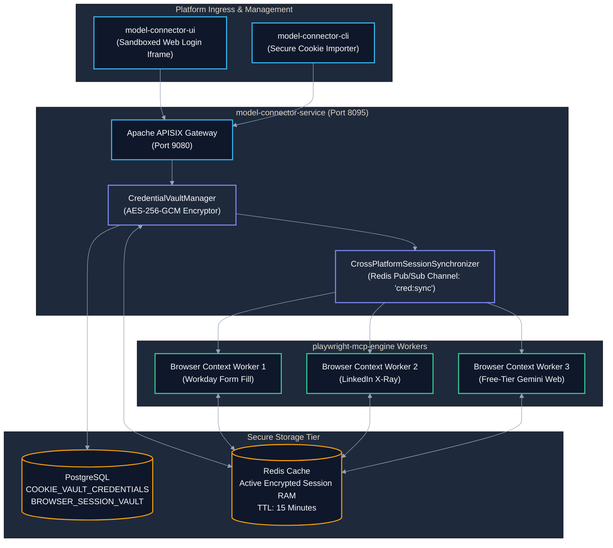
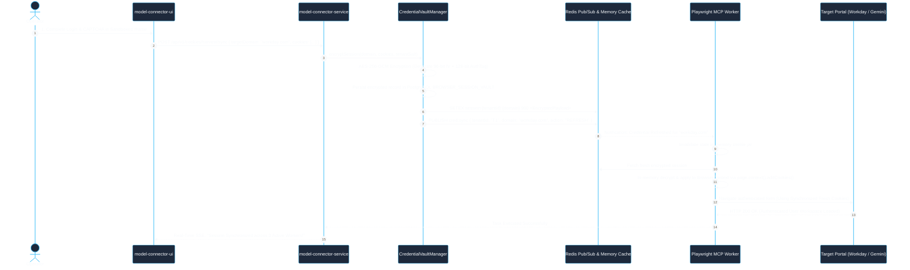
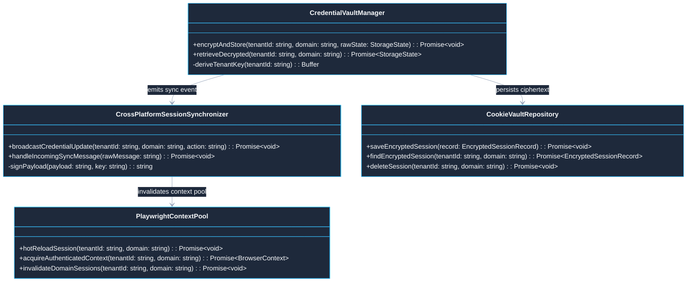

# Use Case 10 — Cross-Platform Cookie Sharing & Credential Vault Synchronization

> **Document ID**: `UC-10`  
> **Category**: Security, Authentication & Distributed Credential Mesh  
> **Master Index**: [README.md §10](README.md#10-use-case-10--cross-platform-cookie-sharing--credential-vault-synchronization)  
> **Master Blueprint**: [blueprint.md §7.1](../blueprint.md#71-multi-mode-authentication--authorization-matrix)  
> **System Architecture (HLD)**: [hld.md §8](../hld.md#8-authentication-authorization--security-perimeters), [§13](../hld.md#13-free-tier-cookie-based-model-connector-client-architecture), [§26](../hld.md#26-playwright-mcp-workflow-template--dynamic-placeholder-engine-with-session-vault)  
> **Component Design (LLD)**: [lld.md §12](../lld.md#12-free-tier-cookie-based-model-connector-client--playwright-sync), [§23](../lld.md#23-playwright-workflow-template-executor-dynamic-placeholder-engine--session-vault)  
> **UI Flows**: [ui-flows.md §11](../ui-flows.md#11-screen-10-free-tier-cookie-management--health-inspector-ui-flow), [§13](../ui-flows.md#13-screen-11-linkedin-x-ray-discovery-playwright-dynamic-placeholder-workflows--ai-assistance-ui-flow)  

---

## 1. Executive Summary & Problem Statement

### 1.1 Executive Summary
* **Distributed Credential Synchronization**: Seamlessly captures, encrypts, synchronizes, and rehydrates authenticated browser cookies and session states (`storageState.json`) across disparate architectural platforms.
* **Multi-Platform Integration**: Unifies credentials across the React UI (`model-connector-ui`), backend services (`model-connector-service`), headless browser pools (`playwright-mcp-engine`), and external targets (Google Gemini, Claude Web, ChatGPT, LinkedIn, Workday).
* **Sub-Millisecond Hot Reloading**: Propagates refreshed credentials to running headless browser contexts in $\le 200\text{ ms}$ via Redis Pub/Sub invalidation buses.
* **Cryptographic Tenant Isolation**: Enforces AES-256-GCM encryption with tenant-specific key derivation and strict RFC 6265 domain boundaries, preventing session cross-contamination.

### 1.2 Problem Statement
* **Process Boundary Fragmentation**: In distributed microservice deployments, workers run in isolated container pools without direct access to browser session memory.
* **Security Exposure in Conventional Stores**: Persisting authentication cookies in plaintext on disk or unencrypted databases exposes credentials to exfiltration, session hijacking, and regulatory non-compliance.
* **Stale Session Disruption**: When an upstream session cookie expires or is refreshed on the client, ongoing headless browser workers fail abruptly unless an automated hot-reloading mechanism synchronizes new tokens in real time.

### 1.3 Constraints & Non-Negotiables
* **Zero Plaintext Invariant**: Cookies, bearer tokens, and storage state payloads must never be logged or persisted in plaintext. All records must be encrypted via AES-256-GCM with tenant-isolated keys.
* **Synchronization Latency SLA**: When a credential is updated via UI or API, active workers must receive and apply the updated credential within $\le 200\text{ ms}$.
* **Strict RFC 6265 Domain Partitioning**: Workday credentials must never leak to LinkedIn; Gemini cookies must never leak to Claude. Scopes are strictly enforced at the cryptographic vault boundary.

---

## 2. Architectural Solutions & System Design (HLD)

### 2.1 System Design Principles
* **Edge Ingress Gateway**: Apache APISIX routes credential updates, verifies JWT claims, and enforces tenant isolation.
* **Credential Vault & Synchronization Core**:
  * `CredentialVaultManager`: Performs AES-256-GCM envelope encryption using tenant keys derived from Cloud KMS/Vault HSM.
  * `CrossPlatformSessionSynchronizer`: Emits and consumes HMAC-SHA256 signed synchronization events across Redis Pub/Sub channels (`cred:sync`).
  * `PlaywrightContextPool`: Manages distributed browser context pools, hot-reloading cookie jars without restarting browser instances.
* **Polyglot Persistence Layer**:
  * **PostgreSQL**: Stores encrypted session payloads in `BROWSER_SESSION_VAULT` with 96-bit IV and 128-bit authentication tags.
  * **Redis**: Retains encrypted active session records (TTL: 15 minutes) and operates the real-time `cred:sync` invalidation bus.

### 2.2 Macro Architecture (HLD) Diagram



---

## 3. End-to-End User Flow Diagram

### 3.1 Nominal End-to-End Session Synchronization Sequence



---

## 4. Low-Level Design (LLD)

### 4.1 LLD Class & Component Interaction Diagram



### 4.2 Cross-Platform Credential Sync Protocol Contract

```typescript
// Centralized runtime encapsulation according to STD-COD-011
import { cryptoUtils } from '@model-box/model-connector-core/utils';

export type CredentialActionType = 'REFRESH' | 'REVOKE' | 'EXPIRE' | 'FORCE_RELOAD';

export interface CredentialSyncMessage {
  readonly messageId: string;
  readonly tenantId: string;
  readonly targetDomain: string; // e.g. "myworkdayjobs.com", "google.com"
  readonly credentialType: 'COOKIE_JAR' | 'STORAGE_STATE' | 'BEARER_TOKEN';
  readonly action: CredentialActionType;
  readonly versionTimestamp: number;
  readonly cryptographicSignature: string; // HMAC-SHA256 signature
}

export class CrossPlatformSessionSynchronizer {
  public constructor(
    private readonly redisClient: any,
    private readonly tenantSecretService: any,
    private readonly localContextPool: any,
  ) {}

  public async broadcastCredentialUpdate(tenantId: string, domain: string, action: CredentialActionType): Promise<void> {
    const tenantSecret = await this.tenantSecretService.getSecret(tenantId);
    const messageId = `SYNC-${Date.now()}-${Math.floor(Math.random() * 1000)}`;
    const versionTimestamp = Date.now();
    const payloadToSign = `${messageId}:${tenantId}:${domain}:${versionTimestamp}`;

    const signature = cryptoUtils.createHmacSha256(payloadToSign, tenantSecret);

    const fullMessage: CredentialSyncMessage = {
      messageId,
      tenantId,
      targetDomain: domain,
      credentialType: 'STORAGE_STATE',
      action,
      versionTimestamp,
      cryptographicSignature: signature,
    };

    await this.redisClient.publish('cred:sync', JSON.stringify(fullMessage));
  }

  public async handleIncomingSyncMessage(rawMessage: string): Promise<void> {
    const msg = JSON.parse(rawMessage) as CredentialSyncMessage;
    const tenantSecret = await this.tenantSecretService.getSecret(msg.tenantId);

    const payloadToVerify = `${msg.messageId}:${msg.tenantId}:${msg.targetDomain}:${msg.versionTimestamp}`;
    const expectedSig = cryptoUtils.createHmacSha256(payloadToVerify, tenantSecret);

    if (expectedSig !== msg.cryptographicSignature) {
      throw new Error('FORGED_SYNC_MESSAGE: Cryptographic signature mismatch.');
    }

    await this.localContextPool.invalidateDomainSessions(msg.tenantId, msg.targetDomain);
  }
}
```

### 4.3 Relational DDL Schema

```sql
-- DDL for Cross-Platform Session and Credential Vault
CREATE TABLE IF NOT EXISTS BROWSER_SESSION_VAULT (
    SESSION_ID VARCHAR(64) PRIMARY KEY,
    TENANT_ID VARCHAR(64) NOT NULL,
    USER_ID VARCHAR(64) NOT NULL,
    TARGET_DOMAIN VARCHAR(255) NOT NULL,
    CIPHERTEXT_BLOB BYTEA NOT NULL,
    INITIALIZATION_VECTOR BYTEA NOT NULL, -- 96-bit AES-GCM IV
    AUTHENTICATION_TAG BYTEA NOT NULL,   -- 128-bit AES-GCM Tag
    KEY_VERSION_ID VARCHAR(64) NOT NULL,
    EXPIRY_TIMESTAMP TIMESTAMP WITH TIME ZONE NOT NULL,
    LAST_SYNCHRONIZED_AT TIMESTAMP WITH TIME ZONE NOT NULL DEFAULT CURRENT_TIMESTAMP,
    CONSTRAINT FK_BSV_TENANT FOREIGN KEY (TENANT_ID) REFERENCES TENANTS (TENANT_ID) ON DELETE CASCADE,
    CONSTRAINT UQ_BSV_TENANT_DOMAIN UNIQUE (TENANT_ID, TARGET_DOMAIN)
);

CREATE INDEX IF NOT EXISTS IDX_BSV_TENANT_DOMAIN ON BROWSER_SESSION_VAULT (TENANT_ID, TARGET_DOMAIN);
```

---

## 5. UI Interaction Flow & Screen States

* **Credential Vault Overview**:
  * Grid rendering target domains (`Workday`, `LinkedIn`, `Gemini Web`).
  * Card displays cookie count, encryption algorithm (`AES-256-GCM`), active worker count, and TTL countdown.
* **Cross-Platform Sync Indicator**:
  * Green pulse animates across worker nodes upon credential updates: `⚡ Syncing to 4 active Playwright workers (Latency: 48ms)`.
* **Revocation Trap Modal**:
  * When a worker detects an upstream HTTP 401, the card highlights in amber: `Session Revoked. One-Click Re-Auth Available`.

---

## 6. API Ingress & Protocol Specification

### 6.1 Harvest & Synchronize Session Across Platforms
* **Endpoint**: `POST /api/v1/credentials/session/sync`
* **Headers**: `Authorization: Bearer <JWT>`, `X-Tenant-Id: <TENANT_ID>`, `Content-Type: application/json`
* **Request Body**:
```json
{
  "targetDomain": "acme.wd5.myworkdayjobs.com",
  "credentialType": "STORAGE_STATE",
  "storageStatePayload": {
    "cookies": [
      { "name": "PLAY_SESSION", "value": "xyz123...", "domain": ".myworkdayjobs.com" }
    ]
  }
}
```
* **Response**: `200 OK`
```json
{
  "status": "SYNCHRONIZED",
  "domain": "acme.wd5.myworkdayjobs.com",
  "activeWorkersUpdated": 3,
  "syncLatencyMs": 42
}
```

---

## 7. Failure Modes, Edge Cases & Recovery User Flow

### 7.1 Edge Cases User Flow & Error Recovery Sequence

```mermaid
%%{init: {'theme': 'base', 'themeVariables': { 'primaryColor': '#1E293B', 'primaryTextColor': '#F8FAFC', 'primaryBorderColor': '#38BDF8', 'lineColor': '#94A3B8', 'secondaryColor': '#0F172A', 'tertiaryColor': '#1E293B', 'noteBkgColor': '#334155', 'noteTextColor': '#F8FAFC'}}}%%
sequenceDiagram
    autonumber
    actor Worker as Playwright Worker
    participant Sync as CrossPlatformSessionSynchronizer
    participant Redis as Redis Pub/Sub
    participant Vault as CredentialVaultManager
    participant UI as model-connector-ui

    Note over Worker,UI: Edge Case 1: Forged or Tampered Sync Message Intercepted
    Redis-->>Sync: Incoming 'cred:sync' message
    Sync->>Sync: Recompute HMAC-SHA256 signature
    Sync->>Sync: Signature Mismatch Detected!
    Sync-->>Sync: Log Security Audit Alert: "FORGED_SYNC_ATTEMPT"
    Sync-->>Worker: Drop message; retain current verified in-memory session

    Note over Worker,UI: Edge Case 2: Target Portal 401 Revocation During Active Automation
    Worker->>Worker: Execute form fill on Workday
    Worker->>Worker: Target returns HTTP 401 Unauthorized
    Worker->>Sync: Trigger Session Revocation Trap
    Sync->>Redis: PUBLISH cred:sync { action: "REVOKE", domain: "workday.com" }
    Sync->>Vault: Invalidate active cached session in Redis RAM
    Sync-->>UI: Real-Time Alert: "Session Revoked. Action required."
    UI-->>UI: Render Re-Authentication Modal for Operator

    Note over Worker,UI: Edge Case 3: Redis Network Split During Broadcast
    Sync->>Redis: PUBLISH cred:sync
    Redis-->>Sync: Connection Timeout (EAI_AGAIN / ECONNREFUSED)
    Sync->>Sync: Fallback to PostgreSQL polling mechanism
    Worker->>Vault: Poll PostgreSQL fallback every 5 seconds for version change
```

### 7.2 Failure Modes & Fallback Matrix

| Failure Mode | Trigger Condition | Automated System Response | User Experience Impact |
| :--- | :--- | :--- | :--- |
| **Tampered Sync Message** | Attacker injects forged message onto Redis Pub/Sub | HMAC signature check fails; message dropped immediately | Zero unauthorized session corruption; security alert logged. |
| **Upstream Session Revocation** | User logs out of Workday/LinkedIn or session expires | Worker intercepts HTTP 401; emits revocation trap; pauses queue | UI highlights domain in amber with one-click re-auth modal. |
| **Redis Network Split** | Temporary network partition between worker node and Redis | Workers fall back to relational DB polling every 5 seconds | Slight increase in sync latency ($5\text{s}$ vs $48\text{ms}$); zero credential loss. |
| **AES-GCM AuthTag Failure** | Storage corruption or incorrect tenant decryption key | Decryption fails; vault quarantines record; forces fresh login | User prompted to re-enter credentials safely. |
| **Cross-Tenant Leak Risk** | Tenant B requests cookies for Tenant A's domain | Vault isolates database queries strictly by `TENANT_ID` | Access denied; complete multi-tenant boundary isolation. |
