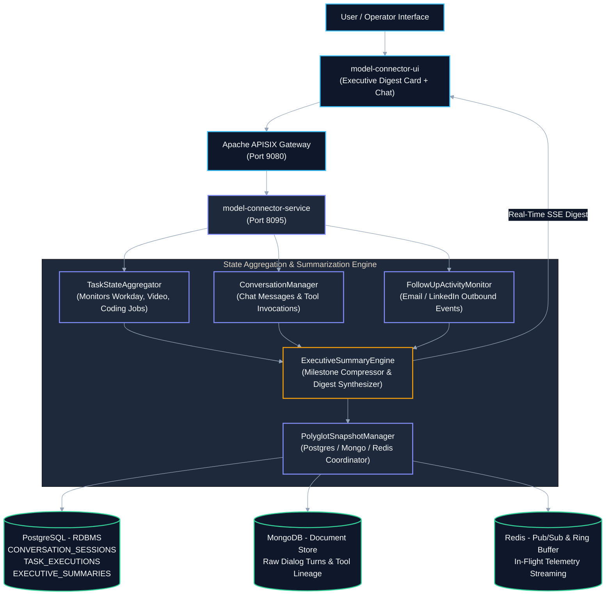
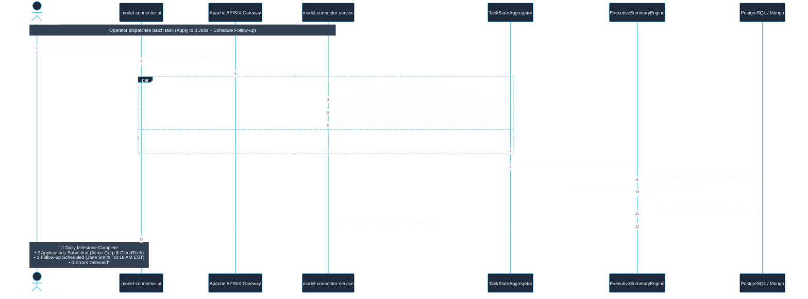
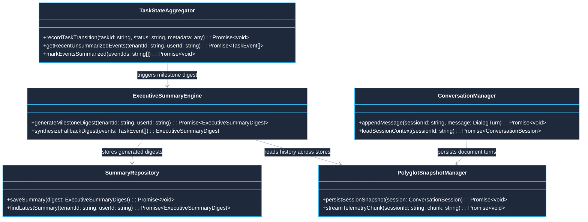

# Use Case 11 — Unified Conversation, Task State & Executive Summary Hub

> **Document ID**: `UC-11`  
> **Category**: State Management, Telemetry & User Communication  
> **Master Index**: [README.md §11](README.md#11-use-case-11--unified-conversation-task-state--executive-summary-hub)  
> **Master Blueprint**: [blueprint.md §6.1](../blueprint.md#61-read-vs-write-workload-profiling)  
> **System Architecture (HLD)**: [hld.md §2.3](../hld.md#23-polyglot-storage-topology-rdbms--document-nosql--in-memory-kv), [§3.3](../hld.md#33-asynchronous-non-blocking-execution-topology), [§9.2](../hld.md#92-structured-ndjson-audit-logging-specification)  
> **Component Design (LLD)**: [lld.md §2.3](../lld.md#23-model-connector-service-gateway--vault-layer), [§3.4](../lld.md#34-enterprise-nosql-document-architecture-mongodb-collections--bson-schemas), [§7](../lld.md#7-distributed-logging--audit-telemetry-schema)  
> **UI Flows**: [ui-flows.md §3](../ui-flows.md#3-screen-2-network-analytics-dashboard--metrics), [§4](../ui-flows.md#4-screen-3-user-workspace--model-interaction-studio)  

---

## 1. Executive Summary & Problem Statement

### 1.1 Executive Summary
* **Unified Cross-Domain Correlation**: Aggregates, normalizes, and correlates interactions across three communication dimensions: interactive chat dialogs, autonomous background task execution, and outbound communication cadences.
* **Human-Centric Executive Summarization**: Synthesizes granular developer debug traces into high-level, actionable executive milestone summaries and daily recap digests.
* **Polyglot Storage Separation**: Allocates workloads across specialized storage tiers (PostgreSQL for relational ledgers, MongoDB for raw dialog ASTs, Redis for real-time SSE ring buffers).
* **Multi-Tenant State Security**: Guarantees zero cross-tenant contamination through cryptographic workspace isolation and row-level tenant partitioning.

### 1.2 Problem Statement
* **Siloed Execution Visibility**: In distributed multi-agent platforms, background workflows run asynchronously for minutes or hours, disconnecting user chat sessions from active automation states.
* **Cognitive Telemetry Overload**: Exposing end users to hundreds of raw HTTP/Playwright logs causes confusion and obscures workflow completion status.
* **Auditability Trade-off**: Omitting low-level traces impairs engineering diagnosis and regulatory compliance. The platform requires a bifurcated architecture separating technical logs from human-friendly digests.

### 1.3 Constraints & Non-Negotiables
* **Polyglot Tier Separation**:
  * Structured transactional entities $\implies$ **PostgreSQL** (`CONVERSATION_SESSIONS`, `TASK_EXECUTIONS`, `EXECUTIVE_SUMMARIES`).
  * Raw JSON-RPC dialog turns, tool call arguments, and prompt markdown $\implies$ **MongoDB** (`CONVERSATION_MESSAGES`, `RAW_AST_VAULT`).
  * In-flight real-time telemetry and SSE ring buffers $\implies$ **Redis** (`ringbuffer:session:{id}`).
* **Digest Generation SLA**: Milestone executive digests must be synthesized and streamed in $\le 800\text{ ms}$ upon task batch completion.
* **Deterministic Fallback Invariant**: If the generative model times out during summarization, a deterministic rule-based template engine must synthesize the digest without throwing an error.

---

## 2. Architectural Solutions & System Design (HLD)

### 2.1 System Design Principles
* **Edge Ingress Gateway**: Apache APISIX terminates client connections, verifies tenant JWT tokens, and manages persistent SSE channels.
* **State Aggregation & Summarization Core**:
  * `TaskStateAggregator`: Collects lifecycle state transitions from background workers across Job Autofill, App Builder, and Storyteller pipelines.
  * `ConversationManager`: Coordinates chat messages, model tool invocations, and multi-turn dialog contexts.
  * `ExecutiveSummaryEngine`: Synthesizes concise bulleted summaries upon milestone triggers or scheduled recaps.
  * `PolyglotSnapshotManager`: Orchestrates data synchronization between PostgreSQL, MongoDB, and Redis.
* **Polyglot Persistence Layer**:
  * **PostgreSQL (RDBMS)**: Maintains relational schemas for sessions, tasks, and executive summaries.
  * **MongoDB (Document)**: Houses unstructured multi-turn dialog turns, AST payloads, and model generation parameters.
  * **Redis (In-Memory)**: Powers transient SSE ring buffers (`ringbuffer:session:{id}`) and pub/sub update channels.

### 2.2 Macro Architecture (HLD) Diagram



---

## 3. End-to-End User Flow Diagram

### 3.1 Nominal End-to-End Task State & Milestone Summary Flow



---

## 4. Low-Level Design (LLD)

### 4.1 LLD Class & Component Interaction Diagram



### 4.2 Executive Summary Synthesizer Implementation Contract

```typescript
// Centralized runtime encapsulation according to STD-COD-011
import { timerUtils, cryptoUtils } from '@model-box/model-connector-core/utils';

export interface ExecutiveSummaryDigest {
  readonly summaryId: string;
  readonly tenantId: string;
  readonly userId: string;
  readonly timeWindow: 'IMMEDIATE_MILESTONE' | 'DAILY_RECAP' | 'WEEKLY_ROLLUP';
  readonly completedTasksCount: number;
  readonly failedTasksCount: number;
  readonly highLevelHighlights: ReadonlyArray<string>;
  readonly recommendedNextActions: ReadonlyArray<string>;
  readonly generatedTimestamp: Date;
}

export class ExecutiveSummaryEngine {
  public constructor(
    private readonly taskRepo: any,
    private readonly summaryRepo: any,
    private readonly modelClient: any,
  ) {}

  public async generateMilestoneDigest(tenantId: string, userId: string): Promise<ExecutiveSummaryDigest> {
    const recentEvents = await this.taskRepo.getRecentUnsummarizedEvents(tenantId, userId);
    
    try {
      const prompt = `Summarize the following technical task executions into 3 concise professional bulleted achievements:\n${JSON.stringify(recentEvents)}`;
      const modelResponse = await this.modelClient.generateText(prompt);
      const highlights = modelResponse.text.split('\n').filter((l: string) => l.trim().startsWith('•'));

      const digest: ExecutiveSummaryDigest = {
        summaryId: `SUM-${Date.now()}`,
        tenantId,
        userId,
        timeWindow: 'IMMEDIATE_MILESTONE',
        completedTasksCount: recentEvents.filter((e: any) => e.status === 'COMPLETED').length,
        failedTasksCount: recentEvents.filter((e: any) => e.status === 'FAILED').length,
        highLevelHighlights: highlights.length > 0 ? highlights : ['• Completed scheduled workflow tasks successfully'],
        recommendedNextActions: ['Review scheduled follow-up draft for Jane Smith'],
        generatedTimestamp: new Date(),
      };

      await this.summaryRepo.persist(digest);
      return digest;
    } catch {
      return this.synthesizeFallbackDigest(tenantId, userId, recentEvents);
    }
  }

  public synthesizeFallbackDigest(tenantId: string, userId: string, events: any[]): ExecutiveSummaryDigest {
    const completed = events.filter((e: any) => e.status === 'COMPLETED').length;
    const failed = events.filter((e: any) => e.status === 'FAILED').length;
    return {
      summaryId: `SUM-FALLBACK-${Date.now()}`,
      tenantId,
      userId,
      timeWindow: 'IMMEDIATE_MILESTONE',
      completedTasksCount: completed,
      failedTasksCount: failed,
      highLevelHighlights: [`• Processed ${completed} automated tasks successfully`, `• Flagged ${failed} tasks requiring user attention`],
      recommendedNextActions: ['Inspect execution logs for flagged actions'],
      generatedTimestamp: new Date(),
    };
  }
}
```

### 4.3 Relational & Document DDL Schemas

```sql
-- DDL for Conversations, Tasks, and Executive Summaries
CREATE TABLE IF NOT EXISTS CONVERSATION_SESSIONS (
    SESSION_ID VARCHAR(64) PRIMARY KEY,
    TENANT_ID VARCHAR(64) NOT NULL,
    USER_ID VARCHAR(64) NOT NULL,
    SESSION_TITLE VARCHAR(255) NOT NULL,
    MODEL_FAMILY VARCHAR(64) NOT NULL DEFAULT 'GEMINI',
    STATUS VARCHAR(32) NOT NULL DEFAULT 'ACTIVE',
    MESSAGE_COUNT INTEGER NOT NULL DEFAULT 0,
    TOTAL_TOKEN_CONSUMPTION BIGINT NOT NULL DEFAULT 0,
    CREATED_AT TIMESTAMP WITH TIME ZONE NOT NULL DEFAULT CURRENT_TIMESTAMP,
    UPDATED_AT TIMESTAMP WITH TIME ZONE NOT NULL DEFAULT CURRENT_TIMESTAMP,
    CONSTRAINT FK_CSESS_TENANT FOREIGN KEY (TENANT_ID) REFERENCES TENANTS (TENANT_ID) ON DELETE CASCADE
);

CREATE TABLE IF NOT EXISTS TASK_EXECUTIONS (
    TASK_ID VARCHAR(64) PRIMARY KEY,
    TENANT_ID VARCHAR(64) NOT NULL,
    USER_ID VARCHAR(64) NOT NULL,
    TASK_TYPE VARCHAR(64) NOT NULL, -- 'JOB_APPLICATION', 'APP_BUILD', 'VIDEO_RENDER', 'FOLLOWUP_DISPATCH'
    TARGET_ENTITY_ID VARCHAR(64),
    TASK_STATUS VARCHAR(32) NOT NULL DEFAULT 'RUNNING', -- 'RUNNING', 'COMPLETED', 'FAILED', 'PAUSED'
    EXECUTION_OUTPUT_SUMMARY TEXT,
    STARTED_AT TIMESTAMP WITH TIME ZONE NOT NULL DEFAULT CURRENT_TIMESTAMP,
    COMPLETED_AT TIMESTAMP WITH TIME ZONE,
    CONSTRAINT FK_TE_TENANT FOREIGN KEY (TENANT_ID) REFERENCES TENANTS (TENANT_ID) ON DELETE CASCADE
);

CREATE TABLE IF NOT EXISTS EXECUTIVE_SUMMARIES (
    SUMMARY_ID VARCHAR(64) PRIMARY KEY,
    TENANT_ID VARCHAR(64) NOT NULL,
    USER_ID VARCHAR(64) NOT NULL,
    TIME_WINDOW VARCHAR(32) NOT NULL, -- 'IMMEDIATE_MILESTONE', 'DAILY_RECAP'
    COMPLETED_TASKS_COUNT INTEGER NOT NULL,
    FAILED_TASKS_COUNT INTEGER NOT NULL,
    HIGHLIGHTS_JSON JSONB NOT NULL,
    NEXT_ACTIONS_JSON JSONB NOT NULL,
    CREATED_AT TIMESTAMP WITH TIME ZONE NOT NULL DEFAULT CURRENT_TIMESTAMP,
    CONSTRAINT FK_ES_TENANT FOREIGN KEY (TENANT_ID) REFERENCES TENANTS (TENANT_ID) ON DELETE CASCADE
);

CREATE INDEX IF NOT EXISTS IDX_TE_TENANT_STATUS ON TASK_EXECUTIONS (TENANT_ID, USER_ID, TASK_STATUS);
CREATE INDEX IF NOT EXISTS IDX_ES_TENANT_USER ON EXECUTIVE_SUMMARIES (TENANT_ID, USER_ID, CREATED_AT DESC);
```

---

## 5. UI Interaction Flow & Screen States

* **Executive Digest Card**:
  * Positioned prominently at the top of the User Workspace ([Screen 3](../ui-flows.md#4-screen-3-user-workspace--model-interaction-studio)).
  * Displays green status pill: `🟢 3 Tasks Finished Successfully`.
  * Renders clear bulleted highlights:
    * `• Applied to Staff AI Engineer at Acme Corp (Workday Confirmation: WD-991)`
    * `• Follow-up scheduled for Recruiter Jane Smith (Tomorrow at 10:18 AM EST)`
    * `• Generated ATS Scorecard (Overall Compatibility: 94%)`
* **Interactive Timeline Stepper**:
  * Clicking the digest card expands a visual chronological drawer showing task inputs, execution durations, and output links.
* **Notification Drawer**:
  * Unread milestone badges alert operators when long-running workflows complete asynchronously while viewing other workspaces.

---

## 6. API Ingress & Protocol Specification

### 6.1 Retrieve Latest Executive Digest
* **Endpoint**: `GET /api/v1/summary/latest`
* **Headers**: `Authorization: Bearer <JWT>`, `X-Tenant-Id: <TENANT_ID>`
* **Response**: `200 OK`
```json
{
  "summaryId": "SUM-17929",
  "timeWindow": "IMMEDIATE_MILESTONE",
  "completedTasksCount": 3,
  "failedTasksCount": 0,
  "highlights": [
    "Applied to Staff AI Engineer at Acme Corp (Confirmation: WD-991)",
    "Follow-up email queued for Jane Smith (Scheduled: Tomorrow 10:18 AM EST)",
    "Generated ATS Scorecard (94% Match)"
  ],
  "recommendedNextActions": [
    "Review scheduled email draft before tomorrow morning"
  ],
  "generatedAt": "2026-10-25T14:30:00Z"
}
```

---

## 7. Failure Modes, Edge Cases & Recovery User Flow

### 7.1 Edge Cases User Flow & Error Recovery Sequence

```mermaid
%%{init: {'theme': 'base', 'themeVariables': { 'primaryColor': '#1E293B', 'primaryTextColor': '#F8FAFC', 'primaryBorderColor': '#38BDF8', 'lineColor': '#94A3B8', 'secondaryColor': '#0F172A', 'tertiaryColor': '#1E293B', 'noteBkgColor': '#334155', 'noteTextColor': '#F8FAFC'}}}%%
sequenceDiagram
    autonumber
    actor User as Operator
    participant UI as model-connector-ui
    participant Svc as model-connector-service
    participant SumEng as ExecutiveSummaryEngine
    participant Redis as Redis Ring Buffer
    participant LLM as Model Inference Provider

    Note over User,LLM: Edge Case 1: Model API Timeout During Milestone Summarization
    Svc->>SumEng: generateMilestoneDigest(tenantId, userId)
    SumEng->>LLM: POST /v1/chat/completions (Prompt with task events)
    LLM-->>SumEng: HTTP 504 Gateway Timeout (or quota exceeded)
    SumEng->>SumEng: Trigger deterministic rule-based template synthesizer
    SumEng-->>Svc: Rule-Based Digest ("Completed 3 tasks successfully")
    Svc-->>UI: Real-Time SSE: Executive Summary Delivered (Fallback Flagged)

    Note over User,LLM: Edge Case 2: SSE Network Disconnect & Ring Buffer Rehydration
    UI->>Svc: Connection severed (Network hiccup)
    Svc->>Redis: Continue appending telemetry chunks to ringbuffer:session:S1
    UI->>Svc: Reconnect GET /api/v1/summary/stream?lastEventId=EVT-42
    Svc->>Redis: Fetch buffered events from EVT-43 to EVT-50
    Redis-->>Svc: Return buffered telemetry chunks
    Svc-->>UI: Replay missing events; seamless UI state restored without reload
```

### 7.2 Failure Modes & Fallback Matrix

| Failure Mode | Trigger Condition | Automated System Response | User Experience Impact |
| :--- | :--- | :--- | :--- |
| **Summarization LLM Outage** | Model API returns 503 or exceeds 800ms SLA | Engine switches to deterministic template generator instantly | User receives clear structured summary; zero latency spike. |
| **Client SSE Connection Drop** | WiFi glitch or browser sleep | Redis ring buffer retains last 100 events; replays on reconnect | UI seamlessly resumes without missed telemetry chunks. |
| **Concurrent Milestone Race** | Two background jobs finish within 5ms of each other | Distributed Redis lock ensures batch aggregation executes once | Exactly one consolidated digest is generated; zero duplication. |
| **MongoDB Document Spill** | Very large dialog turn exceeds standard BSON limit | Engine compresses tool arguments and archives payload to MinIO | Conversation continuity preserved; storage quotas respected. |
| **Database Network Partition** | PostgreSQL temporary failover during summary write | Summary held in Redis RAM; flushed to PostgreSQL upon recovery | Real-time UI updates continue uninterrupted. |
