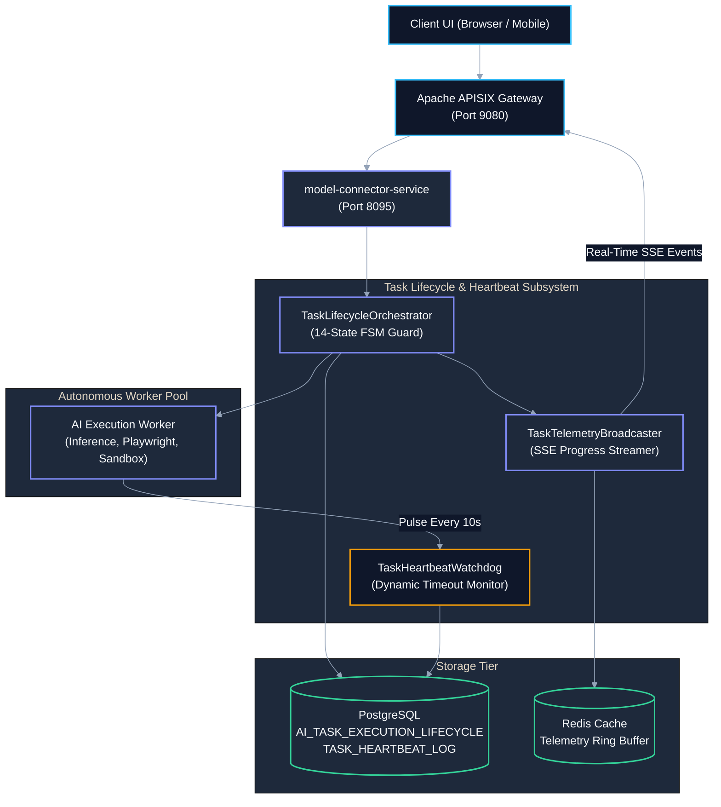
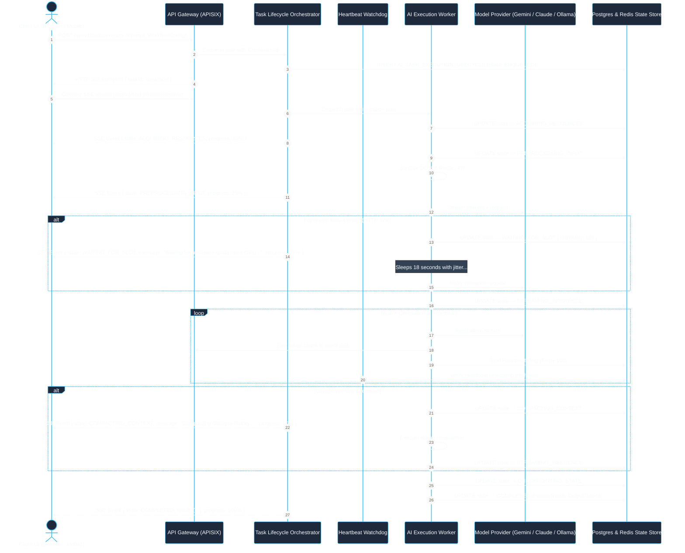
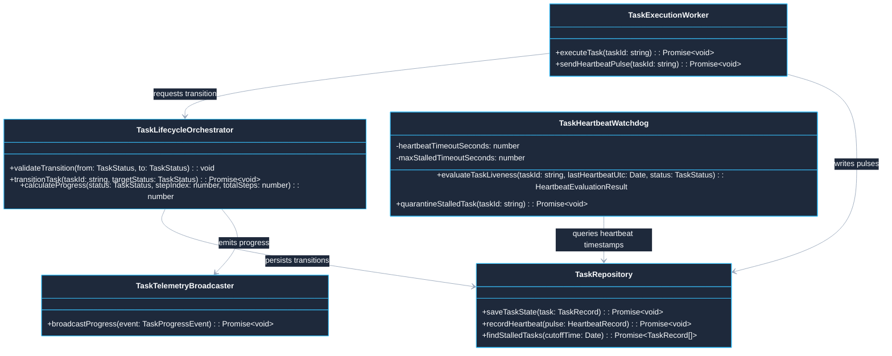

# Use Case 12 — Long-Running AI Task Lifecycle, Heartbeat & Nuanced Status Orchestration

> **Document ID**: `UC-12`  
> **Category**: Distributed Execution & Lifecycle Governance  
> **Master Index**: [README.md §12](README.md#12-use-case-12--long-running-ai-task-lifecycle-heartbeat--nuanced-status-orchestration)  
> **Master Blueprint**: [blueprint.md §6.3](../blueprint.md#63-asynchronous-non-blocking-execution-model)  
> **System Architecture (HLD)**: [hld.md §3.1](../hld.md#31-long-running-ai-inference-vs-timeout-governance), [§3.3](../hld.md#33-asynchronous-non-blocking-execution-topology), [§22](../hld.md#22-resilient-workflow-resumption--cryptographic-tamper-detection-architecture)  
> **Component Design (LLD)**: [lld.md §2.1.2](../lld.md#212-resilience4j-fault-tolerance-engine-resilience), [§8](../lld.md#8-enterprise-queue-system-architecture--zero-leakage-multi-tenant-isolation), [§19](../lld.md#19-low-level-design-workflow-resumption--cryptographic-state-ledger)  
> **UI Flows**: [ui-flows.md §4.2](../ui-flows.md#42-detailed-workspace-chat--verification-ui-flow-diagram), [§7.2](../ui-flows.md#72-detailed-visual-dag-builder-ui-flow-diagram)  

---

## 1. Executive Summary & Problem Statement

### 1.1 Executive Summary
* **14-State Granular Lifecycle FSM**: Replaces simplistic tri-state models (`RUNNING`, `FAILED`, `COMPLETED`) with a 14-state finite state machine providing full visibility across model inference, tool execution, and human approval gates.
* **Bi-directional Heartbeat Pulse Protocol**: Enforces continuous 10-second pulses from active workers to the central watchdog, detecting silent crashes, worker OOMs, and network partitions within 30 seconds.
* **Spring-Style Dynamic Configuration**: Automatically loads lifecycle timeouts (`heartbeatTimeoutSeconds`, `maxStalledTimeoutSeconds`) from `application.yml` via the core environment module.
* **Sub-Stage Micro-Progress Telemetry**: Streams real-time percentage completion, stage indices, and human-readable phase descriptions over Server-Sent Events (SSE).
* **Resilient State Resumption**: Integrates with the cryptographic state ledger ([UC-07 §1.1](UC-07-workflow-ledger-and-tamper-resumption.md#11-executive-summary)) to resume recovered tasks from their last verified checkpoint without full re-execution.

### 1.2 Problem Statement
* **Tri-State Operational Blindspot**: Traditional architectures report `RUNNING` for the entire 30–300 second lifecycle of an AI task, leaving users and watchdogs unable to differentiate between active execution, rate-limit pauses, and complete deadlocks.
* **Zombie Worker Accumulation**: Silent worker failures (e.g. headless browser crash or container OOM) leave database records permanently in `RUNNING`, blocking worker pools and wasting resources.
* **False-Positive Watchdog Kills**: Overly aggressive timeout watchdogs terminate healthy workers that are simply waiting for upstream LLM rate-limit windows to reset.
* **Lack of HITL Execution Freezing**: Long workflows requiring user sign-off (e.g. salary approvals or resume reviews) trigger premature timeout errors if timers are not formally paused.

### 1.3 Constraints & Non-Negotiable Invariants
* **Universal UTC Timestamping**: All heartbeats, state transitions, and SLA checks must be evaluated strictly in UTC ISO 8601 `Z` format.
* **Heartbeat & Liveness Thresholds**:
  * Heartbeat pulse emission interval: **10 seconds**.
  * Stalled transition threshold (`tasks.lifecycle.heartbeatTimeoutSeconds`): **30 seconds** (3 missed pulses).
  * Auto-quarantine & failover deadline (`tasks.lifecycle.maxStalledTimeoutSeconds`): **90 seconds**.
* **Zero Silent Failures**: Every task must conclude in an explicit classified terminal state (`COMPLETED`, `CANCELLED_BY_USER`, or `FAILED_WITH_CLASSIFICATION`).

---

## 2. The 14-State Task Lifecycle Finite State Machine (FSM)

```
                                  +-----------------------+
                                  |      1. ENQUEUED      |
                                  +-----------+-----------+
                                              |
                                              v
                                  +-----------------------+
                                  | 2. ACQUIRING_RESOURCES|
                                  +-----------+-----------+
                                              |
                                              v
                                  +-----------------------+
                                  | 3. PREPROCESSING_INPUT|
                                  +-----------+-----------+
                                              |
         +------------------------------------+------------------------------------+
         |                                    |                                    |
         v                                    v                                    v
+-----------------------+            +-----------------------+            +-----------------------+
|  4. WAITING_FOR_SLOT  |            | 5. STREAMING_INFERENCE|            |  6. AWAITING_MCP_TOOL |
| (Rate-limit / Quota)  |            |   (Tokens Emitting)   |            | (Playwright / Tool)   |
+-----------+-----------+            +-----------+-----------+            +-----------+-----------+
         |                                    |                                    |
         +------------------------------------+------------------------------------+
                                              |
         +------------------------------------+------------------------------------+
         |                                    |                                    |
         v                                    v                                    v
+-----------------------+            +-----------------------+            +-----------------------+
|7. AWAITING_HUMAN_APPR |            | 8. COMPACTING_CONTEXT |            | 9. CHECKPOINTING_STATE|
| (HITL Gate Paused)    |            |  (Rolling Summary)    |            | (Cryptographic State) |
+-----------+-----------+            +-----------+-----------+            +-----------+-----------+
         |                                    |                                    |
         +------------------------------------+------------------------------------+
                                              |
                      +-----------------------+-----------------------+
                      |                                               |
                      v                                               v
          +-----------------------+                       +-----------------------+
          | 10. DEGRADED_FAILOVER |                       | 11. HEARTBEAT_STALLED |
          | (Switching Provider)  |                       |  (Watchdog Probing)   |
          +-----------+-----------+                       +-----------+-----------+
                      |                                               |
                      +-----------------------+-----------------------+
                                              |
         +------------------------------------+------------------------------------+
         |                                    |                                    |
         v                                    v                                    v
+-----------------------+            +-----------------------+            +-----------------------+
|     12. COMPLETED     |            |13. CANCELLED_BY_USER  |            | 14. FAILED_CLASSIFIED |
| (Verified Output Hash)|            | (Clean State Refund)  |            | (Classified Error Code)
+-----------------------+            +-----------------------+            +-----------------------+
```

### 2.1 State Taxonomy & SLA Rules

| State Enum | Description & Trigger | Max Allowable SLA | Next Valid Transitions |
| :--- | :--- | :--- | :--- |
| **`ENQUEUED`** | Task accepted by gateway, HMAC verified, stored in queue. | 60 sec | `ACQUIRING_RESOURCES`, `CANCELLED_BY_USER` |
| **`ACQUIRING_RESOURCES`** | Allocating GPU worker, Playwright browser context, or sandbox. | 30 sec | `PREPROCESSING_INPUT`, `DEGRADED_FAILOVER`, `FAILED_CLASSIFIED` |
| **`PREPROCESSING_INPUT`** | Sanitizing DOM, compiling system prompt, masking PII. | 15 sec | `WAITING_FOR_SLOT`, `STREAMING_INFERENCE` |
| **`WAITING_FOR_SLOT`** | Upstream HTTP 429 backoff; circuit breaker cooldown. | 120 sec | `STREAMING_INFERENCE`, `DEGRADED_FAILOVER` |
| **`STREAMING_INFERENCE`** | Model is actively generating tokens; chunks streamed to client. | 300 sec | `AWAITING_MCP_TOOL`, `COMPACTING_CONTEXT`, `CHECKPOINTING_STATE`, `COMPLETED` |
| **`AWAITING_MCP_TOOL`** | Waiting for external tool (Playwright click, DB query, shell). | 60 sec | `STREAMING_INFERENCE`, `FAILED_CLASSIFIED` |
| **`AWAITING_HUMAN_APPROVAL`** | Paused at HITL safety gate (e.g. approving email or salary offer). | 24 hours | `STREAMING_INFERENCE`, `CANCELLED_BY_USER` |
| **`COMPACTING_CONTEXT`** | Token limit approached; rolling summary running. | 45 sec | `STREAMING_INFERENCE` |
| **`CHECKPOINTING_STATE`** | Persisting intermediate step to cryptographic ledger. | 10 sec | `STREAMING_INFERENCE`, `COMPLETED` |
| **`DEGRADED_FAILOVER`** | Primary model timed out; migrating state to fallback model. | 30 sec | `PREPROCESSING_INPUT`, `FAILED_CLASSIFIED` |
| **`HEARTBEAT_STALLED`** | Worker missed $\ge 3$ consecutive heartbeats (30s). | 60 sec probe | `STREAMING_INFERENCE` (reconnected), `FAILED_CLASSIFIED` (quarantine) |
| **`COMPLETED`** | Terminal: Output schema validated, tokens tallied, billing recorded. | Terminal | None |
| **`CANCELLED_BY_USER`** | Terminal: Explicit operator abort; resources reclaimed. | Terminal | None |
| **`FAILED_WITH_CLASSIFICATION`** | Terminal: Ended with classified domain error and remediation hints. | Terminal | None |

---

## 3. Macro Architecture (HLD) & System Design

### 3.1 System Design Principles
* **Edge Ingress Gateway**: Apache APISIX routes task execution calls, provisions unique Correlation IDs, and establishes persistent SSE streaming connections.
* **Lifecycle Orchestration Subsystem**:
  * `TaskLifecycleOrchestrator`: Controls valid state transitions and enforces the 14-state FSM rules.
  * `TaskHeartbeatWatchdog`: Continuously monitors worker liveness using dynamic timeouts from `application.yml`.
  * `TaskTelemetryBroadcaster`: Emits real-time progress updates to connected clients via SSE.
* **Worker Execution Mesh**: Autonomous containerized worker pool executing model inference, tool operations, and AST extractions.
* **Polyglot Persistence Layer**:
  * **PostgreSQL**: Stores relational task lifecycle states (`AI_TASK_EXECUTION_LIFECYCLE`) and append-only heartbeat logs (`TASK_HEARTBEAT_LOG`).
  * **Redis**: Retains real-time telemetry ring buffers and volatile distributed locks.

### 3.2 Macro Architecture (HLD) Diagram



---

## 4. End-to-End User Flow Diagram

### 4.1 Nominal End-to-End Task Lifecycle Sequence



---

## 5. Low-Level Design (LLD)

### 5.1 LLD Class & Component Interaction Diagram



### 5.2 TypeScript Service Implementations

```typescript
// Centralized runtime encapsulation according to STD-COD-011 and Spring-style Environment loading
import { timerUtils, cryptoUtils } from '@model-box/model-connector-core/utils';
import { environment, type Environment } from "@model-box/model-connector-core";

export type TaskStatus =
  | 'ENQUEUED'
  | 'ACQUIRING_RESOURCES'
  | 'PREPROCESSING_INPUT'
  | 'WAITING_FOR_SLOT'
  | 'STREAMING_INFERENCE'
  | 'AWAITING_MCP_TOOL'
  | 'AWAITING_HUMAN_APPROVAL'
  | 'COMPACTING_CONTEXT'
  | 'CHECKPOINTING_STATE'
  | 'DEGRADED_FAILOVER'
  | 'HEARTBEAT_STALLED'
  | 'COMPLETED'
  | 'CANCELLED_BY_USER'
  | 'FAILED_WITH_CLASSIFICATION';

export interface HeartbeatEvaluationResult {
  readonly taskId: string;
  readonly isHealthy: boolean;
  readonly elapsedSinceLastPulseSeconds: number;
  readonly recommendedAction: 'NONE' | 'MARK_STALLED' | 'FORCE_TERMINATE_AND_FAILOVER';
}

export class TaskHeartbeatWatchdog {
  private readonly heartbeatTimeoutSeconds: number;
  private readonly maxStalledTimeoutSeconds: number;

  constructor(env: Environment = environment) {
    this.heartbeatTimeoutSeconds = env.getPropertyAsNumber(
      'tasks.lifecycle.heartbeatTimeoutSeconds',
      30
    );
    this.maxStalledTimeoutSeconds = env.getPropertyAsNumber(
      'tasks.lifecycle.maxStalledTimeoutSeconds',
      90
    );
  }

  public evaluateTaskLiveness(
    taskId: string,
    lastHeartbeatUtc: Date,
    currentStatus: TaskStatus
  ): HeartbeatEvaluationResult {
    if (currentStatus === 'AWAITING_HUMAN_APPROVAL' || currentStatus === 'COMPLETED' || currentStatus === 'CANCELLED_BY_USER') {
      return { taskId, isHealthy: true, elapsedSinceLastPulseSeconds: 0, recommendedAction: 'NONE' };
    }

    const elapsedSeconds = Math.floor((Date.now() - lastHeartbeatUtc.getTime()) / 1000);

    if (elapsedSeconds > this.maxStalledTimeoutSeconds) {
      return {
        taskId,
        isHealthy: false,
        elapsedSinceLastPulseSeconds: elapsedSeconds,
        recommendedAction: 'FORCE_TERMINATE_AND_FAILOVER',
      };
    }

    if (elapsedSeconds > this.heartbeatTimeoutSeconds) {
      return {
        taskId,
        isHealthy: false,
        elapsedSinceLastPulseSeconds: elapsedSeconds,
        recommendedAction: 'MARK_STALLED',
      };
    }

    return { taskId, isHealthy: true, elapsedSinceLastPulseSeconds: elapsedSeconds, recommendedAction: 'NONE' };
  }
}
```

### 5.3 Enterprise Relational Database Schema & Indexes

```sql
-- DDL for Granular AI Task Execution Lifecycle
CREATE TABLE IF NOT EXISTS AI_TASK_EXECUTION_LIFECYCLE (
    TASK_ID VARCHAR(64) PRIMARY KEY,
    TENANT_ID VARCHAR(64) NOT NULL,
    USER_ID VARCHAR(64) NOT NULL,
    WORKFLOW_ID VARCHAR(64),
    CURRENT_STATUS VARCHAR(32) NOT NULL DEFAULT 'ENQUEUED',
    PREVIOUS_STATUS VARCHAR(32),
    PROGRESS_PERCENT INT NOT NULL DEFAULT 0,
    STATUS_HUMAN_MESSAGE VARCHAR(500) NOT NULL DEFAULT 'Task accepted and enqueued.',
    ASSIGNED_WORKER_ID VARCHAR(64),
    EXECUTION_STAGE_INDEX INT NOT NULL DEFAULT 0,
    TOTAL_EXPECTED_STAGES INT NOT NULL DEFAULT 1,
    LAST_HEARTBEAT_UTC TIMESTAMP WITH TIME ZONE NOT NULL DEFAULT CURRENT_TIMESTAMP,
    ENQUEUED_AT_UTC TIMESTAMP WITH TIME ZONE NOT NULL DEFAULT CURRENT_TIMESTAMP,
    STARTED_AT_UTC TIMESTAMP WITH TIME ZONE,
    COMPLETED_AT_UTC TIMESTAMP WITH TIME ZONE,
    FAILURE_REASON_CODE VARCHAR(64),
    FAILURE_DETAIL TEXT,
    CONSTRAINT FK_ATEL_TENANT FOREIGN KEY (TENANT_ID) REFERENCES TENANTS (TENANT_ID) ON DELETE CASCADE
);

CREATE INDEX IF NOT EXISTS IDX_ATEL_TENANT_STATUS 
    ON AI_TASK_EXECUTION_LIFECYCLE (TENANT_ID, CURRENT_STATUS);

CREATE INDEX IF NOT EXISTS IDX_ATEL_WATCHDOG_HEARTBEAT 
    ON AI_TASK_EXECUTION_LIFECYCLE (CURRENT_STATUS, LAST_HEARTBEAT_UTC) 
    WHERE CURRENT_STATUS NOT IN ('COMPLETED', 'CANCELLED_BY_USER', 'FAILED_WITH_CLASSIFICATION');

-- High-Performance Heartbeat Audit Telemetry Log
CREATE TABLE IF NOT EXISTS TASK_HEARTBEAT_LOG (
    HEARTBEAT_ID VARCHAR(64) PRIMARY KEY,
    TASK_ID VARCHAR(64) NOT NULL,
    WORKER_ID VARCHAR(64) NOT NULL,
    RECORDED_STATUS VARCHAR(32) NOT NULL,
    MEMORY_USAGE_MB INT,
    ACTIVE_STEP_NAME VARCHAR(128),
    PULSE_TIMESTAMP_UTC TIMESTAMP WITH TIME ZONE NOT NULL DEFAULT CURRENT_TIMESTAMP,
    CONSTRAINT FK_THL_TASK FOREIGN KEY (TASK_ID) REFERENCES AI_TASK_EXECUTION_LIFECYCLE (TASK_ID) ON DELETE CASCADE
);

CREATE INDEX IF NOT EXISTS IDX_THL_TASK_TIME 
    ON TASK_HEARTBEAT_LOG (TASK_ID, PULSE_TIMESTAMP_UTC DESC);
```

---

## 6. UI Interaction Flow & Real-Time Micro-Progress State Machine

```
+--------------------------------------------------------------------------------------------------+
|                                  USER WORKSPACE TASK PROGRESS BAR                                 |
+--------------------------------------------------------------------------------------------------+
| [Task #9182: Fullstack App Code Synthesis]                              Elapsed: 42s | ETA: 28s   |
|                                                                                                  |
| [=======================================>-----------------------] 65%                             |
|                                                                                                  |
| Current Phase: AWAITING_MCP_TOOL                                                                 |
| Status: "Executing Playwright browser action: filling Workday employment history..."             |
|                                                                                                  |
|  (●) Queue (✓) -> Preprocess (✓) -> Inference (✓) -> [Tool Executing] -> Review -> Complete      |
|                                                                                                  |
| [Pause Task]          [View Live Worker Logs]                              [Cancel & Reclaim]    |
+--------------------------------------------------------------------------------------------------+
```

### 6.1 State-Driven UI Indicators & Operator Controls
* **`WAITING_FOR_SLOT`**:
  * Status badge pulses in amber/orange.
  * UI displays countdown timer: *"Provider rate limit encountered. Auto-resuming in 14 seconds (No action required)..."*
  * Provides instant option to switch to a backup provider via `DEGRADED_FAILOVER`.
* **`AWAITING_HUMAN_APPROVAL`**:
  * Status badge turns cyan/blue indicating action is required.
  * Displays modal dialog presenting draft content or proposed transaction.
  * Execution timeout watchdogs are temporarily frozen.
* **`HEARTBEAT_STALLED`**:
  * Status badge turns yellow warning.
  * UI banner alerts: *"Worker reconnecting... Verifying state ledger integrity (18s elapsed)..."*

---

## 7. API Ingress & SSE Protocol Schema

### 7.1 Server-Sent Events (SSE) Progress Payload Specification
* **Endpoint**: `GET /api/v1/tasks/:taskId/events`
* **Response**: `text/event-stream`
```json
{
  "event": "TASK_PROGRESS_UPDATE",
  "data": {
    "taskId": "task-8291-uuid",
    "tenantId": "tenant-corp-alpha",
    "status": "STREAMING_INFERENCE",
    "previousStatus": "WAITING_FOR_SLOT",
    "progressPercent": 48,
    "statusHumanMessage": "Generating TypeScript domain models with Google Gemini 1.5 Pro...",
    "stageIndex": 2,
    "totalStages": 4,
    "elapsedSeconds": 31,
    "estimatedRemainingSeconds": 24,
    "heartbeatAgeSeconds": 2,
    "isTerminal": false,
    "timestampUtc": "2026-10-25T14:32:14.218Z"
  }
}
```

---

## 8. Failure Modes, Edge Cases & Recovery User Flow

### 8.1 Edge Cases User Flow & Error Recovery Sequence

```mermaid
%%{init: {'theme': 'base', 'themeVariables': { 'primaryColor': '#1E293B', 'primaryTextColor': '#F8FAFC', 'primaryBorderColor': '#38BDF8', 'lineColor': '#94A3B8', 'secondaryColor': '#0F172A', 'tertiaryColor': '#1E293B', 'noteBkgColor': '#334155', 'noteTextColor': '#F8FAFC'}}}%%
sequenceDiagram
    autonumber
    actor Watchdog as Heartbeat Watchdog
    participant WorkerA as Worker A (Crashing)
    participant DB as PostgreSQL Lifecycle Table
    participant Svc as TaskLifecycleOrchestrator
    participant WorkerB as Worker B (Failover Pod)
    participant UI as model-connector-ui

    Note over Watchdog,WorkerA: Edge Case 1: Silent Worker Process OOM Crash
    WorkerA->>WorkerA: Worker process killed abruptly by OS OOM killer (Exit Code 137)
    Note over Watchdog: 30 seconds elapse without heartbeat pulse
    Watchdog->>DB: Query liveness: elapsed = 32s > heartbeatTimeoutSeconds (30s)
    Watchdog->>DB: Transition state to 'HEARTBEAT_STALLED'
    Watchdog-->>UI: SSE Notification: "Worker reconnecting... (State protected)"
    
    Note over Watchdog: 90 seconds elapse: maxStalledTimeoutSeconds reached
    Watchdog->>Svc: Trigger FORCE_TERMINATE_AND_FAILOVER
    Svc->>DB: Mark Worker A as 'DEAD'; transition task to 'DEGRADED_FAILOVER'
    Svc->>WorkerB: Dispatch task resumption with verified ledger checkpoint
    WorkerB->>DB: UPDATE state to 'STREAMING_INFERENCE' (Pulse Restored)
    WorkerB-->>UI: SSE Notification: "Execution resumed seamlessly on Worker B"

    Note over Watchdog,WorkerA: Edge Case 2: User Aborts Long Running Execution
    UI->>Svc: POST /api/v1/tasks/task-8291/cancel
    Svc->>DB: UPDATE state to 'CANCELLED_BY_USER'
    Svc->>WorkerB: Send SIGTERM interrupt
    WorkerB->>WorkerB: Clean up temporary files & release GPU/browser resources
    Svc-->>UI: 200 OK { status: "CANCELLED_BY_USER", refundedTokens: 4200 }
```

### 8.2 Failure Modes, Recovery Cascades & Fallback Matrix

| Failure Mode | Detection Mechanism | Intermediate State Transition | Automatic Recovery Cascade |
| :--- | :--- | :--- | :--- |
| **Silent Worker Crash / OOM** | Missed $\ge 3$ heartbeats ($>30\text{s}$) in watchdog | `STREAMING_INFERENCE` $\rightarrow$ `HEARTBEAT_STALLED` | Worker process killed; task reassigned to new pod; resumes from last checkpoint in `WORKFLOW_STEP_LEDGER`. |
| **Upstream Rate Limit (429)** | Ingress adapter catches HTTP 429 response | `STREAMING_INFERENCE` $\rightarrow$ `WAITING_FOR_SLOT` | Extract `Retry-After` header; wait with randomized exponential jitter; if retry count $>3$, trigger `DEGRADED_FAILOVER`. |
| **External MCP Tool Hang** | Tool invocation exceeds 60s timeout | `AWAITING_MCP_TOOL` $\rightarrow$ `DEGRADED_FAILOVER` | Terminate stuck Playwright browser context; retry action with fresh isolated context. |
| **User Aborts Long Job** | UI sends `POST /api/v1/tasks/{id}/cancel` | Any active state $\rightarrow$ `CANCELLED_BY_USER` | Immediate SIGTERM to worker; uncommitted tokens refunded to tenant balance; intermediate files cleaned. |
| **Network Hiccup on SSE Stream** | Browser TCP disconnect on event stream | In-flight state unaffected | Client reconnects with `Last-Event-Id`; Redis ring buffer replays missing progress chunks. |
