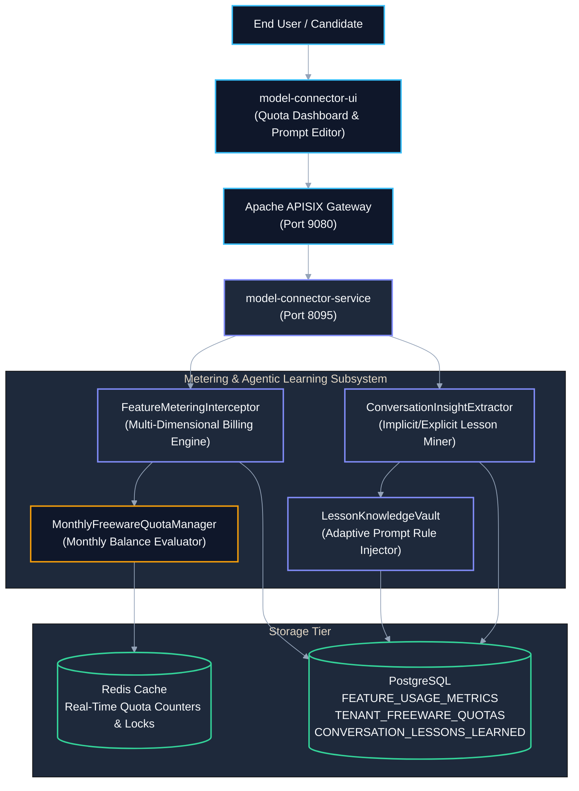
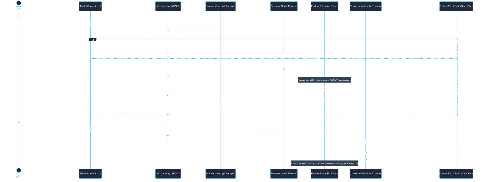
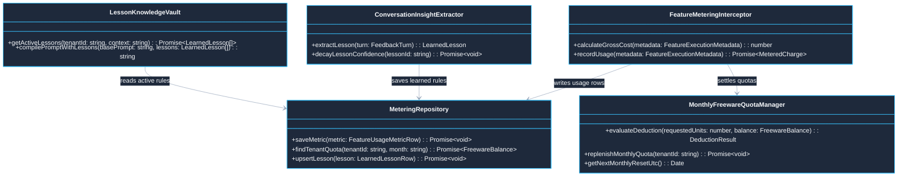
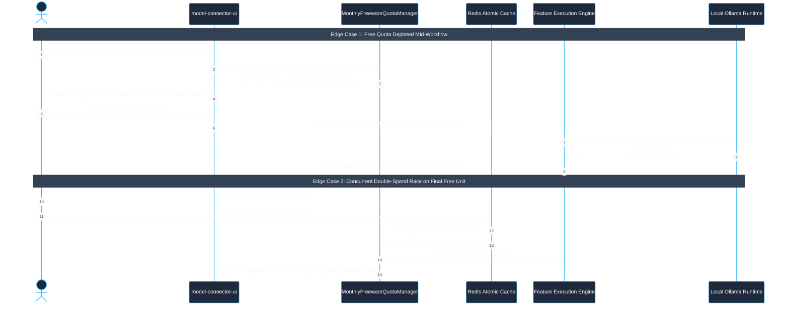

# Use Case 13 — Granular Feature Metering, Monthly Freeware Quotas & Agentic Conversation Learning

> **Document ID**: `UC-13`  
> **Category**: Commercial Operations, Metering & Adaptive Learning  
> **Master Index**: [README.md §13](README.md#13-use-case-13--granular-feature-metering-monthly-freeware-quotas--agentic-conversation-learning)  
> **Master Blueprint**: [blueprint.md §6.4](../blueprint.md#64-zero-leakage-multi-tenant-queue-system)  
> **System Architecture (HLD)**: [hld.md §6](../hld.md#6-multi-tenant-isolation--zero-cross-contamination-security), [§7.2](../hld.md#72-read-vs-write-intensity-profile-analysis), [§9.2](../hld.md#92-structured-ndjson-audit-logging-specification)  
> **Component Design (LLD)**: [lld.md §7](../lld.md#7-distributed-logging--audit-telemetry-schema), [§16](../lld.md#16-comprehensive-flow-restriction-audit-logging--investigation-architecture)  
> **UI Flows**: [ui-flows.md §3](../ui-flows.md#3-screen-2-network-analytics-dashboard--metrics), [§5](../ui-flows.md#5-screen-4-admin-operations--governance-console)  

---

## 1. Executive Summary & Problem Statement

### 1.1 Executive Summary
* **Multi-Dimensional Granular Metering**: Replaces naive token-only billing with holistic multi-dimensional capture across raw LLM tokens, Playwright headless browser execution seconds, RTX 5080 GPU compute time, and document AST extractions.
* **Monthly Replenishable Freeware Quotas**: Grants free-tier users transparent, predictable monthly credits with automated soft warnings and hard budget ceilings, preventing surprise overages.
* **Continuous Agentic Conversation Learning**: Extracts implicit and explicit feedback from conversational turns (e.g. style preferences, negative constraints, terminology edits) and compiles them into persistent tenant knowledge vaults.
* **Zero-Bill-Shock Fallback**: Seamlessly pauses or fails over to local zero-cost Ollama models ([lld.md §2.2.1](../lld.md#221-polymorphic-strategy-pattern-class-diagram)) when commercial quotas are exhausted.

### 1.2 Problem Statement
* **Token-Only Economic Distortion**: Headless browser automation consumes negligible model tokens but substantial CPU/RAM infrastructure, leading to negative margins on compute-heavy workflows.
* **Freeware Quota Friction & Bill Shock**: Users on free or hybrid plans face unexpected job cancellations when arbitrary limits are hit mid-workflow without clear warning or fallback options.
* **Amnesic Agent Redundancy**: When users correct an AI output (e.g., instructing the model to use concise bullet points or avoid specific libraries), conventional platforms forget this guidance immediately, forcing repetitive manual corrections.

### 1.3 Constraints & Non-Negotiable Invariants
* **Atomic Metering Invariant**: Metering events must be cryptographically signed, immutable, and persisted within the same database transaction boundary as the feature execution completion.
* **Monthly Quota Auto-Replenishment**: On the 1st of every calendar month at 00:00:00 UTC, unused freeware quotas are refreshed without rollover debt.
* **Privacy-Preserving Tenant Isolation**: Learned rules and user preferences must be completely sanitized of PII and strictly partitioned by `TENANT_ID`. Zero cross-tenant data leakage.

---

## 2. Feature-Based Metering & Freeware Quota Architecture

### 2.1 Multi-Dimensional Unit Economics Matrix

| Feature Module | Dedicated Operation | Primary Metric Captured | Secondary Metric Captured | Freeware Monthly Quota | Commercial Unit Price (Overage) |
| :--- | :--- | :--- | :--- | :--- | :--- |
| **Job Portal ([UC-01](UC-01-job-portal-and-career-autofill.md#1-executive-summary--problem-statement))** | Resume AST Extraction | Documents Parsed (PDF/DOCX) | AST Depth & Entity Count | 5 Resumes / month | $0.25 / resume |
| **Job Portal ([UC-01](UC-01-job-portal-and-career-autofill.md#1-executive-summary--problem-statement))** | Career Form Autofill | Browser Execution Seconds | DOM Elements Interacted | 3 Applications / month | $0.50 / submission |
| **Storyteller ([UC-03](UC-03-storyteller-video-generation.md#1-executive-summary--problem-statement))** | ComfyUI Video Generation | GPU Wall-Clock Seconds | Output Resolution (1080p/4K) | 60 GPU Sec / month | $0.05 / GPU second |
| **Apps Builder ([UC-02](UC-02-apps-builder-studio.md#1-executive-summary--problem-statement))** | Fullstack Code Synthesis | Input/Output LLM Tokens | Docker Sandbox CPU Minutes | 50,000 Tokens / month | $0.002 / 1k tokens |
| **X-Ray Sourcing ([UC-04](UC-04-linkedin-xray-talent-sourcing.md#1-executive-summary--problem-statement))** | Candidate Profile Extraction | Clean Profile ASTs Extracted | Search Queries Dispatched | 10 Profiles / month | $0.15 / profile |
| **Follow-up Engine ([UC-09](UC-09-automated-followup-and-timezone-dispatch.md#1-executive-summary--problem-statement))** | Timezone Dispatch Cadence | Dispatches Verified & Sent | AI Fact-Checking Tiers | 10 Emails / month | $0.10 / email |

---

### 2.2 Subscription Tier Matrix & User Value Proposition

```
+---------------------------------------------------------------------------------------------------+
|                                  SUBSCRIPTION TIERS & VALUE MATRIX                                |
+-----------------------+-----------------------------+-----------------------+---------------------+
| Feature Dimension     | Free Community Tier         | Professional Solo     | Enterprise Multi-Seat|
+-----------------------+-----------------------------+-----------------------+---------------------+
| Monthly Base Cost     | $0.00 / month               | $29.00 / month        | $299.00 / month     |
| Included Monthly Free | 5 Resumes, 3 Autofills,     | 100 Resumes, 50 Auto, | Unlimited AST,      |
| Quota Allowance       | 50k Tokens, 60s GPU         | 1M Tokens, 1hr GPU    | 20M Tokens, 20hr GPU|
| Model Access Rights   | Gemini Flash, Ollama Local  | Gemini Pro, Claude 3.5| All Frontier Models |
| SLA Response Window   | Best-effort (Queue P3)      | Standard (Queue P2)   | 99.9% Dedicated (P1)|
| Agentic Learning Hub  | Session-only memory         | 90-day Tenant Memory  | Persistent Org Vault|
| Cost Protection Guard | Hard cutoff at 100% quota   | Soft Alert at 80%/100%| Custom PO & Invoicing|
+-----------------------+-----------------------------+-----------------------+---------------------+
```

---

## 3. Macro Architecture (HLD) & System Design

### 3.1 System Design Principles
* **Edge Ingress Gateway**: Apache APISIX authenticates client requests, enforces tenant rate limits, and extracts billing context.
* **Metering & Adaptive Learning Core**:
  * `FeatureMeteringInterceptor`: Intercepts feature executions, computes exact gross charges, and logs immutable usage records.
  * `MonthlyFreewareQuotaManager`: Evaluates freeware balances, executes atomic deductions, and triggers replenishment on calendar month boundaries.
  * `ConversationInsightExtractor`: Analyzes user prompt revisions, detects negative constraints, and registers learned rules with confidence scoring.
  * `LessonKnowledgeVault`: Injects verified user preferences and rules into future prompt compilation pipelines.
* **Polyglot Persistence Layer**:
  * **PostgreSQL**: Stores relational ledgers (`FEATURE_USAGE_METRICS`), monthly quotas (`TENANT_FREEWARE_QUOTAS`), and learned lessons (`CONVERSATION_LESSONS_LEARNED`).
  * **Redis**: Retains atomic real-time quota counters and lock reservations.

### 3.2 Macro Architecture (HLD) Diagram



---

## 4. End-to-End User Flow Diagram

### 4.1 Nominal End-to-End Metering & Adaptive Learning Sequence



---

## 5. Low-Level Design (LLD)

### 5.1 LLD Class & Component Interaction Diagram



### 5.2 TypeScript Service Implementations

```typescript
// Centralized runtime encapsulation according to STD-COD-011
import { timerUtils, cryptoUtils } from '@model-box/model-connector-core/utils';

export interface FeatureExecutionMetadata {
  readonly tenantId: string;
  readonly userId: string;
  readonly featureCode: 'RESUME_PARSER' | 'FORM_AUTOFILL' | 'VIDEO_DIFFUSION' | 'CODE_SYNTHESIS' | 'FOLLOWUP_DISPATCH';
  readonly inputTokens: number;
  readonly outputTokens: number;
  readonly executionDurationMs: number;
  readonly browserSessionSeconds?: number;
  readonly gpuComputeSeconds?: number;
}

export class FeatureMeteringInterceptor {
  private static readonly UNIT_RATES = {
    RESUME_PARSER: 0.25,
    FORM_AUTOFILL: 0.50,
    VIDEO_DIFFUSION_PER_GPU_SEC: 0.05,
    CODE_SYNTHESIS_PER_1K_TOKENS: 0.002,
    FOLLOWUP_DISPATCH: 0.10,
  };

  public calculateGrossCost(meta: FeatureExecutionMetadata): number {
    switch (meta.featureCode) {
      case 'RESUME_PARSER':
        return FeatureMeteringInterceptor.UNIT_RATES.RESUME_PARSER;
      case 'FORM_AUTOFILL':
        return FeatureMeteringInterceptor.UNIT_RATES.FORM_AUTOFILL;
      case 'VIDEO_DIFFUSION':
        return (meta.gpuComputeSeconds ?? 0) * FeatureMeteringInterceptor.UNIT_RATES.VIDEO_DIFFUSION_PER_GPU_SEC;
      case 'CODE_SYNTHESIS':
        return ((meta.inputTokens + meta.outputTokens) / 1000) * FeatureMeteringInterceptor.UNIT_RATES.CODE_SYNTHESIS_PER_1K_TOKENS;
      case 'FOLLOWUP_DISPATCH':
        return FeatureMeteringInterceptor.UNIT_RATES.FOLLOWUP_DISPATCH;
      default:
        throw new Error(`UNKNOWN_FEATURE_CODE: Feature ${meta.featureCode} has no configured metering rate.`);
    }
  }
}
```

### 5.3 Enterprise Relational Database Schemas & Indexing

```sql
-- DDL for Feature Usage Telemetry & Billing Capture
CREATE TABLE IF NOT EXISTS FEATURE_USAGE_METRICS (
    METRIC_ID VARCHAR(64) PRIMARY KEY,
    TENANT_ID VARCHAR(64) NOT NULL,
    USER_ID VARCHAR(64) NOT NULL,
    FEATURE_CODE VARCHAR(32) NOT NULL,           -- 'RESUME_PARSER', 'FORM_AUTOFILL', etc.
    OPERATION_NAME VARCHAR(64) NOT NULL,
    INPUT_TOKENS INT NOT NULL DEFAULT 0,
    OUTPUT_TOKENS INT NOT NULL DEFAULT 0,
    EXECUTION_DURATION_MS INT NOT NULL DEFAULT 0,
    GPU_COMPUTE_SECONDS DECIMAL(8, 2) DEFAULT 0.00,
    GROSS_CHARGE_USD DECIMAL(10, 4) NOT NULL,
    FREEWARE_DEDUCTION_USD DECIMAL(10, 4) NOT NULL DEFAULT 0.0000,
    NET_PAYABLE_USD DECIMAL(10, 4) NOT NULL,
    CORRELATION_ID VARCHAR(64) NOT NULL,
    CAPTURED_AT_UTC TIMESTAMP WITH TIME ZONE NOT NULL DEFAULT CURRENT_TIMESTAMP,
    CONSTRAINT FK_FUM_TENANT FOREIGN KEY (TENANT_ID) REFERENCES TENANTS (TENANT_ID) ON DELETE CASCADE
);

CREATE INDEX IF NOT EXISTS IDX_FUM_TENANT_FEATURE_TIME 
    ON FEATURE_USAGE_METRICS (TENANT_ID, FEATURE_CODE, CAPTURED_AT_UTC DESC);

-- DDL for Monthly Replenishable Freeware Quotas
CREATE TABLE IF NOT EXISTS TENANT_FREEWARE_QUOTAS (
    QUOTA_ID VARCHAR(64) PRIMARY KEY,
    TENANT_ID VARCHAR(64) NOT NULL,
    FEATURE_CODE VARCHAR(32) NOT NULL,
    BILLING_PERIOD_MONTH VARCHAR(7) NOT NULL,     -- '2026-10'
    ALLOCATED_FREE_UNITS INT NOT NULL,
    CONSUMED_FREE_UNITS INT NOT NULL DEFAULT 0,
    RESET_AT_UTC TIMESTAMP WITH TIME ZONE NOT NULL,
    CREATED_AT_UTC TIMESTAMP WITH TIME ZONE NOT NULL DEFAULT CURRENT_TIMESTAMP,
    CONSTRAINT FK_TFQ_TENANT FOREIGN KEY (TENANT_ID) REFERENCES TENANTS (TENANT_ID) ON DELETE CASCADE,
    CONSTRAINT UQ_TFQ_TENANT_PERIOD UNIQUE (TENANT_ID, FEATURE_CODE, BILLING_PERIOD_MONTH)
);

CREATE INDEX IF NOT EXISTS IDX_TFQ_TENANT_FEATURE 
    ON TENANT_FREEWARE_QUOTAS (TENANT_ID, FEATURE_CODE, BILLING_PERIOD_MONTH);

-- DDL for Extracted Conversation Lessons Learned
CREATE TABLE IF NOT EXISTS CONVERSATION_LESSONS_LEARNED (
    LESSON_ID VARCHAR(64) PRIMARY KEY,
    TENANT_ID VARCHAR(64) NOT NULL,
    USER_ID VARCHAR(64) NOT NULL,
    RULE_CATEGORY VARCHAR(32) NOT NULL,          -- 'STYLE_PREFERENCE', 'NEGATIVE_CONSTRAINT'
    DIRECTIVE_SNIPPET TEXT NOT NULL,
    CONFIDENCE_SCORE DECIMAL(3, 2) NOT NULL,
    TIMES_ENFORCED INT NOT NULL DEFAULT 1,
    IS_ACTIVE BOOLEAN NOT NULL DEFAULT TRUE,
    CREATED_AT_UTC TIMESTAMP WITH TIME ZONE NOT NULL DEFAULT CURRENT_TIMESTAMP,
    UPDATED_AT_UTC TIMESTAMP WITH TIME ZONE NOT NULL DEFAULT CURRENT_TIMESTAMP,
    CONSTRAINT FK_CLL_TENANT FOREIGN KEY (TENANT_ID) REFERENCES TENANTS (TENANT_ID) ON DELETE CASCADE
);

CREATE INDEX IF NOT EXISTS IDX_CLL_TENANT_ACTIVE 
    ON CONVERSATION_LESSONS_LEARNED (TENANT_ID, USER_ID) 
    WHERE IS_ACTIVE = TRUE;
```

---

## 6. UI Interaction Flow: Metering, Freeware Progress & Lessons Learned

```
+--------------------------------------------------------------------------------------------------+
|                            USER WORKSPACE & QUOTA USAGE DASHBOARD                                 |
+--------------------------------------------------------------------------------------------------+
| Current Plan: Free Community Tier                         Billing Period: Oct 2026 (Resets in 11d)|
|                                                                                                  |
| [Feature Usage Meters]                                                                            |
|  • Resume AST Parsing:        [=========>-------------] 3 / 5 Resumes used (2 Remaining Free)     |
|  • Job Application Autofill:  [=====================>-] 3 / 3 Used (0 Free Remaining)             |
|  • GPU Video Render Time:     [====>------------------] 18s / 60s used (42s Remaining Free)       |
|  • Code Synthesis Tokens:     [============>----------] 28.5k / 50k used (21.5k Remaining Free)    |
|                                                                                                  |
| [!] Quota Alert: Autofill free quota exhausted. Future submissions billed at $0.50 or use Ollama.|
|                                                                                                  |
| [Adaptive Agent Memory — Lessons Learned (Active for your profile)]                              |
|  ✓ Style: "Format resume bullet points with quantifiable metrics and active verbs" (96% Conf)    |
|  ✓ Style: "Keep outreach follow-up emails strictly under 100 words" (92% Conf)                   |
|  ✓ Constraint: "Do not propose Redux; use Zustand for React state management" (98% Conf)         |
|                                                                                                  |
| [Upgrade to Pro Solo ($29/mo)]     [Manage Learned Rules]                   [View Detailed Invoices] |
+--------------------------------------------------------------------------------------------------+
```

---

## 7. API Ingress & Protocol Specification

### 7.1 Ingest Conversational Feedback & Extract Lesson
* **Endpoint**: `POST /api/v1/conversations/feedback`
* **Headers**: `Authorization: Bearer <JWT>`, `X-Tenant-Id: <TENANT_ID>`, `Content-Type: application/json`
* **Request Body**:
```json
{
  "featureContext": "RESUME_OPTIMIZATION",
  "systemPrompt": "Generate tailored achievement bullets for senior developer role...",
  "generatedAiText": "I was responsible for architecting distributed microservices using Redux and TypeScript...",
  "userCorrectionText": "Do not use Redux; use Zustand for state management.",
  "userExplicitRating": "THUMBS_DOWN"
}
```
* **Response**: `200 OK`
```json
{
  "lessonLearned": {
    "lessonId": "lesson-neg-17921",
    "ruleCategory": "NEGATIVE_CONSTRAINT",
    "directivePromptSnippet": "NEGATIVE INSTRUCTION: Never use or propose Redux; use Zustand for state management.",
    "confidenceScore": 0.96,
    "status": "ACTIVE_SAVED"
  }
}
```

---

## 8. Failure Modes, Edge Cases & Recovery User Flow

### 8.1 Edge Cases User Flow & Error Recovery Sequence



### 8.2 Failure Modes, Recovery Cascades & Fallback Matrix

| Edge Case / Failure | Detection Mechanism | Intermediate Behavior | Recovery & Resolution Cascade |
| :--- | :--- | :--- | :--- |
| **Freeware Depleted Mid-Job** | `MonthlyFreewareQuotaManager` detects 0 remaining credits | Operation does NOT abort; evaluates prepaid balance | If prepaid balance $>0$, seamlessly switches to metered overage; if zero, completes step and prompts upgrade for next step. |
| **Concurrent Double-Spend Attack** | Two simultaneous requests attempt to use last free unit | Redis atomic decrement (`DECRBY`) | Only 1 request gets free unit; 2nd request transitions cleanly to overage or returns HTTP 402 without negative quota. |
| **Hallucinated or Spurious Lesson** | Negative user rating on prompt output | Confidence score reduced by $-0.25$ | If confidence drops below $0.70$, lesson is automatically deactivated (`IS_ACTIVE = FALSE`). |
| **Monthly Calendar Rollover Glitch** | Worker processes job right at 23:59:59 on month-end | UTC calendar timestamp check | Deducted from closing month if started before midnight; replenished quota available for tasks starting after 00:00:00Z. |
| **Redis Quota Cache Cold Start** | Cache eviction or Redis restart | System falls back to PostgreSQL `TENANT_FREEWARE_QUOTAS` aggregation | Rebuilds volatile counter in Redis within 5ms; zero state desync. |
