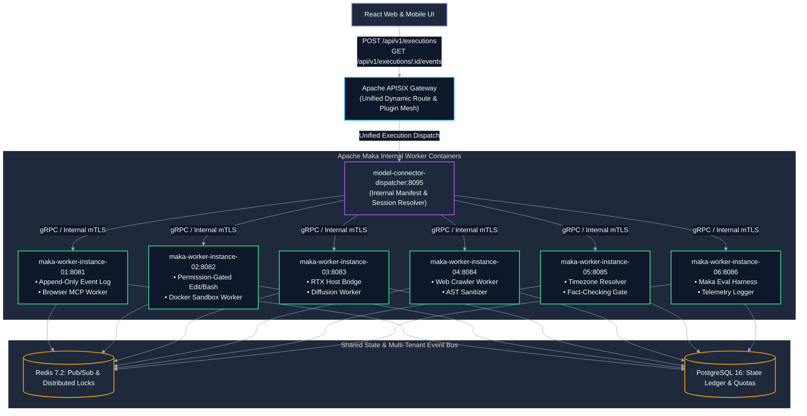
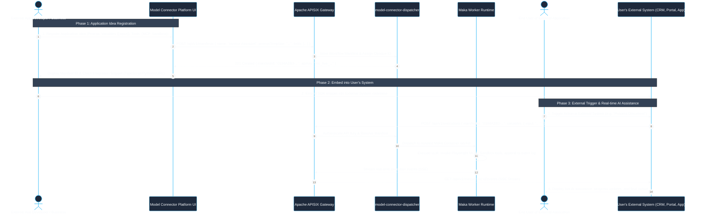
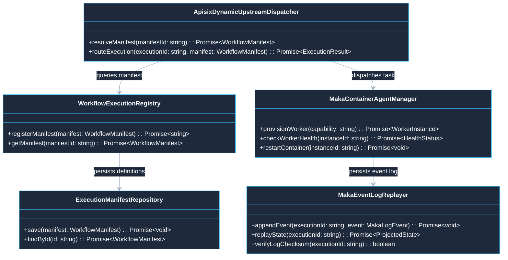
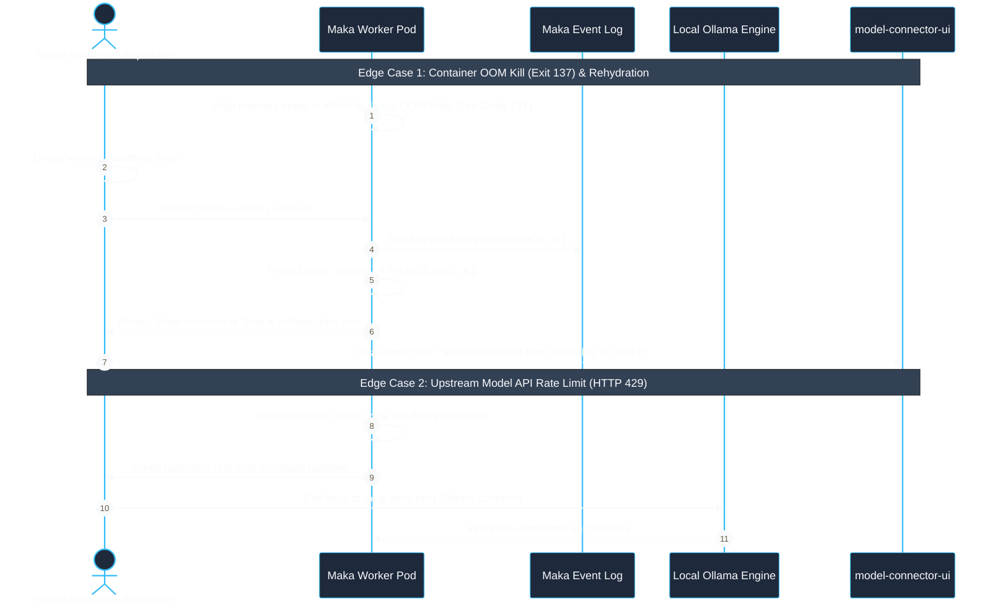

# Use Case 14 — Apache Maka Containerized Agent-Per-Workflow Architecture & Local-First Execution Mesh

> **Document ID**: `UC-14`  
> **Category**: Distributed Infrastructure & Agent Runtime Architecture  
> **Master Index**: [README.md §14](README.md#14-use-case-14--containerized-agent-per-workflow-architecture--modular-micro-execution-topology)  
> **Master Blueprint**: [blueprint.md §2.1](../blueprint.md#21-core-subsystem-responsibilities)  
> **System Architecture (HLD)**: [hld.md §17](../hld.md#17-apache-apisix-enterprise-api-gateway-integration), [§28](../hld.md#28-containerized-agent-per-workflow-architecture--apache-ingress-orchestration)  
> **Component Design (LLD)**: [lld.md §18](../lld.md#18-apache-apisix-ingress-gateway-configuration--routing-engine), [§25](../lld.md#25-containerized-workflow-agent-registry--dynamic-apisix-upstream-dispatcher)  
> **UI Flows**: [ui-flows.md §7](../ui-flows.md#7-screen-6-visual-workflow-dag-builder--mcp-studio)  

---

## 1. Executive Summary & Problem Statement

### 1.1 Executive Summary
* **Isolated Container-Per-Workflow Architecture**: Deploys workflows in single-responsibility, lightweight container environments powered by Apache Maka (Incubating) instead of monolithic shared runtimes.
* **Append-Only Event Log State Projection**: Derives execution state deterministically as $\text{State}(t) = \text{Project}(\text{Log}[0 \dots t])$, guaranteeing zero-loss crash recovery and re-entrancy without custom replay logic.
* **Sub-Millisecond Dynamic Ingress Routing**: Utilizes Apache APISIX as a high-performance perimeter gateway, enforcing tenant rate limits and dispatching execution calls within $< 1.0\text{ ms}$ at P99.
* **Built-in Permission Gating**: Enforces native tool permission gates across filesystem edits and shell commands via configurable Human-in-the-Loop (HITL) policies.
* **Unified Architectural Ingress**: Exposes a single, universal execution endpoint (`/api/v1/executions`) that executes any user-defined manifest without embedding domain or agent slugs in URLs or headers.

### 1.2 Problem Statement
* **Monolithic Fragility & Blast Radius**: Packaging Playwright browsers, AST parsers, ComfyUI hooks, and Docker-in-Docker sandboxes into a single monolithic service creates dependency conflicts and fatal memory spikes that terminate all active jobs.
* **Amnesic Crash Losses**: Traditional agent runtimes that crash mid-task lose intermediate tool outputs and reasoning steps, forcing costly full-task restarts.
* **URL & Data Model Hardcoding**: Exposing workflow-specific routes (e.g. `/api/v1/workflows/job-portal`) tightly couples gateway configuration to business applications, preventing generic multi-agent extensibility.

### 1.3 Architectural Constraints & Non-Negotiables
* **Sub-Millisecond Ingress SLA**: Gateway routing latency must remain $< 1.0\text{ ms}$ at P99 via Apache APISIX. Heavy batch orchestrators (e.g. Apache Airflow) are strictly excluded from the real-time request path.
* **Zero Slug Invariant**:
  * **URLs**: No workflow names or agent slugs in URL paths (e.g., requests target strictly `/api/v1/executions`).
  * **Headers & Parameters**: No `X-Agent-Name` or `?workflow=...` parameters.
  * **Database Keys**: Primary keys must be opaque, collision-resistant UUIDv4 or ULID strings (e.g. `0194A2B3-...`). Domain slugs like `task-maka-...` are strictly prohibited.
* **Least-Privilege Container Hardening**: Containers run under unprivileged users (`USER node` / `USER maka`) with `no-new-privileges: true` and read-only root filesystems where possible.

---

## 2. Macro Architecture (HLD): Apache APISIX & Apache Maka Container Topology

### 2.1 System Design Principles
* **Perimeter Ingress Gateway**: Apache APISIX (port 9080) handles all client traffic, SSL termination, rate limiting, and CORS headers.
* **Dynamic Internal Dispatcher**: `model-connector-dispatcher` resolves execution manifests by opaque UUID and dispatches tasks to dedicated containerized Maka workers over internal mTLS.
* **Maka Agent Container Mesh**: Isolated workers specialized for distinct capabilities (Chromium Playwright, Docker Sandbox, RTX Diffusion, AST Extraction).
* **Polyglot Persistence Layer**:
  * **PostgreSQL**: Stores execution records, manifest definitions, and cryptographic audit ledgers.
  * **Redis**: Houses active pub/sub channels and distributed execution locks.

### 2.2 High-Level Architecture Diagram



---

## 3. End-to-End User Flow Diagram

### 3.1 Nominal Application Registration & Execution Flow



---

## 4. UI Interaction & Real-Time Flow

```
+--------------------------------------------------------------------------------------------------+
|                            MAKA WORKFLOW AGENT TOPOLOGY MONITOR                                  |
+--------------------------------------------------------------------------------------------------+
| Ingress Gateway: Apache APISIX (P99 Latency: 0.42ms)       Active Containers: 6 / 6 Healthy       |
| Unified Ingress: POST /api/v1/executions                  Event Stream: /api/v1/executions/*/events |
|                                                                                                  |
| [Internal Worker Health & Event Log State]                                                       |
|  • maka-worker-instance-01: [ONLINE] 12 Tasks Executed | Last Event: LOG_FLUSH_OK (Lag: 4ms)     |
|  • maka-worker-instance-02: [ONLINE]  4 Code Tasks Run | Active Sandboxes: 2 / 5 (CPU: 18%)      |
|  • maka-worker-instance-03: [IDLE]    RTX 5080 Ready   | VRAM Used: 4.2 GB / 16.0 GB             |
|  • maka-worker-instance-04: [ONLINE] 85 Profiles AST   | Rate-Limit Headroom: 94%                |
|  • maka-worker-instance-05: [ONLINE] 14 Queued Emails  | Next Window: Mon 09:30 AM BST           |
|  • maka-worker-instance-06: [ONLINE] 3 Lessons Learned | Evaluator Score: 98.4% Passing          |
|                                                                                                  |
| [Restart Pod]               [View Maka Event Replay Log]                  [Gateway Config Reload]|
+--------------------------------------------------------------------------------------------------+
```

### 4.1 Step-by-Step UI Execution Mechanics
* **Unified Dispatch**: The UI triggers executions via `POST /api/v1/executions` with an opaque manifest ID. Zero workflow names appear in URL paths.
* **Live SSE Telemetry Stream**: The client UI connects to `/api/v1/executions/{executionId}/events`, rendering step transitions streamed directly from Maka's append-only log.
* **Transparent Rehydration**: If a worker container crashes, the UI displays an amber badge (*"Worker rehydrating from Maka event log..."*), resuming state at the exact interrupted step within $< 500\text{ ms}$.

---

## 5. Low-Level Design (LLD)

### 5.1 LLD Class & Component Interaction Diagram



### 5.2 Container Resource Allocation & Maka Runtime Isolation

| Container Service | Embedded Maka Runtime Features | Dedicated Internal Port | CPU Limit | RAM Limit | Attack Surface Control |
| :--- | :--- | :--- | :--- | :--- | :--- |
| **`gateway-apisix`** | Reverse Proxy, Rate Limiting, CORS | `9080` (HTTP) / `9443` (HTTPS) | `1.0 CPU` | `256 MB` | Strips unrecognized headers; enforces mTLS |
| **`maka-worker-instance-01`** | Append-Only Log, Browser MCP Tools | `8081` (internal only) | `1.5 CPU` | `1536 MB` | Sandboxed Chromium; memory watchdog |
| **`maka-worker-instance-02`** | Permission-Gated `Edit`, `Bash`, `Grep` | `8082` (internal only) | `2.0 CPU` | `2048 MB` | Ephemeral non-root container runner |
| **`maka-worker-instance-03`** | Eval Harness, Local RTX Host Bridge | `8083` (internal only) | `2.0 CPU` | `2048 MB` | Localhost gateway binding; GPU memory throttle |
| **`maka-worker-instance-04`** | DOM Sanitizer, Profile AST Extractor | `8084` (internal only) | `1.0 CPU` | `1024 MB` | Anti-bot randomized human jitter |
| **`maka-worker-instance-05`** | Timezone Resolver, HITL Gate | `8085` (internal only) | `0.5 CPU` | `512 MB` | Read-only candidate data access |
| **`maka-worker-instance-06`** | Telemetry Logger, Lesson Extractor | `8086` (internal only) | `0.5 CPU` | `512 MB` | HMAC signature verification on metrics |

### 5.3 External System Integration Code Example (TypeScript / Node.js)

```typescript
// Centralized runtime encapsulation according to STD-COD-011
import { timerUtils, cryptoUtils } from '@model-box/model-connector-core/utils';

export interface WorkflowTriggerConfig {
  readonly manifestId: string;
  readonly variables: Record<string, string>;
  readonly permissionPolicy: 'CONFIRM_SENSITIVE_ACTIONS' | 'AUTONOMOUS';
}

export class ExternalWorkflowClient {
  public constructor(
    private readonly baseUrl: string,
    private readonly apiKey: string,
  ) {}

  public async triggerExecution(config: WorkflowTriggerConfig): Promise<{ executionId: string; streamUrl: string }> {
    const response = await fetch(`${this.baseUrl}/api/v1/executions`, {
      method: 'POST',
      headers: {
        'Content-Type': 'application/json',
        'Authorization': `Bearer ${this.apiKey}`,
      },
      body: JSON.stringify(config),
    });

    if (!response.ok) {
      throw new Error(`EXECUTION_TRIGGER_FAILED: HTTP ${response.status}`);
    }

    return response.json();
  }
}
```

---

## 6. API Ingress & Protocol Specification

### 6.1 Gateway Routing Manifest (`apisix.yaml`)

```yaml
# config/apisix/apisix.yaml
routes:
  - id: route-unified-executions
    uri: /api/v1/executions
    methods: ["POST", "GET"]
    upstream:
      nodes:
        "model-connector-dispatcher:8095": 1
      type: roundrobin
    plugins:
      cors:
        allow_origins: "http://localhost:3005"
      limit-count:
        count: 100
        time_window: 60
        key_type: var
        key: consumer_name
      opentelemetry:
        sampler:
          name: always_on

  - id: route-unified-execution-events
    uri: /api/v1/executions/*/events
    methods: ["GET"]
    upstream:
      nodes:
        "model-connector-dispatcher:8095": 1
      type: roundrobin
    plugins:
      cors:
        allow_origins: "http://localhost:3005"
```

### 6.2 Maka Task Ingress & Event Response Schema

* **Endpoint**: `POST /api/v1/executions`
* **Headers**: `Authorization: Bearer <JWT>`, `Content-Type: application/json`
* **Request Body**:
```json
{
  "manifestId": "0194A2B3-5C8E-71F0-9A21-4F3B7D8E9011",
  "sessionId": "0194A2B3-5C8E-71F0-9A21-4F3B7D8E9012",
  "variables": {
    "targetInput": "https://careers.acme.com/apply/job-912"
  },
  "permissionPolicy": "CONFIRM_SENSITIVE_ACTIONS"
}
```
* **Response**: `202 Accepted`
```json
{
  "executionId": "0194A2B3-5C8E-71F0-9A21-4F3B7D8E9013",
  "streamUrl": "/api/v1/executions/0194A2B3-5C8E-71F0-9A21-4F3B7D8E9013/events",
  "status": "ENQUEUED",
  "logReplayCursor": 0,
  "timestampUtc": "2026-10-25T14:35:00.000Z"
}
```

---

## 7. Failure Modes, Edge Cases & Recovery User Flow

### 7.1 Edge Cases User Flow & Error Recovery Sequence



### 7.2 Failure Modes, Recovery Cascades & Fallback Matrix

| Failure Mode | Root Cause Detection | Maka Container Response | Gateway & Platform Recovery |
| :--- | :--- | :--- | :--- |
| **Browser Runner Crash / OOM** | Container exits with code 137 | Container restarts automatically (`restart: unless-stopped`) | APISIX detects upstream drop; Maka replays append-only log to restore state at Step $K$. |
| **Model API Quota Exceeded (429)** | Ingress catches 429 from Gemini / Claude | Maka pauses task in `WAITING_FOR_SLOT` | If retry count $>3$, Maka fails over to local Ollama runtime (`llama3.2`) with zero bill shock. |
| **Corrupted Event Log** | Cryptographic hash mismatch on log replay | Replay halts; task flagged `TAMPER_DETECTED` | Task resets safely to Step 0 ([UC-07](UC-07-workflow-ledger-and-tamper-resumption.md#1-executive-summary--problem-statement)); security audit logged. |
| **High Gateway Load Spike** | Ingress exceeds 1,000 req/min | APISIX `limit-count` plugin returns HTTP 429 | Excess requests throttled at perimeter without consuming container CPU or memory. |
| **mTLS Certificate Expiration** | Dispatcher handshake returns handshake_failure | Worker rejects untrusted connection | Automatic cert-manager rotates leaf certificate; traffic resumes in $< 2\text{s}$. |
