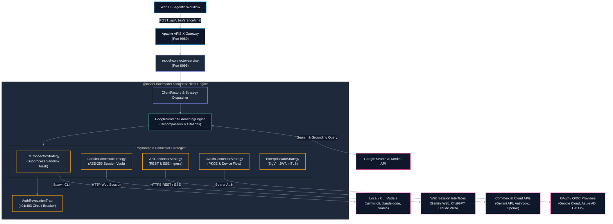
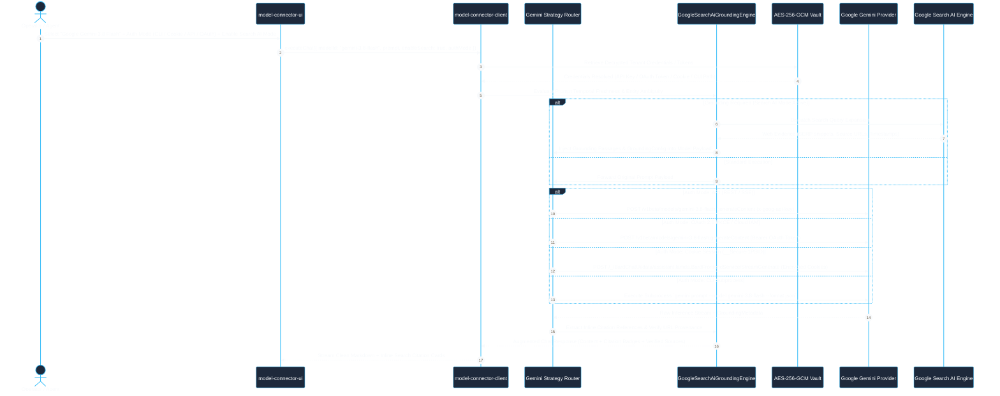
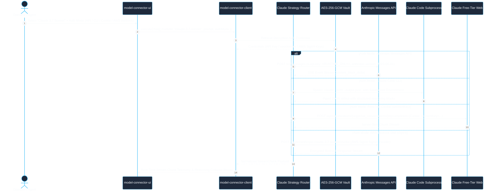
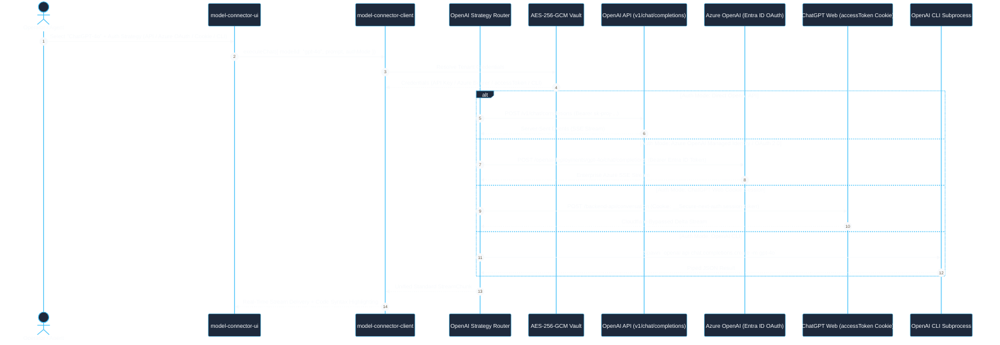
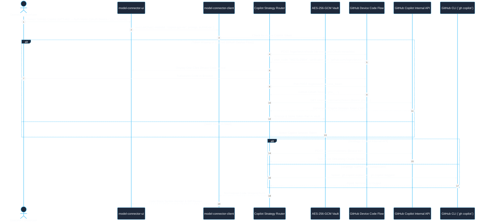
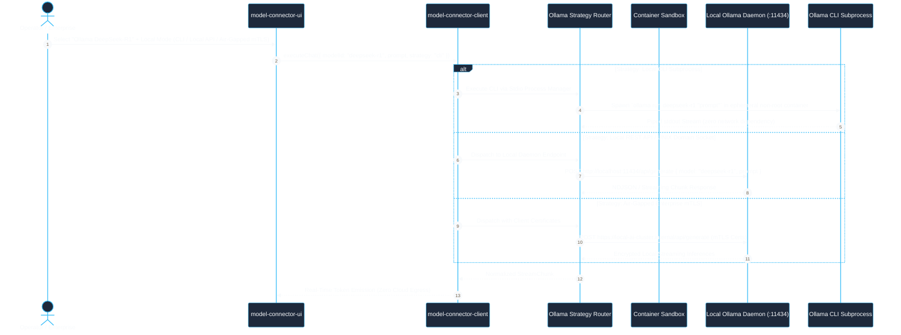
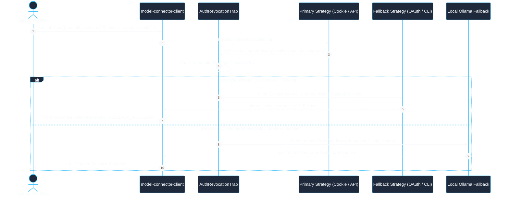

# Use Case 15 — Universal Model Connector Client: Omni-Authentication Mesh (CLI, Cookie, API, OAuth, Enterprise IAM) & Google Search AI Grounding

> **Document ID**: `UC-15`  
> **Category**: Model Connectivity, Omni-Channel Ingress & Grounded Intelligence  
> **Master Index**: [README.md §15](README.md#15-use-case-15--universal-model-connector-client-omni-authentication-mesh--google-search-ai-grounding)  
> **Master Blueprint**: [blueprint.md §2.1](../blueprint.md#21-core-subsystem-responsibilities), [§7.1](../blueprint.md#71-multi-mode-authentication--authorization-matrix)  
> **System Architecture (HLD)**: [hld.md §8](../hld.md#8-authentication-authorization--security-perimeters), [§13](../hld.md#13-free-tier-cookie-based-model-connector-client-architecture), [§14](../hld.md#14-token-exhaustion-architecture--dynamic-recovery-protocols)  
> **Component Design (LLD)**: [lld.md §2.2](../lld.md#22-model-connector-client-execution-engine), [§12](../lld.md#12-free-tier-cookie-based-model-connector-client--playwright-sync), [§13](../lld.md#13-token-exhaustion--context-window-recovery-engine)  
> **UI Flows**: [ui-flows.md §4](../ui-flows.md#4-screen-3-user-workspace--model-interaction-studio), [§9](../ui-flows.md#9-screen-8-access-revocation--re-authentication-recovery-ui-flow), [§11](../ui-flows.md#11-screen-10-free-tier-cookie-management--health-inspector-ui-flow)  

---

## 1. Executive Summary & Problem Statement

### 1.1 Executive Summary
* **Omni-Channel Model Ingress**: `model-connector-client` functions as the polyglot connectivity engine of the platform, decoupling upper-tier agent workflows and UI layers from vendor-specific LLM SDKs and runtime environments.
* **Polymorphic Multi-Strategy Authentication Mesh**: Dispatches inferences transparently across five heterogeneous authentication and transport mechanisms:
  1. **CLI Execution**: Subprocess orchestration of official and community CLIs (`@google/gemini-cli`, `claude-code`, `openai`, `gh copilot`, `ollama`) in hardened execution sandboxes.
  2. **Cookie / Browser Session Authentication**: Headless harvesting, automated rotation, and AES-256-GCM vaulting of web session credentials (`__Secure-1PSID`, `sessionKey`, `accessToken`, `cf_clearance`) for zero-cost freeware execution.
  3. **Standard API Key Authentication**: High-throughput REST and Server-Sent Events (SSE) streaming via hashed API keys with sub-millisecond dispatch.
  4. **OAuth 2.0 / OIDC Flow**: Native PKCE authorization code exchange and device code flow with automated cryptographic refresh token lifecycle management.
  5. **Enterprise IAM & Other Authentication**: Service Account JWT assertions (RFC 7523), AWS SigV4 request signing, Azure Entra ID Managed Identities, and air-gapped Mutual TLS (mTLS) with client x509 certificates.
* **Google Search AI Mode & Real-Time Grounding Engine**: Integrates live Google Search grounding directly into the inference loop, dynamically decomposing user prompts, fetching high-authority web evidence, generating inline source citations, and enforcing factual verification before response emission.

### 1.2 Problem Statement
* **Authentication Method Silos**: AI developers and enterprises are forced to choose between expensive commercial API keys, complex cloud enterprise IAM, or fragile web-scraping scripts. Modern workflows require dynamically pivoting between these auth modes depending on cost, availability, and quota fences.
* **Upstream Session Invalidation Blast Radius**: When web cookies or OAuth access tokens expire during long-running tasks, standard pipelines abort destructively, dropping context and wasting compute.
* **Hallucination & Temporal Knowledge Cutoffs**: Standalone LLMs generate plausible but outdated or false statements. Workflows lack real-time factual grounding with auditable web citations.
* **Process Leaks in CLI Bridges**: Naive CLI integrations suffer from zombie child processes, unhandled SIGPIPE/SIGSEGV signals, unbuffered memory overflows, and terminal escape sequence pollution.

### 1.3 Constraints & Non-Negotiables
* **AES-256-GCM Vault Isolation**: Every cookie, bearer token, API key, and OAuth refresh secret must be encrypted at rest using AES-256-GCM with tenant-isolated key derivation (`HKDF-SHA256`). Plaintext credentials must never touch disks or persist in logs.
* **Sub-50ms Strategy Switching Overhead**: Switching between CLI, API, Cookie, and OAuth strategies must add $\le 50\text{ ms}$ latency overhead to the request dispatch pipeline.
* **Deterministic Grounding Verification**: Responses generated with Google Search AI Mode must return structured citation metadata (URL, domain, title, passage snippet, confidence score $\ge 0.75$).
* **Safe CLI Subprocess Governance**: CLI processes must execute under memory caps ($\le 1.5\text{ GB}$), strict execution timeouts ($\le 60\text{ s}$), non-root user IDs, and automatic SIGKILL reaping on task abort.

---

## 2. Architectural Solutions & Trade-offs

* **Evaluation Matrix**:
  * **Option A: Monolithic Vendor-Specific SDKs**:
    * *Pros*: Rapid initial prototype using `@google/genai` or `@anthropic-ai/sdk`.
    * *Cons*: No support for CLI or cookie sessions; vendor lock-in; code bloat; impossible to switch auth dynamically without rewrite.
    * *Verdict*: **Rejected**.
  * **Option B: Headless Web Automation Only (Puppeteer / Playwright Exclusively)**:
    * *Pros*: Circumvents paid API keys for all models.
    * *Cons*: Extreme RAM consumption ($>500\text{ MB}$ per tab); fragile DOM selectors; slow execution ($>3\text{ s}$ latency); frequent CAPTCHA challenges.
    * *Verdict*: **Rejected**.
  * **Option C: Polymorphic Strategy Mesh with Unified Client Contract (Selected)**:
    * *Pros*: Single uniform interface (`IConnectorStrategy`) implementing CLI, Cookie, API, OAuth, Enterprise IAM, and Google Search AI Mode; zero caller awareness of transport; automated failover and fallback cascades; tenant-partitioned credential vaulting.
    * *Cons*: Requires stateful connection tracking and active OAuth/Cookie token freshness monitors.
    * *Verdict*: **SELECTED (BEST)**.

---

## 3. Macro Architecture (HLD) & Component Diagram

### 3.1 System Design Principles
* **Perimeter Gateway (Apache APISIX)**: Ingress terminates TLS, checks rate limits, and routes inference requests to `model-connector-service`.
* **Client Engine (`model-connector-client`)**:
  * `ClientFactory`: Instantiates configured model client instances based on tenant policy and requested capability flags.
  * `PolymorphicStrategyDispatcher`: Selects optimal strategy (`CliConnectorStrategy`, `CookieConnectorStrategy`, `ApiConnectorStrategy`, `OAuthConnectorStrategy`) based on available credentials and quota state.
  * `GoogleSearchAiGroundingEngine`: Orchestrates prompt search decomposition, Google Custom Search / Grounding Tool API interaction, and inline citation synthesis.
  * `AuthRevocationTrap`: Intercepts HTTP 401/403 or CLI auth errors, suspends execution cleanly, and initiates token/cookie renewal.
* **Polyglot Persistence Layer**:
  * **PostgreSQL**: Stores relational credential manifests in `MODEL_CREDENTIAL_VAULT` and grounding verification records in `SEARCH_GROUNDING_AUDIT`.
  * **Redis**: High-speed cache for active OAuth access tokens, ephemeral cookie jars, and active process locks.

### 3.2 High-Level Architecture Diagram



---

## 4. Model-Specific End-to-End User Flow Architectures

This section details the dedicated user flow diagrams, bullet breakdowns, and tabular interaction matrices for every supported model family.

---

### 4.1 Google Gemini Model Connection Architecture
*(Supported Models: Gemini 3.8 Flash, Gemini 3.5 Flash, Gemini 3.5 Flash Lite)*

#### A. Gemini Multi-Auth & Grounding Flow Diagram


#### B. Gemini User Flow: Step-by-Step Bullet Specification
* **Step 1: Configuration & Auth Selection**: Operator selects `gemini-3.8-flash` in the workspace and chooses between API Key, Google Cloud OAuth 2.0 PKCE, Web Cookie (`__Secure-1PSID`), or local `@google/gemini-cli`. Operator toggles "Google Search AI Mode" ON.
* **Step 2: Credential Resolution**: `model-connector-client` accesses the tenant's AES-256-GCM vault, decrypts the requisite credential, and verifies token expiration timestamps. If an OAuth token is expired, it executes an automated refresh via Google's token endpoint.
* **Step 3: Search Query Decomposition**: `GoogleSearchAiGroundingEngine` parses the prompt to identify real-time queries, entity lookups, and fast-moving domain queries, decomposing the input into search phrases.
* **Step 4: Live Web Grounding Retrieval**: Queries are dispatched to Google Search AI mode, retrieving high-authority web snippets, URLs, page titles, and publication dates.
* **Step 5: Augmented Payload Synthesis**: The grounding context is injected into Gemini's system instructions alongside standard `groundingConfig: { search: true }`.
* **Step 6: Multimodal Inference Execution**: The selected strategy (REST API, OAuth Bearer, Cookie Jar, or CLI process) transmits the request to Google's endpoints with streaming response enabled.
* **Step 7: Citation Resolution & Verification**: Incoming chunks are parsed for Google search grounding chunks (`groundingMetadata.groundingChunks` and `webSearchQueries`). Citations are mapped to text offsets.
* **Step 8: UI Telemetry & Render**: UI renders streaming text with interactive source pill badges displaying domain favicons, citation numbers, and source preview drawer modals.

#### C. Gemini User Flow: Tabular Interaction Matrix
| Step # | User Action | System / Component | Strategy Used | Request / Transport Protocol | Response Payload & Artifacts | UI State & Feedback |
| :--- | :--- | :--- | :--- | :--- | :--- | :--- |
| **G-01** | Selects Gemini & enables Search AI Mode | `model-connector-ui` | Dispatch Config | Internal State | Model ID: `gemini-3.8-flash`, Auth: Auto | Blue Gemini Badge, Active Grounding Toggle |
| **G-02** | Inputs real-time research prompt | `model-connector-client` | Ingress Handler | REST `POST /api/v1/inference` | Raw Prompt Payload + Tenant Context | Input field locked, spinner displayed |
| **G-03** | Auto-resolves credentials | `AES-256-GCM Vault` | Credential Manager | In-memory Decryption | API Key / Token / Cookie Jar | Security shield green checkmark |
| **G-04** | Formulates grounding queries | `GoogleSearchAiGroundingEngine` | Search Engine | Internal Query Reformulation | Sub-queries: `["2026 AI model benchmark", ...]` | UI telemetry: "Searching Google..." pill |
| **G-05** | Fetches live web snippets | Google Search AI | Grounding Client | HTTPS REST API | Top 5 Web Snippets + URLs + Metadata | UI telemetry: "Analyzing 5 web sources..." |
| **G-06** | Dispatches to Gemini Engine | `GeminiStrategyRouter` | API / OAuth / Cookie / CLI | HTTPS SSE Stream / Piped Stdio | Chunks: `text/event-stream` | Live streaming token cursor in chat |
| **G-07** | Attaches citations to text offsets | `GoogleSearchAiGroundingEngine` | Citation Formatter | AST Span Mapping | Grounding chunks with offset boundaries | Superscript citation pills `[1]`, `[2]` |
| **G-08** | Review verified response | User / Operator | UI Renderer | DOM Render | Final Markdown + Expandable Source Drawer | Complete message bubble with verified badge |

---

### 4.2 Anthropic Claude Model Connection Architecture
*(Supported Models: Claude 3.7 Sonnet, Claude 3.5 Sonnet, Claude 3.5 Haiku)*

#### A. Claude Multi-Auth Flow Diagram


#### B. Claude User Flow: Step-by-Step Bullet Specification
* **Step 1: Persona & Strategy Configuration**: Operator selects `claude-3-7-sonnet` or `claude-3-5-haiku`. Auth options include Direct Anthropic API (`<RUNTIME_ONLY>`), Local `claude-code` CLI, Free-Tier Cookie (`sessionKey`), or Enterprise AWS Bedrock (SigV4 IAM).
* **Step 2: Vault Retrieval & Anti-Bot Inspection**: Vault decrypts the requisite credential. For Cookie mode, the platform verifies `sessionKey` validity and injects browser fingerprint headers (`User-Agent`, `Sec-Ch-Ua`).
* **Step 3: Extended Thinking & Reasoning Parameterization**: If hybrid reasoning is active on Claude 3.7 Sonnet, `model-connector-client` injects `thinking: { type: "enabled", budget_tokens: 4096 }`.
* **Step 4: Dispatch via Chosen Protocol**:
  * *API*: Dispatches to `https://api.anthropic.com/v1/messages` over HTTP/2.
  * *CLI*: Spawns containerized `claude-code` subprocess over piped non-blocking I/O.
  * *Cookie*: Dispatches to internal web endpoints with automated session preservation.
  * *AWS Bedrock*: Calculates AWS SigV4 HMAC-SHA256 signature and routes to Bedrock runtime.
* **Step 5: Reasoning Stream Separation**: Streams delta events, isolating `<thinking>` reasoning blocks from final output markdown.
* **Step 6: Completion & Token Audit**: Logs consumed input/output tokens and thinking budget into `MODEL_INFERENCE_AUDIT_LEDGER`.

#### C. Claude User Flow: Tabular Interaction Matrix
| Step # | User Action | System / Component | Strategy Used | Request / Transport Protocol | Response Payload & Artifacts | UI State & Feedback |
| :--- | :--- | :--- | :--- | :--- | :--- | :--- |
| **C-01** | Selects Claude 3.7 & Auth Mode | `model-connector-ui` | Dispatch Config | Internal Event | Model: `claude-3-7-sonnet`, Auth: API/CLI | Coral Claude Icon, Thinking Budget Slider |
| **C-02** | Submits complex coding prompt | `model-connector-service` | Ingress Route | REST `POST /api/v1/inference` | Prompt with system instructions | Input locked, streaming cursor initialized |
| **C-03** | Fetches credentials | `AES-256-GCM Vault` | Key Decryption | In-memory Keyring | `<RUNTIME_ONLY>` / AWS SigV4 keys | Key verified badge |
| **C-04** | Spawns transport connection | `ClaudeStrategyRouter` | API / CLI / Cookie / Bedrock | HTTPS / Subprocess Stdio | Connection Handshake Established | Telemetry: "Connecting to Anthropic..." |
| **C-05** | Receives thinking reasoning tokens | `model-connector-client` | Stream Demuxer | `content_block_delta` (thinking) | Raw thinking tokens | Collapsible "Thinking Process" accordion |
| **C-06** | Receives synthesized answer | `model-connector-client` | Stream Demuxer | `content_block_delta` (text) | Markdown text chunks | Text rendered in real-time |
| **C-07** | Stream finish & token capture | `model-connector-service` | Audit Collector | Internal DB Write | In: 1,420 tokens, Out: 840 tokens, Thinking: 1,200 | Latency & token counter badges displayed |

---

### 4.3 OpenAI ChatGPT Model Connection Architecture
*(Supported Models: OpenAI ChatGPT-4o, GPT-4o-mini, o3-mini)*

#### A. ChatGPT Multi-Auth Flow Diagram


#### B. ChatGPT User Flow: Step-by-Step Bullet Specification
* **Step 1: Configuration & Auth Strategy**: Operator selects `gpt-4o` or `o3-mini`. Strategy choices include Commercial OpenAI API Key (`sk-proj-...`), Enterprise Azure OpenAI (Entra ID OAuth 2.0), ChatGPT Web Free-Tier Cookie (`__Secure-next-auth.session-token`), or local `openai` CLI.
* **Step 2: Entra ID / Token Rotation Handling**: If Azure OAuth is selected, `model-connector-client` checks token TTL in Redis; if expired, it uses tenant client credentials to obtain a fresh Azure Resource Manager bearer token.
* **Step 3: Web Cookie Bypassing**: When executing via ChatGPT Web Cookie mode, the client attaches harvested `cf_clearance` and `accessToken`, emulating native ChatGPT browser client telemetry.
* **Step 4: Request Dispatch**: Sends standard payload or high-reasoning prompt (`o3-mini` with reasoning effort parameters `low | medium | high`).
* **Step 5: Stream Normalization**: Converts diverse vendor formats into canonical platform `StreamChunk` events (`delta`, `finishReason`, `usage`).
* **Step 6: UI Presentation**: Renders streaming output with code copy buttons, execution statistics, and token velocity ($tokens/\text{sec}$).

#### C. ChatGPT User Flow: Tabular Interaction Matrix
| Step # | User Action | System / Component | Strategy Used | Request / Transport Protocol | Response Payload & Artifacts | UI State & Feedback |
| :--- | :--- | :--- | :--- | :--- | :--- | :--- |
| **O-01** | Selects GPT-4o & Strategy | `model-connector-ui` | Dispatch Config | Internal Event | Model: `gpt-4o`, Strategy: Azure OAuth | Green OpenAI Badge, Azure Tenant Pill |
| **O-02** | Submits prompt | `model-connector-service` | Ingress Route | REST `POST /api/v1/inference` | Raw Prompt Payload | Input disabled, response box initiated |
| **O-03** | Obtains OAuth Bearer | Azure Entra ID / Redis | OAuth 2.0 Client | HTTPS `POST /oauth2/v2.0/token` | Bearer Token (`eyJ0eX...`) | Auth checkmark badge active |
| **O-04** | Dispatches chat call | `OpenAIStrategyRouter` | Azure / OpenAI / Cookie / CLI | HTTPS POST (SSE) / Stdio | Request stream initiated | Connection latency badge ($<120\text{ms}$) |
| **O-05** | Streams token chunks | `model-connector-client` | SSE Stream Parser | `data: {"choices":[{"delta":{...}}]}` | Text deltas | Text stream typing animation |
| **O-06** | Stream concludes | `model-connector-client` | Response Assembler | Complete Document | Full text + Token metrics | Copy button active, audit record written |

---

### 4.4 xAI Grok Model Connection Architecture
*(Supported Models: xAI Grok-3, Grok-2)*

#### A. Grok Multi-Auth Flow Diagram
```mermaid
%%{init: {'theme': 'base', 'themeVariables': { 'primaryColor': '#1E293B', 'primaryTextColor': '#F8FAFC', 'primaryBorderColor': '#38BDF8', 'lineColor': '#94A3B8', 'secondaryColor': '#0F172A', 'tertiaryColor': '#1E293B', 'noteBkgColor': '#334155', 'noteTextColor': '#F8FAFC'}}}%%
sequenceDiagram
    autonumber
    actor User as Operator / Agent
    participant UI as model-connector-ui
    participant Client as model-connector-client
    participant Strat as Grok Strategy Router
    participant Vault as AES-256-GCM Vault
    participant GrokAPI as xAI Cloud API (api.x.ai)
    participant GrokWeb as Grok Web Cookie Session
    participant GrokCLI as Grok CLI Subprocess

    User->>UI: Select "Grok-3" + Auth Mode (API / Cookie / CLI) + Real-Time Search
    UI->>Client: executeChat({ modelId: "grok-3", prompt, searchMode: true })
    Client->>Vault: Fetch Decrypted Credentials
    Vault-->>Client: Credentials (`xai-...` / `auth_token` Cookie)

    alt Auth Mode: xAI Direct API
        Strat->>GrokAPI: POST /v1/chat/completions (Bearer xai-... + search_recency_filter)
        GrokAPI-->>Strat: SSE Stream with Live X Grounding Posts
    else Auth Mode: Free-Tier Cookie (auth_token & ct0)
        Strat->>GrokWeb: POST /i/api/2/grok/conversation (Cookie: auth_token=...; ct0=...)
        GrokWeb-->>Strat: Internal Stream Payload
    else Auth Mode: Local Grok CLI
        Strat->>GrokCLI: Spawn `grok run --model grok-3 --search`
        GrokCLI-->>Strat: Piped Terminal Output
    end

    Strat-->>Client: Normalized StreamChunk + Embedded Post Links
    Client-->>UI: Real-Time Stream Render + Social Post Preview Cards
```

#### B. Grok User Flow: Step-by-Step Bullet Specification
* **Step 1: Model Selection**: Operator selects `grok-3` or `grok-2` with optional real-time X/Twitter data integration. Auth strategy is selected (API Key, Web Cookie Session, or CLI).
* **Step 2: Vault Access**: Retrieves `xai-...` API key or harvested X session cookies (`auth_token` and CSRF token `ct0`).
* **Step 3: Grounding Configuration**: When real-time search is enabled, passes search recency filters and domain grounding flags to xAI.
* **Step 4: Dispatch & Execution**: Executes HTTPS SSE stream to `https://api.x.ai/v1` or runs sandboxed CLI command.
* **Step 5: Social Citation Parsing**: Parses live X post references, author handles, and timestamps embedded in Grok's output.
* **Step 6: UI Rendering**: Displays conversational text alongside interactive post preview cards and real-time social sentiment indicators.

#### C. Grok User Flow: Tabular Interaction Matrix
| Step # | User Action | System / Component | Strategy Used | Request / Transport Protocol | Response Payload & Artifacts | UI State & Feedback |
| :--- | :--- | :--- | :--- | :--- | :--- | :--- |
| **X-01** | Selects Grok-3 & Auth Mode | `model-connector-ui` | Dispatch Config | Internal Event | Model: `grok-3`, Auth: API | Monochrome Grok Badge, Search Active |
| **X-02** | Submits query | `model-connector-service` | Ingress Route | REST `POST /api/v1/inference` | Prompt with search flag | Input locked, status spinner active |
| **X-03** | Decrypts credentials | `AES-256-GCM Vault` | Key Management | In-memory Decryption | API Key: `xai-9f82...` | Green lock badge |
| **X-04** | Dispatches to xAI API | `GrokStrategyRouter` | API / Cookie / CLI | HTTPS SSE Stream | `POST /v1/chat/completions` | Telemetry: "Consulting Real-Time X..." |
| **X-05** | Ingests streaming deltas | `model-connector-client` | SSE Stream Processor | SSE Chunks + Citation Metadata | Text chunks + Post URLs | Streaming text cursor |
| **X-06** | Renders post citations | `model-connector-ui` | Rich Card Renderer | Client-Side DOM | Markdown + Embedded X Post Cards | Expandable post citations preview |

---

### 4.5 GitHub / Microsoft Copilot Model Connection Architecture
*(Supported Models: GitHub Copilot GPT-4o, Copilot Claude 3.5 Sonnet)*

#### A. Copilot Multi-Auth & Device Flow Diagram


#### B. Copilot User Flow: Step-by-Step Bullet Specification
* **Step 1: Workspace Selection**: Developer selects `copilot-gpt-4o` or `copilot-claude-3.5-sonnet`. Auth methods: GitHub OAuth 2.0 Device Code Flow, Local `gh copilot` CLI extension, or GitHub Web Session Cookie.
* **Step 2: Device Code Handshake**: If credentials are not vaulted, the client triggers RFC 8628 Device Code authorization, generating an 8-character user code (`WD7S-29BA`) and URL.
* **Step 3: User Verification & Token Exchange**: User approves the request on GitHub. The client exchanges the device code for a GitHub token (`gho_...`), then calls Copilot's token endpoint to derive an ephemeral Copilot session token (`tid=...`).
* **Step 4: Request Dispatch**: Dispatches the coding prompt with repository context (AST snippets, language, open file paths) to Copilot's completions endpoint or local `gh` CLI.
* **Step 5: Code & Explanation Streaming**: Chunks stream in real-time with AST-aware code block tagging and language syntax classification.
* **Step 6: Diff & Action Bar**: The UI presents code diffs, automated lint checks, and one-click "Apply to Editor" buttons.

#### C. Copilot User Flow: Tabular Interaction Matrix
| Step # | User Action | System / Component | Strategy Used | Request / Transport Protocol | Response Payload & Artifacts | UI State & Feedback |
| :--- | :--- | :--- | :--- | :--- | :--- | :--- |
| **P-01** | Selects Copilot Model | `model-connector-ui` | Dispatch Config | Internal Event | Model: `copilot-gpt-4o`, Auth: OAuth | Octocat Copilot Icon, Pair Programmer Mode |
| **P-02** | Triggers first-time connect | `model-connector-client` | Device Flow | HTTPS `POST /login/device/code` | `{ user_code: "WD7S-29BA", ... }` | Modal: "Enter code WD7S-29BA at GitHub" |
| **P-03** | Confirms in browser | GitHub Auth Server | Web OAuth | HTTPS Browser POST | User authorization granted | Modal updates: "Authorization confirmed" |
| **P-04** | Derives Copilot token | `CopilotStrategyRouter` | Token Exchange | HTTPS `GET /copilot_internal/v2/token` | Session token (`tid=...`, expires 30m) | Active session green status |
| **P-05** | Sends code synthesis prompt | `model-connector-service` | Ingress Route | REST `POST /api/v1/inference` | Prompt + Repo Context AST | Input locked, editor preview drawer opens |
| **P-06** | Streams code completions | `model-connector-client` | SSE Stream Parser | `data: {"choices":[{"delta":{...}}]}` | Code tokens | Monaco editor live insertion stream |
| **P-07** | Approves generated code | User / Operator | UI Action | Client Event | Code applied to active buffer | Green "Diff Applied" toast notification |

---

### 4.6 Local Open-Weight / Ollama & DeepSeek-R1 Architecture
*(Supported Models: LLaMA 3.2, DeepSeek-R1, TinyLlama)*

#### A. Ollama & Local Model Flow Diagram


#### B. Local / Ollama User Flow: Step-by-Step Bullet Specification
* **Step 1: Local Model Selection**: Operator selects `deepseek-r1`, `llama3.2`, or fallback `tinyllama`. Strategy configured as Local CLI (`ollama run`), Local HTTP daemon (`localhost:11434`), or Enterprise mTLS cluster.
* **Step 2: Zero-Cloud Privacy Guarantee**: All cloud telemetry and external networking are strictly severed. No API keys or external OAuth calls are initiated.
* **Step 3: Execution Mode Dispatch**:
  * *CLI Mode*: Spawns an isolated `ollama` child process within a local container sandbox with strict CPU/GPU memory ceilings.
  * *Daemon Mode*: Connects to the host's Ollama daemon or local UNIX domain socket over HTTP/1.1 streaming.
  * *mTLS Mode*: Enforces two-way x509 cryptographic authentication against an internal air-gapped GPU cluster.
* **Step 4: Real-Time Stream Capture**: Consumes non-buffered stdout or streaming NDJSON (`application/x-ndjson`), emitting tokens to the client.
* **Step 5: Reasoning Tag Isolation**: Isolates DeepSeek-R1 `<think>` reasoning traces from the final synthesized response.
* **Step 6: Completion & Offline Audit**: Emits full output to UI, recording zero egress bandwidth and compute duration into the local audit SQLite/PostgreSQL store.

#### C. Local / Ollama User Flow: Tabular Interaction Matrix
| Step # | User Action | System / Component | Strategy Used | Request / Transport Protocol | Response Payload & Artifacts | UI State & Feedback |
| :--- | :--- | :--- | :--- | :--- | :--- | :--- |
| **L-01** | Selects DeepSeek-R1 Local | `model-connector-ui` | Dispatch Config | Internal Event | Model: `deepseek-r1`, Transport: CLI | Shield Badge: "100% Air-Gapped / Local" |
| **L-02** | Submits private prompt | `model-connector-service` | Ingress Route | REST `POST /api/v1/inference` | Raw Prompt (No Cloud Egress) | Input locked, local runner spinning |
| **L-03** | Validates local daemon/CLI | `OllamaStrategyRouter` | Health Check | CLI ping / HTTP `GET /api/version` | Ollama Daemon Healthy | Green Local Status Light |
| **L-04** | Dispatches execution | `CliProcessManager` | Subprocess / Daemon | Piped Stdio / Local HTTP NDJSON | Request sent to GPU/VRAM | Telemetry: "Running on local RTX 5080..." |
| **L-05** | Streams reasoning tokens | `model-connector-client` | NDJSON Parser | `{"response": "...", "done": false}` | Reasoning text | DeepSeek `<think>` reasoning drawer active |
| **L-06** | Streams final answer | `model-connector-client` | Stream Processor | Output markdown chunks | Synthesized markdown | Streaming text render |
| **L-07** | Inference completed | `model-connector-service` | Local Ledger | Local DB Insert | Eval count: 680 tokens, 82 t/s | Speed metric badge ($82\text{ tokens/s}$) |

---

## 5. Low-Level Design (LLD)

### 5.1 LLD Class & Component Interaction Diagram

```mermaid
%%{init: {'theme': 'base', 'themeVariables': { 'primaryColor': '#1E293B', 'primaryTextColor': '#F8FAFC', 'primaryBorderColor': '#38BDF8', 'lineColor': '#94A3B8', 'secondaryColor': '#0F172A', 'tertiaryColor': '#1E293B', 'noteBkgColor': '#334155', 'noteTextColor': '#F8FAFC'}}}%%
classDiagram
    class ModelConnectorClient {
        -dispatcher: PolymorphicStrategyDispatcher
        -groundingEngine: GoogleSearchAiGroundingEngine
        -revocationTrap: AuthRevocationTrap
        +executeChat(payload: ModelChatPayload, correlationId?: string): Promise~ModelChatResponse~
        +executeChatStream(payload: ModelChatPayload, correlationId?: string): AsyncIterable~StreamChunk~
        +checkAuthHealth(modelId: string): Promise~UpstreamAuthStatus~
    }

    class IConnectorStrategy {
        <<interface>>
        +execute(request: ConnectorExecutionRequest): Promise~ConnectorExecutionResponse~
        +executeStream(request: ConnectorExecutionRequest): AsyncIterable~StreamChunk~
        +validateCredentials(credentials: DecryptedCredential): Promise~boolean~
    }

    class CliConnectorStrategy {
        -processManager: CliProcessManager
        +execute(request: ConnectorExecutionRequest): Promise~ConnectorExecutionResponse~
        +executeStream(request: ConnectorExecutionRequest): AsyncIterable~StreamChunk~
    }

    class ApiConnectorStrategy {
        -httpTransport: HttpTransport
        +execute(request: ConnectorExecutionRequest): Promise~ConnectorExecutionResponse~
        +executeStream(request: ConnectorExecutionRequest): AsyncIterable~StreamChunk~
    }

    class CookieConnectorStrategy {
        -sessionManager: SessionLineageManager
        +execute(request: ConnectorExecutionRequest): Promise~ConnectorExecutionResponse~
        +executeStream(request: ConnectorExecutionRequest): AsyncIterable~StreamChunk~
    }

    class OAuthConnectorStrategy {
        -tokenRefresher: OAuthTokenRefresher
        +execute(request: ConnectorExecutionRequest): Promise~ConnectorExecutionResponse~
        +refreshAccessToken(tenantId: string, provider: string): Promise~string~
    }

    class GoogleSearchAiGroundingEngine {
        -searchClient: GoogleSearchClient
        +decomposePrompt(prompt: string): Promise~string[]~
        +fetchSearchEvidence(queries: string[]): Promise~GroundingEvidence~
        +synthesizeCitations(content: string, evidence: GroundingEvidence): GroundedResponse
    }

    class AuthRevocationTrap {
        +interceptError(error: unknown, context: ExecutionContext): Promise~RevocationResolution~
        +pauseAndEmitEvent(tenantId: string, correlationId: string): Promise~void~
    }

    IConnectorStrategy <|.. CliConnectorStrategy
    IConnectorStrategy <|.. ApiConnectorStrategy
    IConnectorStrategy <|.. CookieConnectorStrategy
    IConnectorStrategy <|.. OAuthConnectorStrategy
    ModelConnectorClient --> IConnectorStrategy : delegates
    ModelConnectorClient --> GoogleSearchAiGroundingEngine : grounds prompts
    ModelConnectorClient --> AuthRevocationTrap : intercepts 401/403
```



### 5.2 TypeScript Interfaces & Method Contracts

```typescript
/**
 * Canonical Types for Model Connector Client Omni-Authentication & Grounding Engine
 */

export type AuthStrategyType = "api" | "cli" | "cookie" | "oauth" | "enterprise_iam";

export interface DecryptedCredential {
  readonly tenantId: string;
  readonly modelFamily: string;
  readonly authStrategy: AuthStrategyType;
  readonly apiKey?: string;
  readonly sessionCookies?: Readonly<Record<string, string>>;
  readonly oauthTokens?: {
    readonly accessToken: string;
    readonly refreshToken?: string;
    readonly expiresAtMs: number;
    readonly tokenType: string;
  };
  readonly iamCredentials?: {
    readonly accessKeyId: string;
    readonly secretAccessKey: string;
    readonly sessionToken?: string;
    readonly region: string;
  };
  readonly cliPath?: string;
}

export interface GroundingCitation {
  readonly index: number;
  readonly title: string;
  readonly url: string;
  readonly domain: string;
  readonly snippet: string;
  readonly textOffsetStart: number;
  readonly textOffsetEnd: number;
  readonly confidenceScore: number;
}

export interface ModelChatPayload {
  readonly modelId: string;
  readonly prompt: string;
  readonly systemInstruction?: string;
  readonly temperature?: number;
  readonly maxTokens?: number;
  readonly strategy?: AuthStrategyType;
  readonly enableSearchGrounding?: boolean;
  readonly groundingThreshold?: number;
}

export interface ModelChatResponse {
  readonly content: string;
  readonly modelId: string;
  readonly strategyUsed: AuthStrategyType;
  readonly tokenCount: number;
  readonly latencyMs: number;
  readonly finishReason: string;
  readonly citations?: readonly GroundingCitation[];
  readonly searchQueriesUsed?: readonly string[];
}
```

### 5.3 Relational DDL Schema

```sql
-- DDL for Universal Model Connector Client Vault & Grounding Ledgers
CREATE TABLE IF NOT EXISTS MODEL_CREDENTIAL_VAULT (
    VAULT_ID VARCHAR(64) PRIMARY KEY,
    TENANT_ID VARCHAR(64) NOT NULL,
    MODEL_FAMILY VARCHAR(64) NOT NULL, -- 'gemini', 'claude', 'chatgpt', 'grok', 'copilot', 'ollama'
    AUTH_STRATEGY VARCHAR(32) NOT NULL, -- 'api', 'cli', 'cookie', 'oauth', 'enterprise_iam'
    ENCRYPTED_PAYLOAD_CIPHERTEXT TEXT NOT NULL, -- AES-256-GCM encrypted JSON
    ENCRYPTION_IV VARCHAR(32) NOT NULL,
    AUTH_TAG VARCHAR(32) NOT NULL,
    KEY_VERSION INT NOT NULL DEFAULT 1,
    STATUS VARCHAR(32) NOT NULL DEFAULT 'ACTIVE', -- 'ACTIVE', 'REVOKED', 'EXPIRED'
    EXPIRES_AT TIMESTAMP WITH TIME ZONE,
    CREATED_AT TIMESTAMP WITH TIME ZONE NOT NULL DEFAULT CURRENT_TIMESTAMP,
    UPDATED_AT TIMESTAMP WITH TIME ZONE NOT NULL DEFAULT CURRENT_TIMESTAMP,
    CONSTRAINT UQ_TENANT_MODEL_STRATEGY UNIQUE (TENANT_ID, MODEL_FAMILY, AUTH_STRATEGY)
);

CREATE TABLE IF NOT EXISTS GOOGLE_SEARCH_GROUNDING_LOGS (
    GROUNDING_ID VARCHAR(64) PRIMARY KEY,
    TENANT_ID VARCHAR(64) NOT NULL,
    CORRELATION_ID VARCHAR(64) NOT NULL,
    MODEL_ID VARCHAR(64) NOT NULL,
    ORIGINAL_PROMPT_HASH VARCHAR(64) NOT NULL,
    GENERATED_SEARCH_QUERIES JSONB NOT NULL,
    RETRIEVED_SOURCES_COUNT INT NOT NULL DEFAULT 0,
    CITATIONS_JSON JSONB,
    GROUNDING_LATENCY_MS BIGINT NOT NULL,
    CREATED_AT TIMESTAMP WITH TIME ZONE NOT NULL DEFAULT CURRENT_TIMESTAMP
);

CREATE TABLE IF NOT EXISTS MODEL_INFERENCE_AUDIT_LEDGER (
    AUDIT_ID VARCHAR(64) PRIMARY KEY,
    TENANT_ID VARCHAR(64) NOT NULL,
    CORRELATION_ID VARCHAR(64) NOT NULL,
    MODEL_ID VARCHAR(64) NOT NULL,
    STRATEGY_USED VARCHAR(32) NOT NULL,
    INPUT_TOKENS INT NOT NULL,
    OUTPUT_TOKENS INT NOT NULL,
    LATENCY_MS BIGINT NOT NULL,
    EXECUTION_STATUS VARCHAR(32) NOT NULL, -- 'SUCCESS', 'FALLBACK_SUCCESS', 'AUTH_FAILED', 'RATE_LIMITED'
    ERROR_MESSAGE TEXT,
    CREATED_AT TIMESTAMP WITH TIME ZONE NOT NULL DEFAULT CURRENT_TIMESTAMP
);

CREATE INDEX IF NOT EXISTS IDX_MCV_TENANT ON MODEL_CREDENTIAL_VAULT (TENANT_ID, STATUS);
CREATE INDEX IF NOT EXISTS IDX_GSG_CORRELATION ON GOOGLE_SEARCH_GROUNDING_LOGS (CORRELATION_ID);
CREATE INDEX IF NOT EXISTS IDX_MIAL_TENANT_MODEL ON MODEL_INFERENCE_AUDIT_LEDGER (TENANT_ID, MODEL_ID, CREATED_AT);
```

---

## 6. UI Interaction Flow & Screen States

* **Unified Workspace Header & Model Selector Dropdown**:
  * Displays active model badge with vendor icon (Google, Anthropic, OpenAI, xAI, Microsoft, Ollama).
  * Shows an interactive **Strategy Tag**: `[API]`, `[CLI]`, `[Cookie]`, `[OAuth]`, or `[Local-AirGap]`.
  * **Google Search AI Mode Toggle**: Prominently features a Google Search toggle with sparkle icon: `Search Grounding: ON / OFF`.
* **Credential Vault & Health Inspector Modal**:
  * Slide-out drawer displaying real-time credential health for every model family.
  * Indicators show remaining token TTL, cookie expiration dates, and CLI subprocess responsiveness.
  * One-click "Authorize with OAuth" button for Google Cloud, Azure AD, and GitHub Copilot.
* **Inline Web Citations & Evidence Drawer**:
  * Responses with Google Search Grounding render superscript citation pills (`[1]`, `[2]`).
  * Hovering over a pill reveals a popover with page title, domain favicon, source snippet, and factual confidence score.
  * Clicking any pill opens the **Source Evidence Drawer** on the right side of the screen displaying the complete retrieved article excerpt and canonical web link.
* **Amber Silent Revocation Banner**:
  * Triggered when an active cookie or OAuth token is rejected upstream (HTTP 401/403).
  * Displays: *"Upstream authentication expired for Gemini Web Session. Execution paused at Step 3. Click to Re-authenticate."*
  * Clicking the banner launches a sandboxed modal to refresh credentials without terminating the active task.

---

## 7. API Ingress & Protocol Specification

### 7.1 Unified Inference Endpoint (Streaming & Non-Streaming)
* **Endpoint**: `POST /api/v1/inference/chat`
* **Headers**: `Authorization: Bearer <JWT>`, `X-Tenant-Id: <TENANT_ID>`, `X-Correlation-Id: <UUID>`, `Content-Type: application/json`
* **Request Body**:
```json
{
  "modelId": "gemini-3.8-flash",
  "prompt": "Summarize the latest breakthroughs in multi-agent orchestration from Q1 2026.",
  "systemInstruction": "You are an enterprise AI architect. Provide concrete architectural patterns.",
  "strategy": "api",
  "enableSearchGrounding": true,
  "temperature": 0.2,
  "maxTokens": 4096
}
```
* **Response (`200 OK`)**:
```json
{
  "content": "In Q1 2026, multi-agent architectures shifted decisively toward decentralized event-driven meshes...",
  "modelId": "gemini-3.8-flash",
  "strategyUsed": "api",
  "tokenCount": 842,
  "latencyMs": 1150,
  "finishReason": "COMPLETE",
  "searchQueriesUsed": [
    "multi-agent orchestration architecture breakthroughs 2026",
    "decentralized AI agent event mesh 2026"
  ],
  "citations": [
    {
      "index": 1,
      "title": "Decentralized Agent Systems in Enterprise Production",
      "url": "https://arxiv.org/abs/2601.09876",
      "domain": "arxiv.org",
      "snippet": "Analysis of sub-millisecond dispatch and append-only state projections...",
      "textOffsetStart": 32,
      "textOffsetEnd": 110,
      "confidenceScore": 0.94
    }
  ]
}
```

### 7.2 SSE Real-Time Token Streaming Endpoint
* **Endpoint**: `GET /api/v1/inference/stream?executionId=<UUID>`
* **Headers**: `Accept: text/event-stream`
* **Events Emitted**:
  * `event: search_query` `{ "queries": ["..."] }`
  * `event: search_sources` `{ "sourceCount": 4, "domains": ["arxiv.org", "deepmind.google"] }`
  * `event: delta` `{ "text": "Decentralized ", "offset": 120 }`
  * `event: citation` `{ "citationIndex": 1, "url": "https://arxiv.org/abs/2601.09876" }`
  * `event: complete` `{ "tokenCount": 842, "totalLatencyMs": 1150 }`

---

## 8. Failure Modes, Edge Cases & Recovery Cascade Matrix

### 8.1 Error Recovery & Strategy Fallback Sequence



### 8.2 Failure Modes & Fallback Matrix

| Failure Mode | Trigger Condition | Automated System Response | User Experience Impact |
| :--- | :--- | :--- | :--- |
| **Cookie Session Invalidation** | Upstream web interface returns HTTP 401/403 or anti-bot challenge | `AuthRevocationTrap` pauses task, checks vault for API/OAuth fallback; if unavailable, raises amber re-auth banner | Zero data loss; task pauses cleanly until re-authenticated or falls back seamlessly to API key. |
| **API Quota Exceeded (HTTP 429)** | Rate limit or credit exhaustion on commercial model API | Automatic exponential backoff with jitter (1s, 2s, 4s); if still blocked, cascades to Cookie or Local CLI strategy | UI badge displays *"API Rate-limited; routing through standby channel"*; inference completes without aborting. |
| **CLI Subprocess Crash / SIGSEGV** | Local CLI binary terminates abnormally with non-zero exit code | `CliProcessManager` intercepts signal, collects stderr logs, cleans up zombie PIDs, and attempts single restart | Task recovers within $<500\text{ms}$; diagnostic error logged in telemetry. |
| **OAuth Token Expiry During In-Flight Request** | Access token expires while executing long generation | Strategy catches 401, issues atomic refresh request via `refresh_token`, updates vault, and transparently retries request | Complete transparency to operator; zero interruption. |
| **Google Search Grounding Timeout** | Google Search AI endpoint takes $>3.0\text{ seconds}$ to return SERP data | Grounding watchdog trips; pipeline drops external search grounding and falls back to model parametric memory | Inference continues without stalling; UI alerts that answer is generated from static model knowledge. |
| **Air-Gapped / Total Cloud Disconnection** | Complete WAN network failure or enterprise privacy firewall active | Strategy router switches automatically to local Ollama / DeepSeek-R1 runner over local UNIX socket | System continues operating offline; zero data leaks to public internet. |
