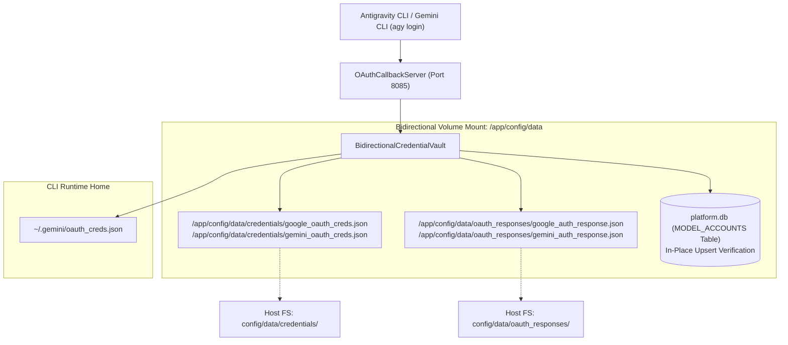

# Antigravity CLI (v1.4.12) Authentication Guide & Specification

## 1. Overview & Architecture

Antigravity CLI (`agy`) v1.4.12 provides terminal-first AI agent capabilities powered by the Google DeepMind core agent engine. Authentication in `agy` is designed for hybrid developer environments, seamlessly handling local interactive desktops, remote headless SSH sessions, and enterprise cloud infrastructure.

The CLI codebase implements four distinct authentication channels:
1. **Interactive Google Sign-In (Default / Personal Accounts)**: OAuth 2.0 PKCE with OS Keyring integration.
2. **Application Default Credentials (`AGY_ADC_AUTH`)**: Google Cloud Project / Service Account integration for enterprise and business tiers.
3. **Gemini API Key (`GEMINI_API_KEY`)**: Headless and CI/CD automated invocation.
4. **Plugin & MCP Server Authentication (`auth.json`)**: Namespaced multi-user credential storage for extensible integrations.

---

## 2. Authentication Channels & Core Implementation

### 2.1 Channel 1: Interactive Google Sign-In (Local & Remote)
* **Local Terminal Sessions**:
  * Running `agy` without an active session initiates Google OAuth.
  * Spawns a local loopback callback server and automatically opens the user's default web browser to the Google OAuth consent screen.
  * Tokens (`access_token`, `refresh_token`, expiration) are stored in the OS system keyring (macOS Keychain, Windows Credential Manager, Linux Secret Service).
  * **Fallback Storage**: If an enterprise token exceeds the OS keychain storage size limit, `agy` transparently falls back to an encrypted private secrets file in `~/.gemini/antigravity-cli/`.
  * **Proactive Refresh**: Refreshes OAuth tokens automatically 5 minutes prior to expiration to prevent mid-session drops.
* **Remote / SSH Terminal Sessions**:
  * The CLI inspects environment variables (`SSH_CLIENT`, `SSH_TTY`, `SSH_CONNECTION`).
  * In headless SSH mode, it suppresses browser launch and renders an authorization URL directly in the terminal.
  * The user opens the URL on their local machine, authorizes the session, and pastes the verification handshake back to the terminal.

### 2.2 Channel 2: Application Default Credentials (`AGY_ADC_AUTH`)
* **Environment Variable**: `AGY_ADC_AUTH=true` or set via Google Cloud SDK (`gcloud auth application-default login`).
* **Google Cloud Project Onboarding**:
  * Connects directly to Google Cloud projects with Vertex AI API enabled.
  * Presents billing options: **Gemini Subscription** or **Pay-As-You-Go**.
  * Dynamic model filtering: Third-party models (e.g., Claude 3.5 Sonnet, Claude 3.5 Opus) are displayed in `/model` only if authorized in the target GCP project.
* **Security & Privacy Governance**:
  * Telemetry is permanently disabled (`off (disabled)`) for Business/ADC accounts.
  * Zero user prompts, codebase contents, or inference outputs are collected.

### 2.3 Channel 3: Direct API Key (`GEMINI_API_KEY`)
* **Configuration**: Set `GEMINI_API_KEY=<token>` in the environment or `.env` file.
* **Usage**: Ideal for lightweight script automation, Docker containers, and CI pipelines without web browsers.
* **Capabilities**: Supports selectable reasoning effort on supported Gemini models (`gemini-2.5-pro`, `gemini-2.5-flash`).

### 2.4 Channel 4: Plugin & MCP Server Authentication
* Configured in plugin manifests via `auth.json`.
* Supports `"optional": true` for providers that can run unauthenticated at base rate limits.
* Stores OAuth tokens scoped strictly to the signed-in user account, preventing cross-user token leakage on multi-user workstations.

---

## 3. Step-by-Step Instructions: Using CLI Authentication

### Step 0: Installing Antigravity CLI
To install Antigravity CLI (`agy`) inside a Linux environment or container:
```bash
curl -fsSL https://antigravity.google/cli/install.sh | bash
```
The binary installs directly into `~/.local/bin/agy` (or `/home/node/.local/bin/agy`). Add this directory to your `PATH` if not already present:
```bash
export PATH="$HOME/.local/bin:$PATH"
agy --version
```

### Step 1: Starting the Interactive Login
When starting the CLI without an active session or executing `/login`:
```bash
agy
```

The CLI renders the interactive login selector:
```text
  ___   _   _ _____ ___   ____ ____     _ __     ___ _____ _   _ 
 / _ \ / \ | |_   _/ _ \ / ___|  _ \   / \\ \   / / |_   _| \ | |
| |_| / _ \| | | || |_| | |  _| |_) | / _ \\ \ / /| | | | |  \| |
|  __/ ___ \ | | ||  __/| |_| |  _ < / ___ \\ V / | | | | | |\  |
|_| /_/   \_\_| |_| |_|  \____|_| \_\_/   \_\ _/  |_| |_| |_| \_|

Welcome to the Antigravity CLI. You are currently not signed in.

Select login method:
> 1. Google OAuth
  2. Use a Google Cloud project

↑/↓ Navigate · enter Select
```

#### Detailed Comparison of Login Methods:
* **Option 1: Google OAuth (Recommended for Individual Developers)**:
  - **No Google Cloud Project Required**: Authenticates individual developers directly via Google OAuth 2.0 PKCE.
  - **Flow**: Starts a local loopback server, prompts user with browser authorization URL, and handles the secure token handshake.
  - **Permissions**: Grants access to Gemini models via Google Cloud Code Assist server.
  - **Bidirectional Storage**: Persists credentials to bidirectional volume directories (`credentials/` and `oauth_responses/`) and `~/.gemini/oauth_creds.json`.
* **Option 2: Use a Google Cloud project (Enterprise / Team Mode)**:
  - **Google Cloud Project Required**: Requires a pre-existing GCP Project (`GOOGLE_CLOUD_PROJECT`) with Vertex AI API enabled.
  - **Billing**: Connects to the project's Enterprise Gemini subscription or Pay-As-You-Go billing.
  - **Flow**: Authenticates via Application Default Credentials (`gcloud auth application-default login`) or service account keys.

### Step 2: Completing Browser Consent (Option 1)
1. Select **1. Google OAuth** from the interactive menu.
2. When the browser launches, select your Google Account (`<user-email>`) and approve permissions.
3. If Google displays the first-party advisory (*"Make sure that you downloaded this app from Google"*), click **Sign in** to confirm.
4. Once the success screen appears (`Sign-in complete`), return to the terminal. The statusline updates to `● READY`.

### Step 3: Authenticating in Headless / Remote SSH Sessions
When connected over SSH:
```bash
agy
```
1. Copy the displayed URL: `https://accounts.google.com/o/oauth2/v2/auth?...`
2. Open the URL in your local browser and sign in.
3. Copy the resulting response code and paste it back into your remote terminal prompt.

### Step 4: Authenticating via Google Cloud ADC (Enterprise / Business)
```bash
# Set ADC authentication mode
export AGY_ADC_AUTH=true

# Launch CLI and select your Google Cloud Project
agy
```
Choose your billing preference (Subscription or Pay-As-You-Go) and pick your designated Google Cloud Project.

### Step 5: Managing Session & Signing Out
* **Check Status**: Run `/config` or inspect the bottom statusline to view your active account and license tier.
* **Sign Out**:
  ```bash
  /logout
  ```
  This immediately purges tokens from the OS keyring and local cache.

---

## 4. Bidirectional Volume Storage Engine

ModelBox Studio integrates a centralized `BidirectionalCredentialVault` engine that coordinates authentication between the containerized platform service, the local CLI runtimes, and the host file system.



### Volume File Paths & Schemas

| Target Location | Relative Path | Purpose |
| :--- | :--- | :--- |
| **Volume Credentials** | `/app/config/data/credentials/google_oauth_creds.json` | Active bearer tokens and credentials for Google provider. |
| **Volume Gemini Creds** | `/app/config/data/credentials/gemini_oauth_creds.json` | Direct symlink/mirror credentials specifically for Gemini model queries. |
| **Volume Response Payload** | `/app/config/data/oauth_responses/google_auth_response.json` | Full raw OAuth response payload with timestamp, expiry, and scopes. |
| **Volume Gemini Response** | `/app/config/data/oauth_responses/gemini_auth_response.json` | Gemini-scoped raw OAuth response payload. |
| **User Home CLI Directory** | `~/.gemini/oauth_creds.json` | Native directory queried by upstream Google CLIs (`agy`, `gemini-cli`). |
| **Database Ledger** | `/app/config/data/platform.db` (`MODEL_ACCOUNTS`) | SQLite persistent account records with duplicate-prevention upsert. |

### API Endpoints for CLI Authentication Management

* **Complete CLI Authentication Handshake**:
  `POST /api/v1/models/:modelId/cli-auth-complete`
  - Payload: `{ "userEmail": "...", "accessToken": "...", "refreshToken": "...", "authMode": "cli-oauth" }`
  - Result: Atomically updates `MODEL_ACCOUNTS`, writes to bidirectional credentials volume, and mirrors to `oauth_responses/` and `~/.gemini/`.
* **Inspect Bidirectional Volume Credentials**:
  `GET /api/v1/models/:modelId/bidirectional-credentials`
  - Returns credentials file status, response payload preview, volume directory path, and CLI home sync status.

---

## 5. Key CLI Commands & Environment Variables Reference

| Command / Variable | Type | Purpose |
| :--- | :--- | :--- |
| `/login` (or `/signin`) | Slash Command | Opens interactive login dialog and switches active account. |
| `/logout` (or `/signout`)| Slash Command | Purges cached credentials from keychain and disk. |
| `/config` | Slash Command | Inspects session parameters, telemetry status, and account settings. |
| `/model` | Slash Command | Displays and selects available models (filtered by account entitlement). |
| `AGY_ADC_AUTH` | Env Var | Enables Google Cloud Application Default Credentials authentication. |
| `GEMINI_API_KEY` | Env Var | Authenticates directly using a Google Gemini API Key. |
| `AGY_CLI_HIDE_ACCOUNT_INFO` | Env Var | Hides personal email and account identifiers from terminal recordings. |

---

## 6. Antigravity CLI Daemon Architecture & IPC Workflow

The Antigravity CLI daemon (`antigravity-auth-daemon.sh`) orchestrates headless interactive CLI authentication in containerized and cloud environments. Because Google OAuth PKCE requires an interactive pseudoterminal (PTY) to capture dynamic authorization URLs and exchange authorization codes, the daemon leverages pure POSIX shell and `script(1)` to drive `/usr/local/bin/antigravity`.

```mermaid
sequenceDiagram
    autonumber
    actor Dev as Developer / Browser
    participant UI as Model Connector UI (React)
    participant Ctrl as ModelConfigController (Express)
    participant Daemon as antigravity-auth-daemon.sh
    participant CLI as Antigravity CLI (/usr/local/bin/antigravity)
    participant Google as Google Identity & OAuth2 Server

    Note over UI,Daemon: Phase 1: On-Demand Daemon Spawning & URL Capture
    UI->>Ctrl: POST /api/v1/models/gemini-3.8-flash/cli-auth-init
    Ctrl->>Daemon: Spawn antigravity-auth-daemon.sh --email=<userEmail>
    Daemon->>CLI: script -q -f -c "antigravity -p 'init' --print-timeout 300s"
    CLI-->>Daemon: Emit: "Authentication required. Please visit URL: https://accounts.google.com/o/oauth2/auth?..."
    CLI-->>Daemon: Emit: "Waiting for authentication (timeout 60s)... Or, paste authorization code here:"
    Daemon->>Ctrl: Sync session (status: PENDING, oauthUrl: "https://accounts.google.com/...")
    Ctrl-->>UI: Return pending session & pure Antigravity CLI OAuth URL

    Note over Dev,Google: Phase 2: User Browser Consent & Code Delivery
    Dev->>UI: Click "Browser Sign-In" (Opens OAuth URL in popup)
    Dev->>Google: Authenticate & Approve Scopes
    Google-->>Dev: Redirect to loopback portal with Authorization Code (4/0AUn6...)
    Dev->>UI: Paste Authorization Code into Input

    Note over UI,CLI: Phase 3: Verification & Invariant Enforcement
    Dev->>UI: Click "Verify & Save" (Manual trigger invariant)
    UI->>Ctrl: POST /api/v1/auth/cli-session/code { authCode: "4/0AUn6..." }
    Ctrl->>Daemon: Write sanitized code to /tmp/antigravity_auth_code.txt
    Daemon->>CLI: Pipe code to PTY stdin (exec 3<> $FIFO_IN; printf "%s\r\n" >&3)
    CLI->>Google: POST https://oauth2.googleapis.com/token (code + code_verifier)
    Google-->>CLI: Return Access & Refresh Tokens
    CLI-->>Daemon: Tokens saved to ~/.gemini/antigravity-cli/ & ~/.config/antigravity/
    Daemon->>Daemon: Sync credentials to /root/.gemini/ and /app/config/data/credentials/
    Daemon->>Ctrl: REST API sync (status: COMPLETED)

    Note over Ctrl,UI: Phase 4: Live Verification & Step Unlocking
    Ctrl->>CLI: antigravity --dangerously-skip-permissions -p "Hi" --model gemini-3.8-flash
    CLI-->>Ctrl: Inference response (Verified live connection)
    Ctrl-->>UI: HTTP 200 { success: true, verified: true }
    UI->>UI: Unlock Step 3 (Token Vault), Set badge "Verified & Active in DB"
```

### 6.1 Daemon Execution Specifications
1. **PTY Virtualization**: Spawns `script -q -f -c "stty cols 4096 rows 100 2>/dev/null; ${cli_cmd}" "$CLI_LOG" < "$FIFO_IN"` to provide a complete interactive TTY.
2. **Standard Input Delivery**: Communicates through Linux named pipe (`mkfifo /tmp/antigravity_auth_in.fifo`) assigned to file descriptor 3 (`exec 3<> "$FIFO_IN"`).
3. **60-Second Real CLI Timeout**: While the overall execution budget is configurable up to 300s, `antigravity` hardcodes a **60-second** timeout for receiving authorization codes. The UI countdown timer and daemon polling loop are synchronized to 60s to prevent user desynchronization.
4. **Credential Mirroring**: Upon successful token exchange, credentials from `$HOME/.gemini/` and `$HOME/.config/antigravity` are mirrored across:
   - `/root/.gemini/antigravity-cli/`
   - `/home/node/.gemini/antigravity-cli/`
   - `/app/config/data/credentials/`

---

## 7. Three-Step UI Userflow & Verification Gating Specification

The onboarding interface enforces a strict, progressive 3-stage pipeline in `IntegrationsPage.tsx`.

```
┌─────────────────────────┐     ┌─────────────────────────┐     ┌─────────────────────────┐
│  Step 1: Select Model   │ ──> │ Step 2: Browser Consent │ ──> │   Step 3: Token Vault   │
│  Provider Configuration │     │ Code Capture & Verify   │     │ Active & Live Verified  │
└─────────────────────────┘     └─────────────────────────┘     └─────────────────────────┘
                                             │                               ▲
                                             │      [Blocked if:             │
                                             │       • Verification Pending  │
                                             └─────  • Code Unverified       │
                                                     • Verification Failed   │
                                                     • 4xx / 401 Received]   │
                                                                             │
                                              [Only after live verify 200 OK]┘
```

### Step 1: Select Model & Protocol
- User selects target model (e.g. `Google Gemini 3.8 Flash (gemini)`) and authentication mode (`OAuth 2.0 Redirect`).
- Pure Antigravity OAuth URL is generated using the CLI's native parameters (RFC 7636 PKCE).

### Step 2: Browser Consent & Code Capture
- **URL Launch**: Clicking **Browser Sign-In** opens the pure Google OAuth authorization portal in a popup.
- **Code Capture**: The user signs in and is provided with the authorization code (`4/0AUn6...`).
- **No Automatic Verification On Page Load**: When the popup redirects or the page loads with query parameters (`?oauth_success=true`), the system populates the authorization code into the input field but **never** initiates code exchange automatically. Verification requires an explicit user action.
- **Strict Verification Gating Invariant**:
  - The **Next: Token Vault & Verification →** button is **strictly disabled** (`disabled={!isAccountVerified}`) while:
    - Verification is in progress (`isVerifyingAuthCode` is true, label changes to `"Verifying..."`).
    - The authorization code has been pasted/entered but not yet verified (`redirectAuthCode` is present).
    - An error occurred (`cliScriptError` or `actionError` or `isOAuthVerificationFailed`).
    - No active verified session exists in the database.
  - The Step 3 button in the top pipeline indicator is disabled with `cursor: not-allowed` and `opacity: 0.55`.

### Step 3: Authenticated Token Vault
- Mounts **only** when `isAccountVerified === true`.
- **Accurate Dynamic Badges**:
  - `Verified & Active in DB` (`.badge-success`, green) — Account active and verified live.
  - `Verification Failed` (`.badge-error`, red) — Token exchange or CLI connection failed.
  - `Unverified / Needs Verification` (`.badge-warning`, amber) — Pending user verification.
  - **Prohibited**: Never display static `"Saved in DB Against Account"` when verification is unconfirmed.

---

## 8. Component Communication & Protocol Ledger

| Component | Target / Peer | Protocol / Channel | Payload / Data | Purpose |
| :--- | :--- | :--- | :--- | :--- |
| `IntegrationsPage.tsx` | `modelConfigController.ts` | HTTP POST `/api/v1/auth/cli-session/code` | `{ modelId, authCode, userEmail }` | Delivers user authorization code to backend. |
| `IntegrationsPage.tsx` | `modelConfigController.ts` | HTTP POST `/api/v1/models/:id/oauth-manual-verify` | `{ input: authCode, userEmail }` | Manually triggers live CLI connection verification. |
| `modelConfigController.ts` | `/tmp/antigravity_auth_code.txt` | Local File IPC | Clean single auth code (`4/...`) | Trigger file polled by `antigravity-auth-daemon.sh`. |
| `antigravity-auth-daemon.sh` | `/usr/local/bin/antigravity` | Linux Named Pipe (`$FIFO_IN`) | Code string + `\r\n` | Sends auth code directly to CLI PTY stdin. |
| `modelConfigController.ts` | `connectionVerificationStrategies.ts` | TypeScript DI Call | `verifyConnection("cli_oauth", ...)` | Executes live verification test inference. |
| `connectionVerificationStrategies.ts` | `/usr/local/bin/antigravity` | Subshell `childProcessUtils.exec` | `antigravity -p "Hi" --model gemini-3.8-flash` | Verifies real end-to-end inference without API key override. |

---

## 9. 4xx/401/400 Regression Diagnostics & Permanent Engineering Invariants

Whenever UI enhancements or refactorings are performed on `IntegrationsPage.tsx`, the following four failure modes must be guarded against:

### ⚠️ Failure Mode 1: HTTP 401 / "Authentication Required" Loop
* **Symptom in UI**:
  ```text
  Execution Diagnostic Error:
  Command failed: antigravity --dangerously-skip-permissions -p "Hi , whats date time now ?" --model gemini-3.8-flash
  Error: authentication required. Run 'antigravity' to log in, then retry. error: authentication failed or timed out
  ```
* **Root Cause**:
  In `connectionVerificationStrategies.ts` (`GeminiProviderVerificationStrategy.buildCliPlan`), when `verifyConnection("cli_oauth", { credentialValue: authCode })` is invoked, `credential` contains the authorization code `4/0AUn6...`. If the strategy assigns `baseEnv.GEMINI_API_KEY = token`, Antigravity CLI treats the authorization code as an invalid Gemini API Key, overriding its saved OAuth token and failing authentication with 401.
* **Engineering Invariant**:
  ```typescript
  // INVARIANT: Never set GEMINI_API_KEY or GOOGLE_API_KEY if token is an OAuth Authorization Code
  const token = credential || processUtils.getEnv("GEMINI_API_KEY", "");
  const isOAuth = token.startsWith("ya29.") ? true : token.startsWith("Bearer ");
  if (isOAuth) {
    baseEnv.GOOGLE_GENAI_USE_GCA = "true";
    baseEnv.GOOGLE_CLOUD_ACCESS_TOKEN = token.replace(/^Bearer\s+/i, "").trim();
  } else if (token && !token.startsWith("4/")) {
    baseEnv.GEMINI_API_KEY = token;
    baseEnv.GOOGLE_API_KEY = token;
  }
  ```

### ⚠️ Failure Mode 2: HTTP 400 / "Malformed auth code" (Doubled Code on Paste)
* **Symptom in Daemon Log**:
  ```text
  token exchange failed: oauth2: "invalid_grant" "Malformed auth code."
  ```
* **Root Cause**:
  In React input fields, defining `onPaste` without `e.preventDefault()` causes the browser to execute its native paste action *and* trigger React's state setter, duplicating the string in the DOM (e.g. `4/0AUn6...4/0AUn6...`, 146 characters instead of 73).
* **Engineering Invariant**:
  All authorization code input handlers must prevent default and sanitize via regex:
  ```typescript
  // INVARIANT: Always call e.preventDefault() and sanitize pasted code
  onPaste={(e) => {
    e.preventDefault();
    const text = e.clipboardData.getData("text");
    if (text) {
      const clean = sanitizeAuthCode(text);
      setRedirectAuthCode(clean);
      setEditableAuthCode(clean);
    }
  }}
  ```

### ⚠️ Failure Mode 3: HTTP 400 / "Invalid Value" on Tokeninfo Endpoint
* **Symptom in UI**:
  ```text
  EXECUTED HTTP CALL: POST https://oauth2.googleapis.com/tokeninfo
  { "error": "invalid_token", "error_description": "Invalid Value" }
  ```
* **Root Cause**:
  `CliProtocolVerificationStrategy.executeCliPlan` calling `OAuthExecutorFactory.getExecutor().validateToken(effectiveCred, ...)` when `effectiveCred` starts with `4/0`. Google's `/tokeninfo` endpoint validates **access tokens**, never **authorization codes**.
* **Engineering Invariant**:
  ```typescript
  // INVARIANT: validateToken must ONLY be called for bearer/access tokens
  if (effectiveCred && (effectiveCred.startsWith("ya29.") || effectiveCred.startsWith("Bearer "))) {
    const oauthResult = await executor.validateToken(effectiveCred, modelId, prompt);
    // ...
  }
  ```

### ⚠️ Failure Mode 4: False "Saved in DB" Badge on Unverified Code
* **Symptom in UI**:
  Inputting `4/invalid_code_12345` displays green badge `Saved in DB Against Account`.
* **Root Cause**:
  Hardcoded ternary checking `oauthSession.authCode.includes("invalid") ? ... : "Saved in DB Against Account"`.
* **Engineering Invariant**:
  Badges must be computed dynamically against live account state and active error flags:
  ```typescript
  <span className={`authcode-badge ${
    cliScriptError || actionError
      ? "badge-error"
      : isAccountVerified
      ? "badge-success"
      : "badge-warning"
  }`}>
    {cliScriptError || actionError
      ? "Verification Failed"
      : isAccountVerified
      ? "Verified & Active in DB"
      : "Unverified / Needs Verification"}
  </span>
  ```

---

## 10. Canonical Code Snippets Reference

### 10.1 Shared Sanitization Function (`@model-box/model-connector-core`)
```typescript
/**
 * Sanitizes authorization codes, extracting the clean single code if duplicated or concatenated.
 * Conforms to RFC 7636 and Google OAuth format.
 */
export const sanitizeAuthCode = (input: string): string => {
  if (!input) return "";
  const trimmed = input.trim();
  const match = trimmed.match(/(4\/[a-zA-Z0-9_\-]+)/);
  return match ? match[1] : trimmed;
};
```

### 10.2 Shell Daemon Sanitization (`antigravity-auth-daemon.sh`)
```bash
if [ -n "$detected_code_file" ]; then
  local auth_code
  auth_code=$(cat "$detected_code_file" 2>/dev/null | tr -d '\r\n[:space:]')
  # Extract single clean code if duplicated
  if [[ "$auth_code" =~ (4/[a-zA-Z0-9_\-]+) ]]; then
    auth_code="${BASH_REMATCH[1]}"
  fi
  if [ -n "$auth_code" ]; then
    logger_info "Authorization code received from [${detected_code_file}]! Transmitting to Antigravity CLI stdin..."
    printf "%s\r\n" "$auth_code" >&3
    rm -f "$CODE_FILE" "/tmp/antigravity_auth_code.txt" 2>/dev/null || true
    # ...
  fi
fi
```

### 10.3 Next Step Gating Invariant (`IntegrationsPage.tsx`)
```typescript
// Determine if account is verified and ready for Step 3 (Token Vault)
const isAccountVerified = useMemo(() => {
  return Boolean(
    oauthSession?.accessToken &&
    !oauthSession.accessToken.includes("invalid") &&
    !cliScriptError &&
    !actionError &&
    !isVerifyingAuthCode &&
    !redirectAuthCode.trim()
  );
}, [oauthSession, cliScriptError, actionError, isVerifyingAuthCode, redirectAuthCode]);

// Next step navigation button
<button
  type="button"
  className={`btn-oauth-action ${isAccountVerified ? "btn-browser-auth" : "btn-disabled"}`}
  disabled={!isAccountVerified}
  onClick={() => {
    if (isAccountVerified) {
      setActiveOAuthStep(3);
    }
  }}
  style={{
    cursor: isAccountVerified ? "pointer" : "not-allowed",
    opacity: isAccountVerified ? 1 : 0.5,
  }}
>
  <span>
    {isVerifyingAuthCode ? "Verifying..." : "Next: Token Vault & Verification →"}
  </span>
</button>
```


