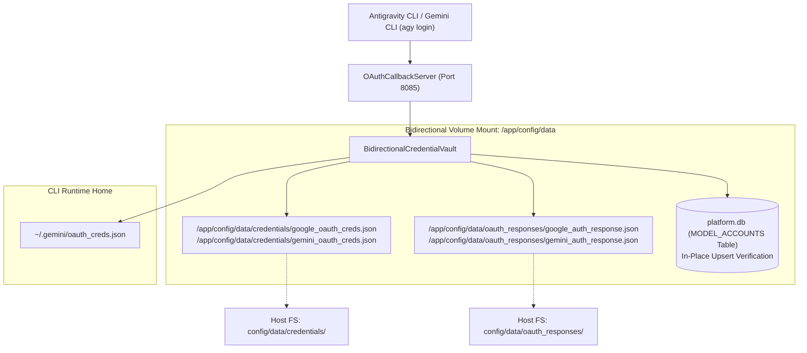

# Antigravity CLI (v1.4.12) Authentication Guide & Specification

## 1. Overview & Architecture

Antigravity CLI (`agy`) v1.4.12 provides terminal-first AI agent capabilities powered by the Google DeepMind core agent engine. Authentication in `agy` is designed for hybrid developer environments, seamlessly handling local interactive desktops, remote headless SSH sessions, and enterprise cloud infrastructure.

The CLI codebase implements four distinct authentication channels:
1. **Interactive Google Sign-In (Default / Personal Accounts)**: OAuth 2.0 PKCE with OS Keyring integration.
2. **Application Default Credentials (`AGY_ADC_AUTH`)**: Google Cloud Project / Service Account integration for enterprise and business tiers.
3. **Gemini API Key (`GEMINI_API_KEY`)**: Headless and CI/CD automated invocation.
4. **Plugin & MCP Server Authentication (`auth.json`)**: Namespaced multi-user credential storage for extensible integrations.

---

## 2. Authentication Channels & Core Implementation

### 2.1 Channel 1: Interactive Google Sign-In (Local & Remote)
* **Local Terminal Sessions**:
  * Running `agy` without an active session initiates Google OAuth.
  * Spawns a local loopback callback server and automatically opens the user's default web browser to the Google OAuth consent screen.
  * Tokens (`access_token`, `refresh_token`, expiration) are stored in the OS system keyring (macOS Keychain, Windows Credential Manager, Linux Secret Service).
  * **Fallback Storage**: If an enterprise token exceeds the OS keychain storage size limit, `agy` transparently falls back to an encrypted private secrets file in `~/.gemini/antigravity-cli/`.
  * **Proactive Refresh**: Refreshes OAuth tokens automatically 5 minutes prior to expiration to prevent mid-session drops.
* **Remote / SSH Terminal Sessions**:
  * The CLI inspects environment variables (`SSH_CLIENT`, `SSH_TTY`, `SSH_CONNECTION`).
  * In headless SSH mode, it suppresses browser launch and renders an authorization URL directly in the terminal.
  * The user opens the URL on their local machine, authorizes the session, and pastes the verification handshake back to the terminal.

### 2.2 Channel 2: Application Default Credentials (`AGY_ADC_AUTH`)
* **Environment Variable**: `AGY_ADC_AUTH=true` or set via Google Cloud SDK (`gcloud auth application-default login`).
* **Google Cloud Project Onboarding**:
  * Connects directly to Google Cloud projects with Vertex AI API enabled.
  * Presents billing options: **Gemini Subscription** or **Pay-As-You-Go**.
  * Dynamic model filtering: Third-party models (e.g., Claude 3.5 Sonnet, Claude 3.5 Opus) are displayed in `/model` only if authorized in the target GCP project.
* **Security & Privacy Governance**:
  * Telemetry is permanently disabled (`off (disabled)`) for Business/ADC accounts.
  * Zero user prompts, codebase contents, or inference outputs are collected.

### 2.3 Channel 3: Direct API Key (`GEMINI_API_KEY`)
* **Configuration**: Set `GEMINI_API_KEY=<token>` in the environment or `.env` file.
* **Usage**: Ideal for lightweight script automation, Docker containers, and CI pipelines without web browsers.
* **Capabilities**: Supports selectable reasoning effort on supported Gemini models (`gemini-2.5-pro`, `gemini-2.5-flash`).

### 2.4 Channel 4: Plugin & MCP Server Authentication
* Configured in plugin manifests via `auth.json`.
* Supports `"optional": true` for providers that can run unauthenticated at base rate limits.
* Stores OAuth tokens scoped strictly to the signed-in user account, preventing cross-user token leakage on multi-user workstations.

---

## 3. Step-by-Step Instructions: Using CLI Authentication

### Step 0: Installing Antigravity CLI
To install Antigravity CLI (`agy`) inside a Linux environment or container:
```bash
curl -fsSL https://antigravity.google/cli/install.sh | bash
```
The binary installs directly into `~/.local/bin/agy` (or `/home/node/.local/bin/agy`). Add this directory to your `PATH` if not already present:
```bash
export PATH="$HOME/.local/bin:$PATH"
agy --version
```

### Step 1: Starting the Interactive Login
When starting the CLI without an active session or executing `/login`:
```bash
agy
```

The CLI renders the interactive login selector:
```text
  ___   _   _ _____ ___   ____ ____     _ __     ___ _____ _   _ 
 / _ \ / \ | |_   _/ _ \ / ___|  _ \   / \\ \   / / |_   _| \ | |
| |_| / _ \| | | || |_| | |  _| |_) | / _ \\ \ / /| | | | |  \| |
|  __/ ___ \ | | ||  __/| |_| |  _ < / ___ \\ V / | | | | | |\  |
|_| /_/   \_\_| |_| |_|  \____|_| \_\_/   \_\ _/  |_| |_| |_| \_|

Welcome to the Antigravity CLI. You are currently not signed in.

Select login method:
> 1. Google OAuth
  2. Use a Google Cloud project

↑/↓ Navigate · enter Select
```

#### Detailed Comparison of Login Methods:
* **Option 1: Google OAuth (Recommended for Individual Developers)**:
  - **No Google Cloud Project Required**: Authenticates individual developers directly via Google OAuth 2.0 PKCE.
  - **Flow**: Starts a local loopback server, prompts user with browser authorization URL, and handles the secure token handshake.
  - **Permissions**: Grants access to Gemini models via Google Cloud Code Assist server.
  - **Bidirectional Storage**: Persists credentials to bidirectional volume directories (`credentials/` and `oauth_responses/`) and `~/.gemini/oauth_creds.json`.
* **Option 2: Use a Google Cloud project (Enterprise / Team Mode)**:
  - **Google Cloud Project Required**: Requires a pre-existing GCP Project (`GOOGLE_CLOUD_PROJECT`) with Vertex AI API enabled.
  - **Billing**: Connects to the project's Enterprise Gemini subscription or Pay-As-You-Go billing.
  - **Flow**: Authenticates via Application Default Credentials (`gcloud auth application-default login`) or service account keys.

### Step 2: Completing Browser Consent (Option 1)
1. Select **1. Google OAuth** from the interactive menu.
2. When the browser launches, select your Google Account (`user@gmail.com`) and approve permissions.
3. If Google displays the first-party advisory (*"Make sure that you downloaded this app from Google"*), click **Sign in** to confirm.
4. Once the success screen appears (`Sign-in complete`), return to the terminal. The statusline updates to `● READY`.

### Step 3: Authenticating in Headless / Remote SSH Sessions
When connected over SSH:
```bash
agy
```
1. Copy the displayed URL: `https://accounts.google.com/o/oauth2/v2/auth?...`
2. Open the URL in your local browser and sign in.
3. Copy the resulting response code and paste it back into your remote terminal prompt.

### Step 4: Authenticating via Google Cloud ADC (Enterprise / Business)
```bash
# Set ADC authentication mode
export AGY_ADC_AUTH=true

# Launch CLI and select your Google Cloud Project
agy
```
Choose your billing preference (Subscription or Pay-As-You-Go) and pick your designated Google Cloud Project.

### Step 5: Managing Session & Signing Out
* **Check Status**: Run `/config` or inspect the bottom statusline to view your active account and license tier.
* **Sign Out**:
  ```bash
  /logout
  ```
  This immediately purges tokens from the OS keyring and local cache.

---

## 4. Bidirectional Volume Storage Engine

ModelBox Studio integrates a centralized `BidirectionalCredentialVault` engine that coordinates authentication between the containerized platform service, the local CLI runtimes, and the host file system.



### Volume File Paths & Schemas

| Target Location | Relative Path | Purpose |
| :--- | :--- | :--- |
| **Volume Credentials** | `/app/config/data/credentials/google_oauth_creds.json` | Active bearer tokens and credentials for Google provider. |
| **Volume Gemini Creds** | `/app/config/data/credentials/gemini_oauth_creds.json` | Direct symlink/mirror credentials specifically for Gemini model queries. |
| **Volume Response Payload** | `/app/config/data/oauth_responses/google_auth_response.json` | Full raw OAuth response payload with timestamp, expiry, and scopes. |
| **Volume Gemini Response** | `/app/config/data/oauth_responses/gemini_auth_response.json` | Gemini-scoped raw OAuth response payload. |
| **User Home CLI Directory** | `~/.gemini/oauth_creds.json` | Native directory queried by upstream Google CLIs (`agy`, `gemini-cli`). |
| **Database Ledger** | `/app/config/data/platform.db` (`MODEL_ACCOUNTS`) | SQLite persistent account records with duplicate-prevention upsert. |

### API Endpoints for CLI Authentication Management

* **Complete CLI Authentication Handshake**:
  `POST /api/v1/models/:modelId/cli-auth-complete`
  - Payload: `{ "userEmail": "...", "accessToken": "...", "refreshToken": "...", "authMode": "cli-oauth" }`
  - Result: Atomically updates `MODEL_ACCOUNTS`, writes to bidirectional credentials volume, and mirrors to `oauth_responses/` and `~/.gemini/`.
* **Inspect Bidirectional Volume Credentials**:
  `GET /api/v1/models/:modelId/bidirectional-credentials`
  - Returns credentials file status, response payload preview, volume directory path, and CLI home sync status.

---

## 5. Key CLI Commands & Environment Variables Reference

| Command / Variable | Type | Purpose |
| :--- | :--- | :--- |
| `/login` (or `/signin`) | Slash Command | Opens interactive login dialog and switches active account. |
| `/logout` (or `/signout`)| Slash Command | Purges cached credentials from keychain and disk. |
| `/config` | Slash Command | Inspects session parameters, telemetry status, and account settings. |
| `/model` | Slash Command | Displays and selects available models (filtered by account entitlement). |
| `AGY_ADC_AUTH` | Env Var | Enables Google Cloud Application Default Credentials authentication. |
| `GEMINI_API_KEY` | Env Var | Authenticates directly using a Google Gemini API Key. |
| `AGY_CLI_HIDE_ACCOUNT_INFO` | Env Var | Hides personal email and account identifiers from terminal recordings. |

