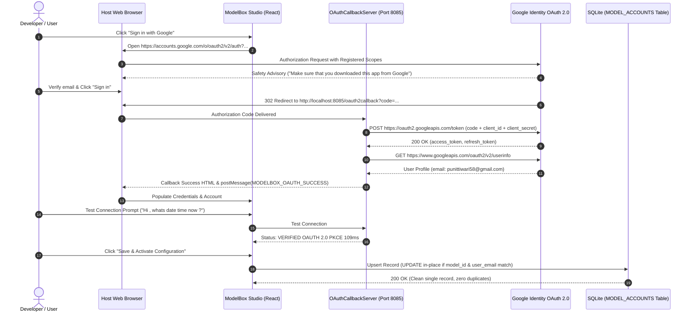

# Gemini CLI Authentication Architecture

## 1. Overview
The Gemini CLI authentication system supports multi-mode identity providers tailored for individual developers, corporate cloud environments, and headless automated runners.

### Official Source Reference
- **Upstream Documentation**: [Gemini CLI authentication setup | Gemini CLI](https://geminicli.com/docs/get-started/authentication/)

---

## 2. Authentication Methods Supported

### 2.1 Sign in with Google (OAuth 2.0 PKCE — Recommended for Individuals)
- **Target Audience**: Free tier users, Google AI Pro, Google AI Ultra, and Google One subscribers.
- **Google Cloud Project**: **Not Required**. Users authenticate directly with their personal Google Account.
- **Upstream Gemini CLI Native Client Specifications** (from `google-gemini/gemini-cli.git`):
  - `client_id`: `<GOOGLE_OAUTH_CLIENT_ID>-[...].apps.googleusercontent.com`
  - `client_secret`: `<GOOGLE_OAUTH_CLIENT_SECRET>-[...REDACTED...]`
- **CLI Command**:
  ```bash
  gemini auth login --browser
  ```
- **Loopback Redirect Protocol**:
  1. The CLI starts a local loopback HTTP server on `http://localhost:8085/oauth2callback`.
  2. Opens the user's default browser to:
     ```
     https://accounts.google.com/o/oauth2/v2/auth?
       client_id=<GOOGLE_OAUTH_CLIENT_ID>-[...].apps.googleusercontent.com&
       redirect_uri=http://localhost:8085/oauth2callback&
       response_type=code&
       scope=https://www.googleapis.com/auth/cloud-platform https://www.googleapis.com/auth/userinfo.email https://www.googleapis.com/auth/userinfo.profile&
       access_type=offline&
       prompt=select_account consent
     ```
  3. The `prompt=select_account consent` parameter forces Google's account selection modal, allowing the user to select which Google identity to authorize.
  4. Google prompts the first-party safety dialog: *"Make sure that you downloaded this app from Google. Don't sign in to Google Antigravity unless you're sure you downloaded this app from Google."* The user clicks **Sign in**.
  5. Google redirects to `http://localhost:8085/oauth2callback?code=...`.
  6. The loopback server exchanges the authorization code by POSTing to `https://oauth2.googleapis.com/token` providing `client_id`, `client_secret`, and `code`. (Note: Google requires `client_secret` during code exchange; missing it causes HTTP 400 `client_secret is missing`).
  7. Bearer access tokens and refresh tokens are stored into `MODEL_ACCOUNTS` in SQLite with record upserting (updating existing records by `(model_id, user_email)` without duplicates).

---

### 2.2 Google AI Studio API Key (`GEMINI_API_KEY`)
- **Target Audience**: Pay-as-you-go developers and automated headless runners.
- **Setup**: Obtain an API key from Google AI Studio (`aistudio.google.com`).
- **Configuration**:
  ```bash
  export GEMINI_API_KEY="<RUNTIME_ONLY>"
  # or configure in settings:
  gemini config set api_key "<RUNTIME_ONLY>"
  ```

---

### 2.3 Google Cloud Vertex AI (Enterprise Mode)
- **Target Audience**: Corporate enterprise environments with SOC2/HIPAA compliance and Google Cloud VPC boundaries.
- **Requirements**:
  - `GOOGLE_CLOUD_PROJECT`: Active GCP project ID.
  - `GOOGLE_CLOUD_LOCATION`: Regional endpoint (e.g. `us-central1`).
  - Google Cloud Application Default Credentials (ADC) or service account JSON:
    ```bash
    gcloud auth application-default login
    # or
    export GOOGLE_APPLICATION_CREDENTIALS="/path/to/service-account.json"
    ```

---

### 2.5 OAuth Handshake, Verification & Record Upsert Flow



### 2.6 Error Resolution & Common Failure Scenarios

| Error / State | Visual Indicator | Root Cause | Fix / Architectural Behavior |
| :--- | :--- | :--- | :--- |
| **HTTP 400 `client_secret is missing`** | `OAuth code exchange rejected (400) for Google Cloud / Gemini: { "error": "invalid_request", "error_description": "client_secret is missing." }` | Missing client_secret in token exchange POST payload. | Upstream Gemini native `client_secret` (`<GOOGLE_OAUTH_CLIENT_SECRET>-[...REDACTED...]`) supplied in token exchange body. |
| **HTTP 403 `restricted_client`** | `Access blocked: Authorization Error`<br/>`Unregistered scope(s) in the request: .../cclog, .../aicode` | Non-public internal scopes requested. | Scopes restricted exclusively to approved set: `cloud-platform`, `userinfo.email`, and `userinfo.profile`. |
| **Google First-Party Safety Dialog** | `"Make sure that you downloaded this app from Google... Don't sign in to Google Antigravity unless you're sure..."` | Identity verification for native app ID. | User clicks **Sign in** to proceed with OAuth consent. |
| **Duplicate Records on Multi-Save** | Multiple identical rows for same user/model. | INSERT called without conflict resolution. | Enforced upsert invariant in `ModelAccountRepository.ts` updating existing row in-place. |

---

### 2.7 Switching Authentication in Interactive Mode
Within the Gemini CLI REPL shell:
```
/auth
```
Opens an interactive menu allowing instant switching between Personal Google Sign-In, API Key, and Vertex AI.
