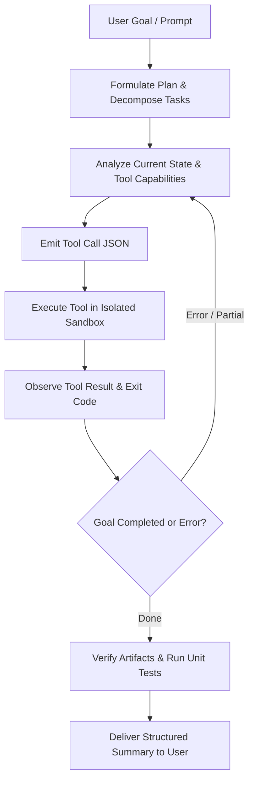

# Gemini CLI — Agent Mode & Autonomous Tool Loop

## 1. Overview

Gemini CLI includes an autonomous **Agent Mode** designed to solve complex multi-step programming and operational tasks. Rather than functioning solely as a conversational responder, the agent acts as an autonomous runtime loop capable of analyzing requests, decomposing objectives into execution plans, invoking tools, inspecting outputs, correcting errors, and completing objectives with verification.

---

## 2. Invocation Modes

Agent mode can be triggered interactively or headlessly:

```bash
# Interactive Agent Session with full tool capabilities
gemini --agent

# Autonomous goal-directed task execution
gemini --agent -p "Refactor the authentication middleware to use JWT verification and run test suites"

# Approval mode configuration
gemini --agent --approval=prompt  # Prompts for destructive tool actions (default)
gemini --agent --approval=auto    # Auto-approves sandboxed read/write commands
```

---

## 3. The Core Agent Loop (ReAct Pattern)

The agent operates on an iterative **Reasoning + Action (ReAct)** lifecycle:



1. **Plan & Decompose**: Breaks the user request into distinct, verifiable phases.
2. **Select Tool**: Chooses the optimal tool from the registered tool registry (file editing, shell execution, web search, MCP server tools).
3. **Sandbox Execution**: Commands run with sandboxed safety boundaries to protect against unintended host modifications.
4. **Self-Correction**: If a compiler, linter, or unit test fails upon tool execution, the agent ingests the error trace and immediately plans a remediation step.

---

## 4. Safety & Sandbox Governance

The Agent runtime strictly enforces security invariants:
- **Workspace Confinement**: Operations default to the local repository directory.
- **Approval Gateways**: High-risk actions (e.g. destructive shell commands, git branch deletion, external HTTP mutations) require interactive user confirmation unless explicitly passed via execution flags.
- **Audit Logging**: Every tool invocation, parameters, execution latency, and exit code are persisted to `.gemini/logs/agent_audit.jsonl` for enterprise accountability.

---

## 5. Subagents & Distributed Delegation

For large-scale codebases, Gemini CLI supports hierarchical agent delegation:
- **Lead Agent**: Coordinates high-level objectives and aggregates sub-results.
- **Specialized Subagents**: Spawned for bounded tasks:
  - *Research Subagent*: Crawls documentation, inspects schemas.
  - *Testing Subagent*: Runs isolated test runners and parses test summaries.
  - *Refactoring Subagent*: Modifies code across multi-package boundaries.
