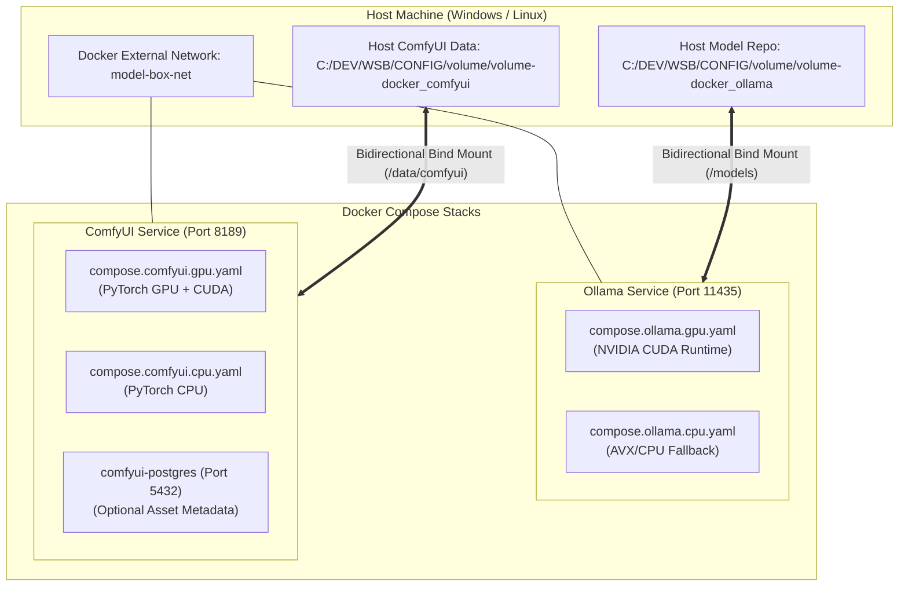

# ModelBox Docker Compose Clean Build & Deployment Master Guide

> **Authoritative Specification**: This is the single, consolidated master runbook for building, cleanly rebuilding, deploying, verifying, and tearing down **Ollama** and **ComfyUI** Docker Compose stacks within `model-box`.
>
> All operational procedures across GPU and CPU runtimes, volume mount architectures, automated script orchestrators, manual Docker commands, and troubleshooting matrices are unified in this single document to eliminate duplication and scattered references.

---

## 📑 Table of Contents

- [1. Architectural Overview & Compose Topology](#1-architectural-overview--compose-topology)
  - [1.1 Parent-Level vs. Subsystem-Level Compose Files](#11-parent-level-vs-subsystem-level-compose-files)
  - [1.2 Port and Service Allocation Matrix](#12-port-and-service-allocation-matrix)
- [2. Prerequisites & Host Environment Preparation](#2-prerequisites--host-environment-preparation)
  - [2.1 Docker Engine & Compose v2](#21-docker-engine--compose-v2)
  - [2.2 Shared Bridge Network (`model-box-net`)](#22-shared-bridge-network-model-box-net)
  - [2.3 NVIDIA GPU / CUDA Toolkit Verification](#23-nvidia-gpu--cuda-toolkit-verification)
- [3. Automated Clean Build & Deployment (Single Entry Point)](#3-automated-clean-build--deployment-single-entry-point)
  - [3.1 PowerShell (Windows: `Deploy-All-Compose.ps1`)](#31-powershell-windows-deploy-all-composeps1)
  - [3.2 Bash (Linux / macOS: `Deploy-All-Compose.sh`)](#32-bash-linux--macos-deploy-all-composesh)
  - [3.3 Clean Rebuild Flags & Artifact Purging Options](#33-clean-rebuild-flags--artifact-purging-options)
- [4. Manual Clean Build Runbook: Ollama Stack](#4-manual-clean-build-runbook-ollama-stack)
  - [4.1 GPU Runtime Clean Build & Launch](#41-gpu-runtime-clean-build--launch)
  - [4.2 CPU Runtime Clean Build & Launch](#42-cpu-runtime-clean-build--launch)
  - [4.3 Hot Mode Switching (GPU ↔ CPU) Without Re-downloading Models](#43-hot-mode-switching-gpu--cpu-without-re-downloading-models)
- [5. Manual Clean Build Runbook: ComfyUI Stack](#5-manual-clean-build-runbook-comfyui-stack)
  - [5.1 GPU Runtime Clean Build & Launch](#51-gpu-runtime-clean-build--launch)
  - [5.2 CPU Runtime Clean Build & Launch](#52-cpu-runtime-clean-build--launch)
  - [5.3 Enabling PostgreSQL Metadata & Asset Profile](#53-enabling-postgresql-metadata--asset-profile)
- [6. Volume Mount Architecture & Host Persistence](#6-volume-mount-architecture--host-persistence)
  - [6.1 Ollama Persistent Storage Mapping](#61-ollama-persistent-storage-mapping)
  - [6.2 ComfyUI Persistent Storage Mapping](#62-comfyui-persistent-storage-mapping)
  - [6.3 Bidirectional Host-Container Synchronization Rules](#63-bidirectional-host-container-synchronization-rules)
- [7. Verification, Health Checks & Smoke Testing](#7-verification-health-checks--smoke-testing)
  - [7.1 Ollama Verification Suite](#71-ollama-verification-suite)
  - [7.2 ComfyUI Verification Suite](#72-comfyui-verification-suite)
- [8. Deep Teardown, Cleanup & Cache Purge](#8-deep-teardown-cleanup--cache-purge)
  - [8.1 Standard Teardown (Safe)](#81-standard-teardown-safe)
  - [8.2 Complete Deep Clean (Containers, Volumes, Networks & Buildx Cache)](#82-complete-deep-clean-containers-volumes-networks--buildx-cache)
- [9. Comprehensive Troubleshooting & Error Recovery Matrix](#9-comprehensive-troubleshooting--error-recovery-matrix)

---

## 1. Architectural Overview & Compose Topology

ModelBox provisions local AI inference stacks through decoupled, multi-runtime Docker Compose configurations. Each runtime ships dedicated **GPU** (NVIDIA accelerated) and **CPU** (fallback) variants sharing identical persistent model repositories.



### 1.1 Parent-Level vs. Subsystem-Level Compose Files
To guarantee root-level portability, Compose configurations exist at two coordinated levels:
1. **Parent-Level Compose (`infra/compose/`):** Executable directly from repository root (`model-box/`). These entrypoints reference the underlying service definitions via Docker Compose `extends`.
2. **Subsystem-Level Compose (`infra/ollama/docker/`, `infra/comfyui/docker/`):** Autonomous, self-contained configurations containing the complete container build recipes, health checks, resource ceilings, and device reservations.

| Runtime Service | Deployment Mode | Parent-Level Compose File | Subsystem-Level Source | Environment File |
| :--- | :--- | :--- | :--- | :--- |
| **Ollama** | **GPU (CUDA)** | `infra/compose/compose.ollama.gpu.yaml` | `infra/ollama/docker/compose.gpu.yaml` | `infra/compose/ollama-gpu.env` |
| **Ollama** | **CPU** | `infra/compose/compose.ollama.cpu.yaml` | `infra/ollama/docker/compose.cpu.yaml` | `infra/compose/ollama-cpu.env` |
| **ComfyUI** | **GPU (CUDA)** | `infra/compose/compose.comfyui.gpu.yaml` | `infra/comfyui/docker/compose.gpu.yaml` | `infra/compose/comfyui-gpu.env` |
| **ComfyUI** | **CPU** | `infra/compose/compose.comfyui.cpu.yaml` | `infra/comfyui/docker/compose.cpu.yaml` | `infra/compose/comfyui-cpu.env` |
| **Connectors Platform** | **Full Stack** | `infra/compose/compose.connectors.yaml` | Applications Service + UI + MCP | Default `.env` |
| **Performance** | **Gatling** | `infra/compose/compose.performance.yaml` | `infra/performance/infra-gatling/docker` | `infra/compose/performance.env` |

### 1.2 Port and Service Allocation Matrix

| Service Name | Host Port | Container Port | Protocol / Purpose | Health Check / Smoke Test URL |
| :--- | :--- | :--- | :--- | :--- |
| **Ollama Model API** | `11435` | `11434` | HTTP REST API / Model Tagging | `http://localhost:11435/api/tags` |
| **ComfyUI Web Interface** | `8189` | `8188` | HTTP Web Studio & WebSocket | `http://localhost:8189/` |
| **ComfyUI PostgreSQL** | `5432` | `5432` | PostgreSQL (Apache AGE graph) | `pg_isready -U comfyui -d comfyui` |
| **Model Connectors API** | `8000` | `8000` | FastAPI Backend Gateway | `http://localhost:8000/health` |
| **Model Connectors UI** | `3000` | `3000` | React 18 Web Dashboard | `http://localhost:3000/` |
| **Playwright MCP Engine** | `8940` | `8940` | JSON Workflow Engine | `http://localhost:8940/health` |
| **Playwright noVNC** | `6080` | `6080` | Interactive Browser Display | `http://localhost:6080/vnc.html` |
| **Gatling Report Server** | `8080` | `8080` | Load Simulation Reports | `http://localhost:8080/` |

---

## 2. Prerequisites & Host Environment Preparation

### 2.1 Docker Engine & Compose v2
Verify Docker Engine (24.0+) and Docker Compose v2 (2.20+) are operational:
```bash
docker --version
docker compose version
```

### 2.2 Shared Bridge Network (`model-box-net`)
All parent-level and subsystem Compose configurations attach to the external bridge network `model-box-net`. Create it idempotently:
```bash
docker network inspect model-box-net >/dev/null 2>&1 || docker network create model-box-net
```
*(Note: The automated orchestrator scripts `Deploy-All-Compose.ps1` and `Deploy-All-Compose.sh` create this network automatically if missing).*

### 2.3 NVIDIA GPU / CUDA Toolkit Verification
For GPU accelerated execution, verify NVIDIA drivers and NVIDIA Container Toolkit pass-through:
```bash
docker run --rm --gpus all nvidia/cuda:12.0.0-base-ubuntu22.04 nvidia-smi
```
Expected output: A valid driver table displaying GPU model (e.g. RTX 4080/5080), driver version, and CUDA version.

---

## 3. Automated Clean Build & Deployment (Single Entry Point)

The repository provides production-grade orchestration scripts in `infra/scripts/` to build, cleanly rebuild, validate, and tear down any or all Compose stacks with real-time log streaming.

### 3.1 PowerShell (Windows: `Deploy-All-Compose.ps1`)
Execute from repository root (`model-box/`):

```powershell
# 1. Standard build and launch of all stacks
.\infra\scripts\Deploy-All-Compose.ps1

# 2. Complete CLEAN BUILD of Ollama (Purges old containers, builds with --no-cache, starts with wait)
.\infra\scripts\Deploy-All-Compose.ps1 -Action BuildAndUp -Stacks 'ollama' -CleanRecreate -NoCache -Wait

# 3. Complete CLEAN BUILD of ComfyUI (Purges old containers, builds with --no-cache, starts with wait)
.\infra\scripts\Deploy-All-Compose.ps1 -Action BuildAndUp -Stacks 'comfyui' -CleanRecreate -NoCache -Wait

# 4. Complete CLEAN BUILD of BOTH Ollama and ComfyUI
.\infra\scripts\Deploy-All-Compose.ps1 -Action BuildAndUp -Stacks 'ollama','comfyui' -CleanRecreate -NoCache -Wait

# 5. Check real-time runtime status
.\infra\scripts\Deploy-All-Compose.ps1 -Action Status

# 6. Stream logs across all running stacks
.\infra\scripts\Deploy-All-Compose.ps1 -Action Logs -FollowLogs

# 7. Teardown all stacks
.\infra\scripts\Deploy-All-Compose.ps1 -Action Down
```

### 3.2 Bash (Linux / macOS: `Deploy-All-Compose.sh`)
Execute from repository root (`model-box/`):

```bash
# 1. Standard build and launch of all stacks
./infra/scripts/Deploy-All-Compose.sh

# 2. Complete CLEAN BUILD of Ollama
./infra/scripts/Deploy-All-Compose.sh --action BuildAndUp --stack ollama --clean-recreate --no-cache --wait

# 3. Complete CLEAN BUILD of ComfyUI
./infra/scripts/Deploy-All-Compose.sh --action BuildAndUp --stack comfyui --clean-recreate --no-cache --wait

# 4. Check status across all services
./infra/scripts/Deploy-All-Compose.sh --action Status

# 5. Teardown all stacks
./infra/scripts/Deploy-All-Compose.sh --action Down
```

### 3.3 Clean Rebuild Flags & Artifact Purging Options
When executing a clean rebuild, the orchestrator accepts granular cleanup switches:

| Parameter Switch | Functionality & Impact |
| :--- | :--- |
| `-CleanRecreate` | Stops and removes existing containers before executing build and up. |
| `-NoCache` | Forces Docker to ignore cached image layers during container build (`--no-cache`). |
| `-RemoveContainers` | Forces removal of all existing containers matching stack definitions. |
| `-RemoveImages` | Deletes local container images before building, ensuring a pristine pull. |
| `-RemoveVolumes` | Purges named volumes associated with the stack (leaves host bind mounts intact). |
| `-RemoveBuildx` | Prunes Docker buildx cache (`docker buildx prune -af`). |
| `-CleanupAfterBuild` | Executes dangling image and builder prune post successful spin-up. |
| `-Wait` | Blocks until container health checks transition to healthy state (timeout 180s/240s). |

---

## 4. Manual Clean Build Runbook: Ollama Stack

To manually build or rebuild the Ollama stack without the automated orchestrator script, execute the following commands from the repository root (`model-box/`).

### 4.1 GPU Runtime Clean Build & Launch

#### Step 1: Teardown existing Ollama containers and purge old build cache
```bash
docker compose --env-file infra/compose/ollama-gpu.env -f infra/compose/compose.ollama.gpu.yaml down --remove-orphans
docker builder prune -f
```

#### Step 2: Build container image cleanly with zero cache
```bash
docker compose --env-file infra/compose/ollama-gpu.env -f infra/compose/compose.ollama.gpu.yaml build --no-cache
```

#### Step 3: Launch in background and wait for health verification
```bash
docker compose --env-file infra/compose/ollama-gpu.env -f infra/compose/compose.ollama.gpu.yaml up -d --wait --wait-timeout 180
```

#### Step 4: Verify active GPU inference and model inventory
```bash
# List all 11 models loaded from persistent host volume
docker compose --env-file infra/compose/ollama-gpu.env -f infra/compose/compose.ollama.gpu.yaml exec -T ollama ollama list

# Verify API connectivity
curl -fsS http://localhost:11435/api/tags
```

---

### 4.2 CPU Runtime Clean Build & Launch

#### Step 1: Teardown existing Ollama containers
```bash
docker compose --env-file infra/compose/ollama-cpu.env -f infra/compose/compose.ollama.cpu.yaml down --remove-orphans
```

#### Step 2: Build CPU container cleanly with zero cache
```bash
docker compose --env-file infra/compose/ollama-cpu.env -f infra/compose/compose.ollama.cpu.yaml build --no-cache
```

#### Step 3: Launch in background and wait for health verification
```bash
docker compose --env-file infra/compose/ollama-cpu.env -f infra/compose/compose.ollama.cpu.yaml up -d --wait --wait-timeout 180
```

#### Step 4: Verify CPU model inventory
```bash
docker compose --env-file infra/compose/ollama-cpu.env -f infra/compose/compose.ollama.cpu.yaml exec -T ollama ollama list
```

---

### 4.3 Hot Mode Switching (GPU ↔ CPU) Without Re-downloading Models
Because both GPU and CPU configurations reference the exact same host model volume (`COMPOSE_OLLAMA_MODELS_HOST`), switching execution modes is zero-cost and preserves all downloaded weights:

```bash
# Switch from GPU to CPU mode
docker compose --env-file infra/compose/ollama-gpu.env -f infra/compose/compose.ollama.gpu.yaml down
docker compose --env-file infra/compose/ollama-cpu.env -f infra/compose/compose.ollama.cpu.yaml up -d --wait

# Switch back from CPU to GPU mode
docker compose --env-file infra/compose/ollama-cpu.env -f infra/compose/compose.ollama.cpu.yaml down
docker compose --env-file infra/compose/ollama-gpu.env -f infra/compose/compose.ollama.gpu.yaml up -d --wait
```

---

## 5. Manual Clean Build Runbook: ComfyUI Stack

To manually build or rebuild the ComfyUI stack, execute the following commands from the repository root (`model-box/`).

### 5.1 GPU Runtime Clean Build & Launch

#### Step 1: Teardown existing ComfyUI containers
```bash
docker compose --env-file infra/compose/comfyui-gpu.env -f infra/compose/compose.comfyui.gpu.yaml down --remove-orphans
docker builder prune -f
```

#### Step 2: Build ComfyUI GPU image with `--no-cache`
```bash
docker compose --env-file infra/compose/comfyui-gpu.env -f infra/compose/compose.comfyui.gpu.yaml build --no-cache
```

#### Step 3: Launch ComfyUI GPU runtime and wait for startup
```bash
docker compose --env-file infra/compose/comfyui-gpu.env -f infra/compose/compose.comfyui.gpu.yaml up -d --wait --wait-timeout 240
```

#### Step 4: Verify ComfyUI web studio and mount points
```bash
# Verify HTTP endpoint returns 200 OK
curl -fsS http://localhost:8189/ >/dev/null && echo "ComfyUI GPU Studio Online (Port 8189)"

# Verify CUDA acceleration inside the running container
docker compose --env-file infra/compose/comfyui-gpu.env -f infra/compose/compose.comfyui.gpu.yaml exec -T comfyui python3 -c "import torch; print(f'CUDA Available: {torch.cuda.is_available()}, Device: {torch.cuda.get_device_name(0)}')"
```

---

### 5.2 CPU Runtime Clean Build & Launch

#### Step 1: Teardown existing ComfyUI containers
```bash
docker compose --env-file infra/compose/comfyui-cpu.env -f infra/compose/compose.comfyui.cpu.yaml down --remove-orphans
```

#### Step 2: Build ComfyUI CPU image with `--no-cache`
```bash
docker compose --env-file infra/compose/comfyui-cpu.env -f infra/compose/compose.comfyui.cpu.yaml build --no-cache
```

#### Step 3: Launch ComfyUI CPU runtime
```bash
docker compose --env-file infra/compose/comfyui-cpu.env -f infra/compose/compose.comfyui.cpu.yaml up -d --wait --wait-timeout 240
```

#### Step 4: Verify ComfyUI CPU runtime
```bash
curl -fsS http://localhost:8189/ >/dev/null && echo "ComfyUI CPU Studio Online (Port 8189)"
```

---

### 5.3 Enabling PostgreSQL Metadata & Asset Profile
ComfyUI includes an optional PostgreSQL 16 database profile with Apache AGE graph extensions for persistent asset metadata and node lineage:

```bash
# Launch ComfyUI GPU stack with the postgres profile enabled
docker compose --env-file infra/compose/comfyui-gpu.env -f infra/compose/compose.comfyui.gpu.yaml --profile postgres up -d --build --wait
```

---

## 6. Volume Mount Architecture & Host Persistence

ModelBox adheres strictly to decoupled, bidirectional bind mount persistence. Containers are disposable; model weights, generated assets, and custom nodes persist across container destructions.

```
+----------------------------------------------------------------------------------------------------+
| HOST FILESYSTEM                                              CONTAINER FILESYSTEM                  |
|                                                                                                    |
| C:\DEV\WSB\CONFIG\volume\volume-docker_ollama  ==========>  /models                                |
| • Manifests, Blobs, Weights (11 Models)                      (OLLAMA_MODELS=/models)               |
|                                                                                                    |
| C:\DEV\WSB\CONFIG\volume\volume-docker_comfyui ==========>  /data/comfyui                          |
| • Checkpoints, LoRAs, VAE, ControlNet                        • /data/comfyui/models/*              |
| • user/default/workflows                       ==========>  • /data/comfyui/user/default/workflows |
| • output                                       ==========>  • /data/comfyui/output                 |
+----------------------------------------------------------------------------------------------------+
```

### 6.1 Ollama Persistent Storage Mapping
- **Host Source Path:** Configured by `COMPOSE_OLLAMA_MODELS_HOST` (Default: `C:\DEV\WSB\CONFIG\volume\volume-docker_ollama`).
- **Container Destination:** `/models` (Set by `COMPOSE_OLLAMA_MODELS_CONTAINER=/models`).
- **Behavior:** Full read-write bidirectional sync. Any model pulled via `ollama pull` inside the container immediately writes to host storage and survives `docker compose down`.

### 6.2 ComfyUI Persistent Storage Mapping
- **Data Root:** `COMPOSE_COMFYUI_VOLUME_HOST` (Default: `C:\DEV\WSB\CONFIG\volume\volume-docker_comfyui`) mounted to `/data/comfyui`.
- **Workflows:** `COMPOSE_COMFYUI_WORKFLOWS_HOST` mounted to `/data/comfyui/user/default/workflows`.
- **Source Code:** `COMPOSE_COMFYUI_SOURCE_HOST` mounted to `/workspace/comfyui-source`.
- **Skills Source:** `COMPOSE_COMFYUI_SKILLS_HOST` mounted to `/workspace/skills`.

### 6.3 Bidirectional Host-Container Synchronization Rules
1. **Never use `read_only: true` on model mounts:** Ollama and ComfyUI write runtime manifests and locks during inference.
2. **Automatic Symlink Initialization:** ComfyUI containers execute `/entrypoint.sh` upon startup, automatically symlinking `/data/comfyui/models/*` into `/opt/comfyui/models/*`.
3. **No Duplicate Downloads:** Both GPU and CPU Compose configurations mount the identical host folders, guaranteeing models downloaded in GPU mode remain visible if switched to CPU mode.

---

## 7. Verification, Health Checks & Smoke Testing

### 7.1 Ollama Verification Suite
Run these verification checks from the host to confirm stack health:

```bash
# 1. Verify HTTP API health endpoint returns JSON list of models
curl -fsS http://localhost:11435/api/tags

# 2. Verify all models are visible inside the container
docker exec -it model-box-ollama-1 ollama list

# 3. Test synchronous inference generation (Smoke Test)
curl -fsS http://localhost:11435/api/generate -d '{
  "model": "llama3.2:latest",
  "prompt": "Hello! Reply in one short sentence.",
  "stream": false
}'
```

### 7.2 ComfyUI Verification Suite
Run these verification checks from the host to confirm stack health:

```bash
# 1. Verify ComfyUI HTTP root responds with HTTP 200
curl -fsS http://localhost:8189/

# 2. Check ComfyUI system stats and GPU VRAM allocation
curl -fsS http://localhost:8189/system_stats

# 3. Verify models symlinked successfully inside container
docker exec -it model-box-comfyui-1 ls -la /opt/comfyui/models/checkpoints
```

---

## 8. Deep Teardown, Cleanup & Cache Purge

### 8.1 Standard Teardown (Safe)
Stops containers and removes the network while preserving image cache and all model weights:

```bash
# PowerShell
.\infra\scripts\Deploy-All-Compose.ps1 -Action Down

# Bash / Manual
docker compose --env-file infra/compose/comfyui-gpu.env -f infra/compose/compose.comfyui.gpu.yaml down
docker compose --env-file infra/compose/ollama-gpu.env -f infra/compose/compose.ollama.gpu.yaml down
```

---

### 8.2 Complete Deep Clean (Containers, Volumes, Networks & Buildx Cache)
When rebuilding after major Dockerfile changes, dependency updates, or persistent container corruption:

```powershell
# PowerShell One-Liner Deep Clean
.\infra\scripts\Deploy-All-Compose.ps1 -Action Down -RemoveContainers -RemoveImages -RemoveVolumes -RemoveBuildx
```

```bash
# Manual Bash Deep Clean Sequence:

# 1. Stop and remove all stack containers and orphan services
docker compose --env-file infra/compose/comfyui-gpu.env -f infra/compose/compose.comfyui.gpu.yaml down -v --remove-orphans
docker compose --env-file infra/compose/ollama-gpu.env -f infra/compose/compose.ollama.gpu.yaml down -v --remove-orphans

# 2. Remove generated container images
docker rmi -f $(docker images --filter "reference=ollama/*" -q) 2>/dev/null || true
docker rmi -f $(docker images --filter "reference=*comfyui*" -q) 2>/dev/null || true

# 3. Prune dangling build cache and unused networks
docker builder prune -af
docker buildx prune -af
docker network prune -f

# 4. Verify host filesystem model weights remain 100% intact
ls -la "C:\DEV\WSB\CONFIG\volume\volume-docker_ollama"
ls -la "C:\DEV\WSB\CONFIG\volume\volume-docker_comfyui"
```

---

## 9. Comprehensive Troubleshooting & Error Recovery Matrix

| Observed Symptom / Error | Root Cause | Exact Remediation Command |
| :--- | :--- | :--- |
| **`network model-box-net declared as external, but could not be found`** | External bridge network was deleted or not created before compose execution. | Run `docker network create model-box-net` before running Compose. |
| **`port 11435 is already allocated` or `port 8189 is already allocated`** | Previous container did not release port, or native background process is active. | Identify PID with `netstat -ano \| findstr 11435` or kill orphan container: `docker rm -f $(docker ps -q --filter publish=11435)`. |
| **`CUDA driver initialization failed` / GPU not found in container** | NVIDIA Container Toolkit not registered with Docker daemon, or WSL2 GPU passthrough halted. | Restart Docker Desktop / Daemon; verify with `docker run --rm --gpus all nvidia/cuda:12.0.0-base-ubuntu22.04 nvidia-smi`. |
| **`failed to compute cache key: context canceled`** | Docker buildx builder instance stalled or corrupted. | Run `docker buildx prune -af` followed by `docker builder prune -af`. |
| **`permission denied on /models` or `/data/comfyui`** | Host volume path permissions conflict with container non-root UID (`10001:10001`). | Verify read-write permissions on host folder `volume-docker_ollama` and `volume-docker_comfyui`. |
| **Ollama shows 0 models after container restart** | Host path environment variable was missing; Compose defaulted to ephemeral empty directory. | Ensure `--env-file infra/compose/ollama-gpu.env` is supplied in the command line so `COMPOSE_OLLAMA_MODELS_HOST` is resolved. |
| **ComfyUI custom nodes fail to import or compile** | Incomplete dependency install during build or PyTorch version mismatch. | Run clean rebuild with no-cache: `.\infra\scripts\Deploy-All-Compose.ps1 -Stacks 'comfyui' -CleanRecreate -NoCache -Wait`. |
| **Container healthcheck times out (`start_period` exceeded)** | Model weights initialization or large checkpoint download took longer than default timeout. | Increase `--wait-timeout 360` during `docker compose up`. |
